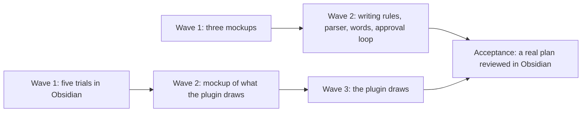

# PLAN-024 detail

Text moved out of [[PLAN-024-working-in-compass-is-visual]] when the plan was shortened for reading on 2026-10-27. Each section below is the original text, unchanged. Task lines appear without their checkbox so that no tool reads this file as a task list; the plan holds the live task lines.

## Goal (original)

This plan implements [[specs/human-surface/SPEC-031-working-in-compass-is-visual]] from the evidence in [[research/human-surface/RESEARCH-working-in-compass-is-visual]]. The spec's D-01 asks for diagrams, charts, callouts, embeds, block links, footnotes, a task table and a spec canvas; its D-02 asks that documents not bloat. Compass documents show diagrams, charts, callouts, embeds, block links, footnotes, a task table and a spec canvas where these replace text; Compass Review, Compass's own Obsidian plugin (`plugin/obsidian/compass-review/`), draws what Obsidian cannot; the approval loop runs in the markdown editor, where the terminal says one line, and says less, in plain words, only when no review surface is configured; and no document grows heavier than its text-only version.

## The waves (original)

**Wave 1** finds out and agrees before anything ships. Five small trials run inside this vault's Obsidian and settle what the research could only read from source: whether a plugin's code block draws while editing, whether Obsidian's own Mermaid draws charts, what a bundled Vega-Lite costs, whether non-note files can be read, and how Obsidian treats a canvas Compass rewrites. Three mockups go to the human through `compass review`: documents written with the new forms, the plain words that replace Compass's coined terms, and the approval loop, read and answered in the markdown editor with one terminal line (plain-text terminal versions are the fallback when no review surface is configured). Wave 1 ends when every trial has a recorded result and every mockup has a verdict.

**Wave 2** builds what the mockups agreed and draws the one mockup the trials unlock: what the plugin will draw. **Wave 3** builds that drawing and closes with a real plan reviewed in Obsidian.

## Choices to approve, with reasons and finding numbers (original)

Every choice the research left open, answered. Finding numbers point into [[research/human-surface/RESEARCH-working-in-compass-is-visual]].

- **Charts of metrics:** Compass's own plugin draws them from a short code block naming its data file. It reads ledgers live with no community plugin (Charts is stale, Tracker cannot read `.jsonl`).
- **Decisions in callouts:** decisions sit inside a callout and `compass decisions` learns to read them, using only callout types GitHub also draws. D-01 asks for it, and one parser change keeps `compass coverage` working (finding 53).
- **Embeds:** embed a section instead of copying it, everywhere. Agents already follow links, and a copy costs bytes and drifts (finding 54).
- **Task table:** the plugin draws it from the plan's own task lines; no table is written into the file. Nothing is duplicated, and Bases cannot see task lines (finding 57).
- **Canvas:** Compass owns which cards and links exist, the human owns where they sit; regeneration keeps positions by card id and `compass move` rewrites card paths. The arrangement survives every regeneration and move (finding 59).
- **Pages like Claude artifacts:** inside Obsidian through Compass's plugin, never claude.ai artifacts. Artifacts need a paid plan, a login and a browser, and are off in headless runs (finding 71).
- **Coined terms:** rename to plain words; a necessary term stays with a short gloss at first use; no glossary file. Plain-language sources say rename before defining (finding 23), and text beside what it explains reads better (finding 25).
- **Terminal visuals:** no color, glyphs, status line or mods; shorter plain text instead. With a review surface configured the terminal carries one line per document and the markdown editor carries the reading and the approval; the plain text is the fallback. The human sees a collapsed tool result, the model gets raw bytes, and glyphs print as `\uXXXX` on Windows (findings 102, 103).
- **Obsidian version floor:** 1.9.0, raised only if a route the trials pick needs more. The Bases the plugin already installs need 1.9.0 (finding 43).
- **Where visuals live:** code blocks drawn by the plugin for anything inside a document; Bases only for lists of whole notes. Code blocks reach task lines and ledgers; Bases see one row per note (finding 113).
- **Chart spec format:** a small Compass block (data file, fields, kind) drawn through Obsidian's own Mermaid `xychart-beta`; Vega-Lite only if Trial B fails. An agent writes three lines it cannot get wrong, and nothing is added to the plugin (findings 130 to 132).
- **Vendored library loading:** none unless Trial B fails; then a copy step pastes the library into `main.js`. That is the documented path; whether Obsidian's community plugin directory accepts `new Function` is unstated (finding 129).
- **Data that is not notes:** the plugin reads ledgers and task lines directly; no generated summary notes or done/total properties. Generated notes go stale and add bytes (finding 119).
- **Views:** the plugin ships template views for the approval loop, the ones in [[research/human-surface/RESEARCH-plugin-ui-mockup]]: a plan approval board, spec decisions as cards, research findings by confidence, a stepper through every file of one review, what changed since the last review, pending reviews by project, and a spec's pipeline strip. An agent uses a template when one fits and writes its own view when none does.
- **How much a drawing may do:** a template view reads vault files and nothing else, with no network. A view an agent writes is a script file in the vault that the plugin runs with the vault's full access, because Obsidian has no plugin sandbox (findings 86, 134); it reaches the human as part of the reviewed change, its script in the `git diff`.

## How D-02 is measured (original)

- Every mockup carries a byte table: for each visual, the bytes it adds and the bytes of text it removes, counted with `wc -c` on the excerpt before and after.
- A visual earns its bytes when it removes at least as many as it adds, or when the human keeps it at mockup review knowing its cost. A visual that only decorates goes: decorative extras hurt comprehension (finding 32).
- A block the plugin draws counts by the bytes in the file, never by the size of the drawing.
- After the build, `compass hot-path` (the size of the files every session loads) reads no higher than before, and the acceptance plan weighs no more than its text-only twin.

## Prerequisites (original)

- Obsidian on this machine with this vault registered and Compass Review on; `compass review` reports a surface configured.
- Node for the plugin harness; the suite green at the start.
- Trials install throwaway plugins into this vault's `.obsidian/plugins/` and TASK-192 installs Dataview (a community plugin that runs queries and scripts in notes); each install needs one Obsidian reload, asked of the human in one line.

## Desired End State (original)

- Specs, plans and research written by Compass use the agreed forms where they replace text, and none weighs more than its text-only version.
- In Obsidian a plan shows its task table and dependency graph drawn from its own task lines, a loop shows its readings and cost over time, and the spec tree is a canvas the human arranges and Compass keeps.
- `compass decisions` and `compass coverage` read decisions inside callouts.
- With a review surface configured, the human reads and approves specs, plans and research in the markdown editor and the terminal says one line; without one, the largest terminal outputs are short. Every term the human reads is a plain word or glossed at first use.

## What We're NOT Doing (original)

- claude.ai artifacts, terminal color or glyphs, the Claude Code status line, output styles and mods.
- Community plugins as a requirement; Dataview appears in one trial only.
- Mobile; readability formulas as a gate (finding 33).
- The loop dashboard (a separate view with Accept and Reject per run) and consolidate's grouping canvas: [[PLAN-022-review-in-obsidian]] holds them. This plan's loop chart is a block inside a document.
- The three CLI link defects in the research: fixed in commit b9ad849.

## Wave 1 task text (original)

- TASK-189: Trial A, a code block drawing while editing: a throwaway `compass-trials` plugin, source under `.compass/tmp/trials/` and installed into this vault, registers a `compass-trial` block that draws a box and appends each draw (view mode, time) to `.compass/tmp/trials/draws.jsonl`; a trial note is opened through `obsidian://open` and the plugin switches it between Reading view and Live Preview; this first result creates the trials document, `RESEARCH-visual-trials-in-obsidian` - complexity: S, depends_on: none, files: [.compass/tmp/trials/compass-trials/main.js, .compass/tmp/trials/compass-trials/manifest.json, .compass/research/human-surface/RESEARCH-visual-trials-in-obsidian.md]
  - Automated verification: `node --check` on the trial plugin; `draws.jsonl` holds a draw for each view mode, or records which mode drew nothing; the trials document records the Obsidian version and the result; `compass validate` adds no warning.
  - Manual verification: none.
- TASK-190: Trial B, charts through Obsidian's own Mermaid: the trial note holds a hand-written `xychart-beta` fence of the readings per run in the ledger of [[LOOP-001-visual-questions]] (the event log of the loop that tunes Compass's questions), and the trial block draws the same chart by building the fence from `ledger.jsonl` and handing it to Obsidian's markdown renderer; record for each, in both views, whether an SVG was drawn; the trial passes when the plugin-built chart draws in both views, and the result decides the chart renderer - complexity: S, depends_on: TASK-189, files: [.compass/tmp/trials/compass-trials/main.js, .compass/research/human-surface/RESEARCH-visual-trials-in-obsidian.md]
  - Automated verification: `draws.jsonl` shows an SVG or a recorded error for each of the four cases; the readings in the drawn chart equal those parsed from `ledger.jsonl` by a script.
  - Manual verification: the human judges whether the chart reads as a metrics chart at pane width.
- TASK-191: Trial C, Vega-Lite bundled into the review plugin: a copy step pastes Vega and Vega-Lite into a trial build of the review plugin's `main.js`, installed into this vault in place of the shipped copy; a `vega-lite` block draws the same ledger chart, its loader allowing vault files only; record `main.js` size, plugin load time, both views, and whether a `data.url` outside the vault is refused; then `compass review --install` restores the shipped copy - complexity: M, depends_on: TASK-189, files: [.compass/tmp/trials/compass-review-vega/build.py, .compass/tmp/trials/compass-review-vega/main.js, .compass/research/human-surface/RESEARCH-visual-trials-in-obsidian.md]
  - Automated verification: `node --check` on the trial build; the recorded size matches `wc -c`; the out-of-vault URL is logged as refused; after restoring, `diff -r plugin/obsidian/compass-review .compass/.obsidian/plugins/compass-review` is empty.
  - Manual verification: the human compares this chart with Trial B's and says which reads better.
- TASK-192: Trial D, reading files that are not notes: with Dataview installed in this vault and `dataviewjs` on, a `dataviewjs` block counts the rows of that same `ledger.jsonl` through `dv.io.load`, and the trial block counts them through the vault adapter; Dataview is turned off afterwards - complexity: S, depends_on: TASK-189, files: [.compass/tmp/trials/compass-trials/main.js, .compass/research/human-surface/RESEARCH-visual-trials-in-obsidian.md]
  - Automated verification: both recorded counts equal `wc -l` of the ledger, or the failing route records its error; `community-plugins.json` lists no Dataview afterwards.
  - Manual verification: none.
- TASK-193: Trial E, a canvas Compass rewrites: two scratch notes under `.compass/tmp/trials/canvas/` and a canvas of them; with the canvas open in Obsidian, the canvas file is rewritten with a card moved, then one note is renamed outside Obsidian; record whether Obsidian shows the new position or writes its own back, and whether it rewrites the card's path - complexity: S, depends_on: TASK-192, files: [.compass/tmp/trials/canvas/trial.canvas, .compass/research/human-surface/RESEARCH-visual-trials-in-obsidian.md]
  - Automated verification: a script compares the card positions and paths read back after each step with those written, and the trials document records its output.
  - Manual verification: none.
- TASK-194: Mockup of plain words: every house term a human reads (in CLI output, `index.md` and `active.md` lines, document templates, `validate` codes), its plain replacement or its first-use gloss, and where it shows, with three real lines rewritten as samples; sent through `compass review` - complexity: S, depends_on: none, files: [.compass/research/human-surface/RESEARCH-plain-words-mockup.md], lessons: [LESSON-ui-change-needs-agreed-mockup-before-build, LESSON-walkthroughs-in-the-humans-words]
  - Automated verification: every term in the research's jargon census appears in the table with a decision; `compass validate` adds no warning.
  - Manual verification: the human's verdict on the words in Obsidian.
- TASK-195: Mockup of documents: a spec, a plan and a research document as the human reads them to approve them, [[specs/human-surface/SPEC-031-working-in-compass-is-visual]], this plan and [[research/human-surface/RESEARCH-working-in-compass-is-visual]], each opening with a visual that shows at a glance what is being approved and what the human decides, drawn with the D-01 forms that render in Obsidian, in the agreed plain words, each with its byte table; sent through `compass review` - complexity: M, depends_on: TASK-194, files: [.compass/research/human-surface/RESEARCH-visual-documents-mockup.md], decisions: [SPEC-031-working-in-compass-is-visual/D-01, SPEC-031-working-in-compass-is-visual/D-02], lessons: [LESSON-ui-change-needs-agreed-mockup-before-build, LESSON-obsidian-bare-link-creates-stray-note]
  - Automated verification: each excerpt's before and after text is saved under `.compass/tmp/mockups/` and its byte counts reproduce with `wc -c`; `compass validate` resolves the file of every embed and block link, and a script confirms each `^id` exists in its target.
  - Manual verification: the human's verdict in Obsidian, including which visuals earn their bytes.
- TASK-196: Mockup of the approval loop: what the human reads while a spec, plan or research is written and approved. With a review surface the markdown editor carries every reading and answer (the draft walkthrough, the research axes and grading choice, the plan's choices, the follow-up after a verdict) and the terminal says one line; the plain-text terminal versions, including a gate asked through `AskUserQuestion`, are the fallback when no review surface is set. The hook lines of that loop are included. Real lines from session transcripts sit beside what the editor carries, the one terminal line and the fallback text in the agreed words, with line and byte counts for each; sent through `compass review` - complexity: S, depends_on: TASK-194, files: [.compass/research/human-surface/RESEARCH-terminal-output-mockup.md], lessons: [LESSON-ui-change-needs-agreed-mockup-before-build]
  - Automated verification: the counts of every excerpt (real line, editor text, terminal line, fallback text) reproduce with `wc -lc` on the saved files; `compass validate` adds no warning.
  - Manual verification: the human's verdict in Obsidian.

**Pause point:** when automated verification passes and every mockup has a verdict, the human confirms the trial judgments before Wave 2 is detailed.

## Later intent lines (original)

- TASK-197: Mockup of what the plugin draws: a plan's task table and dependency graph colored by status, a loop's readings and cost over time, the spec tree canvas, drawn with the routes the trials chose - files: [.compass/research/human-surface/RESEARCH-plugin-visuals-mockup.md], decisions: [SPEC-031-working-in-compass-is-visual/D-01, SPEC-031-working-in-compass-is-visual/D-02]
- TASK-198: `compass decisions` reads decision bullets inside a callout and drops a trailing block id from the decision text; `compass validate` resolves block links - files: [plugin/cli/decisionslib.py, plugin/cli/commands/validate.py, plugin/cli/tests/test_decisionslib.py], decisions: [SPEC-031-working-in-compass-is-visual/D-01]
- TASK-199: The writing rules teach the agreed forms and the byte rule: the obsidian skill, the spec, plan and research templates, and the planner - files: [plugin/skills/obsidian/SKILL.md, plugin/skills/spec/SKILL.md, plugin/skills/plan/SKILL.md, plugin/skills/research/SKILL.md, plugin/templates/agents/planner.md], decisions: [SPEC-031-working-in-compass-is-visual/D-01, SPEC-031-working-in-compass-is-visual/D-02]
- TASK-200: The agreed plain words replace the coined terms wherever the human reads them - files: [plugin/cli/commands/doctor.py, plugin/cli/commands/validate.py, plugin/cli/commands/sync.py, plugin/templates/rules/compass-pipeline.md]
- TASK-201: The approval loop runs in the markdown editor by default as the mockup agreed: draft walkthroughs, research axes and the grading choice, and plan choices go through `compass review`, and the terminal says one line; the plain-text terminal output and `AskUserQuestion` gates are the fallback when no review surface is configured - files: [plugin/templates/rules/compass-pipeline.md, plugin/skills/spec/SKILL.md, plugin/skills/plan/SKILL.md, plugin/skills/research/SKILL.md, plugin/templates/agents/planner.md]
- TASK-202: The plugin draws a plan's task table and dependency graph from the plan's own task lines - files: [plugin/obsidian/compass-review/main.js, plugin/obsidian/tests/test_main.js], decisions: [SPEC-031-working-in-compass-is-visual/D-01, SPEC-031-working-in-compass-is-visual/D-02]
- TASK-203: The plugin draws charts of a loop's readings and cost from the ledger a chart block names, reading vault files only - files: [plugin/obsidian/compass-review/main.js, plugin/obsidian/compass-review/manifest.json, plugin/obsidian/tests/test_main.js], decisions: [SPEC-031-working-in-compass-is-visual/D-01]
- TASK-204: `compass canvas` writes the spec tree as a canvas that keeps the human's card positions, and `compass move` rewrites card paths - files: [plugin/cli/commands/canvas.py, plugin/cli/commands/move.py, plugin/cli/maincli.py], decisions: [SPEC-031-working-in-compass-is-visual/D-01]
- TASK-206: The review plugin ships the template views of [[research/human-surface/RESEARCH-plugin-ui-mockup]], each a code block that reads vault files only - files: [plugin/obsidian/compass-review/main.js, plugin/obsidian/compass-review/styles.css, plugin/obsidian/tests/test_main.js], decisions: [SPEC-031-working-in-compass-is-visual/D-01, SPEC-030-review-documents-open-in-obsidian/D-06]
- TASK-207: An agent writes its own view when no template fits: a view script file in the vault that a code block names and the plugin runs, and writing rules that say when to use a template and when to write a view - files: [plugin/obsidian/compass-review/main.js, plugin/obsidian/tests/test_main.js, plugin/skills/obsidian/SKILL.md], decisions: [SPEC-031-working-in-compass-is-visual/D-01]
- TASK-205: Live acceptance: the next plan Compass writes uses the forms, the human reviews it in Obsidian, and its bytes and `compass hot-path` are compared with its text-only twin - decisions: [SPEC-031-working-in-compass-is-visual/D-02]

## Risks (original)

- Obsidian 1.15 swaps its Mermaid renderer for a new one, Pele, and `xychart-beta` may not survive (finding 48): a chart block keeps only its data in the file, so a renderer swap is a plugin change, never a document change.
- An agent or a GitHub reader sees a block's text, never its drawing: each block names its source file, which they read instead.
- Decisions inside callouts render as plain quotes in older viewers: only the five callout types GitHub draws are used.
- No trial passes for in-editor drawing: drawings fall back to Reading view, and the plugin visuals mockup shows that limit to the human.

## Revision Log (original entries)

- 2026-10-27: TASK-195 mocks up whole documents as read for approval instead of passages restyled form by form - the human's review: not happy with the passages; the loop to solve is reading and approving specs and plans.
- 2026-10-27: TASK-196 and TASK-201 cover the terminal lines of the approval loop (spec, plan and research written and approved) instead of the reference commands `tree`, `unit-check`, `doctor` and `validate` - the human's review: the loop to solve is the human reading and approving specs and plans, and those commands are rarely run.
- 2026-10-27: TASK-196 and TASK-201 run the approval loop in the markdown editor by default, with the terminal as the fallback when no review surface is configured, and TASK-201 gains `plugin/templates/agents/planner.md` - the human's review: the terminal versions conflict with the markdown editor the spec asks for.
- 2026-10-27: Template views plus views an agent writes when none fits (new choice "Views", TASK-206, TASK-207); an agent's view is a script run with the vault's full access and reviewed in the `git diff`. TASK-195 and TASK-197 are answered by [[research/human-surface/RESEARCH-plugin-ui-mockup]] - the human's review approved all seven views and asked for basic templates with agents free to do whatever they want.
