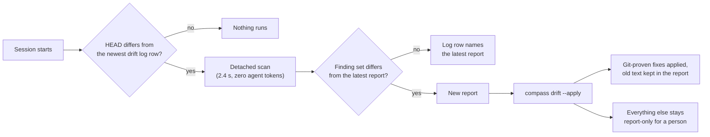

# The Drift Recheck Runs on Its Own at Session Start and Fixes Only What Git Proves

## Context

The consolidate skill runs only when a standing trigger exists ("Do not run on a fixed cadence - a trigger is the contract"). That rule guards a model-run pass that merges and rewrites lessons and spends agent tokens each time.

`compass drift` is a script that checks the vault against git and the files it describes: every code reference (a `path:line` cited in a document), every index line (the one-line description of a document in an `index.md`) and every lesson catalog row. It spends no agent tokens. Each run appends one row to the drift log, `.compass/archive/drift/log.jsonl`, with the HEAD commit and the counts found. [[REVIEW-consolidation-from-sources]] left open whether the no-cadence rule also covers this scan.

The scan of this vault at commit e37ecc1 gives the evidence for the rulings below:

| Measurement | Value |
|---|---|
| Scan time | 2.4 s |
| Findings | 451, of which 386 sit in `research/` |
| `shifted` references (an edit above the cited lines) | 227, all with the cited text byte-identical at the proposed line; in 71 the edits above net to zero, so the proposed line is the cited one and the reference is in fact unchanged |
| `moved` references (the file was renamed) | 20, all at similarity 100 (git finds the renamed file's content identical to the old one) |
| `changed` references (an edit inside the cited lines) | 170, none with a proposal |
| Index lines differing from their target's `summary` | 12: 3 with the target newer, 3 with the index line newer, 6 with no newer side |
| Findings in the remaining classes | 22 |

So 247 of 451 findings are corrections git proves outright, and an automatic run that wrote a full report each time would produce a new 400-row file every session.

## Decision

> [!NOTE]
> - **D-01:** The drift recheck sits outside consolidation's no-cadence rule. The scan spends zero agent tokens; the model-run consolidate pass stays trigger-only.
> - **D-02:** The scan runs from the `SessionStart` `startup` hook as a detached process, and only when HEAD differs from the HEAD in the newest row of the drift log.
> - **D-03:** An automatic run writes a new report only when its finding set differs from the latest report's; otherwise its log row names the latest report.
> - **D-04:** Code applies a correction alone only where git proves it: a `shifted` reference whose cited text is byte-identical at the new line, a `moved` reference at similarity 100, and an index line whose target `summary` is newer than the line. Every `changed` reference, every move below similarity 100 and every other index line stays report-only. Each applied change keeps the old reference or old text beside the new one in the run's report.

## Options per decision

**D-01, does the no-cadence rule cover the scan.**
1. The scan is outside the rule (chosen). The rule exists to stop unprompted token spending and unprompted rewrites; a zero-token scan that reports does neither.
2. The scan is inside the rule and runs only on a trigger or when asked. Rejected: drift accumulates unseen between asks, and nothing else in the vault reveals that a reference went stale, so the ask rarely comes.

**D-02, the host.**
1. `SessionStart` `startup`, detached, gated on HEAD moving (chosen). A 2.4 s scan off the startup path costs a session nothing visible, and an unchanged HEAD means nothing new to check.
2. `PostToolUse` on every vault write. Rejected: it reruns the full scan on each edit, many times per session, for changes git has not recorded yet.
3. `compass checkup` only. Rejected: it runs only when someone asks, which is the trigger-only behaviour D-01 leaves behind.

**D-03, report per run.**
1. A new report only when the finding set changes (chosen). The log still records every run, so "ran, found the same" differs from "never ran".
2. A new report on every run. Rejected: a new 400-row file each session buries the one that changed.

**D-04, what code fixes alone.**
1. Only git-proven corrections (chosen): the cited text is found byte-identical at the new place, or the rename is exact, or the target's `summary` is the newer side.
2. Report everything and fix nothing. Rejected: it leaves 247 corrections a person would make mechanically.
3. Also fix `changed` references and partial moves. Rejected: none of the 170 `changed` rows has a proposal, and a move below similarity 100 changed the cited code, so a person must judge whether the reference still holds.

## Consequences

Good:
- The vault's references are rechecked against the code after every commit with no one asking and no agent tokens spent.
- About half the findings measured at e37ecc1 (247 of 451) repair themselves, which leaves the report holding only what needs a person.
- `compass doctor` can say when the scan last ran, since every run writes a log row.
- Applied fixes lose nothing: the report keeps every replaced reference and description.

Bad:
- A new hook adds a process at every session start on a moved HEAD; on a much larger vault the 2.4 s could grow, and the detached run hides that cost from the person.
- Applied fixes leave uncommitted edits in vault documents; a citing file is read as `unclassifiable` (its citing line has no commit to compare against) until they are committed, and a file with uncommitted edits is skipped by `--apply`.
- Rewriting references in `research/` and handoff documents changes historical records, though the cited text is byte-identical at the new place and the report keeps the old reference.
- The 6 index lines with no newer side and every `changed` reference still wait on a person; D-04 leaves that work where it was.
