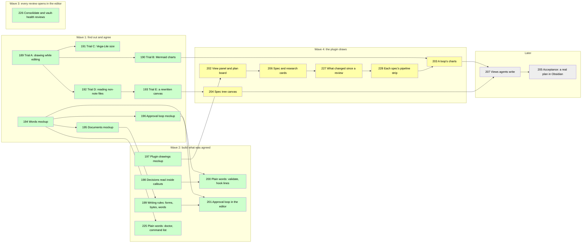

# Working in Compass Is Visual

## Goal

This plan implements [[specs/human-surface/SPEC-031-working-in-compass-is-visual]] from the evidence in [[research/human-surface/RESEARCH-working-in-compass-is-visual]]. Compass documents show diagrams, charts, callouts, embeds, block links, footnotes, a task table and a spec canvas where these replace text, and none grows heavier than its text-only version. Compass Review, Compass's own Obsidian plugin ("the plugin" below), draws what Obsidian cannot. A visual stays only if it removes at least as many bytes of text as it adds, or the human keeps it knowing its cost. The approval loop runs in the markdown editor and the terminal says one line.

## What you approve



Numbers are task ids; a wave is a group of tasks planned in detail together; later waves stay sketched until the one before is verified. Green is done, yellow is detailed and not started, grey is sketched under Later. TASK-197, done ahead of its wave, is listed under Later. Wave 4's plugin tasks run one after another because they all edit the plugin's one `main.js`; TASK-204 runs beside them.

| Choice                      | The plan's answer (recommended)                                                                                                   |
| --------------------------- | --------------------------------------------------------------------------------------------------------------------------------- |
| Charts of metrics           | drawn by the plugin from the loop's own `ledger.jsonl` |
| Decisions in callouts       | decisions sit in callouts (highlighted boxes); `compass decisions` learns to read them                                            |
| Embeds                      | embed a section instead of copying it                                                                                             |
| Task table                  | drawn by the plugin from the task lines, never written into the file                                                              |
| Spec canvas                 | the spec tree as a canvas (a board of cards): Compass owns which cards exist, the human owns where they sit                       |
| Pages like Claude artifacts | interactive pages like those Claude builds on claude.ai, drawn inside Obsidian through the plugin                                 |
| Coined terms                | plain words, a short definition at first use, no glossary file                                                                    |
| Terminal visuals            | none; one line when the markdown editor holds the document, shorter plain text otherwise                                          |
| Lowest Obsidian version     | 1.9.0, raised only if a trial needs more                                                                                          |
| Where visuals live          | a Compass view panel beside the document draws the view its `type:` picks; Bases (Obsidian's tables of notes) only for lists of whole notes |
| Chart format                | a small Compass block drawn by Obsidian's Mermaid (diagrams from text); Vega-Lite, a heavier chart library, only if Trial B fails |
| Chart library loading       | no library is bundled into the plugin unless Trial B fails                                                                        |
| Data that is not notes      | the plugin reads run logs and task lines directly                                                                                 |
| Views                       | the seven ready-made (template) views of [[research/human-surface/RESEARCH-plugin-ui-mockup]]; an agent writes its own when none fits |
| How much a drawing may do   | template views read vault files only; an agent's own view is a script, reviewed in the `git diff`                                 |

The reasons behind each choice, how the byte rule is measured, the full task text and the earlier log entries are in [[archive/PLAN-024-working-in-compass-is-visual-detail]].

## Prerequisites

Obsidian with this vault registered and Compass Review on (`compass review` reports a surface); Node for the plugin harness; each throwaway plugin install needs one Obsidian reload, which the builder asks the human for in one line.

## Not Doing

- claude.ai artifacts, terminal color or glyphs, community plugins as a requirement, mobile.
- The loop dashboard and consolidate's grouping canvas: [[PLAN-022-review-in-obsidian]] holds them.

## Phases

### Wave 1 (detailed): trials and mockups

- [x] TASK-189: Trial A, does a code block draw while editing: a throwaway plugin registers a `compass-trial` block and logs each draw in Reading view and Live Preview; creates the trials document [[research/human-surface/RESEARCH-visual-trials-in-obsidian]] - complexity: S, depends_on: none, files: [.compass/tmp/trials/compass-trials/main.js, .compass/tmp/trials/compass-trials/manifest.json, .compass/research/human-surface/RESEARCH-visual-trials-in-obsidian.md]
  - Automated verification: `node --check` on the trial plugin; `draws.jsonl` holds a draw for each view mode, or records which mode drew nothing; the trials document records the Obsidian version and the result; `compass validate` adds no warning.
  - Manual verification: none.
- [x] TASK-190: Trial B, charts through Obsidian's own Mermaid: the plugin builds an `xychart-beta` from the run log of [[LOOP-001-visual-questions]] and hands it to Obsidian's renderer; it passes when the chart draws in both views, and the result decides the chart renderer - complexity: S, depends_on: TASK-189, files: [.compass/tmp/trials/compass-trials/main.js, .compass/research/human-surface/RESEARCH-visual-trials-in-obsidian.md]
  - Automated verification: `draws.jsonl` shows an SVG or a recorded error for each of the four cases; the readings in the drawn chart equal those parsed from `ledger.jsonl` by a script.
  - Manual verification: the human judges whether the chart reads as a metrics chart at pane width.
- [x] TASK-191: Trial C, Vega-Lite bundled into the review plugin: a trial build draws the same chart from vault files only; records `main.js` size, load time, both views, and whether a URL outside the vault is refused; then `compass review --install` restores the shipped copy - complexity: M, depends_on: TASK-189, files: [.compass/tmp/trials/compass-review-vega/build.py, .compass/tmp/trials/compass-review-vega/main.js, .compass/research/human-surface/RESEARCH-visual-trials-in-obsidian.md]
  - Automated verification: `node --check` on the trial build; the recorded size matches `wc -c`; the out-of-vault URL is logged as refused; after restoring, `diff -r plugin/obsidian/compass-review .compass/.obsidian/plugins/compass-review` is empty.
  - Manual verification: the human compares this chart with Trial B's and says which reads better.
- [x] TASK-192: Trial D, reading files that are not notes: Dataview's `dv.io.load` and the plugin's vault adapter each count the rows of the same `ledger.jsonl`; Dataview is turned off afterwards - complexity: S, depends_on: TASK-189, files: [.compass/tmp/trials/compass-trials/main.js, .compass/research/human-surface/RESEARCH-visual-trials-in-obsidian.md]
  - Automated verification: both counts equal `wc -l` of the file, or the failing route records its error; `community-plugins.json` lists no Dataview afterwards.
  - Manual verification: none.
- [x] TASK-193: Trial E, a canvas Compass rewrites: with a scratch canvas open, rewrite the file with a card moved, then rename a note outside Obsidian; record whether Obsidian keeps the new position and whether it rewrites the card's path - complexity: S, depends_on: TASK-192, files: [.compass/tmp/trials/canvas/trial.canvas, .compass/research/human-surface/RESEARCH-visual-trials-in-obsidian.md]
  - Automated verification: a script compares the positions and paths read back after each step with those written, and the trials document records its output.
  - Manual verification: none.
- [x] TASK-194: Mockup of plain words: every house term a human reads, its plain replacement or first-use gloss and where it shows, with three real lines rewritten; sent through `compass review` - complexity: S, depends_on: none, files: [.compass/research/human-surface/RESEARCH-plain-words-mockup.md], lessons: [LESSON-ui-change-needs-agreed-mockup-before-build, LESSON-walkthroughs-in-the-humans-words]
  - Automated verification: every term in the research's jargon census appears in the table with a decision; `compass validate` adds no warning.
  - Manual verification: the human's verdict on the words in Obsidian.
- [x] TASK-195: Mockup of documents: a spec, a plan and a research document as the human reads them to approve them, each opening with a visual of what is approved and what he decides, each with its byte table; sent through `compass review` - complexity: M, depends_on: TASK-194, files: [.compass/research/human-surface/RESEARCH-visual-documents-mockup.md], decisions: [SPEC-031-working-in-compass-is-visual/D-01, SPEC-031-working-in-compass-is-visual/D-02], lessons: [LESSON-ui-change-needs-agreed-mockup-before-build, LESSON-obsidian-bare-link-creates-stray-note]
  - Automated verification: each excerpt's before and after text is saved under `.compass/tmp/mockups/` and its byte counts reproduce with `wc -c`; `compass validate` resolves the file of every embed and block link, and a script confirms each `^id` exists in its target.
  - Manual verification: the human's verdict in Obsidian, including which visuals earn their bytes.
- [x] TASK-196: Mockup of the approval loop: the markdown editor carries every reading and answer and the terminal says one line; plain terminal text, including `AskUserQuestion` gates, is the fallback when no review surface is set; real session lines sit beside each with line and byte counts; sent through `compass review` - complexity: S, depends_on: TASK-194, files: [.compass/research/human-surface/RESEARCH-terminal-output-mockup.md], lessons: [LESSON-ui-change-needs-agreed-mockup-before-build]
  - Automated verification: the counts of every excerpt reproduce with `wc -lc` on the saved files; `compass validate` adds no warning.
  - Manual verification: the human's verdict in Obsidian.

**Pause point:** when automated verification passes and every mockup has a verdict, the human confirms the trial results before Wave 2 is detailed.

### Wave 2 (detailed): build what was agreed

The words come from [[research/human-surface/RESEARCH-plain-words-mockup]], the document shape from [[research/human-surface/RESEARCH-visual-documents-mockup]], the approval loop from [[research/human-surface/RESEARCH-terminal-output-mockup]]. Every check of a `plugin/` change greps or tests `plugin/` itself, since `compass doctor` and `compass validate` run from the local install in `.claude/`, which holds the older copy until `/compass:update` refreshes it.

- [x] TASK-198: `compass decisions` reads decision bullets inside a callout (lines opened by `>`, at any depth) under a Decisions heading, and drops a trailing block id (`^id`) from the decision text; `compass validate` warns `broken_block_link` when `[[doc#^id]]` names an id its target lacks - complexity: M, depends_on: none, files: [plugin/cli/decisionslib.py, plugin/cli/commands/validate.py, plugin/cli/tests/test_decisionslib.py, plugin/cli/tests/test_validate_block_links.py], decisions: [SPEC-031-working-in-compass-is-visual/D-01], lessons: [LESSON-wikilink-validator-skip-code]
  - Automated verification: tests, where `parsed`, `none-present` and `could-not-parse` are the parse statuses `compass decisions` reports: three decisions in a callout parse as `parsed` and a plan citing them passes `compass coverage`; the same callout inside a code fence is `none-present`; a malformed `> - **D-` beside good ones is `could-not-parse`; a trailing ` ^d-01` is dropped from the decision text; a block link to a present id is clean, to a missing id warns, inside inline code is skipped; `python -m pytest plugin/cli/tests` passes; `compass coverage` gives every plan in this vault the verdict it gave before.
  - Manual verification: none.
- [x] TASK-199: The obsidian skill teaches the forms and words the human agreed in the documents and plain-words mockups: each spec, plan and research template opens with a picture of what is approved and a "You decide" callout; callouts use only the five types GitHub draws (note, tip, important, warning, caution); decision bullets sit in a callout under the Decisions heading and a document citing a decision links that heading, while block ids mark cited lines outside callouts; a section is embedded, never copied; a visual stays only when it removes as many bytes as it adds or the human keeps it knowing its cost; the agreed word list joins the skill, with words a program reads (field names, codes, heading grammar) kept unchanged in the files that hold them; one line in the Document Writing section of the pipeline rules (`compass-pipeline.md`) points to the skill - complexity: M, depends_on: none (PLAN-021 TASK-163 also edits the obsidian skill: whichever lands second rebases), files: [plugin/skills/obsidian/SKILL.md, plugin/templates/rules/compass-pipeline.md, plugin/cli/tests/test_writing_rules.py], decisions: [SPEC-031-working-in-compass-is-visual/D-01, SPEC-031-working-in-compass-is-visual/D-02], lessons: [LESSON-remove-context-before-adding, LESSON-obsidian-bare-link-creates-stray-note]
  - Automated verification: tests: the skill names the five callout types and no other, states the byte rule, and carries every "Say instead" word of the Terms table in [[research/human-surface/RESEARCH-plain-words-mockup]]; the pipeline rules file has no more lines than before; `python -m pytest plugin/cli/tests` passes.
  - Manual verification: the human reads the skill's new section and says whether it describes the documents he approved in the documents mockup.
- [x] TASK-200: `compass validate` and the hook status lines speak the agreed words: each finding prints a plain sentence with its details first and its code last in brackets, worded as the Warning codes table of [[research/human-surface/RESEARCH-plain-words-mockup]]; the findings `check_vault` returns keep their code-first form for the programs that read them, and `make-unit`'s report prints the same sentences; each hook status text with a coined term takes the agreed words, and the two status texts shown in moment 10 ("Hook lines in the loop") of [[research/human-surface/RESEARCH-terminal-output-mockup]], the index update and the lesson check, take that wording verbatim - complexity: M, depends_on: TASK-198 (validate.py), files: [plugin/cli/commands/validate.py, plugin/cli/commands/make_unit.py, plugin/hooks/hooks.json, plugin/cli/tests/test_validate_plain.py]
  - Automated verification: tests: every code `validate.py` can emit, collected from its source, renders as a sentence ending in `(code)`; an unknown code prints unchanged; `check_vault` results still start with their code; no `hooks.json` status text contains "capture opportunity", "signal" or ".compass index"; `python -m pytest plugin/cli/tests` passes.
  - Manual verification: the human reads one `compass validate` run and says whether it reads plainly.
- [x] TASK-225: `compass doctor`, `compass unit-check` and the command list speak the agreed words: doctor's row names and details, which use terms such as unit-promotion candidates, capture posture, worker ledger, host materializations, overlay and NEVER USED, and each command's one-line help use the words of [[research/human-surface/RESEARCH-plain-words-mockup]]; command names stay - complexity: M, depends_on: none (PLAN-022 TASK-168 edits doctor.py and test_doctor.py; PLAN-021 TASK-161 and this plan's TASK-204 edit maincli.py: whichever lands second rebases and adds no line in the old words), files: [plugin/cli/commands/doctor.py, plugin/cli/commands/unit_check.py, plugin/cli/maincli.py, plugin/cli/tests/test_plain_words.py]
  - Automated verification: tests: no doctor row, unit-check line or help line contains a term the mockup replaces; `doctor`'s exit codes are unchanged on a clean and a broken fixture; every command name in `COMMAND_SPECS` is unchanged; `python -m pytest plugin/cli/tests` passes.
  - Manual verification: the human reads one `compass doctor` run and says whether it reads plainly.
- [x] TASK-201: The approval loop runs in the markdown editor as agreed in [[research/human-surface/RESEARCH-terminal-output-mockup]]: with a review surface (a markdown editor set up to receive reviews), a spec, plan or research reaches the human as the document itself, opening with its picture and "You decide" callout, any guess the agent made marked inline; the planned research axes, the human's own questions and a checkbox for whether findings get graded are a draft research document sent for review; a document sent back after a changes verdict opens with a "Since your last review" callout; the "You decide" callout leaves the file at approval; the terminal says one line naming the document's title, id and commit; without a review surface, the mockup's plain-text fallback and `AskUserQuestion` gates hold - complexity: L, depends_on: TASK-199 (pipeline rules; PLAN-025 TASK-218 edits the pipeline rules, the plan skill and the planner: whichever lands second rebases), files: [plugin/templates/rules/compass-pipeline.md, plugin/skills/spec/SKILL.md, plugin/skills/plan/SKILL.md, plugin/skills/research/SKILL.md, plugin/templates/agents/planner.md, plugin/cli/tests/test_approval_loop_text.py], decisions: [SPEC-030-review-documents-open-in-obsidian/D-04], lessons: [LESSON-walkthroughs-in-the-humans-words, LESSON-remove-context-before-adding]
  - Automated verification: tests: the spec, plan and research skills each send their gate through `compass review` when a surface is set and keep the `AskUserQuestion` fallback; the research skill names "Your questions" and the grading checkbox; the pipeline rules state the one terminal line; no edited file grows by more lines than it removes; `python -m pytest plugin/cli/tests` passes.
  - Manual verification: the human approves one real spec, plan or research in Obsidian after this ships and says whether the terminal line and the document match the mockup.

**Pause point:** when automated verification passes, the human confirms the manual checks before Wave 3 is detailed.

### Wave 3 (detailed): every document Compass asks about opens in the editor

- [x] TASK-226: The approval points of `/compass:consolidate` and `/compass:vault-health` go through `compass review` when a review surface is set: consolidate writes its structure proposal (one section per proposed topic folder: the folder, the files that move, the index line that replaces theirs, the reason) as a draft document under `.compass/tmp/proposals/`, opening with a picture of the folders before and after and a "You decide" callout, with a checkbox per folder; a ticked box approves that folder, an unticked one leaves its files flat, and a note revises it. Vault-health writes its bulk fix as a document listing each file and the change, sent the same way. Without a review surface, the `AskUserQuestion` gates hold as they are - complexity: M, depends_on: none, files: [plugin/skills/consolidate/SKILL.md, plugin/skills/vault-health/SKILL.md, plugin/cli/tests/test_review_maintenance_text.py], decisions: [SPEC-030-review-documents-open-in-obsidian/D-04]
  - Automated verification: tests: each skill sends its approval through `compass review` when a surface is set and keeps its `AskUserQuestion` fallback; the consolidate skill names the per-folder checkbox and the proposal's place under `.compass/tmp/proposals/`; neither file grows by more lines than it removes plus ten; `python -m pytest plugin/cli/tests` passes.
  - Manual verification: the human approves the next real taxonomy proposal in Obsidian and says whether it reads as easily as a plan.

### Wave 4 (detailed): the plugin draws

Every view ports its drawing from the agreed mockup plugin, `.compass/.obsidian/plugins/compass-ui-mockups/main.js` ([[research/human-surface/RESEARCH-plugin-ui-mockup]]), reads vault files only, and uses Obsidian's color variables so it follows the theme. The plugin's tests run under `node --test plugin/obsidian/tests/test_main.js`. The two mockup views a review of several files needs, the walk through the files and the reviews waiting across projects, already ship in the review panel ([[plans/PLAN-025-review-across-files-and-sessions]]).

- [x] TASK-202: A Compass view panel and the plan board: a view in the right sidebar follows the open document and draws the view its `type:` frontmatter picks, and shows one plain line for a type with no view; for a plan it draws the task table (id, task, wave, status, depends on) and the dependency graph colored by status, both parsed from the plan's task lines, and a click on a task opens its line. When a review of the plan is pending, each row of the plan's choices table takes Agree or Change with a note, and the answers join the review's note as one `<choice>: <note>` line per changed choice; the board writes nothing into the plan - complexity: M, depends_on: none, files: [plugin/obsidian/compass-review/main.js, plugin/obsidian/compass-review/styles.css, plugin/obsidian/tests/test_main.js], decisions: [SPEC-031-working-in-compass-is-visual/D-01, SPEC-031-working-in-compass-is-visual/D-02], lessons: [LESSON-ui-change-needs-agreed-mockup-before-build]
  - Automated verification: tests: the task parser reads every task line of this plan and of [[plans/PLAN-025-review-across-files-and-sessions]] with its id, status and depends_on, and skips task-shaped lines inside fences and under a `## Wave N elaborated` heading; the panel picks no view for a file with no `type:`; Agree on every choice adds no line to the note and Change adds one; no file under `.compass/` changes when the board opens; `node --test plugin/obsidian/tests/test_main.js` and `python -m pytest plugin/cli/tests` pass.
  - Manual verification: the human opens this plan in Obsidian and says whether the board reads as the mockup's did.
- [x] TASK-206: Spec and research cards in the view panel: a spec shows its Problem and Desired Outcome in the human's words and one card per decision; a research document shows bars counting findings per section, filters by confidence, and rows that open the finding's line. During a pending review each decision card takes Agree or Change with a note, joining the review's note as `D-NN: <note>` lines - complexity: M, depends_on: TASK-202 (main.js), files: [plugin/obsidian/compass-review/main.js, plugin/obsidian/compass-review/styles.css, plugin/obsidian/tests/test_main.js], decisions: [SPEC-031-working-in-compass-is-visual/D-01, SPEC-030-review-documents-open-in-obsidian/D-06]
  - Automated verification: tests: decisions parse from plain bullets and from bullets inside a callout, matching `compass decisions` on every spec in this vault; findings tables parse with number, confidence and evidence from [[research/human-surface/RESEARCH-working-in-compass-is-visual]]; a Change with an empty note is refused; `node --test plugin/obsidian/tests/test_main.js` passes.
  - Manual verification: the human approves the next real spec in Obsidian through the cards and says whether answering per decision was easier than one note.
- [ ] TASK-227: What changed since a review: when a review lists a document already reviewed before, `compass review` saves `git diff` of each file against the commit that review showed as `<id>.changes.diff` beside the request; the view panel shows those changes grouped under the heading each sits in, with the changed words marked, and a click opens the line - complexity: M, depends_on: TASK-206 (main.js), files: [plugin/cli/reviewlib.py, plugin/cli/commands/review.py, plugin/cli/tests/test_review_changes_file.py, plugin/obsidian/compass-review/main.js, plugin/obsidian/tests/test_main.js], decisions: [SPEC-031-working-in-compass-is-visual/D-01, SPEC-030-review-documents-open-in-obsidian/D-05]
  - Automated verification: tests: a second review of a changed file writes a diff equal to `git diff <sha> -- <file>`; a first review and an unchanged file write none; the diff file is removed with the request; the parser groups hunks by the heading above them and marks changed words; `node --test plugin/obsidian/tests/test_main.js` and `python -m pytest plugin/cli/tests` pass.
  - Manual verification: the human reviews a revised document and says whether the changes view shows what moved.
- [ ] TASK-228: Each spec's pipeline strip: the view for a spec also shows spec, research, plan, build and validate as one strip, each stage read from the frontmatter of the documents that link the spec and the plan's task lines, with what waits on the human and what runs next - complexity: S, depends_on: TASK-227 (main.js), files: [plugin/obsidian/compass-review/main.js, plugin/obsidian/compass-review/styles.css, plugin/obsidian/tests/test_main.js], decisions: [SPEC-031-working-in-compass-is-visual/D-01]
  - Automated verification: tests: for [[specs/human-surface/SPEC-031-working-in-compass-is-visual]] the strip names this plan as approved with its done and open task counts equal to a count of its task lines; a spec no document links shows only the spec stage; `node --test plugin/obsidian/tests/test_main.js` passes.
  - Manual verification: none.
- [ ] TASK-203: A loop's charts: the view for a loop (`type: loop`) charts each run's reading and its estimated cost from the loop's `ledger.jsonl`, drawn through Obsidian's own Mermaid (`loadMermaid()` then `mermaid.render`, the route Trial B found drawing in both views); the cost axis is labelled an estimate, since on a subscription `cost_usd` is not a charge; the manifest's lowest Obsidian version is raised only if `loadMermaid` needs it - complexity: M, depends_on: TASK-228 (main.js), files: [plugin/obsidian/compass-review/main.js, plugin/obsidian/compass-review/manifest.json, plugin/obsidian/tests/test_main.js], decisions: [SPEC-031-working-in-compass-is-visual/D-01], lessons: [LESSON-subscription-cost-is-an-estimate-not-a-budget]
  - Automated verification: tests: the chart source built from [[loops/LOOP-001-visual-questions/index|LOOP-001]]'s ledger holds the 50 readings the `run` records carry, in order; malformed ledger lines are skipped and counted; a ledger with no `run` record draws one plain line; `node --test plugin/obsidian/tests/test_main.js` passes.
  - Manual verification: the human opens LOOP-001 in Obsidian and says whether the chart reads as a metrics chart at pane width.
- [x] TASK-204: `compass canvas` writes the spec tree as `.compass/specs.canvas`, one card per spec file and an edge from each folder spec to its children; a rerun adds and removes cards for specs that appeared or left and keeps every remaining card's position and size; `compass move` rewrites the card paths of moved files, since Obsidian leaves a card naming the old path (Trial E) - complexity: M, depends_on: none, files: [plugin/cli/commands/canvas.py, plugin/cli/commands/move.py, plugin/cli/maincli.py, plugin/cli/tests/test_canvas.py, plugin/cli/tests/test_move.py], decisions: [SPEC-031-working-in-compass-is-visual/D-01]
  - Automated verification: tests: the canvas holds one card per spec under `specs/`; a card moved by hand keeps its position across a rerun; a deleted spec's card goes and a new spec's card appears; `compass move --apply` rewrites the moved file's card path; the file parses as JSON Canvas; `python -m pytest plugin/cli/tests` passes.
  - Manual verification: the human rearranges the canvas in Obsidian, reruns `compass canvas`, and says whether the cards stayed put.

**Pause point:** when automated verification passes, the human runs the manual checks before TASK-207 is detailed.

## Later (intent only)

- [x] TASK-197: Mockup of what the plugin draws: a plan's task table and dependency graph, a loop's readings and cost over time, the spec tree canvas - files: [.compass/research/human-surface/RESEARCH-plugin-visuals-mockup.md], decisions: [SPEC-031-working-in-compass-is-visual/D-01, SPEC-031-working-in-compass-is-visual/D-02]
- [ ] TASK-207: An agent writes its own view when no template fits: a script file in the vault that a code block names and the plugin runs, plus writing rules for when to use which - files: [plugin/obsidian/compass-review/main.js, plugin/obsidian/tests/test_main.js, plugin/skills/obsidian/SKILL.md], decisions: [SPEC-031-working-in-compass-is-visual/D-01]
- [ ] TASK-205: Live acceptance: the next plan Compass writes uses the forms, the human reviews it in Obsidian, and its bytes and `compass hot-path` are compared with its text-only twin - decisions: [SPEC-031-working-in-compass-is-visual/D-02]

## Wave 2 elaborated

How each Wave 2 task differs from its one-line sketch in the plan as first approved, and why.

- TASK-198: the same intent as its sketch.
- TASK-199: the agreed word list joins the obsidian skill as a writing rule, because [[research/human-surface/RESEARCH-plain-words-mockup]] keeps words programs read unchanged in their files; the documents mockup, which the human approved as "much better", fixes the opening picture and "You decide" callout; a citation links the Decisions heading because a block id cannot sit inside a callout (finding 55 of [[research/human-surface/RESEARCH-working-in-compass-is-visual]]). The spec, plan and research skills and the planner move to TASK-201.
- TASK-200: split; it keeps `validate` and the hook lines (moment 10 of [[research/human-surface/RESEARCH-terminal-output-mockup]]); the word list moves to TASK-199, doctor and the command list to TASK-225. `compass tree` and `index.md` keep naming links by file name: agents write links from them, and titles would push `index.md` past the size limit on the files every session reads first.
- TASK-225: split from TASK-200 so the doctor and help edits merge separately from PLAN-022's changes to doctor (its TASK-168).
- TASK-201: the human's approval of the terminal mockup settles its open questions as the mockup draws them: a "Since your last review" callout, research axes in the draft research document, the review panel (the review card in the editor) with two buttons, Approve and Needs changes, and a terminal line that names the commit; the "You decide" callout leaves the file at approval, since an approved document states what is. Reviews of several files at once go through the review panel of [[plans/PLAN-025-review-across-files-and-sessions]], which walks the files one by one (its TASK-210, mockup approved).

## Wave 4 elaborated

How each Wave 4 task differs from its one-line sketch, and why. The sketches read:

```markdown
- [ ] TASK-202: The plugin draws a plan's task table and dependency graph from its task lines - files: [plugin/obsidian/compass-review/main.js, plugin/obsidian/tests/test_main.js], decisions: [SPEC-031-working-in-compass-is-visual/D-01, SPEC-031-working-in-compass-is-visual/D-02]
- [ ] TASK-203: The plugin draws charts of a loop's readings and cost from the file a chart block names, vault files only - files: [plugin/obsidian/compass-review/main.js, plugin/obsidian/compass-review/manifest.json, plugin/obsidian/tests/test_main.js], decisions: [SPEC-031-working-in-compass-is-visual/D-01]
- [x] TASK-204: `compass canvas` writes the spec tree as a canvas that keeps the human's card positions, and `compass move` rewrites card paths - files: [plugin/cli/commands/canvas.py, plugin/cli/commands/move.py, plugin/cli/maincli.py], decisions: [SPEC-031-working-in-compass-is-visual/D-01]
- [ ] TASK-206: The plugin ships the template views of [[research/human-surface/RESEARCH-plugin-ui-mockup]], each a code block reading vault files only; the walk through several files is the review panel of [[plans/PLAN-025-review-across-files-and-sessions]], and the list of reviews across projects takes its project and session names from that plan's TASK-211 - files: [plugin/obsidian/compass-review/main.js, plugin/obsidian/compass-review/styles.css, plugin/obsidian/tests/test_main.js], decisions: [SPEC-031-working-in-compass-is-visual/D-01, SPEC-030-review-documents-open-in-obsidian/D-06]
```

- TASK-202: the task table and the graph draw in a Compass view panel that follows the open document, so a plan carries no block and adds no bytes; the human's review of Wave 4 chose the panel over a `compass-*` block in each document, since every code fence names a real language. From the plan board of [[research/human-surface/RESEARCH-plugin-ui-mockup]], approved with all seven views: answering the plan's choices with Agree or Change. The mockup left open whether Mark done writes the checkbox; the board writes nothing, and the agent checks tasks off as before.
- TASK-206: narrowed to the spec cards and research reading of the mockup. Its walk through several files and its list of reviews across projects shipped in the review panel of [[plans/PLAN-025-review-across-files-and-sessions]]. The mockup's What changed and Where each spec stands views become TASK-227 and TASK-228, each its own merge.
- TASK-227: new, from the mockup's What changed view, which needs `compass review` to save the diff, since a plugin cannot run git portably.
- TASK-228: new, from the mockup's Where each spec stands view.
- TASK-203: the chart draws through Obsidian's own Mermaid, the route Trial B found drawing in both views with nothing bundled; Trial C's Vega-Lite made the plugin 50 times larger. The cost axis reads as an estimate, from [[lessons/pipeline/LESSON-subscription-cost-is-an-estimate-not-a-budget]].
- TASK-204: Trial E found that an open canvas reloads a file rewritten outside Obsidian and keeps the new positions, and that a note renamed outside Obsidian leaves its card naming the old path, so `compass move` rewrites card paths.

## Risks

- Obsidian 1.15 may drop `xychart-beta`: a chart block keeps only its data in the file, so the fix is a plugin change, never a document change.
- An agent or a GitHub reader sees a block's text, not its drawing: each block names its source file.
- Older viewers show decisions in callouts as plain quotes: only the five callout types GitHub draws are used (note, tip, important, warning, caution).
- If no trial passes for in-editor drawing, drawings fall back to Reading view.

## Revision Log

- 2026-10-27: TASK-195 mocks up whole documents as read for approval.
- 2026-10-27: TASK-196 and TASK-201 cover the terminal lines of the approval loop, not the reference commands.
- 2026-10-27: TASK-196 and TASK-201 run the approval loop in the markdown editor by default, terminal as fallback; TASK-201 gains the planner file.
- 2026-10-27: Views choice added (TASK-206, TASK-207); TASK-195 and TASK-197 are answered by [[research/human-surface/RESEARCH-plugin-ui-mockup]].
- 2026-10-27: Plan shortened for reading, detail moved to the archive file; the human's review asked for it.
- 2026-10-27: TASK-206 leaves the walk through several files to the review panel of [[plans/PLAN-025-review-across-files-and-sessions]] and takes project and session names from its TASK-211.
- 2026-10-27: Wave 2 approved; the "You decide" box left the plan at approval.
- 2026-10-27: TASK-226 added and approved: the review of Wave 2's checks asked that every document Compass needs reviewed, the taxonomy proposal included, open in the editor.
- 2026-10-28: Wave 4 detailed (TASK-202, TASK-206, TASK-227, TASK-228, TASK-203, TASK-204); where the drawings live is put to the human, since the approved answer used `compass-*` fences.
- 2026-10-28: Wave 4 approved: drawings live in a view panel beside the document.
