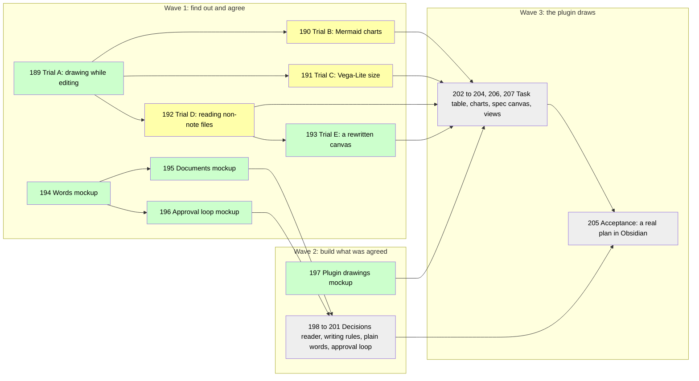

# Working in Compass Is Visual

## Goal

This plan implements [[specs/human-surface/SPEC-031-working-in-compass-is-visual]] from the evidence in [[research/human-surface/RESEARCH-working-in-compass-is-visual]]. Compass documents show diagrams, charts, callouts, embeds, block links, footnotes, a task table and a spec canvas where these replace text, and none grows heavier than its text-only version. Compass Review, Compass's own Obsidian plugin ("the plugin" below), draws what Obsidian cannot. A visual stays only if it removes at least as many bytes of text as it adds, or the human keeps it knowing its cost. The approval loop runs in the markdown editor and the terminal says one line.

## What you approve

Numbers are task ids; a wave is a group of tasks planned in detail together; later waves stay sketched until the one before is verified. Green is done, yellow is detailed and not started, grey is sketched under Later.

> [!IMPORTANT]
> You decide: approve the plan and the 15 choices below, all recommended, or comment on a row to change that choice.

| Choice                      | The plan's answer (recommended)                                                                                                   |
| --------------------------- | --------------------------------------------------------------------------------------------------------------------------------- |
| Charts of metrics           | drawn by the plugin from a short block naming a data file                                                                         |
| Decisions in callouts       | decisions sit in callouts (highlighted boxes); `compass decisions` learns to read them                                            |
| Embeds                      | embed a section instead of copying it                                                                                             |
| Task table                  | drawn by the plugin from the task lines, never written into the file                                                              |
| Spec canvas                 | the spec tree as a canvas (a board of cards): Compass owns which cards exist, the human owns where they sit                       |
| Pages like Claude artifacts | inside Obsidian, through the plugin                                                                                               |
| Coined terms                | plain words, a short definition at first use, no glossary file                                                                    |
| Terminal visuals            | none; one line when the markdown editor holds the document, shorter plain text otherwise                                          |
| Lowest Obsidian version     | 1.9.0, raised only if a trial needs more                                                                                          |
| Where visuals live          | plugin-drawn blocks in documents; Bases (Obsidian's tables of notes) only for lists of whole notes                                |
| Chart format                | a small Compass block drawn by Obsidian's Mermaid (diagrams from text); Vega-Lite, a heavier chart library, only if Trial B fails |
| Chart library loading       | no library is bundled into the plugin unless Trial B fails                                                                        |
| Data that is not notes      | the plugin reads run logs and task lines directly                                                                                 |
| Views                       | the seven template views of [[research/human-surface/RESEARCH-plugin-ui-mockup]]; an agent writes its own when none fits          |
| How much a drawing may do   | template views read vault files only; an agent's own view is a script, reviewed in the `git diff`                                 |

The reasons behind each choice, how the byte rule is measured, the full task text and the earlier log entries are in [[archive/PLAN-024-working-in-compass-is-visual-detail]].

## Prerequisites

Obsidian with this vault registered and Compass Review on (`compass review` reports a surface); Node for the plugin harness; each throwaway plugin install needs one Obsidian reload, which the builder asks the human for in one line.

## Not Doing

- claude.ai artifacts, terminal color or glyphs, community plugins as a requirement, mobile.
- The loop dashboard and consolidate's grouping canvas: [[PLAN-022-review-in-obsidian]] holds them.

## Phases

### Wave 1 (detailed): trials and mockups

- [x] TASK-189: Trial A, does a code block draw while editing: a throwaway plugin registers a `compass-trial` block and logs each draw in Reading view and Live Preview; creates the trials document [[research/human-surface/RESEARCH-visual-trials-in-obsidian]] - complexity: S, depends_on: none, files: [.compass/tmp/trials/compass-trials/main.js, .compass/tmp/trials/compass-trials/manifest.json, .compass/research/human-surface/RESEARCH-visual-trials-in-obsidian.md]
  - Automated verification: `node --check` on the trial plugin; `draws.jsonl` holds a draw for each view mode, or records which mode drew nothing; the trials document records the Obsidian version and the result; `compass validate` adds no warning.
  - Manual verification: none.
- [ ] TASK-190: Trial B, charts through Obsidian's own Mermaid: the plugin builds an `xychart-beta` from the run log of [[LOOP-001-visual-questions]] and hands it to Obsidian's renderer; it passes when the chart draws in both views, and the result decides the chart renderer - complexity: S, depends_on: TASK-189, files: [.compass/tmp/trials/compass-trials/main.js, .compass/research/human-surface/RESEARCH-visual-trials-in-obsidian.md]
  - Automated verification: `draws.jsonl` shows an SVG or a recorded error for each of the four cases; the readings in the drawn chart equal those parsed from `ledger.jsonl` by a script.
  - Manual verification: the human judges whether the chart reads as a metrics chart at pane width.
- [ ] TASK-191: Trial C, Vega-Lite bundled into the review plugin: a trial build draws the same chart from vault files only; records `main.js` size, load time, both views, and whether a URL outside the vault is refused; then `compass review --install` restores the shipped copy - complexity: M, depends_on: TASK-189, files: [.compass/tmp/trials/compass-review-vega/build.py, .compass/tmp/trials/compass-review-vega/main.js, .compass/research/human-surface/RESEARCH-visual-trials-in-obsidian.md]
  - Automated verification: `node --check` on the trial build; the recorded size matches `wc -c`; the out-of-vault URL is logged as refused; after restoring, `diff -r plugin/obsidian/compass-review .compass/.obsidian/plugins/compass-review` is empty.
  - Manual verification: the human compares this chart with Trial B's and says which reads better.
- [ ] TASK-192: Trial D, reading files that are not notes: Dataview's `dv.io.load` and the plugin's vault adapter each count the rows of the same `ledger.jsonl`; Dataview is turned off afterwards - complexity: S, depends_on: TASK-189, files: [.compass/tmp/trials/compass-trials/main.js, .compass/research/human-surface/RESEARCH-visual-trials-in-obsidian.md]
  - Automated verification: both counts equal `wc -l` of the file, or the failing route records its error; `community-plugins.json` lists no Dataview afterwards.
  - Manual verification: none.
- [x] TASK-193: Trial E, a canvas Compass rewrites: with a scratch canvas open, rewrite the file with a card moved, then rename a note outside Obsidian; record whether Obsidian keeps the new position and whether it rewrites the card's path - complexity: S, depends_on: TASK-192, files: [.compass/tmp/trials/canvas/trial.canvas, .compass/research/human-surface/RESEARCH-visual-trials-in-obsidian.md]
  - Automated verification: a script compares the positions and paths read back after each step with those written, and the trials document records its output.
  - Manual verification: none.
- [x] TASK-194: Mockup of plain words: every house term a human reads, its plain replacement or first-use gloss and where it shows, with three real lines rewritten; sent through `compass review` - complexity: S, depends_on: none, files: [.compass/research/human-surface/RESEARCH-plain-words-mockup.md], lessons: [LESSON-ui-change-needs-agreed-mockup-before-build, LESSON-walkthroughs-in-the-humans-words]
  - Automated verification: every term in the research's jargon census appears in the table with a decision; `compass validate` adds no warning.
  - Manual verification: the human's verdict on the words in Obsidian.
- [x] TASK-195: Mockup of documents: a spec, a plan and a research document as the human reads them to approve them, each opening with a visual of what is approved and what he decides, each with its byte table; sent through `compass review` - complexity: M, depends_on: TASK-194, files: [.compass/research/human-surface/RESEARCH-visual-documents-mockup.md], decisions: [SPEC-031-working-in-compass-is-visual/D-01, SPEC-031-working-in-compass-is-visual/D-02], lessons: [LESSON-ui-change-needs-agreed-mockup-before-build, LESSON-obsidian-bare-link-creates-stray-note]
  - Automated verification: each excerpt's before and after text is saved under `.compass/tmp/mockups/` and its byte counts reproduce with `wc -c`; `compass validate` resolves the file of every embed and block link, and a script confirms each `^id` exists in its target.
  - Manual verification: the human's verdict in Obsidian, including which visuals earn their bytes.
- [x] TASK-196: Mockup of the approval loop: the markdown editor carries every reading and answer and the terminal says one line; plain terminal text, including `AskUserQuestion` gates, is the fallback when no review surface is set; real session lines sit beside each with line and byte counts; sent through `compass review` - complexity: S, depends_on: TASK-194, files: [.compass/research/human-surface/RESEARCH-terminal-output-mockup.md], lessons: [LESSON-ui-change-needs-agreed-mockup-before-build]
  - Automated verification: the counts of every excerpt reproduce with `wc -lc` on the saved files; `compass validate` adds no warning.
  - Manual verification: the human's verdict in Obsidian.

**Pause point:** when automated verification passes and every mockup has a verdict, the human confirms the trial results before Wave 2 is detailed.

## Later (intent only)

- [x] TASK-197: Mockup of what the plugin draws: a plan's task table and dependency graph, a loop's readings and cost over time, the spec tree canvas - files: [.compass/research/human-surface/RESEARCH-plugin-visuals-mockup.md], decisions: [SPEC-031-working-in-compass-is-visual/D-01, SPEC-031-working-in-compass-is-visual/D-02]
- [ ] TASK-198: `compass decisions` reads decision bullets inside a callout and drops a trailing block id from the decision text; `compass validate` resolves block links - files: [plugin/cli/decisionslib.py, plugin/cli/commands/validate.py, plugin/cli/tests/test_decisionslib.py], decisions: [SPEC-031-working-in-compass-is-visual/D-01]
- [ ] TASK-199: The writing rules teach the agreed forms and the byte rule - files: [plugin/skills/obsidian/SKILL.md, plugin/skills/spec/SKILL.md, plugin/skills/plan/SKILL.md, plugin/skills/research/SKILL.md, plugin/templates/agents/planner.md], decisions: [SPEC-031-working-in-compass-is-visual/D-01, SPEC-031-working-in-compass-is-visual/D-02]
- [ ] TASK-200: The agreed plain words replace the coined terms wherever the human reads them - files: [plugin/cli/commands/doctor.py, plugin/cli/commands/validate.py, plugin/cli/commands/sync.py, plugin/templates/rules/compass-pipeline.md]
- [ ] TASK-201: The approval loop runs in the markdown editor by default and the terminal says one line; plain terminal text and `AskUserQuestion` gates are the fallback when no review surface is configured - files: [plugin/templates/rules/compass-pipeline.md, plugin/skills/spec/SKILL.md, plugin/skills/plan/SKILL.md, plugin/skills/research/SKILL.md, plugin/templates/agents/planner.md]
- [ ] TASK-202: The plugin draws a plan's task table and dependency graph from its task lines - files: [plugin/obsidian/compass-review/main.js, plugin/obsidian/tests/test_main.js], decisions: [SPEC-031-working-in-compass-is-visual/D-01, SPEC-031-working-in-compass-is-visual/D-02]
- [ ] TASK-203: The plugin draws charts of a loop's readings and cost from the file a chart block names, vault files only - files: [plugin/obsidian/compass-review/main.js, plugin/obsidian/compass-review/manifest.json, plugin/obsidian/tests/test_main.js], decisions: [SPEC-031-working-in-compass-is-visual/D-01]
- [ ] TASK-204: `compass canvas` writes the spec tree as a canvas that keeps the human's card positions, and `compass move` rewrites card paths - files: [plugin/cli/commands/canvas.py, plugin/cli/commands/move.py, plugin/cli/maincli.py], decisions: [SPEC-031-working-in-compass-is-visual/D-01]
- [ ] TASK-206: The plugin ships the template views of [[research/human-surface/RESEARCH-plugin-ui-mockup]], each a code block reading vault files only - files: [plugin/obsidian/compass-review/main.js, plugin/obsidian/compass-review/styles.css, plugin/obsidian/tests/test_main.js], decisions: [SPEC-031-working-in-compass-is-visual/D-01, SPEC-030-review-documents-open-in-obsidian/D-06]
- [ ] TASK-207: An agent writes its own view when no template fits: a script file in the vault that a code block names and the plugin runs, plus writing rules for when to use which - files: [plugin/obsidian/compass-review/main.js, plugin/obsidian/tests/test_main.js, plugin/skills/obsidian/SKILL.md], decisions: [SPEC-031-working-in-compass-is-visual/D-01]
- [ ] TASK-205: Live acceptance: the next plan Compass writes uses the forms, the human reviews it in Obsidian, and its bytes and `compass hot-path` are compared with its text-only twin - decisions: [SPEC-031-working-in-compass-is-visual/D-02]

## Risks

- Obsidian 1.15 may drop `xychart-beta`: a chart block keeps only its data in the file, so the fix is a plugin change, never a document change.
- An agent or a GitHub reader sees a block's text, not its drawing: each block names its source file.
- Older viewers show decisions in callouts as plain quotes: only the five callout types GitHub draws are used (note, tip, important, warning, caution).
- If no trial passes for in-editor drawing, drawings fall back to Reading view.

## Revision Log

- 2026-10-27: TASK-195 mocks up whole documents as read for approval.
- 2026-10-27: TASK-196 and TASK-201 cover the terminal lines of the approval loop, not the reference commands.
- 2026-10-27: TASK-196 and TASK-201 run the approval loop in the markdown editor by default, terminal as fallback; TASK-201 gains the planner file.
- 2026-10-27: Views choice added (TASK-206, TASK-207); TASK-195 and TASK-197 are answered by [[research/human-surface/RESEARCH-plugin-ui-mockup]].
- 2026-10-27: Plan shortened for reading, detail moved to the archive file; the human's review asked for it.
