# Review Across Files and Sessions

> [!IMPORTANT]
> You decide: start Wave 4, the review in VS Code and Cursor? The live check found that a link reaches whichever VS Code window was used last, while `code <folder>` raises the window holding that folder, so Compass uses the command and each window's extension picks up the reviews under its own folder. No VS Code call can minimize a window, so VS Code stays in front after you answer. Approving builds the panel you approved, a project setting that picks the editor, and a live try in VS Code and Cursor.

## Goal

This plan implements the outcomes of [[specs/human-surface/SPEC-030-review-documents-open-in-obsidian|Review Documents Open in Obsidian (SPEC-030)]] that the review plugin does not meet yet, from the evidence in [[research/human-surface/RESEARCH-review-across-files-and-sessions]]. One review walks the human through several files and closes with one answer. Several Claude Code sessions, in one project or several, each reach their own Obsidian and get their own answer back, and nothing from one review leaks into another. The review lives in the side panel of Obsidian, one card (box) per review, and approving stays one click. After an answer Obsidian steps aside: it goes to the background so the human is back where he was. A VS Code version follows, using the same request and answer files. Earlier work: [[PLAN-022-review-in-obsidian]] built the one-file review.

## What you approve

```mermaid
flowchart LR
  subgraph W1["Wave 1: find out, agree, lay the ground"]
    T208["208 Live check: right window, two projects"]:::done
    T209["209 Live check: whose writes count as edits"]:::done
    T210["210 Mockup: review panel, several files and sessions"]:::done
    T211["211 compass review takes several files"]:::done
    T212["212 PLAN-024 views point here"]:::done
  end
  subgraph W2["Wave 2: build what was agreed"]
    T213["213 The panel as the mockup"]:::done
    T214["214 Only typed edits count"]:::done
    T215["215 Each window steps aside on its own"]:::done
    T217["217 Change report: full diff for the review's files"]:::done
    T218["218 Gates send several documents, release"]:::done
    T219["219 Acceptance: two projects, several files"]:::done
  end
  subgraph W3["Wave 3: VS Code, checked and drawn"]
    T220["220 Live check: VS Code and Cursor windows"]:::done
    T221["221 Mockup: the panel in VS Code"]:::done
  end
  subgraph W4["Wave 4: the review in VS Code and Cursor"]
    V["222 223 Editor choice, VS Code surface"]:::open
    VA["224 Acceptance in VS Code and Cursor"]:::open
  end
  T208 --> T209
  W1 --> T213 & T217
  T213 --> T214 --> T215
  T215 & T217 --> T218 --> T219
  T219 --> T220 & T221 --> V --> VA
  classDef done fill:#bfb,color:#000
  classDef open fill:#ffa,color:#000
  classDef later fill:#eee,color:#000
```



Numbers are task ids. A wave is a stage: a group of tasks planned in detail together; later waves stay sketched until the one before is checked. Green is done, yellow is detailed and not started, grey is sketched under Later. TASK-216 was dropped: every link reached its own window.

The 15 choices below are approved. Two rows give less than the spec asks: the change report (the git diff Compass prints after an answer) gives other changed files by name only, and VS Code may stay in front after an answer.

| Choice | The plan's answer (recommended) |
| --- | --- |
| Several files | one review, one card, one answer for all of them |
| Marks per file | read or not, plus an optional note; no approve per file |
| When a file counts as read | when it is opened |
| Moving between files | Previous, Next, Next unread and arrow keys; opening a listed file, by a link or by hand, moves the walk to it |
| Where the walk lives | in the review panel's card; PLAN-024's TASK-206 walk view gives way to it |
| Telling sessions apart | each card names its project and its session |
| Reviews of other projects | each Obsidian lists its own project's; a list across projects stays a PLAN-024 view, reading the names this plan adds |
| Which edits count | only edits typed in Obsidian's editor; if TASK-209 cannot tell them apart, only edits to the review's own files |
| Stepping aside | each card decides from its own window's focus |
| A link that reaches nothing | the plugin confirms receipt; without it, Compass sends again, then asks in the terminal; built only if the TASK-208 check shows a link can fail |
| Change report after an answer | full changes for the reviewed and edited files; other changed files by name only |
| Approvals with several documents | sent as one review, such as a plan and its detail file |
| VS Code | a later wave after the Obsidian walk passes; VSCodium uses the same extension, Cursor too if TASK-220 finds the calls it needs |
| Two editors set up | a project setting picks one; without it, the first found |
| Stepping aside on VS Code | the `code` command brings VS Code forward; VS Code steps aside only if TASK-220 finds a way, else it stays in front |

The reasons behind each choice, which finding or open check each task answers, and the full task text are in [[archive/PLAN-025-review-across-files-and-sessions-detail]].

## Prerequisites

Obsidian with this vault and one scratch vault registered, Compass Review on in both (`compass review` reports a surface); Node for the plugin test harness. A throwaway plugin needs one Obsidian reload, which the builder asks the human for in one line.

## Not Doing

- Running on macOS, Linux and WSL, including whether stepping aside hides other projects' windows on macOS: [[PLAN-022-review-in-obsidian]] TASK-177 holds the live runs.
- The views drawn inside documents (the plan board, what changed, the list across projects): [[plans/PLAN-024-working-in-compass-is-visual]] TASK-206 holds them.
- Zed, Typora and Logseq as editors: none can host the review panel today.

## Phases

### Wave 1 (detailed): live checks, mockup, the request

- [x] TASK-208: Live check, the right window: with this vault and a scratch vault both open in Obsidian, each project sends `compass review`; record whether each link reaches its own project's plugin and raises its window, what happens with one vault closed, whether a link to an open vault does nothing (the forum report), and whether a second link launch reaches the running Obsidian; this first result creates the live checks document - complexity: S, depends_on: none, files: [.compass/research/human-surface/RESEARCH-review-live-checks.md], decisions: [SPEC-030-review-documents-open-in-obsidian/D-06]
  - Automated verification: a script reads both vaults' `tmp/review/` and shows one verdict per vault for the two-vault run, written by that vault's plugin; the document holds the Obsidian version and one table per check (two vaults, vault closed, open vault, second launch); `compass validate` adds no warning.
  - Manual verification: the human says which window came forward each time.
- [x] TASK-209: Live check, whose writes count as edits: a throwaway plugin logs Obsidian's file-changed and editor-changed events while a script rewrites one note, Compass writes `active.md`, the human types in a second note, and Obsidian's table editor pads a table; the result settles which edits a review lists - complexity: S, depends_on: TASK-208, files: [.compass/tmp/trials/review-edits/main.js, .compass/tmp/trials/review-edits/manifest.json, .compass/.obsidian/plugins/compass-review-edits/main.js, .compass/research/human-surface/RESEARCH-review-live-checks.md], decisions: [SPEC-030-review-documents-open-in-obsidian/D-03]
  - Automated verification: `node --check` on the trial plugin; the log holds at least the editor-changed event of the typed word, proving the plugin ran; a script matches each logged event to one of the four writes and records which writes fired no event; the plugin is off afterwards, checked in `community-plugins.json`.
  - Manual verification: none.
- [x] TASK-210: Mockup of the review panel: one card walking four real files of this vault (File i of n, Previous, Next, Next unread, a row per file with its read mark and note count, one Approve and one Needs changes), a second card from another session labelled by project and session, the "On this file" note on a file outside the review, and the clicks each path takes beside today's; drawn as a side panel in the throwaway mockup plugin, sent through `compass review` - complexity: M, depends_on: none, files: [.compass/.obsidian/plugins/compass-ui-mockups/main.js, .compass/research/human-surface/RESEARCH-review-panel-mockup.md], decisions: [SPEC-030-review-documents-open-in-obsidian/D-03, SPEC-030-review-documents-open-in-obsidian/D-06], lessons: [LESSON-ui-change-needs-agreed-mockup-before-build]
  - Automated verification: `node --check` on the mockup plugin; every Send it writes under `tmp/mockups/ui/verdicts/` parses as the verdict shape in the detail file's TASK-211 text, at least one Send included; `compass validate` adds no warning.
  - Manual verification: the human approves the mockup in Obsidian.
- [x] TASK-211: `compass review a.md b.md ...` sends one review of several files: the request keeps `file` as the first path and adds `files` (each a path and an optional one-line reason), `session` and `project`; every file must be committed; the write guard and `--status` cover every listed file; after the answer it prints one line per file with its mark and note and reprints only files with notes or edits; a verdict's optional `files` list is checked, and a one-file review is unchanged - complexity: M, depends_on: none, files: [plugin/cli/commands/review.py, plugin/cli/reviewlib.py, plugin/cli/commands/guard.py, plugin/cli/tests/test_review_files.py, plugin/cli/tests/test_guard.py], decisions: [SPEC-030-review-documents-open-in-obsidian/D-06, SPEC-030-review-documents-open-in-obsidian/D-05, SPEC-030-review-documents-open-in-obsidian/D-04]
  - Automated verification: tests cover three files (request order kept, `file` equals the first), one uncommitted file among three (refused, no request written), the guard denying each listed file, `--status` naming the file count, a verdict with a malformed `files` list (rejected), an old one-file verdict (accepted), the line per file printed after the answer, the reprint of only files with notes or edits, `--why` reasons kept in order, and `session` and `project` filled in; `python -m pytest plugin/cli/tests` passes.
  - Manual verification: none.
- [x] TASK-212: [[plans/PLAN-024-working-in-compass-is-visual]] TASK-206 names this plan's panel as the walk through several files, and its list of reviews across projects depends on TASK-211 for the project and session names - complexity: S, depends_on: none, files: [.compass/plans/PLAN-024-working-in-compass-is-visual.md]
  - Automated verification: a grep shows TASK-206's line naming this plan and TASK-211; `compass coverage` on PLAN-024 still passes.
  - Manual verification: none.

**Pause point:** when automated verification passes and the human has approved the mockup, the human confirms the live check results before Wave 2 is detailed.

### Wave 2 (detailed): build what was agreed

TASK-213, TASK-214 and TASK-215 run one after another, since all three edit the plugin and its test harness; TASK-217 touches only the command line side and runs beside them. TASK-218 waits for all four because it ships them as a release, and TASK-219 runs on that release. The full text of each task is in [[archive/PLAN-025-review-across-files-and-sessions-detail#Wave 2 task text]].

- [x] TASK-213: The review panel becomes the approved mockup of [[research/human-surface/RESEARCH-review-panel-mockup]]: one card per review walks its files (File i of n, Previous, Next, Next unread, arrow keys, a row per file with its read mark, reason and note count, a note field that follows the walk), names its project and session, shows "On this file" for an open file outside the review, and closes with one Approve and one Needs changes whose answer carries each file's mark and note - complexity: L, depends_on: none, files: [plugin/obsidian/compass-review/main.js, plugin/obsidian/compass-review/styles.css, plugin/obsidian/tests/test_main.js], decisions: [SPEC-030-review-documents-open-in-obsidian/D-03, SPEC-030-review-documents-open-in-obsidian/D-06, SPEC-030-review-documents-open-in-obsidian/D-04], lessons: [LESSON-ui-change-needs-agreed-mockup-before-build]
  - Automated verification: `node --test plugin/obsidian/tests/test_main.js` and `python -m pytest plugin/cli/tests` pass, with harness tests for: a four-file request drawing one card at "File 1 of 4" with four rows in request order; Next opening file 2 and marking it read; Previous off on the first file and Next off on the last; Next unread skipping read files and off when none is left; opening a listed file by hand moving the walk and marking it read; an outside file showing "On this file" with its note sent in `comments`; the answer's `files` list in request order with `read` and `note`; Needs changes off until a note or an edit exists; two requests from two sessions giving two cards, each showing its project and the first six characters of its session; a one-file request answered with `id`, `file`, `verdict`, `notes`, `comments`, `edited` and `at` and no `files` list; a renamed listed file keeping its mark and note; a withdrawn request sending nothing.
  - Manual verification: the human approves a real review of four files, sent with `compass review` and `--why`, through the panel in Obsidian, and says it matches the mockup.
- [x] TASK-214: A file counts as edited only when Obsidian's editor-changed event fires for it during the review; the edit goes to every card that lists the file, and an edit to a file no card lists goes to no card - complexity: S, depends_on: TASK-213, files: [plugin/obsidian/compass-review/main.js, plugin/obsidian/tests/test_main.js], decisions: [SPEC-030-review-documents-open-in-obsidian/D-03]
  - Automated verification: harness tests show a file-changed event with no editor-changed event listing nothing; an editor-changed event on a file one of two cards lists, landing on that card only; on a file both cards list, landing on both; on an unlisted file, on none; after the answer, on none; `node --test plugin/obsidian/tests/test_main.js` and `python -m pytest plugin/cli/tests` pass.
  - Manual verification: during a real review of two files, `compass sync` runs and a script rewrites one listed file while the human types a word in the other; the answer's `edited` names only the typed file.
- [x] TASK-215: Each window decides its own stepping aside: a review arriving by link records whether its own Obsidian window had focus before it was raised, and after the last answer in that window Obsidian steps aside only when an answered review arrived without focus; a review found at start-up keeps the request's `return` - complexity: S, depends_on: TASK-214, files: [plugin/obsidian/compass-review/main.js, plugin/obsidian/tests/test_main.js], decisions: [SPEC-030-review-documents-open-in-obsidian/D-02, SPEC-030-review-documents-open-in-obsidian/D-06]
  - Automated verification: harness tests with a window stub that reports focus show a review arriving with focus leaving the window in front after the answer, even with `return` true; arriving without focus stepping aside, even with `return` false; two cards stepping aside only after the second answer; a review found at start-up following `return`; `node --test plugin/obsidian/tests/test_main.js` and `python -m pytest plugin/cli/tests` pass.
  - Manual verification: with both vaults open and the human working in the Compass vault's window, a script sends a review from the second project; after his answer the second window steps aside and the Compass window stays in front. A review sent to the Compass vault while he works in that window leaves it in front after the answer.
- [x] TASK-217: The change report after an answer prints the full diff only for the review's files and the files the answer lists as edited, and one `changed <path>` line for every other changed file; untracked files stay named one per line - complexity: M, depends_on: none, files: [plugin/cli/reviewlib.py, plugin/cli/commands/review.py, plugin/cli/tests/test_review_git.py], decisions: [SPEC-030-review-documents-open-in-obsidian/D-05]
  - Automated verification: tests show a change to a reviewed file printing its diff; a change to a file in the answer's `edited` printing its diff; another file changed during the review giving one `changed` line and none of its diff lines; an `edited` path relative to an Obsidian vault below the repository root reaching the right file; an edited file with no change printing nothing for it; untracked files still named one `untracked <path>` line each and the diff still cut at 2,000 lines; the whole-repository diff test rewritten to these rules; `python -m pytest plugin/cli/tests` passes.
  - Manual verification: after a real review during which another file changed, the human reads the printed report and confirms that file appears by name only.
- [x] TASK-218: The approval points that judge a document with the one it answers send both as one review: `/compass:research-codebase` sends the research with its spec, and the wave pause of `/compass:build` sends the plan with the wave's result documents; then the release, Compass 0.30.0 with the Obsidian plugin at 0.2.0, refreshes this repo's install and both vaults' plugin - complexity: S, depends_on: TASK-213, TASK-214, TASK-215, TASK-217, files: [plugin/skills/research-codebase/SKILL.md, plugin/skills/build/SKILL.md, plugin/cli/tests/test_approval_loop_text.py, plugin/.claude-plugin/plugin.json, plugin/obsidian/compass-review/manifest.json, .compass/meta/plugin.yaml], decisions: [SPEC-030-review-documents-open-in-obsidian/D-06, SPEC-030-review-documents-open-in-obsidian/D-04]
  - Automated verification: a text test finds `compass review` with two files on both approval points, and each edited skill within the line ceiling the test file sets for it; `compass review --install` reports the plugin installed, and both vaults' `main.js` match `plugin/obsidian/compass-review/main.js` byte for byte; `.claude/skills/` matches `plugin/skills/` for the two skills; `python -m pytest plugin/cli/tests` passes; `compass validate` adds no warning.
  - Manual verification: none; TASK-219 runs on this install.
- [x] TASK-219: Live acceptance: this repo and the second project each send a review of three files, and a second session in this repo sends a one-file review at the same time; the human walks each in its own window, opens a second pane, a file outside the review and renames a listed file, answers all three, and the clicks and minutes go into [[research/human-surface/RESEARCH-review-live-checks]] - complexity: S, depends_on: TASK-218, files: [.compass/research/human-surface/RESEARCH-review-live-checks.md], decisions: [SPEC-030-review-documents-open-in-obsidian/D-06]
  - Automated verification: a script reads both vaults' `tmp/review/` and shows one answer per review, written by its own vault's plugin, each three-file answer with a `files` list naming all three and the renamed file under its new path; each printed report shows full diffs only for its own review's files; `compass validate` adds no warning.
  - Manual verification: the human says each walk kept its place across the second pane, the outside file and the rename, that the two cards in this vault were told apart by session, and how he reached each window.

**Pause point:** when automated verification passes, the human confirms each manual check; TASK-219's result is what Wave 3 is detailed from.

### Wave 3 (detailed): VS Code, checked and drawn

TASK-220 and TASK-221 run side by side: one checks VS Code and Cursor live, the other draws the panel. TASK-222 to TASK-224 stay intent until the human agrees the drawing and the live check says whether VS Code can step aside. The full text of each task is in [[archive/PLAN-025-review-across-files-and-sessions-detail#Wave 3 task text]].

- [x] TASK-220: Live check of VS Code 1.143 and Cursor on this machine: which window `code <folder>`, `code -r` and a `vscode://` or `cursor://` link reach with two windows open on two folders, by `code <folder>` and `code -r <folder>` while the other window is in front, and with the editor closed; whether a throwaway extension can raise or minimize its own window; whether Cursor's older engine accepts the same extension; the results go into [[research/human-surface/RESEARCH-review-live-checks]] - complexity: S, depends_on: none, files: [.compass/research/human-surface/RESEARCH-review-live-checks.md], decisions: [SPEC-030-review-documents-open-in-obsidian/D-01, SPEC-030-review-documents-open-in-obsidian/D-02]
  - Automated verification: the throwaway extension under `.compass/tmp/trials/vscode-probe/` logs each link it receives with its window's folder, and each call it tries on its own window with whether the window moved, to `events.jsonl`; a script lines every sent link up with the window that logged it; `compass validate` adds no warning.
  - Manual verification: the human says which window came forward for each case, and the result is in the live checks document.
- [x] TASK-221: Mockup of the review panel in VS Code: a webview in the Activity Bar holding the approved Obsidian card (File i of n, Previous, Next, Next unread, a row per file with its read mark and note count, "On this file", one Approve and one Needs changes) over the same four real files, drawn in a throwaway extension that Compass opens in VS Code for the human; the write-up counts the clicks beside the Obsidian panel - complexity: M, depends_on: none, files: [.compass/research/human-surface/RESEARCH-vscode-review-mockup.md], decisions: [SPEC-030-review-documents-open-in-obsidian/D-01, SPEC-030-review-documents-open-in-obsidian/D-03], lessons: [LESSON-ui-change-needs-agreed-mockup-before-build]
  - Automated verification: `node --check` on the throwaway extension; every Send it writes under `.compass/tmp/mockups/vscode/verdicts/` parses as the verdict shape of TASK-211, at least one Send included; `compass validate` adds no warning.
  - Manual verification: the human approves the mockup in VS Code, or says what to change.

**Pause point:** when automated verification passes, the human has approved the VS Code mockup and the live check is recorded, TASK-222 to TASK-224 are detailed from both.

### Wave 4 (detailed): the review in VS Code and Cursor

TASK-222 and TASK-223 touch different files and run side by side; TASK-224 tries the release live. The full text of each task is in [[archive/PLAN-025-review-across-files-and-sessions-detail#Wave 4 task text]].

- [ ] TASK-222: A project setting, `review_editor: obsidian | vscode | cursor` in `.compass/meta/plugin.yaml`, picks the review editor when more than one is set up; without it the first set up wins, as today; `compass doctor` names the editor picked and says that a VS Code or Cursor extension installs once per user - complexity: S, depends_on: none, files: [plugin/cli/reviewlib.py, plugin/cli/commands/doctor.py, plugin/cli/tests/test_review_surfaces.py], decisions: [SPEC-030-review-documents-open-in-obsidian/D-01]
  - Automated verification: tests show two editors set up and no setting picking the first; the setting picking the second; a setting naming an editor not set up falling back to the first with one doctor warning naming it; a setting naming an unknown editor reported by doctor as an error; `python -m pytest plugin/cli/tests` passes.
  - Manual verification: none.
- [ ] TASK-223: A VS Code surface, also serving Cursor: the extension of the approved mockup ([[research/human-surface/RESEARCH-vscode-review-mockup]]) watches `tmp/review/` under its window's folder and claims every request there; Compass brings the window forward with `code <folder>` or `cursor <folder>`, which raises the window holding the folder or opens one; the answer has the Obsidian panel's shape; after an answer VS Code stays in front, since no extension call minimizes a window - complexity: L, depends_on: none, files: [plugin/cli/review_surfaces/__init__.py, plugin/cli/review_surfaces/vscode.py, plugin/vscode/compass-review/package.json, plugin/vscode/compass-review/extension.js, plugin/vscode/compass-review/media/card.js, plugin/vscode/tests/test_extension.js, plugin/cli/tests/test_review_vscode.py], decisions: [SPEC-030-review-documents-open-in-obsidian/D-01, SPEC-030-review-documents-open-in-obsidian/D-03, SPEC-030-review-documents-open-in-obsidian/D-06], lessons: [LESSON-ui-change-needs-agreed-mockup-before-build]
  - Automated verification: Python tests show the surface found when the editor's command is on the path, `deliver` running `code <folder>` (Cursor: `cursor <folder>`) with the folder holding the vault, `install` running `--install-extension` on the shipped `.vsix`, and `doctor` reporting the extension missing; node tests drive the card with a stubbed `vscode` module through the Obsidian harness's cases (walk, read marks, Next unread, outside-file note, edits only from typing in a listed file, one answer per review, a withdrawn request sending nothing); `node --test plugin/vscode/tests/test_extension.js` and `python -m pytest plugin/cli/tests` pass.
  - Manual verification: none; TASK-224 tries it live.
- [ ] TASK-224: Live acceptance: with `review_editor: vscode`, this repo sends a three-file review; the window holding the repo comes forward, the human walks the files in the panel, leaves a note on a file outside the review and answers; the same in Cursor; the results go into [[research/human-surface/RESEARCH-review-live-checks]] - complexity: S, depends_on: TASK-222, TASK-223, files: [.compass/research/human-surface/RESEARCH-review-live-checks.md], decisions: [SPEC-030-review-documents-open-in-obsidian/D-01]
  - Automated verification: a script reads `tmp/review/` and shows one answer per review with a `files` list naming all three files and the outside note in `comments`; `compass validate` adds no warning.
  - Manual verification: the human says the right window came forward and the panel matched the mockup.

**Pause point:** when automated verification passes and the human confirms TASK-224, the plan is done.

## Later (intent only)


## Risks

- TASK-213 and PLAN-024's TASK-206 both edit `main.js` and its harness: TASK-213 merges first and TASK-206 rebases onto it.
- TASK-218 adds to the approval text PLAN-024's TASK-201 wrote and rewrites none of it.
- An old plugin gets a review of several files: it shows the first file as today, and the answer carries no marks per file.
- A link reaches no Obsidian window: the answer still arrives when the human opens the vault, since the plugin scans for waiting reviews at start-up.

## Wave 2 elaborated

- TASK-213 changed: the human, approving the live checks, asked that the approval part be the better UI drawn earlier, so the task builds every part of the approved mockup ([[research/human-surface/RESEARCH-review-panel-mockup]], TASK-210) and its manual check is the human approving a real review through the panel against it. Needs changes is also enabled by an edit, as the card in `plugin/obsidian/compass-review/main.js` is; the mockup enabled it on a note only.
- TASK-214 changed: "the edits TASK-209 shows the human made" became files with an editor-changed event during the review. [[research/human-surface/RESEARCH-review-live-checks]] found that only typing in Obsidian fires that event, the table editor's padding after the human's own edit included, and that writes from outside fire a file-changed event alone.
- TASK-215 changed: Compass's own focus check stays, read only for a review the plugin finds at start-up, which has no arrival of its own to measure; `plugin/cli/review_surfaces/obsidian.py` and `plugin/cli/tests/test_review_surfaces.py` drop out of the task's files.
- TASK-216 dropped: TASK-208 saw every link reach its own vault, two vaults in the same second, a closed vault and an open one, each into the running Obsidian. Its decisions stay carried by TASK-215.
- TASK-217: unchanged - intent held.
- TASK-218 changed: the pipeline rules, the plan skill and the planner already send a plan with its detail file as one review (TASK-201), so they drop out of the task's files; the task adds the form to the research and wave-pause approval points, and the release also bumps the Obsidian plugin's version.
- TASK-219 changed: a second session in this repo joins, since TASK-211 now puts session names on requests, so one vault shows two cards told apart by session; the results go into the live checks document TASK-208 created.

## Wave 3 elaborated

- TASK-220 changed: Cursor joins the check, since it is installed here and runs an older engine (finding 3.17 of [[research/human-surface/RESEARCH-review-across-files-and-sessions]]); the check uses a throwaway extension that logs which window took each link, so the answer is read from a file. It also decides D-02 on VS Code: a raise or minimize that works keeps stepping aside, otherwise VS Code stays in front after an answer. The superseded intent line:

  ```markdown
  - [ ] TASK-220: Live check of VS Code: which window a `code` command and a `vscode://` link reach with several folders open or none, whether an extension can raise or minimize its window, and whether Cursor's older engine has the needed calls - files: [.compass/research/human-surface/RESEARCH-review-live-checks.md], decisions: [SPEC-030-review-documents-open-in-obsidian/D-01]
  ```
- TASK-221 changed: the human approved the Obsidian card in a real four-file review (TASK-213) and walked it again in TASK-219, so the VS Code panel copies that card; the smaller form hypothesis H14 of the research allowed, modal buttons and an input box with no notes on other files, is set aside. The superseded intent line:

  ```markdown
  - [ ] TASK-221: Mockup of the review panel in VS Code - files: [.compass/research/human-surface/RESEARCH-vscode-review-mockup.md], decisions: [SPEC-030-review-documents-open-in-obsidian/D-01]
  ```

## Wave 4 elaborated

- TASK-222 changed: the setting lives in `.compass/meta/plugin.yaml`, the file Compass already reads for this project's install; `review_surfaces/__init__.py` moved to TASK-223, which registers the new surface there. The superseded intent line:

  ```markdown
  - [ ] TASK-222: A project setting picks the review editor when two are set up, and install and doctor wording allow an editor installed per user - files: [plugin/cli/reviewlib.py, plugin/cli/review_surfaces/__init__.py, plugin/cli/commands/doctor.py, plugin/cli/tests/test_review_surfaces.py], decisions: [SPEC-030-review-documents-open-in-obsidian/D-01]
  ```
- TASK-223 changed: [[research/human-surface/RESEARCH-review-live-checks]] found that a `vscode://` link goes to the last VS Code window used whatever folder it names, and asks for permission on first use, while `code <folder>` raises the window holding that folder. So Compass brings the window forward with the command, and each window's extension claims the requests under its own folder. No call minimizes a VS Code window, so after an answer VS Code stays in front, as the approved row "Stepping aside on VS Code" allows. Cursor accepted the same extension, so one surface serves both. The human approved the panel in [[research/human-surface/RESEARCH-vscode-review-mockup]]. The superseded intent line:

  ```markdown
  - [ ] TASK-223: A VS Code surface: each window claims the reviews under its own folder and shows the agreed panel, installed from a `.vsix` - files: [plugin/cli/review_surfaces/vscode.py, plugin/vscode/compass-review/package.json, plugin/vscode/compass-review/extension.js, plugin/cli/tests/test_review_vscode.py], decisions: [SPEC-030-review-documents-open-in-obsidian/D-01]
  ```
- TASK-224 changed: Cursor joins, and the note on a file outside the review, never seen arriving in Obsidian, is checked here too. The superseded intent line:

  ```markdown
  - [ ] TASK-224: Live acceptance: a review of several files answered in VS Code - decisions: [SPEC-030-review-documents-open-in-obsidian/D-01]
  ```
