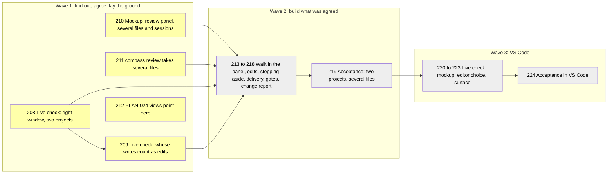

# Review Across Files and Sessions

## Goal

This plan implements the outcomes of [[specs/human-surface/SPEC-030-review-documents-open-in-obsidian|Review Documents Open in Obsidian (SPEC-030)]] that the review plugin does not meet yet, from the evidence in [[research/human-surface/RESEARCH-review-across-files-and-sessions]]. One review walks the human through several files and closes with one answer. Several Claude Code sessions, in one project or several, each reach their own Obsidian and get their own answer back, and nothing from one review leaks into another. The review lives in the side panel of Obsidian, one card (box) per review, and approving stays one click. After an answer Obsidian steps aside: it goes to the background so the human is back where he was. A VS Code version follows, using the same request and answer files. Earlier work: [[PLAN-022-review-in-obsidian]] built the one-file review.

## What you approve

Numbers are task ids. A wave is a stage: a group of tasks planned in detail together; later waves stay sketched until the one before is checked. Yellow is detailed and not started, grey is sketched under Later.

> [!IMPORTANT]
> You decide: approve the plan and the 15 choices below, all recommended, or comment on a row to change that choice. Two rows give less than the spec asks: the change report (the git diff Compass prints after an answer) gives other changed files by name only, and VS Code may stay in front after an answer.

| Choice | The plan's answer (recommended) |
| --- | --- |
| Several files | one review, one card, one answer for all of them |
| Marks per file | read or not, plus an optional note; no approve per file |
| When a file counts as read | when it is opened |
| Moving between files | Previous, Next, Next unread and arrow keys; opening a listed file, by a link or by hand, moves the walk to it |
| Where the walk lives | in the review panel's card; PLAN-024's TASK-206 walk view gives way to it |
| Telling sessions apart | each card names its project and its session |
| Reviews of other projects | each Obsidian lists its own project's; a list across projects stays a PLAN-024 view, reading the names this plan adds |
| Which edits count | only edits typed in Obsidian's editor; if TASK-209 cannot tell them apart, only edits to the review's own files |
| Stepping aside | each card decides from its own window's focus |
| A link that reaches nothing | the plugin confirms receipt; without it, Compass sends again, then asks in the terminal; built only if the TASK-208 check shows a link can fail |
| Change report after an answer | full changes for the reviewed and edited files; other changed files by name only |
| Approvals with several documents | sent as one review, such as a plan and its detail file |
| VS Code | a later wave after the Obsidian walk passes; VSCodium uses the same extension, Cursor too if TASK-220 finds the calls it needs |
| Two editors set up | a project setting picks one; without it, the first found |
| Stepping aside on VS Code | the `code` command brings VS Code forward; VS Code steps aside only if TASK-220 finds a way, else it stays in front |

The reasons behind each choice, which finding or open check each task answers, and the full task text are in [[archive/PLAN-025-review-across-files-and-sessions-detail]].

## Prerequisites

Obsidian with this vault and one scratch vault registered, Compass Review on in both (`compass review` reports a surface); Node for the plugin test harness. A throwaway plugin needs one Obsidian reload, which the builder asks the human for in one line.

## Not Doing

- Running on macOS, Linux and WSL, including whether stepping aside hides other projects' windows on macOS: [[PLAN-022-review-in-obsidian]] TASK-177 holds the live runs.
- The views drawn inside documents (the plan board, what changed, the list across projects): [[plans/PLAN-024-working-in-compass-is-visual]] TASK-206 holds them.
- Zed, Typora and Logseq as editors: none can host the review panel today.

## Phases

### Wave 1 (detailed): live checks, mockup, the request

- [ ] TASK-208: Live check, the right window: with this vault and a scratch vault both open in Obsidian, each project sends `compass review`; record whether each link reaches its own project's plugin and raises its window, what happens with one vault closed, whether a link to an open vault does nothing (the forum report), and whether a second link launch reaches the running Obsidian; this first result creates the live checks document - complexity: S, depends_on: none, files: [.compass/research/human-surface/RESEARCH-review-live-checks.md], decisions: [SPEC-030-review-documents-open-in-obsidian/D-06]
  - Automated verification: a script reads both vaults' `tmp/review/` and shows one verdict per vault for the two-vault run, written by that vault's plugin; the document holds the Obsidian version and one table per check (two vaults, vault closed, open vault, second launch); `compass validate` adds no warning.
  - Manual verification: the human says which window came forward each time.
- [ ] TASK-209: Live check, whose writes count as edits: a throwaway plugin logs Obsidian's file-changed and editor-changed events while a script rewrites one note, Compass writes `active.md`, the human types in a second note, and Obsidian's table editor pads a table; the result settles which edits a review lists - complexity: S, depends_on: TASK-208, files: [.compass/tmp/trials/review-edits/main.js, .compass/tmp/trials/review-edits/manifest.json, .compass/.obsidian/plugins/compass-review-edits/main.js, .compass/research/human-surface/RESEARCH-review-live-checks.md], decisions: [SPEC-030-review-documents-open-in-obsidian/D-03]
  - Automated verification: `node --check` on the trial plugin; the log holds at least the editor-changed event of the typed word, proving the plugin ran; a script matches each logged event to one of the four writes and records which writes fired no event; the plugin is off afterwards, checked in `community-plugins.json`.
  - Manual verification: none.
- [ ] TASK-210: Mockup of the review panel: one card walking four real files of this vault (File i of n, Previous, Next, Next unread, a row per file with its read mark and note count, one Approve and one Needs changes), a second card from another session labelled by project and session, the "On this file" note on a file outside the review, and the clicks each path takes beside today's; drawn as a side panel in the throwaway mockup plugin, sent through `compass review` - complexity: M, depends_on: none, files: [.compass/.obsidian/plugins/compass-ui-mockups/main.js, .compass/research/human-surface/RESEARCH-review-panel-mockup.md], decisions: [SPEC-030-review-documents-open-in-obsidian/D-03, SPEC-030-review-documents-open-in-obsidian/D-06], lessons: [LESSON-ui-change-needs-agreed-mockup-before-build]
  - Automated verification: `node --check` on the mockup plugin; every Send it writes under `tmp/mockups/ui/verdicts/` parses as the verdict shape in the detail file's TASK-211 text, at least one Send included; `compass validate` adds no warning.
  - Manual verification: the human approves the mockup in Obsidian.
- [ ] TASK-211: `compass review a.md b.md ...` sends one review of several files: the request keeps `file` as the first path and adds `files` (each a path and an optional one-line reason), `session` and `project`; every file must be committed; the write guard and `--status` cover every listed file; after the answer it prints one line per file with its mark and note and reprints only files with notes or edits; a verdict's optional `files` list is checked, and a one-file review is unchanged - complexity: M, depends_on: none, files: [plugin/cli/commands/review.py, plugin/cli/reviewlib.py, plugin/cli/commands/guard.py, plugin/cli/tests/test_review_files.py, plugin/cli/tests/test_guard.py], decisions: [SPEC-030-review-documents-open-in-obsidian/D-06, SPEC-030-review-documents-open-in-obsidian/D-05, SPEC-030-review-documents-open-in-obsidian/D-04]
  - Automated verification: tests cover three files (request order kept, `file` equals the first), one uncommitted file among three (refused, no request written), the guard denying each listed file, `--status` naming the file count, a verdict with a malformed `files` list (rejected), an old one-file verdict (accepted), the line per file printed after the answer, the reprint of only files with notes or edits, `--why` reasons kept in order, and `session` and `project` filled in; `python -m pytest plugin/cli/tests` passes.
  - Manual verification: none.
- [x] TASK-212: [[plans/PLAN-024-working-in-compass-is-visual]] TASK-206 names this plan's panel as the walk through several files, and its list of reviews across projects depends on TASK-211 for the project and session names - complexity: S, depends_on: none, files: [.compass/plans/PLAN-024-working-in-compass-is-visual.md]
  - Automated verification: a grep shows TASK-206's line naming this plan and TASK-211; `compass coverage` on PLAN-024 still passes.
  - Manual verification: none.

**Pause point:** when automated verification passes and the human has approved the mockup, the human confirms the live check results before Wave 2 is detailed.

## Later (intent only)

- [ ] TASK-213: The review panel's card walks several files as the mockup agreed, sends one answer with each file's mark and note, and names its project and session - files: [plugin/obsidian/compass-review/main.js, plugin/obsidian/compass-review/styles.css, plugin/obsidian/tests/test_main.js], decisions: [SPEC-030-review-documents-open-in-obsidian/D-03, SPEC-030-review-documents-open-in-obsidian/D-06, SPEC-030-review-documents-open-in-obsidian/D-04]
- [ ] TASK-214: A review lists only the edits TASK-209 shows the human made, and an edit outside every review goes to no card - files: [plugin/obsidian/compass-review/main.js, plugin/obsidian/tests/test_main.js], decisions: [SPEC-030-review-documents-open-in-obsidian/D-03]
- [ ] TASK-215: Each card decides its own stepping aside from its own window's focus, so another project's Obsidian no longer counts - files: [plugin/obsidian/compass-review/main.js, plugin/cli/review_surfaces/obsidian.py, plugin/obsidian/tests/test_main.js, plugin/cli/tests/test_review_surfaces.py], decisions: [SPEC-030-review-documents-open-in-obsidian/D-02, SPEC-030-review-documents-open-in-obsidian/D-06]
- [ ] TASK-216: The plugin confirms receipt of a review; without it Compass sends again, then asks in the terminal; dropped if TASK-208 finds every link arrives - files: [plugin/cli/reviewlib.py, plugin/cli/commands/review.py, plugin/obsidian/compass-review/main.js, plugin/cli/tests/test_review.py, plugin/obsidian/tests/test_main.js], decisions: [SPEC-030-review-documents-open-in-obsidian/D-02, SPEC-030-review-documents-open-in-obsidian/D-06]
- [ ] TASK-217: The change report after an answer shows full changes for the reviewed and edited files and names other changed files only - files: [plugin/cli/reviewlib.py, plugin/cli/commands/review.py, plugin/cli/tests/test_review_git.py], decisions: [SPEC-030-review-documents-open-in-obsidian/D-05]
- [ ] TASK-218: Approval points with several documents send them as one review, and the release refreshes this repo's install - files: [plugin/templates/rules/compass-pipeline.md, plugin/skills/plan/SKILL.md, plugin/templates/agents/planner.md, plugin/skills/research-codebase/SKILL.md, plugin/.claude-plugin/plugin.json], decisions: [SPEC-030-review-documents-open-in-obsidian/D-06, SPEC-030-review-documents-open-in-obsidian/D-04]
- [ ] TASK-219: Live acceptance: two sessions in two projects each send a review of several files; the human walks both, opens a second pane, a file outside the review and renames one, and the clicks and minutes are recorded - decisions: [SPEC-030-review-documents-open-in-obsidian/D-06]
- [ ] TASK-220: Live check of VS Code: which window a `code` command and a `vscode://` link reach with several folders open or none, whether an extension can raise or minimize its window, and whether Cursor's older engine has the needed calls - files: [.compass/research/human-surface/RESEARCH-review-live-checks.md], decisions: [SPEC-030-review-documents-open-in-obsidian/D-01]
- [ ] TASK-221: Mockup of the review panel in VS Code - files: [.compass/research/human-surface/RESEARCH-vscode-review-mockup.md], decisions: [SPEC-030-review-documents-open-in-obsidian/D-01]
- [ ] TASK-222: A project setting picks the review editor when two are set up, and install and doctor wording allow an editor installed per user - files: [plugin/cli/reviewlib.py, plugin/cli/review_surfaces/__init__.py, plugin/cli/commands/doctor.py, plugin/cli/tests/test_review_surfaces.py], decisions: [SPEC-030-review-documents-open-in-obsidian/D-01]
- [ ] TASK-223: A VS Code surface: each window claims the reviews under its own folder and shows the agreed panel, installed from a `.vsix` - files: [plugin/cli/review_surfaces/vscode.py, plugin/vscode/compass-review/package.json, plugin/vscode/compass-review/extension.js, plugin/cli/tests/test_review_vscode.py], decisions: [SPEC-030-review-documents-open-in-obsidian/D-01]
- [ ] TASK-224: Live acceptance: a review of several files answered in VS Code - decisions: [SPEC-030-review-documents-open-in-obsidian/D-01]

## Risks

- TASK-213 and PLAN-024's TASK-206 both edit `main.js` and its harness: TASK-213 merges first and TASK-206 rebases onto it.
- TASK-218 and PLAN-024's TASK-201 both edit the pipeline rules and the plan skill: whichever lands second rebases onto the first; neither rewrites the other's paragraph.
- An old plugin gets a review of several files: it shows the first file as today, and the answer carries no marks per file.
- A link reaches no Obsidian window: the answer still arrives when the human opens the vault, since the plugin scans for waiting reviews at start-up.
