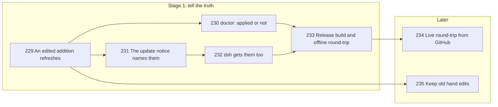

# Local Additions Survive Update, and Say So

## Goal

This plan finishes [[specs/distribution/SPEC-014-update-safe-customizations|Project-local customizations survive update (SPEC-014)]], the spec (what we need), using [[research/distribution/RESEARCH-update-safe-customization]], its research (the evidence). Since v0.14.0 a local addition kept in `.compass/meta/local/` is appended to the fresh copy at every update, and `CLAUDE.md` is never touched. Three needs are still open: the update report and `compass doctor` must say which additions applied and which did not ([[specs/distribution/SPEC-014-update-safe-customizations#^need-report]]), a real round-trip must prove it ([[specs/distribution/SPEC-014-update-safe-customizations#^live-round-trip]]), and old hand edits must be movable into the local form ([[specs/distribution/SPEC-014-update-safe-customizations#^need-migrate]]).

> [!NOTE]- How local additions work today
> ![[decisions/distribution/ADR-020-local-overlays-appended-after-refresh#Decision]]

## Current State

Read against `684e1f7`; the research is from 2026-08, before the mechanism shipped.

- `plugin/cli/commands/overlay.py:75` skips any target already holding the addition's marker, so an edited addition never reaches the install until a new release replaces the file. Run in a scratch project: the local file changed from v1 to v2, `--apply` reported `skipped`, the install kept v1.
- `plugin/cli/commands/doctor.py:340-360` runs the check in list mode, where `applied` means "would apply", and counts it as applied: a project whose addition never landed reads `OK 1 applied`. Same scratch run confirmed it.
- `plugin/cli/commands/self_update.py:310-317` applies the additions and discards the result; the notice at `:425` and `:463` says only the version change.
- `plugin/cli/commands/self_update.py:294-299` builds the dsh skills and the `AGENTS.md` rules section from the plain shipped source, so dsh never sees a local addition. The update skill's step 4a builds dsh skills from `.claude/skills`, which also turns a project's own skills into `compass-*` copies.

## Desired End State

- An edited local addition lands on the next `compass overlay --apply`, once, with the shipped text intact.
- `compass doctor` warns when an addition is not applied or out of date, and names the command that fixes it.
- Every update notice that prints names the additions it re-applied, the ones with no shipped file, and any failure to apply.
- On a machine with dsh, an addition to a skill or rule reaches `.dsh/skills/` and the `AGENTS.md` rules section.
- A scratch project updated end to end keeps `CLAUDE.md` byte-identical and shows both a shipped change and its local addition.

## Not Doing

- Shaping the pipeline itself: [[specs/pipeline/SPEC-009-configurable-pipeline-workflows]].
- Replacing or deleting shipped lines: additions append, as the decision record holds.
- Local additions to CLI code, the hooks file, or dsh agents (dsh agents come from one bundle shared by every project).
- Whole new local skills: they already survive update.

## Prerequisites

None. Every Stage 1 test runs offline.

## Phases

### Stage 1 (detailed): local additions tell the truth

- [x] TASK-229: `compass overlay` knows four states per addition - not applied, current, out of date (its block differs from the local file), no shipped file - and `--apply` replaces an out-of-date block from its own marker to the end of the target; the list output names each state; ADR-020's D-03 text is updated to say the marker also bounds the block it replaces - complexity: M, depends_on: none, files: [plugin/cli/commands/overlay.py, plugin/cli/tests/test_overlay.py, .compass/decisions/distribution/ADR-020-local-overlays-appended-after-refresh.md], decisions: [SPEC-014-update-safe-customizations/D-01, SPEC-014-update-safe-customizations/D-02], lessons: [LESSON-installer-removes-only-what-it-installed]
  - Automated verification: tests where an edited local file plus `--apply` leaves the new text once, the old text gone, the shipped text and any text above the marker unchanged; a second `--apply` leaves the target's bytes unchanged; list mode reports `out of date` and writes nothing; a local file whose text contains the marker string is still applied once; `python -m pytest plugin/cli/tests -q` passes; `python plugin/cli/compass overlay` exits 0; `compass decisions decisions/distribution/ADR-020-local-overlays-appended-after-refresh` still parses six decisions.
  - Manual verification: the human reads the new D-03 wording and agrees it says what the code does.
- [x] TASK-230: The doctor row reads the four states: WARN naming each addition not applied or out of date, with the fix `run compass overlay --apply`; OK only when every addition is current - complexity: S, depends_on: TASK-229, files: [plugin/cli/commands/doctor.py, plugin/cli/tests/test_doctor.py], decisions: [SPEC-014-update-safe-customizations/D-02]
  - Automated verification: tests for each state, including the case today's row gets wrong (target present, addition never applied, row must WARN); the no-shipped-file WARN and the scan-failure WARN keep their text; `python -m pytest plugin/cli/tests -q` passes.
  - Manual verification: the human reads the row on the scratch project of TASK-233 and judges the fix line clear.
- [x] TASK-231: The update notice names what it re-applied: `_apply` returns the additions' result, and the notice reads `Compass updated A -> B; local additions re-applied: <names>`, adding the names with no shipped file and, when applying raised, `local additions not applied (run compass doctor)`; the same text goes to `self-update.log`; the update skill's step 7 report names step 4b's lines - complexity: S, depends_on: TASK-229, files: [plugin/cli/commands/self_update.py, plugin/cli/tests/test_self_update.py, plugin/skills/update/SKILL.md], decisions: [SPEC-014-update-safe-customizations/D-02]
  - Automated verification: tests where an update with one addition puts its name in the notice and the log; with no additions the notice is byte-identical to today's; an addition that raises still lets the update finish and puts the failure in the notice; `grep -n "local additions" plugin/skills/update/SKILL.md` finds the step 7 line; `python -m pytest plugin/cli/tests -q` passes.
  - Manual verification: the human reads one real notice in TASK-233 and judges it one short line.
- [ ] TASK-232: dsh gets local additions: the dsh skill and rules builders append a shipped name's local addition under the same marker; the update skill's step 4a builds from the clone (`$SRC/skills`, `$SRC/templates/rules`) the way `self_update.py` does - complexity: M, depends_on: TASK-229, TASK-231, files: [plugin/cli/hostlib.py, plugin/cli/commands/overlay.py, plugin/cli/tests/test_hostlib.py, plugin/skills/update/SKILL.md], decisions: [SPEC-014-update-safe-customizations/D-02]
  - Automated verification: tests where a skill addition appears once in `.dsh/skills/compass-<name>/SKILL.md` and a rule addition appears once inside the `AGENTS.md` rules section, with every byte outside the section unchanged; a project's own skill is never written as `compass-<name>`; a project with no additions builds byte-identical dsh files; `grep -n "\$SRC/skills" plugin/skills/update/SKILL.md` finds step 4a and `grep -c "'.claude/skills'" plugin/skills/update/SKILL.md` prints 0; `python -m pytest plugin/cli/tests -q` passes.
  - Manual verification: on a machine with dsh, the human opens one dsh skill with a local addition and finds it at the end.
- [ ] TASK-233: Release build and offline round-trip: bump `plugin/.claude-plugin/plugin.json` to the next minor, refresh this repo's `.claude/` with `python plugin/cli/compass self-update --force`, then run a scratch project in the session scratchpad holding a copy of `plugin/` as its local source, a `CLAUDE.md`, and a local addition with Compass-usage instructions on `researcher`; change the copy's shipped `researcher.md`, update, and record the result as a finding in the research - complexity: S, depends_on: TASK-230, TASK-232, files: [plugin/.claude-plugin/plugin.json, .compass/research/distribution/RESEARCH-update-safe-customization.md], decisions: [SPEC-014-update-safe-customizations/D-02]
  - Automated verification: in the scratch project the notice names `agents/researcher.md`; the installed `researcher.md` holds the changed shipped line and the addition once; `sha256sum CLAUDE.md` matches before and after; `compass doctor` shows the row OK; after editing the addition, `compass overlay --apply` lands it and doctor stays OK; `diff -r plugin/cli .claude/cli` is empty apart from `__pycache__`; `compass validate` adds no warning.
  - Manual verification: the human reads the recorded finding and the scratch project's installed `researcher.md`.

**Pause point:** when automated verification passes, the human confirms the manual checks before Stage 2 gets its detail.

## Later (intent only)

- [ ] TASK-234: Push the release (the human's approval point), then update a scratch project pinned to the previous release's commit from GitHub: the notice names its addition, `CLAUDE.md` is unchanged, the doctor row is OK - files: [.compass/research/distribution/RESEARCH-update-safe-customization.md], decisions: [SPEC-014-update-safe-customizations/D-02]
- [ ] TASK-235: Keep old hand edits: update records a hash of each file it installs, saves a file changed since then before replacing it, names it in the notice, and `compass overlay --extract` turns its added lines into a local addition, naming lines it cannot express - files: [plugin/cli/commands/self_update.py, plugin/cli/commands/overlay.py, plugin/skills/update/SKILL.md], decisions: [SPEC-014-update-safe-customizations/D-02]

## Risks

- Another plan releasing first takes the version number: TASK-233 bumps from whatever `plugin.json` holds when it runs.
- Replacing an addition's block removes text a human typed below its marker in `.claude/`; the spec leaves hand edits to shipped files to update.
- dsh is not installed on this machine, so TASK-232's manual check waits for a machine that has it.

## Revision Log

- 2026-10-29: Approved in Obsidian with the recommended answers: an edited addition replaces its own block, additions reach dsh, and Stage 2 keeps old hand edits.
