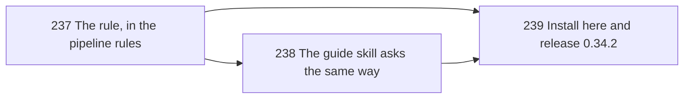

# Every Choice Is a Numbered List



> [!IMPORTANT]
> You decide: approve one rule in the pipeline rules, the guide skill's fix and a 0.34.2 release, as the way decision D-01 (a numbered ruling) of [[specs/human-surface/SPEC-029-questions-to-the-human-are-clear-and-visual#Decisions]] reaches every question Compass asks.

## Goal

This plan carries decision D-01 of [[specs/human-surface/SPEC-029-questions-to-the-human-are-clear-and-visual|Questions to the Human Are Clear and Visual (SPEC-029)]], the spec (what we need): every choice put to the human is a numbered list, so a reply can be just the number.

The rule lives once, in the pipeline rules. That file loads into every Claude Code session and is folded into `AGENTS.md` for dsh (a second agent CLI Compass installs into), which has no `AskUserQuestion` tool, so one sentence there reaches every skill, every agent and every host.

What the human sees when a choice reaches him as text:

```text
Approve this plan?
1. Approve as-is (Recommended): tasks are distributed.
2. Request changes: you say what to modify.
3. Reject: start over or abandon.
```

A reply of `1` approves.

## The waves

One wave. The rule goes into the pipeline rules first, with a test that holds the file to its size limit; then the guide skill, the one skill that writes its questions as prose, asks them the same way; then the change is installed in this repo and released. The wave ends at the human's live check: a numbered question in a real session, answered with a number.

## Current State

Read against `b14d675`.

- `plugin/templates/rules/compass-pipeline.md:16` is the one rule for asking: `AskUserQuestion`, one question per call, recommended option first labelled "(Recommended)", one short line per option, "Other" open, a subagent returning the question to the orchestrator. It says nothing about numbering.
- `plugin/templates/rules/compass-pipeline.md:18` sends document gates to the review surface and falls back to `AskUserQuestion` on `not configured`, so the review path inherits line 16.
- `plugin/templates/rules/compass-pipeline.md:102` (Build) restates line 16 in full for the no-plan case.
- `plugin/templates/rules/compass-pipeline.md` is 141 lines and 12,419 bytes. `plugin/cli/tests/test_writing_rules.py` (`PIPELINE_MAX_LINES = 141`) and `plugin/cli/tests/test_approval_loop_text.py` (`LINE_CEILINGS`) fail if it grows a line.
- `plugin/cli/commands/self_update.py:423-426` copies `templates/rules/*.md` into `.claude/rules/`; `plugin/cli/hostlib.py:205-230` folds the same files into the `AGENTS.md` section dsh loads; `plugin/cli/hostlib.py:129` lists `AskUserQuestion` as a tool dsh lacks. On dsh every choice reaches the human as text.
- 18 skills restate the line 16 protocol at their asking points (`plugin/skills/{autopilot,build,clone-old,consolidate,guide,handoff,learned,plan,research,research-codebase,research-papers,retroactive,setup,spec,specs,update,vault-health,vision}/SKILL.md`), and five agent templates return questions to the orchestrator (`plugin/templates/agents/{builder.md:51,planner.md:29,126,researcher.md:34,reviewer.md:58,validator.md:38}`). None of them says how options are written, so none contradicts a numbering rule.
- `plugin/skills/guide/SKILL.md:35-46` is the one place that scripts choices as prose: "Want me to run setup?", "Want to start?", "Spec roadmap: [list from vision.md]. Which one first?", and section C's "list options (continue building, validate, new task, handoff, checkup)". Only section D (`:48`) routes its question through `AskUserQuestion`.
- `plugin/skills/research-papers/SKILL.md:56` presents three candidate papers to pick from; the numbering rule covers it as written.
- `.compass/loops/LOOP-001-visual-questions/sensor.py` counts asking points that do not route through `AskUserQuestion`; it reads 0 today.
- `AskUserQuestion` draws its own option list. That it shows the options numbered is confirmed in TASK-239's live check (see Risks).

## Desired End State

- The pipeline rules say every choice is a numbered list with the recommended option as 1, a bare-number reply picks that option, the tool's labels carry no number of their own, and a choice written as text uses `1.`, `2.`, `3.` lines.
- The pipeline rules are no longer than 141 lines or 12,419 bytes.
- The guide skill asks its closing questions through `AskUserQuestion`.
- `.claude/` in this repo matches `plugin/`, and `plugin/.claude-plugin/plugin.json` reads `0.34.2`.

## What We're NOT Doing

- Adding the numbering rule to each skill's asking point. The pipeline rules hold it once.
- Rewriting the 18 skills' restatements of the asking protocol; they agree with the new rule.
- Changing the LOOP-001 sensor. Every asking point it counts stays routed through `AskUserQuestion`.

## Phases

### Wave 1 (detailed): one rule, one fix, one release

- [ ] TASK-237: Number every choice in the pipeline rules - complexity: S, depends_on: none, files: [plugin/templates/rules/compass-pipeline.md, plugin/cli/tests/test_numbered_choices_text.py], decisions: [specs/human-surface/SPEC-029-questions-to-the-human-are-clear-and-visual/D-01], lessons: [LESSON-remove-context-before-adding, LESSON-ui-change-needs-agreed-mockup-before-build]
  - Line 16 becomes, within the same paragraph: "Ask through `AskUserQuestion`, exactly one question per call: the options are a numbered list, the recommended one first and labelled "(Recommended)", each one short line saying what choosing it does, the free-text "Other" left open, and a reply of just a number picks that option. The tool numbers its options, so labels carry none; a choice shown as text, as on a host without the tool, is written as `1.`, `2.`, `3.` lines. Several questions are never batched in one message or one call; the next question waits for this answer. A subagent cannot call `AskUserQuestion`: it stops and returns the question to the orchestrator, its options numbered and the recommended one marked, and the orchestrator asks it the same way."
  - Line 102 (Build) shortens to: "Builders execute approved planned tasks. With no approved plan, do not improvise: ask the human what to do through `AskUserQuestion`, as When to Stop and Ask describes." The bytes it frees pay for line 16's growth; the two edits together shrink the file by 2 bytes.
  - Automated verification: new `plugin/cli/tests/test_numbered_choices_text.py`, reading the file the way `test_approval_loop_text.py` does, asserts the "When to Stop and Ask" section holds one block naming a numbered list, the recommended option first, a reply of just a number, labels carrying no number, and text written as `1.` lines; that the subagent sentence says the returned options are numbered; that the file stays at or below 141 lines and 12,419 bytes; that `hostlib.materialize_dsh_instructions` run on a temporary project puts the numbered-list sentence into `AGENTS.md`; and that no `plugin/skills/*/SKILL.md` or `plugin/templates/agents/*.md` option bullet starts with a digit (a numbered label would show twice in the tool). `python -m pytest plugin/cli/tests -q` passes; `python .compass/loops/LOOP-001-visual-questions/sensor.py` still reads `"value":0`.
  - Manual verification: the human reads the two edited lines in `plugin/templates/rules/compass-pipeline.md` and approves the wording or names the words to change.

- [ ] TASK-238: The guide skill asks its closing questions through the rule - complexity: S, depends_on: TASK-237, files: [plugin/skills/guide/SKILL.md, plugin/cli/tests/test_numbered_choices_text.py], decisions: [specs/human-surface/SPEC-029-questions-to-the-human-are-clear-and-visual/D-01]
  - Under "### 2. Respond", one line: each response that ends in a question asks it through `AskUserQuestion`, one question per call. The "Vision but no specs" quote drops `Spec roadmap: [list from vision.md].` and asks "Which roadmap item first?", the roadmap items being the options. Section C asks what next, the options being continue building, validate, new task, handoff and checkup, in place of "list options".
  - Automated verification: tests in the same file assert the Respond section names `AskUserQuestion` and one question per call, no longer contains "list options" or "[list from vision.md]", and the guide stays at or below its size today, 87 lines and 4,132 bytes; `python -m pytest plugin/cli/tests -q` passes; the LOOP-001 sensor still reads 0.
  - Manual verification: after TASK-239 installs it, the human runs `/compass:guide` in this repo and sees its closing question as numbered options.

- [ ] TASK-239: Install the change here and release 0.34.2 - complexity: S, depends_on: TASK-237, TASK-238, files: [.claude/rules/compass-pipeline.md, .claude/skills/guide/SKILL.md, plugin/.claude-plugin/plugin.json, plugin/cli/tests/test_numbered_choices_text.py], decisions: [specs/human-surface/SPEC-029-questions-to-the-human-are-clear-and-visual/D-01]
  - Copy `plugin/templates/rules/compass-pipeline.md` to `.claude/rules/` and `plugin/skills/guide/SKILL.md` to `.claude/skills/guide/`; bump `plugin/.claude-plugin/plugin.json` from 0.34.1 to 0.34.2; commit `plugin.json` as "Release 0.34.2: every choice put to the human is a numbered list" (`.claude/` is gitignored and stays out of the commit).
  - Automated verification: a test asserts `plugin.json`'s version is at least 0.34.2; `diff plugin/templates/rules/compass-pipeline.md .claude/rules/compass-pipeline.md` and `diff plugin/skills/guide/SKILL.md .claude/skills/guide/SKILL.md` print nothing; `python -m pytest plugin/cli/tests -q` passes.
  - Manual verification: in a fresh Claude Code session in this repo, the human runs `/compass:guide` and sees a numbered question, answers it with just the number, and the answer is taken; then he runs `/compass:plan new` on [[specs/human-surface/SPEC-029-questions-to-the-human-are-clear-and-visual]], whose planner returns the "update the existing plan or create a new one" question because this plan exists, and sees that question's options numbered.

**Pause point:** when automated verification passes, wait for the human to confirm the manual checks.

## Risks

- `AskUserQuestion` might show its options without numbers on some Claude Code version: then the rule's "the tool numbers its options" is false there. TASK-239's live check shows it; if the numbers are absent, the same sentence changes to put the number in each label.
- An agent reading a skill's asking point without the pipeline rules (a host that loads skills only) never sees the rule: dsh loads the rules through `AGENTS.md`, which TASK-237's test covers; any other host gets the rules the same way when it is added.
