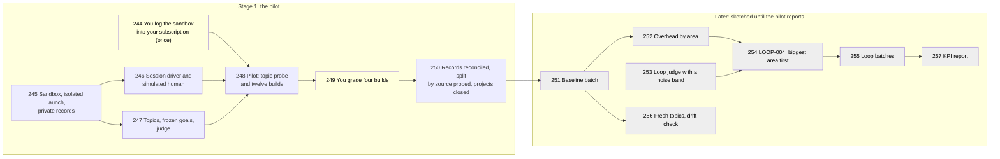

# Compass's Whole Overhead on Real Projects

Numbers are task ids; yellow tasks are yours. A stage (written "Wave" in the section headings, which Compass's tools read) is a group of tasks planned in detail together; the grey ones stay one-line sketches until the pilot's numbers are in.

> [!IMPORTANT]
> You decide: approve Stage 1 as written, meaning twelve full builds on your subscription, one at a time, stopping at any usage-limit event, one login by you before the builds and one grading session of four builds after them. Approving also makes the guesses marked `[guess]` below binding until the pilot reports; each is a number or a choice the pilot measures and Stage 2 revisits.

## Goal

This plan implements [[specs/tooling/SPEC-027-compass-uses-fewer-tokens/SPEC-032-whole-overhead-measured-on-real-projects|Compass's Whole Overhead, Measured on Real Projects (SPEC-032)]], the spec (what we need), from the evidence and the six rulings in [[research/whole-overhead/REVIEW-whole-overhead]]. Agents pick a project and build it from first setup to the result, headless on the human's Claude subscription, in two arms (two versions of the same build): one with Compass and one without, while a script plays the human. Every token of every session is counted from Claude Code's own records. The share that is Compass overhead is measured, broken into areas, and cut biggest area first by a control loop, with build success judged by signals that exist the same way in both arms.

## The waves

**Stage 1, the pilot.** No full Compass build has been run headless or measured for cost, and the batch size for the whole measurement depends on how much the overhead share varies between builds, which no source measures. Stage 1 builds the smallest harness that runs a real build in a throwaway project, runs a topic probe and twelve builds, and writes what it saw: the spread of the share, the cost and time of one build, whether Compass's hooks and gates behave headless, whether the records add up, and whether the judge agrees with you. It ends at the pilot report, with the batch size computed from the spread; you confirm the manual checks before anything else starts.

**Later stages** take the pilot's numbers and run the first baseline batch, rank the overhead by area, teach the loop machinery to judge a noisy sensor, and run a whole-overhead loop that changes the biggest area first. They stay sketched because each one's size and shape depend on what the pilot measures.

## Rulings this plan carries

The research's six rulings, approved 2026-11-01, bind every task:

1. Compass-driven extra work (tests, research, review rounds, validator runs, spawned agents) counts as overhead, measured as its own area. Every topic is built in both arms, and the paired difference holds the changed behavior.
2. Agents pick topics into a recorded pool; before and after runs replay that pool; a fresh batch at intervals checks the pool has not gone stale. In the seeded form, code samples attributes (kind of program, size class, language) and puts them in the prompt, and the agent picks the topic inside them; in the unseeded form the agent picks freely. The pilot's topic probe runs both and the pool takes the form that fills more distinct classes, the unseeded form on a tie.
3. The KPI is the list-price weighted share (cache reads at their list-price fraction of fresh input); the raw-token share is reported beside it.
4. Only success signals that exist the same way in both arms count: the frozen goal list, checks run in the finished project, and a judge that inspects the workspace. The validator verdict and plan checkboxes are recorded, never counted.
5. The simulated human holds a hidden goal it reveals only to specific questions, has no solution knowledge, has a fixed question budget, answers pickers through a PreToolUse hook, and its own tokens stay outside the build's count.
6. Builds run on the human's subscription at a modest pace: the pilot, then batches sized by the pilot, stopping at any usage-limit event, the API only if Anthropic objects.

### The harness

- **Where it lives.** All measurement tooling is repo-local dev tooling under `bench/overhead/`, beside the rest of `bench/`; nothing in Stage 1 touches `plugin/`. Later tasks say which of their pieces ship to users.
- **Bench.** `bench/overhead/` is the harness for this measurement. It reuses `sensorlib.machine_id` and the `usage-scan` refusal pattern from `plugin/cli`. The wrapper scripts `bench/README.md` names are not on disk; the README says so and points to `bench/overhead/`.
- **Private data.** The topic pool, goal lists, grading sheets, records and the sandbox's Claude config live under `~/.compass/overhead/`. Records hold only allowlisted counts, enums, durations, model ids, versions, Compass source names and a hashed machine id; no topic text, path, prompt, session id or model output. Writing any of these inside a git work tree is refused. The pilot report in this repo carries only aggregates.
- **Projects.** Throwaway projects live under `C:\compass-overhead\projects\` [guess], a folder with no `CLAUDE.md` above it, since a project under the home folder would load `~\.claude\CLAUDE.md` as an ancestor file. TASK-245 checks the human's global rules do not load there.
- **Isolation.** Every session (build, simulated human, topic, goal, judge) runs `claude -p` with `CLAUDE_CONFIG_DIR=~/.compass/overhead/claude-config`, `--setting-sources project,local` and `--strict-mcp-config`. Its environment drops `ANTHROPIC_API_KEY`, `ANTHROPIC_AUTH_TOKEN`, `CLAUDE_CODE_OAUTH_TOKEN`, `GH_TOKEN` and `GITHUB_TOKEN`; sets `DISABLE_AUTOUPDATER=1`, `PIP_REQUIRE_VIRTUALENV=1` (pip refuses to install outside a virtual environment), `GH_CONFIG_DIR` to an empty sandbox folder and `DSH_HOME` to a sandbox path that does not exist, so no session reaches GitHub or the human's dsh install; and takes the VS Code and Cursor folders off `PATH`, so no review window opens.
- **The Compass under test.** Builds run only from a clean `plugin/` (`git status --porcelain plugin/` empty), and each build records the repo's HEAD sha. The Compass arm loads the plugin with `--plugin-dir <repo>/plugin` and its first message is `/compass:setup`, so setup's tokens count. After setup the driver writes `commit:` into the project's `plugin.yaml` with the sha of the repository's remote head, so Compass's start-of-session self-update finds the install current and leaves it alone; each build then checks that `.claude/` still matches `plugin/` at the recorded sha.
- **Pinning.** Model ids, the Claude Code version and the plugin sha are recorded per build; the real model is read from `modelUsage`. [guess: builds and the judge pinned to `claude-opus-5-5`, the model the research trials ran on; simulated human, goal writer and topic picker on `claude-sonnet-4-6`.]
- **Counting.** A build's tokens are, per model and per token kind, the sum over every session whose working directory is the build's project: the main session, its subagents, and Compass's detached capture workers, which run as their own `claude -p` sessions. For each session the count is the last `result` event's `modelUsage` before each reset (a stream session's results carry running totals, and `/clear` restarts them), cross-checked against the transcript's assistant records deduplicated by message id. Before a build's record closes, every `worker-started` row in the project's capture ledger has its end row and `tmp/capture-worker.lock` is gone, waited on up to the project's `worker_grace_seconds`. Simulated-human, topic, goal and judge sessions run from their own folders and are counted apart.

## Prerequisites

- Claude Code 2.1.316 on PATH (`claude --version`); Python 3.13 with pytest 9 (present).
- `ANTHROPIC_API_KEY` and `CLAUDE_CODE_OAUTH_TOKEN` unset in the human's environment (true at research time).
- `~/.compass` sits outside any git repository (checked).

## Desired End State

- `bench/overhead/` runs a full build of an agent-picked topic, with or without Compass, headless on the subscription, in a throwaway project outside the repo, with a script answering every question Compass or Claude Code asks, and writes one project-free record per session.
- The pilot report, `research/whole-overhead/RESEARCH-whole-overhead-pilot.md` in this vault, states the spread of the overhead share between and within topics, the batch size it implies with its uncertainty, the cost and time of one build and how many fit a five-hour window, how Compass behaves headless, whether the record paths agree, how far a split by source reaches without the API, whether agent-picked topics collapse, and the judge's agreement with the human.
- The pilot's projects are deleted with `claude purge`, except any the human marks to keep, which are copied out to a folder he names.

## What We're NOT Doing

- No Anthropic API key and no `count_tokens` endpoint, so no exact offline tokenization (Anthropic's tokenizer for current models is not published); splits by source are estimates calibrated by ablation calls.
- The Agent SDK is used only if neither plain `claude -p` route offers the question tool (TASK-246), and then in `bench/overhead/.venv`, never system Python.
- No container or VM; no OpenTelemetry collector (the pilot only records whether the console exporter names Compass's parts).
- No change to `plugin/` in Stage 1, and no change to the external-benchmark harness in `bench/` beyond its README.
- No sequential stopping rule for the share ([[research/whole-overhead/RESEARCH-axis-8-gap-pass]], gap 3); batches are fixed in size from the pilot's spread.
- No parallel builds: one build at a time, so a usage limit stops one build.

## Phases

### Wave 1 (detailed): the pilot

TASK-246 and TASK-247 run in parallel after TASK-245: they touch separate files, and TASK-245 owns the shared fake `claude` both test against. TASK-249 and TASK-250 run in that order, since TASK-250 ends by deleting the projects.

- [ ] TASK-244: You log the sandbox config into your Claude subscription, once, in PowerShell: `$env:CLAUDE_CONFIG_DIR = "$HOME\.compass\overhead\claude-config"; claude`, then type `/login`, sign in with your subscription account in the browser, type `/exit`, and close that PowerShell window so the variable goes with it; a human step, nothing ships - complexity: S, depends_on: none, files: [~/.compass/overhead/claude-config/], decisions: [SPEC-032-whole-overhead-measured-on-real-projects/D-02], lessons: [LESSON-subscription-cost-is-an-estimate-not-a-budget]
  - Automated verification: in Git Bash, from an empty folder, `mkdir -p "$HOME/.compass/overhead/login-check" && cd "$HOME/.compass/overhead/login-check" && CLAUDE_CONFIG_DIR="$HOME/.compass/overhead/claude-config" env -u ANTHROPIC_API_KEY -u ANTHROPIC_AUTH_TOKEN -u CLAUDE_CODE_OAUTH_TOKEN claude -p "Reply with the single word ok." --output-format stream-json --verbose --setting-sources project,local --strict-mcp-config --max-budget-usd 0.2 < /dev/null` prints a `system/init` event whose `apiKeySource` names no API key and a result with `is_error: false` and nonzero tokens; `~/.claude/projects` gains no folder for this run.
  - Manual verification: your claude.ai usage page shows the call against your plan, and your normal `claude` sessions are still logged in.

- [ ] TASK-245: Sandbox, isolated launch and private records, repo-local in `bench/overhead/`: `sandbox.py` creates a project under the projects root (its own `git init`), lists projects, keeps one (copies it to a folder given with `--to`) and discards one (deletes the folder and runs `claude purge <path> --yes` with the sandbox config); `launch.py` builds the command line and environment of "The harness" section for any session, refuses to start when `plugin/` has uncommitted changes, runs the session, reads `stream-json`, and classifies its end as done, failed or usage-limit (a `rate_limit_event` with `status: rejected`, an `api_error` of `usage_limit_reached`, or exit 1 with nothing on stdout and an `isApiErrorMessage` entry at the transcript tail), keying on `api_error`, never on `subtype`; `records.py` counts each session as "The harness" section describes, adds list-price weights, and appends one allowlisted row per session to `~/.compass/overhead/records/<machine>.jsonl`; the shared fake `claude` replays canned `stream-json`: a clean run, a run with a subagent, a multi-turn session with a `/clear`, each of the three usage-limit shapes, and a crash; `bench/README.md` states its two wrapper scripts are not on disk and points to `bench/overhead/README.md` - complexity: L, depends_on: none, files: [bench/overhead/README.md, bench/overhead/sandbox.py, bench/overhead/launch.py, bench/overhead/records.py, bench/overhead/tests/conftest.py, bench/overhead/tests/fake_claude.py, bench/overhead/tests/test_sandbox.py, bench/overhead/tests/test_launch.py, bench/overhead/tests/test_records.py, bench/README.md], decisions: [SPEC-032-whole-overhead-measured-on-real-projects/D-02], lessons: [LESSON-subscription-cost-is-an-estimate-not-a-budget, LESSON-headless-worker-denies-tools-silently]
  - Automated verification: `python -m pytest bench/overhead/tests -q` passes: leak tests with a temporary HOME assert no topic string, project path, session id or `result` text reaches a record; a record path inside this repo is refused; the child environment carries none of the dropped variables even when the parent has them; a multi-turn session with a `/clear` counts each token once; each usage-limit shape halts; `python -m pytest plugin/cli/tests -q` still passes; `python -c "import pathlib,sys; bad=[p for p in [*pathlib.Path('bench/overhead').rglob('*'), pathlib.Path('bench/README.md'), pathlib.Path('.compass/research/whole-overhead/RESEARCH-whole-overhead-pilot.md')] if p.is_file() and p.suffix in {'.py','.md'} and any(chr(c) in p.read_text(encoding='utf-8') for c in (0x2013, 0x2014))]; print(bad); sys.exit(bool(bad))"` (the dash check) exits 0.
  - Manual verification: from a new sandbox project, an isolated `claude -p` asked whether its instructions contain a section headed "Global Rules" answers no; `sandbox.py new` then `discard` leaves no folder and no entry in the sandbox's `.claude.json`.

- [ ] TASK-246: The session driver and the simulated human, repo-local. `drive.py` holds one build session open as `claude -p --input-format stream-json --output-format stream-json --verbose` in the project, sends the opening message, and at every end of turn (a gate that ends its turn, Compass's stop at 80% of the context window, a question asked in prose) asks the simulated human for the next message, until the simulated human says the build is done or a cap is hit [guess: 90 minutes wall time, 400 turns, `--max-budget-usd 25` as a runaway guard only]. In the Compass arm it applies "The Compass under test" in "The harness" section and records the skill and agent counts of `system/init` before and after setup. `human.py` runs the simulated human as its own isolated session from its own folder: it holds the hidden brief from TASK-247, reveals a goal item only to a question that names it, has no solution knowledge, knows Compass's user commands from its README in the Compass arm, and answers at most 12 questions that reveal goal items [guess]; gate approvals and continue messages do not count, and once the budget is spent it answers "decide yourself". `hooks/answer_question.py` is a PreToolUse command hook the driver writes into the project's `.claude/settings.local.json`: it answers `AskUserQuestion` by returning `permissionDecision: allow` with `updatedInput` holding the questions and the simulated human's answers, and denies a Bash, Write or Edit call whose path leaves the project, any `gh` command and any `git push`. A live probe opens the task and keeps the first route under which `system/init` lists `AskUserQuestion`: `stream-json` input with the hook, then `--permission-prompt-tool` naming a tool of the harness's own stdio server passed with `--mcp-config`, then the Agent SDK in `bench/overhead/.venv`; the route found is recorded - complexity: L, depends_on: TASK-245, files: [bench/overhead/drive.py, bench/overhead/human.py, bench/overhead/permission_server.py, bench/overhead/hooks/answer_question.py, bench/overhead/tests/test_drive.py, bench/overhead/tests/test_human.py, bench/overhead/tests/test_answer_question.py], decisions: [SPEC-032-whole-overhead-measured-on-real-projects/D-01], lessons: [LESSON-headless-worker-denies-tools-silently, LESSON-blind-the-author-in-self-validation]
  - Automated verification: `python -m pytest bench/overhead/tests -q` passes: the hook turns a recorded `AskUserQuestion` PreToolUse event into an allow with `updatedInput.answers` keyed by question text, multi-select and free text included; paths outside the project, `gh` and `git push` are denied; the driver, against the fake `claude`, continues after an end of turn, stops on the simulated human's done, on each cap and on a usage-limit end, and writes the simulated human's tokens to their own record rows; the budget counter ignores gate approvals and continue messages; the dash check exits 0.
  - Manual verification: the live probe's record names the route that offered `AskUserQuestion`, and a two-question toy prompt in a sandbox project shows the hook answering and the run continuing.

- [ ] TASK-247: Topics, frozen goals and the judge, repo-local. `topics.py` asks an isolated session to pick one project it would build, seeded or unseeded (ruling 2), and adds the pick to `~/.compass/overhead/topics/pool.json` under a random topic id. `goals.py` has a separate session, which never takes part in the build, turn the pick into a frozen goal list (each item checkable in the finished project, with a command to run where one exists) and the simulated human's hidden brief, stored beside the pool before any build of that topic. `judge.py` copies a finished project without `.git`, `.compass/`, `.claude/`, `CLAUDE.md` or Compass lines in `.gitignore`, runs a judge session on the copy that inspects the files and scores each goal item met, partly met or not met with the file or command output as its reason, and runs the goal list's commands; the builder's own tests and Compass's validator verdict are recorded beside the score and not counted - complexity: L, depends_on: TASK-245, files: [bench/overhead/topics.py, bench/overhead/goals.py, bench/overhead/judge.py, bench/overhead/tests/test_topics.py, bench/overhead/tests/test_goals.py, bench/overhead/tests/test_judge.py], decisions: [SPEC-032-whole-overhead-measured-on-real-projects/D-01], lessons: [LESSON-blind-the-author-in-self-validation, LESSON-score-the-do-nothing-baseline-before-running]
  - Automated verification: `python -m pytest bench/overhead/tests -q` passes: seeds come from the code-defined attribute lists with a fixed random seed per call; a build of a topic cannot start before its goal list exists; a search of the judge's copy for `.compass`, `SPEC-`, `TASK-` and `compass` finds nothing; the judge parses a canned verdict into per-item scores and rejects one that skips an item; pool, goal and verdict files are refused inside a git work tree; the dash check exits 0.
  - Manual verification: none; TASK-249 checks the judge.

- [ ] TASK-248: The pilot, on the subscription, one session at a time, resumable from its own run log after a usage-limit halt by re-running the same command. First the topic probe: 10 unseeded and 10 seeded picks [guess], each placed in a code-defined kind and language class; the pool takes the form ruling 2 names. Then three topics enter the pool with frozen goals, and twelve builds run, each topic twice in each arm [guess], the first topic's pair first as a smoke check that stops the pilot on any headless blocker; each build is judged. The report, `research/whole-overhead/RESEARCH-whole-overhead-pilot.md`, gives: the weighted and raw overhead share per topic as a ratio of sums (Compass-arm tokens minus without-Compass tokens, summed over builds, over Compass-arm tokens summed); the spread between topics and between the two runs of one topic in each arm; the batch size for a 10% relative drop in the share at 95% confidence and 80% power [guess], from the point estimate of the within-topic spread and from its upper 80% chi-square bound; cost estimate, wall time, turns and builds per five-hour window; and each headless check: Compass's hooks under the flags, a review gate falling back to a picker with no window opened, whether `--plugin-dir` and setup together load Compass twice (the `system/init` counts), which built-in plugins loaded, `.claude/` unchanged by self-update, the capture workers counted, and how many frozen goal items the Compass arm's own spec dropped; all projects stay until TASK-250 - complexity: M, depends_on: TASK-244, TASK-246, TASK-247, files: [bench/overhead/pilot.py, bench/overhead/stats.py, bench/overhead/tests/test_pilot.py, bench/overhead/tests/test_stats.py, .compass/research/whole-overhead/RESEARCH-whole-overhead-pilot.md, .compass/research/whole-overhead/index.md], decisions: [SPEC-032-whole-overhead-measured-on-real-projects/D-01, SPEC-032-whole-overhead-measured-on-real-projects/D-02], lessons: [LESSON-score-the-do-nothing-baseline-before-running, LESSON-deterministic-fixtures-survive-scratch-wipes, LESSON-subscription-cost-is-an-estimate-not-a-budget]
  - Automated verification: `python -m pytest bench/overhead/tests -q` passes, including `stats.py` against hand-computed shares and the batch-size formula $n = (z_{0.975} + z_{0.8})^2 \cdot 2\sigma_w^2 / \delta^2$, with $\sigma_w$ the within-topic standard deviation of the share and $\delta$ the drop to detect, at the point estimate and the upper bound; the run log shows twelve closed builds or a usage-limit halt with its `resetsAt`; the record rows match the session transcripts in the sandbox config's `projects/` folders one for one; a scan of the pilot report finds no topic text, path or session id; the dash check exits 0.
  - Manual verification: you read the pilot report and confirm the batch size and the cost of one build are a pace your subscription can carry.

- [ ] TASK-249: You grade four pilot builds, two from each arm, once: `bench/overhead/grade.py` prepares a copy of each the way the judge's copy is made, under neutral names, and a grading sheet under `~/.compass/overhead/grading/` listing the frozen goals; you mark each goal met, partly met or not met and mark any project you want kept; the script then gives the judge's agreement with you per goal item and adds it to its own section of the pilot report - complexity: S, depends_on: TASK-248, files: [bench/overhead/grade.py, bench/overhead/tests/test_grade.py, .compass/research/whole-overhead/RESEARCH-whole-overhead-pilot.md], decisions: [SPEC-032-whole-overhead-measured-on-real-projects/D-02], lessons: [LESSON-measure-the-procedures-intermediates, LESSON-blind-the-author-in-self-validation]
  - Automated verification: `python -m pytest bench/overhead/tests -q` passes: a grading copy carries no `.git`, `.compass/`, `.claude/`, `CLAUDE.md`, arm name, `SPEC-` or `TASK-`; agreement is computed per goal item against a hand-made fixture; the dash check exits 0.
  - Manual verification: you grade the four sheets.

- [ ] TASK-250: Records reconciled, the split by source probed, and the pilot's projects closed. `attribute.py` compares, per build, the counting rule's totals with the transcript's `cost-state` and with the deduplicated sum of assistant records (parent, `subagents/` files, workers), and names the cause of any mismatch the transcript shows (resume, compaction, an auxiliary request); it lists which attachment kinds reached the model; for one Compass-arm session it rebuilds each request's text from the transcript and compares its UTF-8 bytes divided by 4 with the API's input count; and three ablation calls (an isolated `claude -p "hi"` with and without one Compass rules file, one skill, one agent definition) give each one's real first-request tokens beside its bytes divided by 4. The console OpenTelemetry exporter is tried once and the report says whether Compass's skills and agents appear by name. The results go into their own section of the pilot report; then every pilot project is discarded except the ones marked to keep in TASK-249, which `sandbox.py keep --to <folder>` copies out first - complexity: M, depends_on: TASK-248, TASK-249, files: [bench/overhead/attribute.py, bench/overhead/tests/test_attribute.py, .compass/research/whole-overhead/RESEARCH-whole-overhead-pilot.md], decisions: [SPEC-032-whole-overhead-measured-on-real-projects/D-03, SPEC-032-whole-overhead-measured-on-real-projects/D-02]
  - Automated verification: `python -m pytest bench/overhead/tests -q` passes: deduplication counts a response written as several records once, and reconciliation flags a constructed mismatch; the report section lists every pilot build with its three totals and each ablation's ratio of real tokens to bytes divided by 4; `python bench/overhead/sandbox.py list` then shows only kept projects; the dash check exits 0.
  - Manual verification: any project you marked to keep is in the folder you named.

**Pause point:** when the automated checks pass, wait for you to confirm the manual checks of TASK-244, TASK-248, TASK-249 and TASK-250 before Stage 2 is detailed.

## Later (intent only)

- [ ] TASK-251: Baseline batch: replay the pool, each topic through both arms at the pilot's batch size, and record the first measured overhead share, weighted and raw, with a bootstrap interval over topics and the success rate on the counting signals beside it - files: [bench/overhead/baseline.py, .compass/research/whole-overhead/RESEARCH-whole-overhead-baseline.md], decisions: [SPEC-032-whole-overhead-measured-on-real-projects/D-01]
- [ ] TASK-252: Overhead by area, ranked by weighted tokens: each loaded Compass source, sessions Compass spawns by agent type, capture workers, hook and command output, and changed behavior as the residual of the paired difference; repo-local - files: [bench/overhead/areas.py], decisions: [SPEC-032-whole-overhead-measured-on-real-projects/D-03]
- [ ] TASK-253: The loop machinery judges a noisy sensor, shipped in `plugin/` since any loop user's sensor can be noisy: a noise band from the sensor's own repeat spread, a minimum gain before a run counts as help, sensor spend inside the budget, and a sensor timeout sized for builds - files: [plugin/cli/sensorlib.py, plugin/cli/looprunner.py, plugin/cli/looplib.py]
- [ ] TASK-254: LOOP-004, whole overhead, repo-local: the sensor replays a fixed batch of pool topics through the Compass arm, the controller ranks areas biggest first, the actuator changes the top area in `plugin/` - files: [.compass/loops/LOOP-004-whole-overhead/loop.json, .compass/loops/LOOP-004-whole-overhead/controller.py, .compass/loops/LOOP-004-whole-overhead/index.md], decisions: [SPEC-032-whole-overhead-measured-on-real-projects/D-03]
- [ ] TASK-255: Run LOOP-004 batches on the subscription, stopping at any usage-limit event, until the top area's gain falls inside the noise band; each accepted change ships in `plugin/` - decisions: [SPEC-032-whole-overhead-measured-on-real-projects/D-03]
- [ ] TASK-256: Fresh topics and drift: at intervals agents pick a new batch, measured beside the pool, to show whether the pool has gone stale, and the without-Compass arm is re-measured when the model or Claude Code version changes - decisions: [SPEC-032-whole-overhead-measured-on-real-projects/D-01]
- [ ] TASK-257: The KPI report after each loop batch: the overhead share against the first baseline with its interval, and whether the agents still finish what they set out to build

## Risks

- **A usage limit mid-build loses that build's data.** The harness halts at the first limit event, records `resetsAt`, and the pilot resumes from its run log; a halted build is rerun whole.
- **The subscription pace is unknown.** Twelve builds may take several five-hour windows. The pilot runs one build at a time and reports builds per window before any batch is sized; when the batch the spread implies needs more windows than you accept, Stage 2 sizes it for a larger drop.
- **Bash in an unattended build runs as your Windows user.** Builds run with `--permission-mode acceptEdits` and Bash allowed [guess]; the answering hook denies calls whose paths leave the project, `gh` and `git push`, `PIP_REQUIRE_VIRTUALENV=1` keeps pip off system Python, and the pilot records every denial.
- **The within-topic spread rests on three topics.** Its uncertainty is wide, so the report gives the batch size at the upper bound of the spread beside the point estimate.
- **The simulated human is too cooperative and inflates success.** The hidden brief, the specificity rule and the question budget fence it; your grading in TASK-249 measures how far the judge can be trusted.
- **Capture workers run outside the harness's flags.** They are launched by Compass's own hook with their own command line; the pilot records their flags and counts their tokens, and their difference from the build's flags stays a known difference in the report.
- **`claude -p` can exit 1 with nothing on stdout at a long-run limit** ([[research/whole-overhead/RESEARCH-axis-8-gap-pass]], finding 10). `launch.py` checks the transcript tail for an `isApiErrorMessage` entry and treats an unexplained empty exit as a limit, so the batch stops rather than retrying into the limit.
