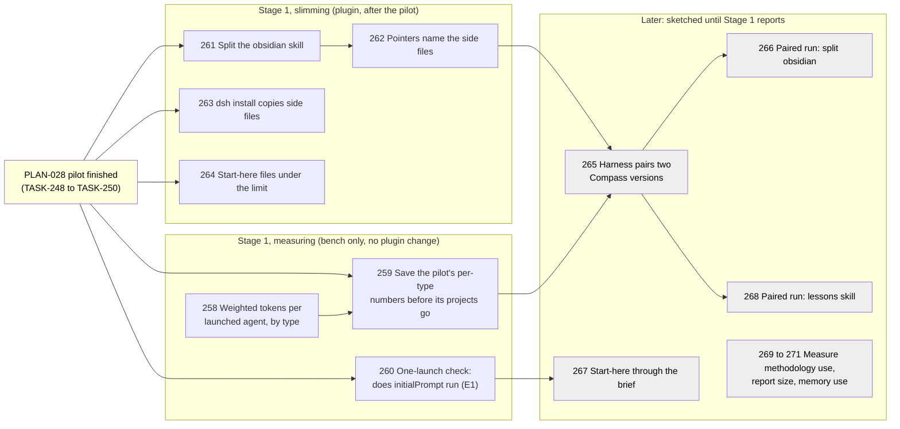

# Crafted Context for Each Launched Agent

Numbers are task ids. The yellow box is the pilot of [[PLAN-028-whole-overhead-on-real-projects]], which every plugin change waits for. A stage (written "Wave" in the headings below, which Compass's tools read) is a group of tasks planned in detail together; grey ones stay one-line sketches.

## Rulings

Approved 2026-11-05 with these readings of the approved rulings: (1) the `obsidian` skill is split once, for every agent that preloads it, so the planner, researcher, reviewer and pr-describe read the templates side file before writing a document; (2) the start-here files reach agents through the brief the orchestrating skills write, with a hook used only if the brief route fails; (3) the `lessons` skill stays in every agent until TASK-268's paired run; (4) every plugin change lands after PLAN-028's TASK-250. The capability removals at the end are questions, not tasks.

## Goal

This plan implements [[SPEC-027-compass-uses-fewer-tokens]], the spec (what we need: Compass uses fewer tokens without losing quality), from the four approved rulings and the ranked changes of [[research/whole-overhead/REVIEW-agent-context-2026-11]]. A launched Compass agent today starts with about 39k tokens, 60% of them preloaded skill bodies; `obsidian` alone is 36.9k characters and is 44% to 57% of skill tokens. Design A cuts that with no hook: the always-loaded part of each skill holds only what every launch needs, and the rest sits in side files an agent reads when its task calls for them. Every change is judged by one number: weighted tokens per launched agent, per agent type, at equal task outcome, measured with `bench/overhead/token_profile.py` on builds the pilot harness runs.

## The waves

**Stage 1, measuring.** Today's profiler adds every session of a project into one table, so it cannot say what a builder or a validator costs per launch. Stage 1 first gives it that per-type number, saves the pilot's per-type numbers as the "before" figures while the pilot's transcripts still exist, and runs the one-launch check (E1) that says whether the start-here read declared in eight agent files ever runs. None of this touches `plugin/`.

**Stage 1, slimming.** Once the pilot has finished, the `obsidian` skill is split into a short always-loaded part (the link rule and the properties rules) and side files, every pointer into the old sections is moved to the file that now holds them, the other-host install copies side files, and the start-here files come back under their 5,000-token limit. Stage 1 ends when the automated checks pass and you confirm the manual checks; the paired runs that judge these changes at equal outcome are the next stage, because their size comes from the pilot's batch size.

**Later stages** pair two Compass versions in the harness, run the paired comparisons for the split skill and for the `lessons` skill, deliver the start-here files through the brief once E1 has answered, and measure the three remaining unknowns (`methodology` use, report size, agent memory use).

## Prerequisites

- PLAN-028's TASK-248 (the pilot) has closed its twelve builds before TASK-259 and TASK-260 start; TASK-259 runs before TASK-250 discards the pilot's projects, since discarding purges their transcripts.
- PLAN-028's TASK-250 is checked off before any of TASK-261 to TASK-264 is merged: the pilot refuses to start with `plugin/` changed and records one plugin sha per build, and its ablation calls measure the current `obsidian` skill.
- `python -m pytest bench/overhead/tests -q -p no:cacheprovider` and `python -m pytest plugin/cli/tests -q` pass at the starting commit.

## Desired End State

- `python bench/overhead/token_profile.py PROJECT --by-agent` prints, per agent type, the launch count, mean weighted tokens per launch and each source family's share; `bench/overhead/compare.py` compares two saved sets per agent type and refuses a verdict when the outcome counts differ.
- The pilot's per-type figures sit under the private records root, aggregates only, as the "before" set.
- A research note states whether `initialPrompt` runs for an installed subagent, from one launch's transcript.
- `plugin/skills/obsidian/SKILL.md` is under 10,000 characters [guess] and holds the link and properties rules; every section it held before lives in exactly one side file beside it; no shipped text points at a section that moved.
- `compass hot-path` prints a total at or under 5,000, and a `compass sync` run leaves it there.

## What We're NOT Doing

- No hook of any kind (ruling 1); a `SubagentStart` hook comes in only through TASK-267 if the brief route fails.
- No removal of the `lessons` skill from any agent (ruling 3) before TASK-268 shows equal outcome.
- No task packet command (design B), no report cap, no `omitClaudeMd`, no change to `methodology` or to agent memory; the last three are measured only (TASK-269 to TASK-271).
- No removal of the Agent tool or of `memory: project`; both are questions below.
- No change to `plugin/` while the pilot runs.

## Phases

### Wave 1 (detailed): measure per agent type, check initialPrompt, split obsidian

TASK-258 starts now. TASK-259 and TASK-260 start when the pilot's builds have closed. TASK-261, TASK-263 and TASK-264 run in parallel after PLAN-028's TASK-250, their files disjoint; TASK-262 follows TASK-261.

- [ ] TASK-258: Weighted tokens per launched agent, repo-local. `token_profile.py` gains a per-session-kind table: for each `subagent:<type>` the number of sessions, the mean and median weighted tokens per session, and the share of each source family (`group()`), kept in the summary as `by_agent`; `--by-agent` renders it. `bench/overhead/compare.py BEFORE AFTER` reads two folders of saved profile JSON and prints, per agent type, the mean weighted tokens per launch in each, the change, and a bootstrap 95% interval over sessions [guess]; given outcome files (the judge's per-goal scores and the test result per build), it prints "outcome differs" and no token verdict when the two sets' outcome counts differ - complexity: M, depends_on: none, files: [bench/overhead/token_profile.py, bench/overhead/compare.py, bench/overhead/tests/test_token_profile.py, bench/overhead/tests/test_compare.py, bench/overhead/README.md], lessons: [LESSON-measure-the-procedures-intermediates]
  - Automated verification: `python -m pytest bench/overhead/tests -q -p no:cacheprovider` passes: a fixture folder with two builder and one validator subagent sessions gives `by_agent` counts 2 and 1 and means equal to hand-summed weighted tokens; a subagent type outside the public names prints as `(other)`; `compare.py` on two fixture sets prints the hand-computed change, and on sets whose outcome counts differ prints no token verdict; the dash check (`python -c "import pathlib,sys; bad=[str(p) for p in pathlib.Path('bench/overhead').rglob('*') if p.suffix in {'.py','.md'} and any(chr(c) in p.read_text(encoding='utf-8') for c in (0x2013,0x2014))]; print(bad); sys.exit(bool(bad))"`) exits 0.
  - Manual verification: none; TASK-259 shows the table on real data.

- [ ] TASK-259: The "before" figures, saved while the pilot's transcripts exist. After PLAN-028's TASK-248 has closed its builds and before TASK-250 discards any project, run `token_profile.py --by-agent --json` on every Compass-arm pilot project and save the outputs under the private records root as `context-before/`, beside the plugin sha each build recorded; the per-type means go, as aggregates only, into a short section of the pilot report - complexity: S, depends_on: TASK-258, PLAN-028 TASK-248, files: [.compass/research/whole-overhead/RESEARCH-whole-overhead-pilot.md], lessons: [LESSON-measure-the-procedures-intermediates]
  - Automated verification: one saved file per Compass-arm pilot build; a scan of the report section finds no topic text, path or session id; the dash check on the report exits 0.
  - Manual verification: you see a per-type table (builder, tester, validator, planner, researcher, reviewer at least) and the numbers look like the review's 37k to 43k first-request range.

- [ ] TASK-260: The one-launch check E1, repo-local. `bench/overhead/probe_initial_prompt.py` runs one isolated session in a fresh sandbox project with Compass installed by `/compass:setup` (no `--plugin-dir` in the second session, per the double-load lesson), asks it to launch one `builder` with a two-line task, then reads the builder's subagent transcript and reports: whether its first turns hold Reads of the three start-here files, what its first user turn is, and whether its tool calls ran without permission prompts (the `permissionMode` doubt of the review's Conflicts). The result goes into `research/whole-overhead/RESEARCH-initialprompt-in-subagents.md`; runs only when no pilot build is running - complexity: S, depends_on: PLAN-028 TASK-248, files: [bench/overhead/probe_initial_prompt.py, bench/overhead/tests/test_probe_initial_prompt.py, .compass/research/whole-overhead/RESEARCH-initialprompt-in-subagents.md, .compass/research/whole-overhead/index.md], lessons: [LESSON-plugin-dir-plus-setup-double-registers-hooks, LESSON-headless-worker-denies-tools-silently]
  - Automated verification: `python -m pytest bench/overhead/tests -q -p no:cacheprovider` passes: against canned subagent transcripts the probe reports "ran" when the three Reads come before the brief's first tool call, "did not run" when they are absent, and "did not run" when only one of the three appears; a scan of the note finds no path or session id; the dash check exits 0.
  - Manual verification: you read the note's one-line answer.

- [ ] TASK-261: Split the `obsidian` skill. `SKILL.md` keeps "The one linking rule", "YAML frontmatter" with its status lifecycle, the "Wikilinks" table and a short table saying which side file holds what and when to read it. The other sections move, whole and unedited, to top-level side files beside it (the installer copies only top-level `.md` files of a skill): `templates.md` (Document templates), `documents.md` (Decision bullets, Documents the human reads, A view an agent writes, Plain words), `vault-layout.md` (Math, File naming, Hierarchical specs and plans, Children, Unit folders, Facet tags, Vault search patterns). `test_writing_rules.py` and `test_vault_bases.py` read the skill folder instead of `SKILL.md` alone - complexity: M, depends_on: PLAN-028 TASK-250, files: [plugin/skills/obsidian/SKILL.md, plugin/skills/obsidian/templates.md, plugin/skills/obsidian/documents.md, plugin/skills/obsidian/vault-layout.md, plugin/cli/tests/test_writing_rules.py, plugin/cli/tests/test_vault_bases.py, plugin/cli/tests/test_obsidian_skill_split.py], lessons: [LESSON-remove-context-before-adding]
  - Automated verification: `python -m pytest plugin/cli/tests -q` passes, including `test_obsidian_skill_split.py`: every `##` and `###` heading of the skill at the starting commit appears in exactly one file of the folder; the text under each moved heading is byte-identical to the original; `SKILL.md` is under 10,000 characters and names each side file; the frontmatter keys `test_vault_bases.py` finds are the same set as before the split; `grep -c "^## The one linking rule" plugin/skills/obsidian/SKILL.md` prints 1 (the check reads `plugin/`, since doctor and validate read only the local install).
  - Manual verification: you open `plugin/skills/obsidian/SKILL.md` in Obsidian and judge that the short part reads as complete on its own.

- [ ] TASK-262: Pointers name the side files. Every shipped line that points into a moved section names its new file: the pipeline rules (`compass-pipeline.md`, "Documents the human reads"), the `lessons` skill (the Lesson template), the `spec` skill ("Decision bullets", "Where a new artifact goes"), the `methodology` skill (unit-folder conventions), `writing-principles.md`, and the researcher's Marks line. The planner, researcher, reviewer and pr-describe agent bodies gain one line: before writing a vault document, read `templates.md` of the `obsidian` skill. A test resolves every "`obsidian` skill, section ..." and "file ..." pointer in `plugin/` to a heading in the named file - complexity: S, depends_on: TASK-261, files: [plugin/templates/rules/compass-pipeline.md, plugin/skills/lessons/SKILL.md, plugin/skills/spec/SKILL.md, plugin/skills/methodology/SKILL.md, plugin/skills/obsidian/writing-principles.md, plugin/templates/agents/planner.md, plugin/templates/agents/researcher.md, plugin/templates/agents/reviewer.md, plugin/templates/agents/pr-describe.md, plugin/cli/tests/test_obsidian_pointers.py]
  - Automated verification: `python -m pytest plugin/cli/tests -q` passes, including a pointer naming a heading that does not exist in its file failing the new test; `grep -rn "obsidian/SKILL.md" plugin/skills plugin/templates` finds no pointer to a moved section; the pipeline rules stay within `PIPELINE_MAX_LINES`.
  - Manual verification: none.

- [ ] TASK-263: The other-host install copies skill side files. `materialize_dsh_skills` writes every top-level `.md` beside `SKILL.md` into `.dsh/skills/compass-<name>/` unchanged, so the side files `obsidian` and `research` already ship reach dsh - complexity: S, depends_on: PLAN-028 TASK-250, files: [plugin/cli/hostlib.py, plugin/cli/tests/test_hostlib.py]
  - Automated verification: `python -m pytest plugin/cli/tests -q` passes: a fixture skill with two side files lands all three files; a side file removed from the source is removed from the install; a user's own `.dsh/skills/` folder is untouched.
  - Manual verification: none.

- [ ] TASK-264: The start-here files back under their limit. `compass sync` re-adds every handoff line that was moved to `archive/handoff-pointers.md`, which is why the index is over its limit again (5,178 of 5,000); the fix makes sync count an artifact as indexed when the section links a document that links it. Then the handoff lines below "Older handoffs" in `.compass/index.md` move into `archive/handoff-pointers.md`, none deleted - complexity: M, depends_on: PLAN-028 TASK-250, files: [plugin/cli/commands/sync.py, plugin/cli/tests/test_sync_pointer_documents.py, .compass/index.md, .compass/archive/handoff-pointers.md]
  - Automated verification: `python -m pytest plugin/cli/tests -q` passes: a handoff linked only from a pointer document the section links is not re-added; a handoff linked nowhere is still added; a pointer document two links away does not count; `.claude/cli/compass sync` then `.claude/cli/compass hot-path` prints a total at or under 5000; every handoff link removed from the index appears in `archive/handoff-pointers.md` (`grep -c`).
  - Manual verification: you open the Handoffs section of the index and find the older ones one click away.

**Pause point:** when the automated checks pass, wait for you to confirm the manual checks of TASK-259 to TASK-261 and TASK-264 before Stage 2 is detailed.

## Later (intent only)

- [ ] TASK-265: The harness pairs two Compass versions: the Compass arm can load the plugin from a given commit (a temporary worktree of `plugin/`), so the same topics run on the "before" and "after" commits, each build recording which - files: [bench/overhead/drive.py, bench/overhead/launch.py, bench/overhead/pilot.py]
- [ ] TASK-266: Paired run of the split skill (E5 and E9): the pool's topics on the commits before and after TASK-261 and TASK-262, at the pilot's batch size; `compare.py` gives weighted tokens per launched agent per type at equal judged outcome, and counts link-rule and properties misses and side-file reads per type - lessons: [LESSON-blind-the-author-in-self-validation]
- [ ] TASK-267: The start-here files reach agents through the brief, as TASK-260's answer directs: the orchestrating skills (build, plan, research, research-codebase, research-papers, validate, autopilot, diagnose) put the start-here excerpt in each Agent prompt; the dead `initialPrompt` leaves the eight agent files and the methodology frontmatter template; `hot_path.py` and the template test describe the brief - files: [plugin/skills/build/SKILL.md, plugin/skills/plan/SKILL.md, plugin/skills/research/SKILL.md, plugin/skills/research-codebase/SKILL.md, plugin/skills/research-papers/SKILL.md, plugin/skills/validate/SKILL.md, plugin/skills/autopilot/SKILL.md, plugin/skills/diagnose/SKILL.md, plugin/templates/agents/, plugin/skills/methodology/agent-frontmatter.md, plugin/cli/commands/hot_path.py, plugin/cli/tests/test_apply_models.py]
- [ ] TASK-268: Paired run of the `lessons` skill for tester, reviewer, validator and researcher: with and without it, judged on outcome and on `capture-note` and `lesson-coverage` use; the skill leaves an agent only where the outcome is equal, put to you first - lessons: [LESSON-blind-the-author-in-self-validation]
- [ ] TASK-269: Measure per-section use of the `methodology` skill in the saved transcripts, ranked by weighted tokens
- [ ] TASK-270: Measure each subagent's returned report size against the 1,000 to 2,000-token band (E8)
- [ ] TASK-271: Measure agent memory: reads and writes of each type's memory folder, and the MEMORY.md share of the 14.3k-character memory section (E7)

## Questions for you (not planned as tasks)

These remove a capability, so they stay out of the plan until you rule on them; TASK-266 and TASK-271 give the numbers for each.

1. Remove the Agent tool from agent types that rarely delegate (2.6% to 3.7% of weighted tokens; one Agent call in 95 sessions)? The builder's body tells it to spawn a code-review sub-agent, the debug agent spawns three, the planner uses pattern-finder and the researcher spawns per axis, so each of those loses a step its body describes.
2. Drop `memory: project` from the agent types that never read or write their memory folder (the section is 55% to 74% of their system prompt)? Each loses its notes across sessions.
3. Set `omitClaudeMd: true` on launched agents (1.2% to 1.8% of weighted tokens)? The pipeline rules reach agents only through those files, so they would have to be restated in the brief.

## Risks

- The pilot overruns and Stage 1's slimming waits: TASK-258 to TASK-260 still proceed, and the plugin tasks are small enough to rebase.
- TASK-259 misses its window and the pilot's transcripts are purged: TASK-259's ordering against TASK-250 is a named prerequisite, and the saved profiles PLAN-028 already writes keep the whole-project totals as a fallback.
- Writer agents skip the templates side file and write malformed documents: TASK-266 counts properties and link-rule misses per type; `compass validate` catches malformed properties on write.
- LOOP-004 of PLAN-028 (TASK-254) also changes the biggest area in `plugin/`: its baseline batch (TASK-251) records the plugin sha, so a baseline taken after this Stage 1 lands measures the slim agents [guess: Stage 1 lands before TASK-251 starts].
- The review's approved rulings are a numbered list, not decision bullets (`- **D-NN:**`), so `compass coverage` tracks none of them; this plan carries them in its Rulings section and its task text.
