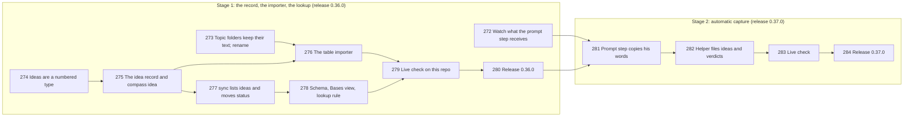

# Ideas Keep Their Status



> [!note] Approved 2026-11-19
> Stage 1 in full and stage 2's shape, with these choices:
> - The prompt step records a weak hint, so talk holding only ideas opens a helper pass at the capture interval of 12 turns (`capturelib.py:62-65, 291-318`), not after every prompt; a pass costs about $0.33 (median of 57 runs, finding 9 of the research).
> - Naming an idea in a spec, plan or ADR's `ideas:` property moves it to `adopted` whatever that document's own status, a draft spec included.
> - The helper files a new idea into the best existing category and creates a category only when none fits, its "What belongs here" line marked `[guess]` for you to edit.
> - A repeat is an idea whose words match an existing idea's words exactly; the same idea in other words becomes a second idea.
> - An idea's file name is its number plus the first five of his words.
> - `compass idea find` with no exact match ranks ideas by words shared with the question and prints the top five.
> - If Obsidian cannot group the table view by category folder, the view groups by status and shows the folder as a column.

## Goal

This plan implements [[SPEC-033-ideas-keep-their-status]] (what we need: every idea he gives is kept in his words, with a current status and where it led, findable by any later session) from [[RESEARCH-ideas-keep-their-status]]. Each choice follows the option the human approved at that research's forks F1 to F8: `decided` maps to `adopted` per F5, and an imported status outside the list keeps its text per F8.

Each idea is one file in a category folder: his words copied by code, a status, a dated history, and links to where it led. A spec, plan or decision record (ADR) that an idea shaped names it in an `ideas:` property, and `compass sync` moves the idea to `adopted`. An agent asked "what happened to idea X" runs `compass idea find`, which the always-loaded pipeline rules name. Ideas from past sessions come in through an importer reading a hand-made table.

## The waves

Stage 1 builds everything that does not wait on an observation: the idea record and its command, the importer, the status upkeep in sync, the Obsidian table view, and the lookup rule. It ships as 0.36.0, so a project with a hand-made idea table can import it at once. The same stage records what the prompt step (`UserPromptSubmit`) really receives on this machine, since the step that copies his words is written against that record. Stage 1 ends at the human's check of the table view in Obsidian and the lookup answer from a fresh session.

Stage 2 turns capture on: the prompt step copies each of his prompts into a raw log, the background helper (the capture worker) reads it and files new ideas and his drop or park verdicts, and 0.37.0 ships it. Stage 2 is listed by intent only: its first task is written against TASK-272's record of what the prompt step receives, so its detail follows that record.

## Current State

Read against `36b30f3`. Each task names the code it starts from.

- Ideas have no artifact type, no number prefix and no folder; topic folders lose their "What belongs here" text on undo and cannot be renamed.
- `compass sync` writes a folder listing for lessons only, and no property moves another document's status.
- No automatic step sees his messages: the steps that exist see tool calls and subagent replies (finding 1 of [[RESEARCH-ideas-keep-their-status]]).
- The start-here files stand at 4412 of 5000 tokens.

## Desired End State

- `ideas/<category>/IDEA-NNN-<slug>.md` files exist, each holding his words verbatim, a status from `new`, `exploring`, `parked`, `adopted`, `done`, `dropped`, a `## History` of dated lines, `led_to` links and a `led_to_note`.
- `compass idea add|status|find|import` works, dry-run by default, `--apply` to write.
- A spec, plan or ADR listing an idea in `ideas:` moves it from `new` or `exploring` to `adopted` at the next sync, with a history line; `parked`, `dropped`, `done` and `adopted` never move back.
- Each category folder's `index.md` carries a sync-written `## Ideas` listing; `ideas/index.md` lists categories with counts; Obsidian shows `ideas.base` grouped by category and by status.
- A fresh session asked about an idea answers with his words, status and where it led, from the vault alone.
- After stage 2: his prompts reach `.compass/tmp/prompt-log.jsonl` at submit, and the helper files ideas and verdicts from it with no request from him.

An idea file (made-up example):

```markdown
---
title: "IDEA-007: what if the map remembers where you died"
type: idea
status: adopted
words: "what if the map remembers where you died, like a scar on the ground"
led_to: ["[[SPEC-004-world-memory]]"]
led_to_note: "[[SPEC-004-world-memory]]: scars fade after a day"
raw_status: ""
source: "backfill row 7"
tags: [idea, gameplay]
created: 2026-11-19
updated: 2026-11-19
---

> what if the map remembers where you died, like a scar on the ground

## History

- 2026-11-19: adopted (imported; status as written: "adopted")
```

## What We're NOT Doing

- Past ideas come in through a hand-made table; transcripts and `clone-old` stay out of backfill (findings 38 to 40 of [[RESEARCH-ideas-keep-their-status]]).
- Status records what happened to an idea; ranking ideas and turning one into a spec stay with the human, who adopts through the `ideas:` property.
- Each idea said in other words is its own file; merging near-duplicates is outside this plan.
- Obsidian views come from Bases, which ships with Obsidian; Dataview and a compass-review list view are outside this plan.
- The raw prompt log lives in gitignored `tmp/` for its whole life, outside the log ageing into `archive/logs/`, since it can hold anything he typed.

## Prerequisites

- PyYAML in the test environment, for the round-trip checks against a real YAML reader (`test_vault_bases.py` already skips without it).
- Files shared with PLAN-031, the plan for [[SPEC-032-screenplays-in-the-vault]]: this plan owns only these lines in them.
  - `plugin/cli/review_surfaces/obsidian.py`: the `BASE_FILES` tuple, appending `"ideas.base"` (TASK-278). Nothing else in that file.
  - `plugin/cli/maincli.py`: the `idea` entry and the `make-domain` help line in `COMMAND_SPECS` (TASK-275).
  - `plugin/skills/obsidian/SKILL.md`: appended keys in the properties block (TASK-278).
  - `plugin/templates/rules/compass-pipeline.md`: one new `## Ideas` section (TASK-278).
  - `plugin/.claude-plugin/plugin.json`: the version line (TASK-280, TASK-284).
  - Merge rule: the plan that merges second rebases its own line-level edits onto the first, keeps the other plan's entries, and bumps the version from whatever the first released.

## Phases

### Wave 1 (detailed): the record, the importer, the lookup

- [x] TASK-272: Record what `UserPromptSubmit` hands a command on this machine - complexity: S, depends_on: none, files: [plugin/cli/tests/fixtures/user_prompt_submit/, .compass/research/learning/RESEARCH-ideas-keep-their-status.md], lessons: [LESSON-hook-payloads-observe-before-coding]
  - Starts from `plugin/hooks/hooks.json` (no `UserPromptSubmit` entry) and finding 2 of [[RESEARCH-ideas-keep-their-status]] (its documented payload, untested here).
  - The probe is a local setting removed at the end of the task; nothing shipped reads it. Add a probe entry to this machine's `.claude/settings.local.json` (the file's other entries untouched) whose command appends stdin plus a timestamp to `.compass/tmp/ups-probe.jsonl` through the same `[ -f ... ] || exit 0; ... python3 ... else python` shell wrapper `hooks.json` uses. Drive cases with `claude -p --input-format stream-json --output-format stream-json --verbose`: a typed line, a multi-line prompt, Brazilian Portuguese with accents, a slash command, a second message sent while the first is still running, and a background subagent finishing. Time the step with a no-op command and with a Python start. Remove the probe entry.
  - Save one JSON file per case under `plugin/cli/tests/fixtures/user_prompt_submit/`, prompts being the probe's own text. Append one finding to [[RESEARCH-ideas-keep-their-status]] naming the fields present, how each non-human turn is told apart (or that it is not), whether the queued second message fires the step, encoding of accents, and the measured per-prompt time.
  - Automated verification: every fixture parses as JSON and holds `prompt` and `session_id`; `git diff --stat .claude/settings.local.json` is empty after removal (or the file matches its pre-task copy); `grep -c "UserPromptSubmit" .compass/research/learning/RESEARCH-ideas-keep-their-status.md` rises.
  - Manual verification: if stream-json cannot reproduce the queued message or the subagent report, the human sends those two in one interactive session with the probe on; otherwise none.

- [x] TASK-273: Topic folders keep their scope text on undo, and can be renamed - complexity: M, depends_on: none, files: [plugin/cli/commands/make_domain.py, plugin/cli/tests/test_make_domain_rename.py]
  - Starts from `make_domain.py:73-107` (`--undo` runs `shutil.rmtree`, deleting the scope text) and `move.py:197` (`_rewrite_links`).
  - `--undo` moves the folder's `index.md` to `archive/domains/<path>/index.md` (a numbered suffix on collision) before removing the empty folder; its output names the archive path.
  - `--rename <old> <new>`: refuses a missing source, an existing target, a target in another type dir, or a new name that is not a valid sibling; moves the folder (`git mv` when tracked, a filesystem rename otherwise), rewrites path-qualified links through `move._rewrite_links`, sets the index's `title` and first tag to the new name, keeps its Scope text byte for byte, and logs a sizing row (`action: rename`). Dry-run by default, `--apply` with `--reason`.
  - `--title "<text>"` sets the created index's title, keeping the folder name from the path; `_template` takes the title.
  - Automated verification: new tests run against temporary vaults: undo leaves the scope text at the archive path with identical bytes; undo twice on same-named folders keeps both copies; rename keeps the scope bytes, rewrites a path-qualified link in another document, leaves a bare link and inline-code mention untouched, and refuses each of the four bad inputs with zero changes; `--title` with quotes and a colon round-trips through `vaultlib.parse_frontmatter`. `python -m pytest plugin/cli/tests -q` passes.
  - Manual verification: none.

- [x] TASK-274: Ideas are a numbered artifact type - complexity: S, depends_on: none, files: [plugin/cli/vaultlib.py, plugin/cli/commands/next_num.py, plugin/cli/tests/test_idea_type.py]
  - Starts from `next_num.py:21-29` and `vaultlib.py:17-30, 88-93`: an `ideas/` holding only category folders is classified as nothing.
  - `ideas` joins `CORE_TYPE_DIRS`; `TYPE_TO_DIR["idea"] = "ideas"`; `PREFIX["idea"] = "IDEA"`.
  - Automated verification: new tests: `next-num idea` returns `001` on an empty vault and one more than the highest `IDEA-NNN` across two category folders; an `ideas/` holding only an empty category folder classifies as a type dir; `make-domain ideas/world-building --class-here x --reason y --apply` succeeds on it; `make-unit ideas` is refused as reserved. `python -m pytest plugin/cli/tests -q` passes.
  - Manual verification: none.

- [x] TASK-275: The idea record and `compass idea add|status|find` - complexity: M, depends_on: TASK-274, files: [plugin/cli/idealib.py, plugin/cli/commands/idea.py, plugin/cli/maincli.py, plugin/cli/tests/test_idealib.py, plugin/cli/tests/test_idea_command.py]
  - Starts from `vaultlib.py:208-222`: the properties reader undoes only an escaped quote and backslash; `yaml_double_quote` writes.
  - `idealib` reads and writes idea files in the shape under Desired End State. `words` is written as a double-quoted scalar on one line and as a `|-` block scalar when it holds a newline; the body blockquote repeats it, each line prefixed `> `. It sets `status`, appends to `led_to` (never removes), and appends `## History` lines `- YYYY-MM-DD: <old> -> <new> (<reason>)`, editing only the lines it owns.
  - `verbatim(words, source_text)` is true only when `words` is an exact substring of `source_text`. The prompt log row it reads is `{"id": "<session_id>:<n>", "at": "<iso>", "session_id": "...", "prompt": "..."}` in `.compass/tmp/prompt-log.jsonl`.
  - `compass idea add --category <slug> --words "<text>" [--source <prompt-id>] [--status <s>] [--apply]`: with `--source`, refuses words that are not verbatim in that logged prompt; refuses words matching an existing idea's words exactly, naming it; refuses an unknown status or a missing category folder; numbers with `next-num idea`; slug from the first five words.
  - `compass idea status <IDEA-NNN> <status> [--words "<his sentence>" --source <prompt-id>] [--led-to "[[doc]]"] [--apply]`: appends one history line quoting his sentence when given, verbatim-checked the same way.
  - `compass idea find "<text or IDEA-NNN>"`: an id prints that idea; text matches case-insensitive substrings of `words`, `led_to_note` and title, and with no substring hit ranks ideas by shared words and prints the top five. Each hit prints id, category, status, his words, `led_to`, `led_to_note` and the history lines. No hit prints one line saying so; exit 0.
  - `COMMAND_SPECS` gains `idea` and the `make-domain` line names `--rename` and that `--undo` archives the scope text.
  - Automated verification: round-trip tests through `vaultlib.parse_frontmatter` and PyYAML for words holding `"`, `\`, `: `, `#`, `[`, a leading `-`, `...`, accented Portuguese, and a newline; `verbatim` rejects a one-character change, trimmed whitespace and curly-for-straight quotes; add refuses each bad input with no file written; status on `dropped` with `--words` keeps the old line and adds one; find on an id, a substring, a no-substring word overlap and nothing. `python plugin/cli/compass idea find x` runs in this repo. `python -m pytest plugin/cli/tests -q` passes.
  - Manual verification: none.

- [ ] TASK-276: `compass idea import <file>` reads a hand-made table grouped by category headings - complexity: M, depends_on: TASK-273, TASK-275, files: [plugin/cli/ideaimport.py, plugin/cli/commands/idea.py, plugin/cli/tests/test_idea_import.py, plugin/cli/tests/fixtures/idea_backfill/], lessons: [LESSON-autocrlf-churns-lf-writers]
  - Read the file as UTF-8 with an optional BOM, any line endings. Each `## ` heading is a category: slug for the folder, the heading text as its title through `make-domain --title`, created when missing, an empty section included. A table is a header row, a separator row, then rows; cells split on `|` not preceded by `\`, and `\|` unescapes to `|`. A row with other than four cells is skipped and reported.
  - Columns by position: number, his words, status, where it led. Words lose one surrounding pair of straight double quotes, nothing else. The table number becomes the IDEA number when free, otherwise the next free number, reported as a remap. Status: the six values as written, case-insensitive; `decided` becomes `adopted` (F5); anything else, a compound value like "spec approved, research running" included, becomes `exploring` (F8). `raw_status` keeps the cell text whenever the status differs from it, and every non-matching row is listed. Where it led: each link resolving in this vault goes to `led_to`; broken or ambiguous ones are reported; the whole cell, unescaped, is `led_to_note`. History: `- <date>: <status> (imported; status as written: "<cell>")`. A row whose words match an existing idea's words exactly is reported as present, not written.
  - Dry-run prints one line per row (id, category, status, first 60 characters of the words, links resolved and broken) and a report of categories to create, remaps, status rows, broken links and skipped rows; `--apply` writes the same, all files written LF.
  - Fixture: a made-up table in the shape of a project with a hand-made idea table (category sections, one empty; numbers out of order; CRLF), committed LF since `.gitattributes` normalizes line endings, the tests writing CRLF and BOM variants at run time. It holds a `[[doc\|alias]]` cell, a link followed by text, a plain-text cell, `decided`, a compound status such as "spec approved, research running", a duplicate number, a five-cell row, a broken link and `...` inside quotes.
  - Automated verification: tests on the fixture assert each rule above, that a second `--apply` writes nothing, that dry-run writes nothing (vault tree hash unchanged), and that every imported `words` equals the cell's inner text byte for byte. `python -m pytest plugin/cli/tests -q` passes.
  - Manual verification: none.

- [ ] TASK-277: sync lists ideas and moves status when a document names one - complexity: M, depends_on: TASK-275, files: [plugin/cli/commands/sync.py, plugin/cli/vaultgraph.py, plugin/cli/tests/test_sync_ideas.py, plugin/cli/tests/test_graph_ideas.py], lessons: [LESSON-append-only-index-misses-mutations]
  - Starts from `sync.py:359` (lessons left out of the root index), `sync.py:717-807` (the listing generator, fixed to lessons) and `vaultgraph.py:98-101` (`depends_on` and `lessons` make typed links).
  - The lessons listing becomes one generator taking a type dir, a heading and a line format; lessons output is byte-identical. Ideas: each category index gets `## Ideas`, one line per idea `- [[IDEA-NNN-slug]] - <status> - "<words, cut at 100 characters with ...>"`; `ideas/index.md` is created when missing and lists each category `(<n> ideas: <count per status>)` with its summary, then uncategorized ideas. Idea files are left out of the root index, as lessons are; category folder lines stay.
  - Adoption: for every non-idea artifact whose `ideas:` names an idea, sync adds the artifact to the idea's `led_to` once; an idea at `new` or `exploring` moves to `adopted` with `- <date>: <old> -> adopted ([[artifact]] names it)`; any other status gets `- <date>: named by [[artifact]]` once, status unchanged. An `ideas:` entry naming no idea is a line in the sync report. A rewritten idea file is reported as written only when its bytes changed.
  - `vaultgraph` reads `ideas:` as a `citation` link, so `compass graph impact IDEA-NNN` lists the adopting documents.
  - Automated verification: tests on temporary vaults: a spec naming a `new` idea makes it `adopted` with one history line, and a second sync changes no byte; `parked` and `dropped` stay; removing the property later leaves status and history; two documents naming one idea give two `led_to` entries and one status move; a broken entry reports; the existing `test_sync_lessons_indexes.py` passes unchanged; an idea file in a category folder adds no root index line; `graph impact` shows the citation. `python -m pytest plugin/cli/tests -q` passes.
  - Manual verification: none.

- [ ] TASK-278: Schema, the Bases view, and the lookup rule - complexity: M, depends_on: TASK-275, TASK-277, files: [plugin/skills/obsidian/SKILL.md, plugin/skills/obsidian/templates.md, plugin/obsidian/bases/ideas.base, plugin/cli/review_surfaces/obsidian.py, plugin/templates/rules/compass-pipeline.md, plugin/skills/methodology/SKILL.md, plugin/cli/tests/test_ideas_text.py]
  - Starts from `obsidian.py:32` (`BASE_FILES`), `self_update.py:456` (each update installs any missing base) and `test_vault_bases.py:29-50` (a base uses only schema keys); the pipeline rules stand at 111 of 141 lines and 10,059 of 12,419 bytes.
  - Obsidian skill: `idea` joins the `type` values; a status line for ideas (`new | exploring | parked | adopted | done | dropped`); keys `words`, `led_to`, `led_to_note`, `raw_status`, `source` (ideas) and `ideas` (spec, plan, decision) with one comment each. `templates.md`: `ideas: ["[[IDEA-NNN-slug]]"]  # OPTIONAL` in the Spec, Plan and Decision properties.
  - `ideas.base`: filter `type == "idea"`; table views "By category" (group by `file.folder`) and "By status", columns `file.name`, `status`, `words`, `led_to`, `led_to_note`. `BASE_FILES` gains `"ideas.base"`.
  - Pipeline rules, a `## Ideas` section of at most three lines: asked about an idea or what became of something he said, run `compass idea find "<his words or IDEA-NNN>"` and answer with his words, status, where it led and its history; a spec, plan or ADR an idea shaped names it in `ideas:`; capture is automatic, so never ask him whether to record an idea. Methodology skill: one sentence in the capability index naming `compass idea`.
  - Automated verification: `test_vault_bases.py` passes with the new base (keys named in the schema, table views); new `test_ideas_text.py` greps `plugin/` for the rule sentence, the `ideas:` key in all three templates, the six statuses, and asserts the pipeline rules stay within 141 lines and 12,419 bytes and hold no em-dash or en-dash character (U+2014, U+2013). `python -m pytest plugin/cli/tests -q` passes.
  - Manual verification: covered in TASK-279.

- [ ] TASK-279: Live check of stage 1 on this repo - complexity: S, depends_on: TASK-276, TASK-278, files: [.compass/ideas/, .compass/specs/learning/SPEC-033-ideas-keep-their-status.md]
  - `python plugin/cli/compass self-update --force` refreshes `.claude/`. Write, in the session scratchpad, a table in the importer's shape holding ideas this vault already quotes verbatim (the categorize sentence in SPEC-033's Desired Outcome among them), under two category headings; dry-run it, then `--apply`. Add `ideas:` naming the categorize idea to SPEC-033's properties; the hook's sync runs.
  - Ask a fresh headless session in this repo, with `--allowedTools "Read,Grep,Glob,Bash(python:*),Bash(python3:*)"`: "What happened to my idea about categorizing ideas?" Its answer is saved to `.compass/tmp/`.
  - Automated verification: `compass idea find categoriz` prints the idea at `adopted` with SPEC-033 in `led_to` and two history lines; `compass graph impact` on the idea lists SPEC-033 as `citation`; the saved answer contains the verbatim sentence, `adopted` and `SPEC-033`; `compass hot-path` stays at or under 5000; `compass validate` reports no new error.
  - Manual verification: in Obsidian the human opens `ideas.base`: the "By category" view groups by category folder and the "By status" view shows his words and the links. If grouping by `file.folder` shows nothing, the view groups by status with a folder column, and the human sees that version instead.

- [ ] TASK-280: Release 0.36.0 - complexity: S, depends_on: TASK-279, files: [plugin/.claude-plugin/plugin.json]
  - Bump `plugin/.claude-plugin/plugin.json` from 0.35.0 (or from PLAN-031's release, per the merge rule) to the next minor; commit "Release 0.36.0: ideas keep their words, status and history; compass idea imports a table of past ideas"; push master to origin. Each project's next session start self-updates from it.
  - Automated verification: `git log origin/master -1 --oneline` names the release commit; `python -m pytest plugin/cli/tests -q` passes on the release commit.
  - Manual verification: in a project with a hand-made idea table, a new session's `.compass/meta/plugin.yaml` reads the new version and `compass idea import <its table>` prints a dry-run with no skipped rows the human did not expect.

**Pause point:** when automated verification passes, wait for the human to confirm the Obsidian view and that project's dry-run before stage 2.

## Later (intent only)

- [ ] TASK-281: `compass prompt-log --hook`, a `UserPromptSubmit` step that appends each human prompt verbatim to `.compass/tmp/prompt-log.jsonl` in TASK-275's row shape, keeps out the non-human turns TASK-272 tells apart, exits at once under `COMPASS_WORKER_SESSION`, records a weak `human-prompt` hint, and installs for dsh (deepseek-harness, a second agent CLI Compass installs into) too - files: [plugin/cli/commands/prompt_log.py, plugin/hooks/hooks.json, plugin/cli/maincli.py, plugin/cli/tests/test_prompt_log.py, plugin/cli/tests/test_hooks_config.py]
- [ ] TASK-282: every background helper pass reads prompt-log rows past its cursor and runs an `extract-ideas` skill after lesson extraction, filing new ideas with `compass idea add --source` and drop or park verdicts with `compass idea status --words --source`, into the best existing category or a new one marked `[guess]`; `capture-close` counts ideas - files: [plugin/skills/extract-ideas/SKILL.md, plugin/cli/commands/capture_worker.py, plugin/cli/commands/capture_close.py, plugin/cli/tests/test_capture_worker_ideas.py]
- [ ] TASK-283: live check of stage 2 on this repo: a real session where he gives an idea and later drops another, the helper files both in his words, and a fresh session answers about each - files: [.compass/ideas/]
- [ ] TASK-284: release 0.37.0, push, and confirm that a project with a hand-made idea table gets prompt-log rows at its next session - files: [plugin/.claude-plugin/plugin.json]

## Risks

- The prompt step may not tell his turns from scheduled turns or subagent reports: TASK-272 records what the payload carries before TASK-281 is detailed; if nothing tells them apart, TASK-281 filters on the text markers finding 38 of [[RESEARCH-ideas-keep-their-status]] lists.
- The prompt step adds start-up time to every prompt: TASK-272 measures it; under the helper's own session the step exits before Python starts.
- Bases may not group by `file.folder`: TASK-279 checks it in Obsidian, with the status grouping as the fallback.
- His words in the properties could be altered by the vault's own reader: TASK-275 round-trips every hard character through both readers before anything writes an idea.
- This plan and PLAN-031 share five files: the Prerequisites list each line this plan owns and the merge rule.
- Task numbers here are provisional: the numbers each task takes in `active.md` and `backlog.md` are the binding ones, so a clash with PLAN-031's numbers resolves there.
