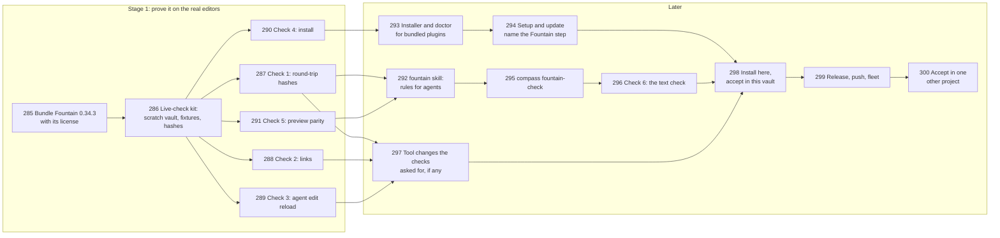

# Screenplays in the Vault

> [!note] Approved 2026-11-19
> The human approved the five live checks you run in Obsidian and VS Code, in one sitting on a scratch vault outside this repo, as the gate for every later task; and that Compass then installs Fountain into every project with an Obsidian vault, listing it as switched on when it first installs it, so a plugin you later turn off stays off (unless check 4 shows Obsidian drops that entry by itself).

## Goal

Fountain is a plain-text screenplay format. Fountain (by bgrundmann) is also the name of an Obsidian plugin that writes and previews it, and BetterFountain is the VS Code extension the human already uses for it. This plan builds what [[specs/human-surface/SPEC-032-screenplays-in-the-vault|Screenplays Live in the Vault (SPEC-032)]], the spec (what we need), asks for, along the six choices (forks) the human approved in [[research/human-surface/RESEARCH-screenplays-in-the-vault#Forks]]: Fountain by bgrundmann is the Obsidian plugin; scripts stay `.fountain` on disk; Obsidian notes link in with the extension written (`[[pilot.fountain]]`) and scripts link out with `[[>target]]`, the Fountain plugin's link written inside a script; Compass bundles the plugin's release files and widens its installer beyond Compass Review; Compass's own tools change only where a live check shows the need; agents follow a rule list and a text check that needs no parser.

Every behaviour the research reports was read from source code, so the six live checks it lists come first, and each later task names the check it rests on. Findings are cited by the research's labels (A1 to E9), each glossed where it is used.

## The waves

**Stage 1** proves the approach on the real editors before any shipped behaviour changes. Compass first commits the plugin's release files, pinned to version 0.34.3, and a small kit that builds a scratch vault holding test scripts, the plugin, and a note linking to the scripts, and records a fingerprint (SHA-256 hash) of every script. You then run five checks in one sitting [guess: 45 minutes]: you open and edit the scripts in both editors while the kit tells which bytes changed; you click the links; you watch an agent's edit appear in both editors; you switch the plugin on the way an install leaves it; you compare the two previews. The stage ends at a gate: the results sit in the research document and you confirm them. A check that fails stops the plan and its fork comes back to you.

**Later** turns the results into the shipped feature: a skill agents load only when they touch a `.fountain` file, the installer and doctor (Compass's health check) rows for the bundled plugin, a text check after agent edits, any tool change the checks asked for, then acceptance in this repo, the release, and acceptance in one other Compass project the human names at the time.

## Current State

Read against `36b30f3`.

- `plugin/cli/review_surfaces/obsidian.py:29-32` names one plugin: `PLUGIN_ID = "compass-review"`, `PLUGIN_FILES`, and `install_plugin`, `plugin_state`, `plugin_current`, `shipped_plugin_dir` and `doctor` all assume it. `install_plugin` (`:240-282`) copies the files atomically, appends the id to `community-plugins.json` keeping other entries, and leaves a list that does not parse untouched.
- `plugin/cli/review_surfaces/obsidian.py:137-143`: a review installs Compass Review on demand, without Bases views. `install` (`:285`) and `prepare` (`:166`) install plugin and Bases views; `reviewlib.install` (`plugin/cli/reviewlib.py:761`) runs every surface's `install`, and `self_update.py:447-457` calls it after copying `plugin/obsidian/` into `.claude/obsidian/`.
- The setup and update skills copy the whole `plugin/obsidian/` folder (`plugin/skills/setup/SKILL.md:89-90`, `plugin/skills/update/SKILL.md:71-72`), and `self_update.py:434-439` copies every `plugin/skills/*/` folder, so a new `plugin/obsidian/fountain/` and a new `plugin/skills/fountain/` ship with no copy code changed.
- `plugin/cli/commands/doctor.py:615-620` makes one `<surface> review` row per surface from `reviewlib.doctor_rows`.
- `install_plugin` checks only that a `.obsidian/` folder exists (`obsidian.py:250`), and `prepare` creates one when no vault holds the project (`:171-174`).
- `.gitattributes` sets `* text=auto eol=lf`, so git rewrites line endings of any text file committed here unless a path opts out.
- `plugin/cli/tests/test_doctor.py:685,716,776,1553,1624` count 16 doctor rows and `:902` lists the rows of every run; `test_review_editor_selection.py:371` expects the listing `["compass-review"]` after `review --editor obsidian`; `test_review_post_build.py:105` replaces `shipped_plugin_dir` with a no-argument function; `test_self_update.py:310-325` ships only Compass Review and expects `["dataview","compass-review"]`.
- BetterFountain's `big_fish_crlf.fountain` and `brick_and_steel_crlf.fountain` at commit `4f109ec` hold LF line endings only (its repo normalizes them), so a CRLF test file has to be made by the kit. BetterFountain 1.14.3 is installed here; the research read 1.14.2.
- Fountain 0.34.3 is the latest release (2026-08-29), MIT; its assets are `main.js` (sha256 `4a8815180e5fb35bbf03870579352360e5f0ab6dcd2b8ac560a331cb5924ea8a`), `manifest.json` (`797ede0e7ea10cfa5b82b087e67988a04f9a6a123b6e8fa8b175be49a5e9581f`) and `styles.css` (`cfdc14afce627463150ae8edde35e5b2a37d55056ee581a42b9fa3771457fe2c`), read through `gh release view` on 2026-11-19.
- This repo's vault already has `.compass/.obsidian/` with Compass Review on.

## Desired End State

- In every Compass project with an `.obsidian/` folder, an update leaves Fountain 0.34.3 in `.obsidian/plugins/fountain/` with its license, listed as enabled the first time, and doctor shows an `obsidian fountain` row.
- A `.fountain` file opens in Obsidian's Fountain view and in VS Code's BetterFountain, and round-trips with the byte changes Stage 1 recorded and no others.
- An Obsidian note's `[[pilot.fountain]]` opens the script; the script's `[[>target]]` opens the note.
- An agent about to edit a script loads the `fountain` skill, edits by its rules, and runs `compass fountain-check`, which reports each break the rules name and nothing on a clean edit.
- `plugin/.claude-plugin/plugin.json` carries a new minor version, pushed, and the projects on this machine run it.

## What We're NOT Doing

- Making scripts full vault documents: no index lines, tag index entries or reading of links inside scripts (fork 5, option 3).
- Fountain Reference Panel or any second third-party plugin (fork 3, option 2).
- Downloading plugins at install time (fork 4, option 2).
- Any screenwriting feature beyond what Fountain and BetterFountain give (spec Non-Goals).
- Committing BetterFountain's sample screenplays, which are third-party scripts: the kit downloads them into the scratch vault at run time.
- Writing the other project's path, name or details anywhere in Compass.

## Prerequisites

- Obsidian desktop and VS Code with BetterFountain installed on this machine, and `code` on the PATH.
- `gh` signed in, to download the release files.
- No other plugin in the scratch vault registers `.fountain` (the kit's vault holds none).

## Overlap with the idea-tracking plan

The plan for [[SPEC-033-ideas-keep-their-status|Ideas Keep Their Status (SPEC-033)]] ([[PLAN-030-ideas-keep-their-status]], its TASK-272 to TASK-284) ships a `.base` file through the same installer. Files both plans may touch, and the rule for each:

| File | This plan | Rule |
|---|---|---|
| `plugin/cli/review_surfaces/obsidian.py` | TASK-293 adds the bundled-plugin list and leaves `BASE_FILES` and `install_bases` as they are | whichever lands second rebases; PLAN-030's edit to `BASE_FILES` and this plan's plugin functions sit in separate functions |
| `plugin/cli/commands/doctor.py`, `plugin/cli/reviewlib.py` | TASK-293 adds the `obsidian fountain` row | same; rows are appended, never reordered |
| `plugin/cli/tests/test_doctor.py`, `test_review_editor_selection.py`, `test_review_post_build.py`, `test_self_update.py` | TASK-293 updates the row count, the listing and the stubs named in Current State | second to land rebases and recounts doctor rows |
| `plugin/skills/setup/SKILL.md`, `plugin/skills/update/SKILL.md` | TASK-294 names the Fountain step | same |
| `plugin/skills/obsidian/SKILL.md` | TASK-292 adds one row to the link table | PLAN-030 appends properties keys to its frontmatter block; separate sections, second to land rebases |
| `plugin/cli/maincli.py` | TASK-295 appends one `COMMAND_SPECS` entry | append-only; second to land rebases |
| `plugin/.claude-plugin/plugin.json` | TASK-299 bumps the minor version | the second release takes the next minor number |

Every other test this plan adds lives in a new file.

## Phases

### Wave 1 (detailed): prove it on the real editors

- [x] TASK-285: Bundle Fountain 0.34.3 with its license - complexity: S, depends_on: none, files: [plugin/obsidian/fountain/main.js, plugin/obsidian/fountain/manifest.json, plugin/obsidian/fountain/styles.css, plugin/obsidian/fountain/LICENSE, .gitattributes, README.md, plugin/cli/tests/test_obsidian_bundled_fountain.py]
  - `gh release download 0.34.3 -R bgrundmann/obsidian-fountain` into `plugin/obsidian/fountain/`; `LICENSE` from the repo at tag `0.34.3`, byte for byte. `.gitattributes` gains `plugin/obsidian/fountain/** -text` and `plugin/cli/tests/fixtures/fountain/** -text`, so git never rewrites these bytes or the test scripts' line endings. The README's License section gains one line: Compass bundles the Fountain Obsidian plugin 0.34.3 by bgrundmann under the MIT license, text in `plugin/obsidian/fountain/LICENSE`.
  - Automated verification: the new test asserts the SHA-256 of each of the three release files equals the digest in Current State, `manifest.json` reads `id` `fountain` and `version` `0.34.3`, and `LICENSE` begins `MIT License`; `git check-attr text plugin/obsidian/fountain/main.js plugin/cli/tests/fixtures/fountain/pilot.fountain` prints `unset` for both; `grep -n "Fountain" README.md` shows the line; `python -m pytest plugin/cli/tests -q` passes.
  - Manual verification: none.

- [x] TASK-286: The live-check kit: a scratch vault, test scripts and fingerprints - complexity: M, depends_on: TASK-285, files: [bench/fountain/livecheck.py, bench/fountain/tests/test_livecheck.py, plugin/cli/tests/fixtures/fountain/pilot.fountain]
  - `pilot.fountain` holds every construct the research names: a title page with an indented continuation line, a `# Snippets` section, nested `/* /* */ */` boneyard, `[[>links]]` pointing at the kit's note, a Fountain note `[[a note]]`, `=` synopses, dual dialogue with `^`, a `#1#` scene number, a transition, `>THE END<`, and a dialogue block held together by a two-space line.
  - `livecheck.py`, standard library only, with subcommands:
    - `setup <dir> [--offline]`: builds the scratch vault: `pilot.fountain` and three variants made from it at run time (`pilot-crlf`, `pilot-bom`, `pilot-no-final-newline`), BetterFountain's `big_fish_crlf.fountain` and `brick_and_steel_crlf.fountain` downloaded from its repo at commit `4f109ec` (skipped with `--offline`) and saved as they come, plus a CRLF copy of each made by the kit, a `links.md` note holding `[[pilot.fountain]]`, `[[pilot]]`, `![[pilot.fountain]]` and `[[missing.fountain]]`, `.obsidian/plugins/fountain/` and `.obsidian/plugins/compass-review/` copied from `plugin/obsidian/`, `community-plugins.json` listing both, `.vscode/settings.json` with `fountain.general.numberScenesOnSave` off, and the baseline fingerprints in `<dir>/.livecheck/`. It refuses a folder that is not empty and has no `.livecheck/`.
    - `open <dir> <script> [--editor obsidian|vscode|both]`: opens the script through `obsidian://open?path=<absolute path>` and `code <dir> -g <path>`, so VS Code reads the folder's settings.
    - `scenes <dir> on|off`: sets `fountain.general.numberScenesOnSave` in the folder's VS Code settings.
    - `hash <dir> --step <name>`: fingerprints every script, appends the step to `<dir>/.livecheck/steps.jsonl`, and prints one line per script, `unchanged` or `changed` with its CRLF, LF and lone-CR counts, byte-order mark, final newline, and the first 20 lines of the diff.
    - `listing <dir> [--add <id> | --remove <id>]`: prints `community-plugins.json`, or edits it the way the installer does (atomic write, other entries kept, a list that does not parse left untouched and named).
    - `report <dir>`: a markdown table, one row per script, one column per step.
    - `versions`: the bundled Fountain version and BetterFountain's version from `code --list-extensions --show-versions`.
  - Automated verification: `python -m pytest bench/fountain/tests -q` passes: `setup --offline` builds the tree and listing named above and the CRLF, BOM and no-final-newline variants differ from `pilot.fountain` only in those bytes; `setup` refuses a non-empty foreign folder; `hash` on an untouched vault reads `unchanged` for every script; one CRLF line turned LF, a byte-order mark removed, a final newline added and one changed character each read `changed` with the matching counts; `listing --add` keeps the other ids and leaves an unparseable listing byte-identical; `scenes on` then `scenes off` leaves the setting off and the rest of the settings file unchanged; `report` renders a row per script; the fixture holds each construct listed above; one test runs `setup` online, downloads both samples and finds CRLF in the kit-made copies, and is skipped when GitHub cannot be reached. `python bench/fountain/livecheck.py setup <scratch> --offline` then `hash <scratch> --step baseline` prints `unchanged` for every script.
  - Manual verification: none.

- [ ] TASK-287: Live check 1, round-trip hashes - complexity: S, depends_on: TASK-286, files: [.compass/research/human-surface/RESEARCH-screenplays-in-the-vault.md]
  - The agent runs `setup` (online) in a scratch folder outside the repo and `versions`, then walks the human through each step and runs `hash --step <name>` after it: open the folder as a vault in Obsidian and switch on Fountain; open and close every script in Obsidian; type and delete one character in each and let Obsidian save; the same two steps in VS Code; then the agent runs `scenes on` and the human repeats the type-and-delete step in VS Code.
  - **Pass:** open and close change no fingerprint in either editor; type, delete and save change none with `numberScenesOnSave` off. Recorded as facts, not failures: a change of line endings, byte-order mark or final newline, and scene numbers BetterFountain adds with `numberScenesOnSave` on; each becomes a rule in TASK-292. **Fail:** any other byte change; the plan stops and forks 1 and 2 return to the human with the diff.
  - The agent appends `## Live check results` to the research: date, Obsidian, Fountain and BetterFountain versions, the `report` table, and the confidence of finding B3 (line endings after an Obsidian edit) moved to what the check showed. Each result is one table row whose first cell is its id: `1.1`, `1.2`, and so on for check 1.
  - Automated verification: `grep -n "## Live check results" .compass/research/human-surface/RESEARCH-screenplays-in-the-vault.md` finds the section, and `grep -cE '^\| 1\.[0-9]+ \|'` on the same file counts one row per script per step; `python .claude/cli/compass validate` reports nothing new for the research.
  - Manual verification: the human performs the editor steps and confirms the recorded table matches what he did.

- [ ] TASK-288: Live check 2, links on the current Obsidian build - complexity: S, depends_on: TASK-286, files: [.compass/research/human-surface/RESEARCH-screenplays-in-the-vault.md], lessons: [LESSON-obsidian-bare-link-creates-stray-note]
  - In the scratch vault with Fountain on, the human clicks each link in `links.md` and the `[[>links]]` link inside `pilot.fountain`, types `[[pil` in a note, opens the script's backlinks pane and the graph with attachments shown, then renames `pilot.fountain` and `links.md` in Obsidian. The agent lists the vault folder after each click, since a click on a missing target creates a file.
  - **Pass:** `[[pilot.fountain]]` opens the script in Fountain's view, and `[[>links]]` opens `links.md`. Recorded as facts: whether the `[[` suggester lists the script, whether the backlinks pane lists `links.md`, whether the graph shows a node, what `[[pilot]]` and `![[pilot.fountain]]` do, whether "Show all file types" is needed, whether `[[missing.fountain]]` leaves `missing.fountain` or `missing.fountain.md` on disk, and whether each rename rewrites the link pointing at the renamed file. **Fail:** `[[pilot.fountain]]` does not open the script; fork 3 returns to the human.
  - Automated verification: `grep -cE '^\| 2\.[0-9]+ \|'` on the research counts one row per item above, and `grep -n "settled"` finds the backlinks and graph-node contradictions marked settled.
  - Manual verification: the human performs the clicks and confirms the recorded rows.

- [ ] TASK-289: Live check 3, an agent's edit reloads in both editors - complexity: S, depends_on: TASK-286, files: [.compass/research/human-surface/RESEARCH-screenplays-in-the-vault.md]
  - With `pilot.fountain` open in Fountain's view, in a second Obsidian pane, and in VS Code, the agent changes one dialogue line with its Edit tool. The human then types one word in the Obsidian pane and later one in VS Code; the agent runs `hash` after each.
  - **Pass:** the agent's line shows in all three views without reopening, and after both human edits the file holds the agent's line and both words. **Fail:** any view keeps the old text or saves it back; the fountain skill then tells agents to edit only scripts closed in the editors, and the human hears this before TASK-292.
  - Automated verification: `grep -cE '^\| 3\.[0-9]+ \|'` on the research counts a row per view plus the final diff.
  - Manual verification: the human watches the three views and types the two words.

- [ ] TASK-290: Live check 4, install the way Compass will - complexity: S, depends_on: TASK-286, files: [.compass/research/human-surface/RESEARCH-screenplays-in-the-vault.md]
  - Part one, before Obsidian opens: a fresh `setup` vault whose listing holds both plugins; the human opens it, turns off restricted mode if asked, and the agent records whether Fountain is on with no further step. Part two, with Obsidian running: `listing --remove fountain`, reload, then `listing --add fountain` while Obsidian stays open (an update landing mid-session); the human switches Compass Review off and on; the agent runs `listing` to see whether Obsidian kept `fountain`, and records whether Fountain loads before and after "Reload app without saving". The agent also reads the Custom File Extensions plugin's id and settings file from its repo, since finding A3 (only one plugin can own `.fountain`) says that plugin set to `.fountain` crashes Fountain.
  - **Pass:** with the files and the listing in place, a reload, or the switch the human flips, opens `.fountain` in Fountain's view. Recorded as facts, for TASK-293's enable steps: whether Obsidian rewrites the listing from memory and drops an entry added while it runs, and which step the human needs. **Fail:** Fountain never loads from files Compass placed; fork 4 returns to the human.
  - Automated verification: `grep -cE '^\| 4\.[0-9]+ \|'` on the research counts a row per step, each holding the listing printed after it.
  - Manual verification: the human flips the switches and reloads.

- [ ] TASK-291: Live check 5, the two previews side by side - complexity: S, depends_on: TASK-286, files: [.compass/research/human-surface/RESEARCH-screenplays-in-the-vault.md]
  - The human opens each script in BetterFountain's preview and in Fountain's read-only view and names every element the two show differently; the agent records them against finding B4 (the syntax the two parsers read differently).
  - **Pass:** each difference is one finding B4 names, or a new one that becomes a rule in TASK-292. **Fail:** one preview drops text the other shows outside boneyard, notes and snippets; the plan stops and fork 1 returns to the human.
  - Automated verification: `grep -cE '^\| 5\.[0-9]+ \|'` on the research counts a row per difference, each naming the B4 item it matches or "new".
  - Manual verification: the human compares the previews.

**Pause point:** when the five results sit in the research, the human confirms them; the Later tasks are detailed from those results.

## Later (intent only)

- [ ] TASK-292: The `fountain` skill, loaded when an agent reads, writes or edits a `.fountain` file: finding D1's rules (what an agent keeps when editing a script), the rules the results of checks 1, 3 and 5 add, the link conventions (notes link with the extension, scripts link out with `[[>target]]`, no properties block in a script), and `compass fountain-check` after every edit; one row in the obsidian skill's link table points to it; a text test holds its rules and size - files: [plugin/skills/fountain/SKILL.md, plugin/skills/obsidian/SKILL.md, plugin/cli/tests/test_fountain_skill_text.py]
- [ ] TASK-293: The installer and doctor handle a list of bundled plugins - complexity: M, depends_on: TASK-285, TASK-290, files: [plugin/cli/review_surfaces/obsidian.py, plugin/cli/reviewlib.py, plugin/cli/commands/doctor.py, plugin/cli/tests/test_obsidian_bundled_plugins.py, plugin/cli/tests/test_doctor.py, plugin/cli/tests/test_review_editor_selection.py, plugin/cli/tests/test_review_post_build.py, plugin/cli/tests/test_self_update.py], commit-upfront: `obsidian.py` is shared with PLAN-030, so its shape is fixed now for both plans to merge against
  - `obsidian.py` gains `BUNDLED_PLUGINS`, one entry per plugin: id, files, and whether a review needs it. Compass Review keeps its three files and is re-enabled on every install as today; Fountain carries its three release files and `LICENSE`, and is listed as enabled when its folder was absent before the install. If check 4 shows Obsidian keeps an entry added while it runs, later installs leave the listing alone, so a plugin the human switched off stays off; if Obsidian drops such an entry, the doctor row's `off` fix and the update notice carry the switch-on step instead. `plugin_state`, `plugin_current` and `shipped_plugin_dir` take the plugin id, defaulting to `compass-review`, so their callers and tests stay as they are. `install` and `prepare` install every bundled plugin and then the Bases views; a bundled plugin whose shipped files are missing is skipped and named while the others still install; a review's on-demand install (`configuration`) installs Compass Review only.
  - Fountain is copied but not enabled, and the result line names the other plugin, when another enabled plugin owns `.fountain`: a plugin other than `fountain` whose `main.js` matches `registerExtensions\(\s*\[[^\]]*["']fountain["']`, or Custom File Extensions with `fountain` in its settings (id and settings file as check 4 read them). Only one plugin can own an extension. A Fountain copy whose installed `manifest.json` version is newer than the bundled one is left in place [guess: the human updated it in Obsidian].
  - A surface may answer `extra_doctor_rows(compass_vault)`; `reviewlib.doctor_rows` appends them and doctor names each by its own label. Obsidian's `obsidian fountain` row: OK with no Obsidian vault; WARN absent, with `compass review --install`; WARN off, with the enable steps check 4 found; WARN when another plugin owns `.fountain`, naming it; OK on, with the installed version.
  - Automated verification: the new test file, on temporary vaults: an install writes four Fountain files byte-equal to the bundle and lists `fountain` once, keeping other ids; a second install with `fountain` removed from the listing leaves it removed; a vault with a fake enabled plugin whose `main.js` calls `registerExtensions(["fountain"], ...)` gets the files, no listing entry, and a line naming that plugin; the bundled Fountain `main.js`, which itself calls `registerExtensions(["fountain"]`, never counts as a conflict; an installed manifest at `0.35.0` is left in place; a missing Fountain bundle still installs Compass Review; a review's `configuration` installs no Fountain files; doctor shows each `obsidian fountain` state above with its fix; an unparseable listing stays byte-identical. `python plugin/cli/compass doctor` in this repo shows the row; the four existing test files named in Current State pass with the doctor row count, the listing and the stub updated; `python -m pytest plugin/cli/tests -q` passes.
  - Manual verification: the human reads the doctor row's wording in this repo after TASK-298.
- [ ] TASK-294: The setup and update skills name the Fountain switch in the step they hand the human, and the update skill counts an `obsidian fountain` WARN, like the review row, as a step only the human can take - files: [plugin/skills/setup/SKILL.md, plugin/skills/update/SKILL.md, plugin/cli/tests/test_fountain_skill_text.py]
- [ ] TASK-295: `compass fountain-check <file> [--before <path> | --rev <git rev>]` compares a script with its earlier text (default `HEAD`) and reports, one sentence per break with its line and code, an unclosed `/*`, a two-space line emptied, an added plain `[[...]]` whose text names a vault document, a title page no longer first, and a changed line ending, byte-order mark or final newline; exit 1 on any break - files: [plugin/cli/commands/fountain_check.py, plugin/cli/maincli.py, plugin/cli/tests/test_fountain_check.py, plugin/cli/tests/fixtures/fountain/breaks/]
- [ ] TASK-296: Live check 6: in a scratch vault, an agent with the fountain skill makes one edit per rule the check names that breaks it, and one edit that keeps every rule; pass when the check reports each break and nothing on the clean edit - files: [.compass/research/human-surface/RESEARCH-screenplays-in-the-vault.md]
- [ ] TASK-297: From checks 1 to 3, decide whether a Compass tool changes (the sync automatic step on script writes, a validate hint for a bare link to an existing script, a `.gitattributes` note for scripts); no change unless a check showed the need, and the reason goes in the research - files: [.compass/research/human-surface/RESEARCH-screenplays-in-the-vault.md]
- [ ] TASK-298: Install here with `python plugin/cli/compass self-update --force` and accept in this vault: doctor shows Fountain, the human switches it on, a script committed at `.compass/screenplays/sample.fountain` (a folder holding only scripts, kept as the vault's example) opens in both editors, a note's link to it opens it, an agent edit through the skill passes `fountain-check` and its transcript shows the skill loaded, and after the round-trip `git status` shows only the agent's edit to that script
- [ ] TASK-299: Release: bump `plugin/.claude-plugin/plugin.json` to the next minor at merge time, commit "Release X.Y.0: screenplays live in the vault", push on the human's word, then `python bench/scripts/fleet_update.py` (dry run) and `--apply` so the Compass projects on this machine run it; other machines update at their next session start - files: [plugin/.claude-plugin/plugin.json]
- [ ] TASK-300: Accept in one other Compass project the human names at the time: its self-update pulls the release, doctor shows Fountain, the human switches it on, one of his scripts opens unchanged in both editors, a note links to it, an agent edits a scene through the skill and the check, and `git diff` shows only that edit

## Risks

- **Fountain has one maintainer and has been quiet for 12 weeks** (finding A2, the plugin's maintenance): the bundle is pinned, so a stall changes nothing until Obsidian breaks it; a newer upstream release is a one-task bump of TASK-285's files and digests.
- **Git rewrites line endings in projects that normalize them:** this repo's `.gitattributes` turns CRLF into LF on commit, and other projects may do the same. TASK-298 and TASK-300 check `git status` on a committed script after the round-trip; a churn found there goes to TASK-297's decision.
- **Compass updates revert a Fountain copy the human installed from Obsidian** (the cost fork 4 names): TASK-293 leaves a newer installed version in place [guess].
- **An agent edits a script without loading the skill:** the skill's description names `.fountain`, and TASK-298's acceptance asks an agent to edit a scene and checks its transcript for the skill; `compass guard`, the automatic step that stops an agent from emptying a vault file, still blocks gutting a script.
- **Obsidian drops a listing entry added while it runs:** check 4 measures it before TASK-293 writes its enable steps.

## Inherited Questions (from spec)

- The spec's one question, whether an existing Obsidian plugin beats a Compass-built one, is resolved by fork 1: Fountain by bgrundmann. Stage 1's checks confirm it on the real editors, and a failed check returns the fork to the human.
