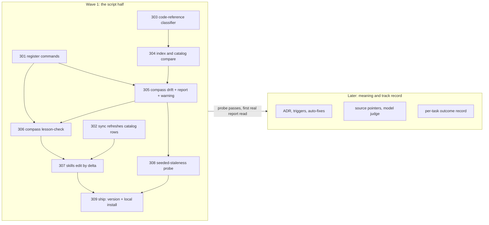

# Consolidation Grounded in Sources

## Goal

This plan implements [[SPEC-002-consolidation-grounded-in-sources]] based on [[REVIEW-consolidation-from-sources]] and [[AXIS-5-gap-pass]]. The vault's memory is rechecked against what it describes: every `file:line` reference against git, every index line against its target's `summary`, every catalog row against its lesson file. What no longer holds lands in a drift report with the old and new text beside it. Every lesson edit passes a mechanical check that nothing was lost before it counts. Later waves add the half only a model can judge (does the lesson still say what its source says) and each lesson's track record.

## The waves

**Wave 1** builds everything a script can decide, at zero agent tokens. A new command reads git history to tell which code references still point at the line they cited, which moved, and which point at code that changed; it compares index lines and catalog rows with the files they summarize; and it writes what it finds into a report document that `compass validate` points at. Sync stops leaving catalog rows stale. A second command checks that an edited lesson kept its displaced text and its 5-line cap, and the consolidate and lesson-write skills edit lessons by delta through it. A probe then plants known staleness in a throwaway clone and confirms the scan reports every planted item and nothing else. The wave ends at that gate: the probe passes and the human has read the first real drift report on this vault, which shows how much natural drift exists and whether the report is readable.

**Later waves** depend on what Wave 1 shows. How noisy the real report is decides which corrections code may apply on its own and where the scan runs automatically. Lessons need a tracked source pointer before a model can judge them against their source, and that judge needs a measured cost. The track record joins each task's cited lessons with its fix-loop and validator signals and stays report-only.

## Terms

- **Lesson fields:** `score` (1-10, raised each time the lesson recurs), `seen` (the dates it recurred), `escalated` (set after the third recurrence).
- **`## Record (preserved)`:** a section below a lesson's body, exempt from the 5-line cap, where text displaced from the body is kept.
- **The Data rule:** nothing destroys information; stale text is reported or moved colder, never deleted.
- **Fix loop:** the rerun of a task's builder after its tests fail, counted per task in `phase-summary.yaml`.

## Current State

- `plugin/cli/commands/sync.py:512-528` `_catalog_row` builds a row once; `_sync_catalog` (`:531`) skips any filename already present, so later edits to `score` or `summary` never reach the catalog (7 of 60 rows differ today, [[REVIEW-consolidation-from-sources]] claim 9).
- `plugin/cli/commands/sync.py:221-234` `_text_preserved`: an index line is dropped only when its text survives in the target.
- `plugin/cli/commands/validate.py:42-51,266-330` checks links, frontmatter, caps and sizing; it opens no `file:line` reference and no lesson body. Warning classes render through `PLAIN_SENTENCES` (`:442`).
- `plugin/cli/lessonslib.py:1-21` documents "sync appends rows but never rewrites existing ones"; `rank` uses `score` as the final tiebreak (`:157-220`).
- `plugin/skills/lesson-write/SKILL.md` 4a hand-stamps `escalated` onto the catalog row; 4b edits a row in place and moves displaced text to `## Record (preserved)`, checked by nothing.
- `plugin/skills/consolidate/SKILL.md` steps 3-4 (`:52-71`): a model merges and rewrites bodies, reported after the fact, no gate.
- `plugin/cli/maincli.py:19` `COMMAND_SPECS`; `plugin/cli/tests/test_maincli.py:13` asserts help lists every command.
- `bench/overhead/goals.py` freezes a goal list against a second write; the probe reuses that pattern.
- Measured natural drift on this vault ([[AXIS-2-recheck-against-sources]] f8-f10): 380 refs (132 unchanged, 118 shifted, 41 in an edited hunk, 1 missing, 57 unclassifiable); 108 missing paths; 11 of 123 index lines differ from the target `summary`.

## Choices taken as guesses

The review left six questions (forks) for the human; each guess below is the option the research recommended, or the gap pass's pairing for correction admission. Overturn any at this gate.

- [guess: fork 1, outcome signal: join plan `lessons:` with `phase-summary.yaml` and persist that per-task record outside `tmp/` (Later TASK-316).]
- [guess: fork 2, counter schema: record outcome per task and per cited set; derive a per-lesson figure only for lessons cited alone or across many tasks (Later TASK-317).]
- [guess: fork 3, where the recheck runs: a script writes a standing validate drift warning; a skill runs the model judge on it (TASK-305, Later TASK-314).]
- [guess: fork 4, no-cadence rule: it does not cover a drift recheck; an ADR rules it separate, gated by the zero-token scan so low-usage projects still cost nothing (Later TASK-310).]
- [guess: fork 5, stale catalog score: sync rewrites `score` and `summary` on existing rows from the lesson file (TASK-302), rather than `rank` ceasing to break ties on `score`.]
- [guess: fork 6, delta-only lesson edits: build them now with the mechanical Record and cap check (TASK-306, TASK-307).]
- [guess: correction admission: a mechanical ref fix or index resync is admitted by a mechanical check alone (Later TASK-312); a lesson body change is admitted by the mechanical check plus human review through `compass review`, one checkbox per lesson, the model judge supplying evidence and never the verdict (TASK-307). Capture-time refinements by `lesson-write` 4b get the mechanical check only, since that path runs headless and has no gate today.]

## Prerequisites

- `git` on PATH; the scan reads history, so a repository without git reports itself unsupported and exits 1.
- The research was written at commit 6faced1; the one later commit (de69024) touches only `plugin/hooks/hooks.json` and its test, no file this plan cites.
- Files other plans also edit: `plugin/cli/maincli.py` (every new command adds a line; here TASK-301 adds both), `plugin/cli/commands/validate.py` (here TASK-305 then TASK-306, in that order), and `plugin/cli/tests/test_doctor.py`, which hard-codes the number of doctor rows, so any task adding a row (Later TASK-311) updates that number.

## Desired End State

- `python plugin/cli/compass drift` on this repo writes a dated report listing every reference, index line and catalog row that no longer matches its source, each row carrying file, line, base commit, old text, current text and class; a clean run writes a log row and no report.
- `compass validate` shows one `drift_open` warning naming the latest report while it has findings.
- After any sync, every catalog row's `status`, `category`, `area`, `tags`, `score` and `escalated` equal the lesson file's; `summary` equals it whenever the old row text is kept elsewhere in the file.
- `python plugin/cli/compass lesson-check <lesson>` exits 1 when an edit drops body text that is not kept in the file, grows the body past 5 lines, or shrinks `seen`, `tags` or `score`.
- The seeded-staleness probe reports all seeded script-half items and zero controls on three random draws.

## What We're NOT Doing

- The model judge, source pointers on lessons and the track record: Later, after Wave 1's outcomes.
- Any cron, daemon or schedule; any deletion of stale text (the Data rule: drift is reported, replaced text moves colder).
- `helpful`/`harmful` or `cited_ok`/`cited_rework` integers on lessons; logging lesson reads from transcripts.
- Changing `rank`'s tiebreak on `score`.
- A recall harness for [[SPEC-028-agent-memory-is-good-enough]]; it measures a reader's recall, a different thing ([[AXIS-5-gap-pass]] f1).

## Phases

### Wave 1 (detailed): the script half

- [x] TASK-301: Register `drift` and `lesson-check` in `COMMAND_SPECS` with one-line help each; handlers arrive in TASK-305 and TASK-306 and report not-implemented until then - complexity: S, depends_on: none, files: [plugin/cli/maincli.py]
  - Automated verification: `python -m pytest plugin/cli/tests/test_maincli.py -q` passes (help lists both names); `python plugin/cli/compass --help` prints `drift` and `lesson-check`; `python -m pytest plugin/cli/tests -q` passes.
  - Manual verification: the two help lines read as plain sentences a newcomer understands.

- [x] TASK-302: Sync refreshes existing catalog rows from their lesson files: `status`, `category`, `area`, `tags`, `score` and `escalated` are rewritten whenever they differ; `summary` is rewritten only when the row's old text survives in the lesson file (same rule as `_text_preserved`), otherwise the row keeps it and sync reports `summary_unpreserved: <file>`; a row whose file is missing is left as is; the catalog is written only when a byte changes. Update the `lessonslib.py` docstring to state that sync owns every row - complexity: M, depends_on: none, files: [plugin/cli/commands/sync.py, plugin/cli/lessonslib.py, plugin/cli/tests/test_sync_catalog_refresh.py], lessons: [LESSON-append-only-index-misses-mutations]
  - Automated verification: new test file on temporary vaults: a raised `score` reaches the row; `escalated` set on the file reaches the row and survives a second sync; a summary edit whose old text sits in `## Record (preserved)` reaches the row; a summary edit whose old text is nowhere in the file leaves the row unchanged and prints `summary_unpreserved`; a row for a deleted file stays byte-identical; a lesson missing a required field leaves its row untouched; a second sync with no edits leaves the catalog's mtime and bytes unchanged; a duplicate row is still collapsed. In a `git clone --local` scratch copy of this repo, `python plugin/cli/compass sync` then a script comparing each row's `score` with its file reports 0 mismatches. `grep -n "never rewrites" plugin/cli/lessonslib.py` prints nothing. `python -m pytest plugin/cli/tests -q` passes.
  - Manual verification: the scratch copy's catalog diff shows only the 7 known score rows and the summary rows whose old text is preserved.

- [ ] TASK-303: `driftlib.py` code-reference classifier. Find each code-span reference `path:N` or `path:N-M` (comma lists included) in vault documents outside `archive/` and `tmp/`, where `path` starts with a top-level entry of `git ls-files`. Base commit per reference is the commit that last changed its line in the citing document, by `git blame --porcelain` [guess: blame in place of the research's add commit, since editing the citing line re-anchors it]. Classify against `git diff -U0 <base>..HEAD -- <path>`: `unchanged`, `changed-elsewhere` (edits only below the range), `shifted` (an edit above the range; reports the new line where the cited text is found), `changed` (an edit inside the range), `moved` (`git log --diff-filter=R -M` proposes the new path, with the rename commit and similarity), `missing`, `unclassifiable` (citing line not committed). Each result carries the old text (`git show <base>:<path>`) and the current text. With `--base-from add` the base is the commit that added the citing document instead, the fallback when blame is too slow - complexity: M, depends_on: none, files: [plugin/cli/driftlib.py, plugin/cli/tests/test_driftlib_refs.py]
  - Automated verification: new test file builds a git repo in a temp dir with one commit per seeded change and asserts each class on its exact boundary: a line inserted directly above the range is `shifted` with the right new line, one directly below is `changed-elsewhere`, an edit of the range's last line is `changed`; `git mv` gives `moved` with the commit sha, a rename with edits gives `moved` with similarity below 100; a deleted file gives `missing`; an uncommitted citing line gives `unclassifiable`; a citing line edited after the document was added classifies against its own commit under blame and against the add commit under `--base-from add`; `path:0`, `path:abc`, a line past the end of the file at base, and a path outside `git ls-files` are reported as malformed or ignored, never crash; a reference inside a fenced code block is still found and one in plain prose (no backticks) is not. `python plugin/cli/compass test-smells plugin/cli/tests/test_driftlib_refs.py` passes. `python -m pytest plugin/cli/tests -q` passes.
  - Manual verification: none beyond Wave 1's report read (TASK-305).

- [ ] TASK-304: Add the text checks to `driftlib.py`: each `[[link]] - desc` line in every `index.md` (parsed with sync's `ENTRY_PATTERN`) against its target's `summary`, newer side decided by commit dates of the target and of the index line; each catalog row against its lesson file's fields; output rows in the same record shape as TASK-303 - complexity: S, depends_on: TASK-303, files: [plugin/cli/driftlib.py, plugin/cli/tests/test_driftlib_text.py]
  - Automated verification: new test file on temporary vaults: an index line differing from its target `summary` by one character is reported with both texts; an identical one is not; a target with no `summary`, an unresolved link and an ambiguous link are each reported under their own class, never as drift; a catalog `score` one off from the file is reported; a row for a missing lesson file is reported as `missing`; a row equal to its file is not. `python -m pytest plugin/cli/tests -q` passes.
  - Manual verification: none beyond TASK-305.

- [ ] TASK-305: `compass drift` command. Runs both scanners and writes the findings to `.compass/archive/drift/DRIFT-<UTC>.md` [guess: the report's home; tracked, dated, one file per run with findings], opening with a count per class, then one row per finding with file, line, base commit, old text, current text, class and the git-proven proposal (new path or new line) where one exists. Every run, clean or not, appends one row to `.compass/archive/drift/log.jsonl` with the HEAD commit, counts per class and the report name or `clean`, so "ran, found nothing" differs from "never ran". `--print` writes to stdout only. Exit 0 on any findings; exit 1 only when git is unavailable or the vault is malformed. `compass validate` gains one `drift_open` warning, with a plain sentence, when the latest log row names a report - complexity: M, depends_on: TASK-301, TASK-304, files: [plugin/cli/commands/drift.py, plugin/cli/commands/validate.py, plugin/cli/tests/test_drift_command.py, plugin/cli/tests/test_validate_plain.py]
  - Automated verification: new test file: a temp repo with one seeded change writes one report and one log row; a clean repo writes a `clean` log row and no report; two runs append two rows and never rewrite the first; `--print` writes no file; a directory without git exits 1 with one line; validate shows `drift_open` naming the report after a dirty run and shows nothing after a later clean run; `plain_finding` renders the new class as a sentence. `python plugin/cli/compass drift --print` on this repo completes in under 60 seconds [guess: the time bound] and prints counts for every class. `python -m pytest plugin/cli/tests -q` passes.
  - Manual verification: the human reads the first real report on this vault (run in a scratch clone) and judges whether a row tells him what changed without opening another file.

- [ ] TASK-306: `compass lesson-check <lesson> [--base REV]` mechanical admission check, base default `HEAD`. Exit 1, naming the failing line, when: the body (text between the frontmatter and `## Record (preserved)`) exceeds 5 physical lines; a body line present at base is absent from the file; a Record line present at base is gone; `seen` or `tags` lost an entry; `score` fell; `created` changed. A lesson with no base revision is checked for the cap only. `compass validate` gains a `lesson_body_over_cap` warning for every lesson file - complexity: M, depends_on: TASK-301, TASK-305, files: [plugin/cli/commands/lesson_check.py, plugin/cli/commands/validate.py, plugin/cli/tests/test_lesson_check.py, plugin/cli/tests/test_validate_plain.py]
  - Automated verification: new test file in a temp git repo: a 5-line body passes and a 6-line body fails; a body line moved verbatim into Record passes; the same line moved with one character changed fails; a line dropped from Record fails; `seen` with a date appended passes and with one removed fails; tags unioned passes; score raised passes and lowered fails; a brand-new uncommitted lesson gets the cap check only; a file with no frontmatter exits 1 naming the cause. Validate shows `lesson_body_over_cap` for a 6-line lesson and nothing for a 5-line one, and `plain_finding` renders it as a sentence. In a `git clone --local` scratch copy of this repo, every unedited lesson exits 0 with `--base HEAD`; deleting one body line from one lesson there makes it exit 1 naming that line. `python -m pytest plugin/cli/tests -q` passes.
  - Manual verification: none.

- [ ] TASK-307: Skills edit lessons by delta. `consolidate` step 3 (merge) and step 4 (rewrite) move displaced lines verbatim into `## Record (preserved)`, run `compass lesson-check` after each edit and fix the edit until it passes; every body change from consolidation or from a drift report is first written to one proposal under `.compass/tmp/proposals/` with old text, new text and evidence per lesson and a checkbox each, and sent through `compass review`, applied only where ticked. `lesson-write` 4b runs `compass lesson-check` after its edit; 4a and 4b stop hand-editing catalog rows, since sync now owns them - complexity: M, depends_on: TASK-302, TASK-306, files: [plugin/skills/consolidate/SKILL.md, plugin/skills/lesson-write/SKILL.md, plugin/cli/tests/test_lesson_skills_delta_edits.py]
  - Automated verification: a new test reads the two skill files and asserts, by section: in consolidate steps 3 and 4, `compass lesson-check` appears after the sentence moving displaced lines into `## Record (preserved)`, and the `compass review` proposal step appears before any sentence that applies a body change; in lesson-write 4b, `compass lesson-check` appears after the edit; neither 4a nor 4b names `lessons-catalog.yaml` as a file the skill edits; `grep -nP "\x{2014}|\x{2013}" plugin/skills/consolidate/SKILL.md plugin/skills/lesson-write/SKILL.md` prints nothing; `python -m pytest plugin/cli/tests -q` passes.
  - Manual verification: a fresh-context reader of the two skills can say, without other files, what happens to a displaced line and who lets a body change take effect.

- [ ] TASK-308: Seeded-staleness probe for the script half ([[AXIS-5-gap-pass]] f4-f5). `seed.py` makes a `git clone --local` into an empty scratch dir outside the vault, runs `compass drift --print` as the baseline, draws controls only from baseline-clean items, writes a frozen seed list (refuses a second write, as `bench/overhead/goals.py` does) from a fixed random seed, and commits the seeds in the clone: refs 40 items with 8 stale (3 shifted, 3 edited, 1 `git mv`, 1 deleted), index lines 30 with 6 stale (3 target `summary` edited, 3 index text edited), catalog rows 30 with 6 stale (3 `score`, 3 `summary` in the lesson file), with no sync run between seeding and scan. `score.py` reruns the scan and counts a seeded item reported as detected (wrong class tracked apart) and a control reported as a false positive. Pass: 20 of 20 seeded detected and 0 of 80 controls reported, on 3 random draws - complexity: M, depends_on: TASK-305, files: [bench/drift-probe/seed.py, bench/drift-probe/score.py, bench/drift-probe/README.md, bench/drift-probe/tests/test_probe.py]
  - Automated verification: `python -m pytest bench/drift-probe/tests -q` passes: a second `seed.py` write to a frozen list exits 1 and leaves it byte-identical; the same random seed yields the same list; the seeder refuses a target dir inside the repo or non-empty; `score.py` on a hand-built result counts detected, wrong-class and false-positive rows correctly. Then three real runs on this repo: `python bench/drift-probe/seed.py <scratch> --seed N` and `python bench/drift-probe/score.py <scratch>` for N = 1, 2, 3 each print `pass`. `git status` in the repo shows no change outside `bench/drift-probe/`.
  - Manual verification: the human reads one `score.py` result and the README and agrees the pass rule matches the spec's KPI ("the stale ones and no fresh ones").

- [ ] TASK-309: Ship Wave 1: bump `plugin/.claude-plugin/plugin.json` minor version and copy the changed `plugin/` files (both new command modules, `driftlib.py`, `maincli.py`, `sync.py`, `validate.py`, `lessonslib.py`, the two skills) into the matching paths under `.claude/`, since `/compass:update` fetches from GitHub and sees nothing unpushed - complexity: S, depends_on: TASK-307, TASK-308, files: [plugin/.claude-plugin/plugin.json]
  - Automated verification: `python .claude/cli/compass drift --print` and `python .claude/cli/compass lesson-check` on one lesson run from the local install; `python .claude/cli/compass doctor` shows no FAIL row; `diff plugin/skills/consolidate/SKILL.md .claude/skills/consolidate/SKILL.md` prints nothing; `python -m pytest plugin/cli/tests -q` passes.
  - Manual verification: none.

**Pause point:** when automated verification passes, wait for the human to confirm the manual checks (above all, reading the first real drift report and the probe result) before elaborating the next wave. Skip if the human asked for `all-phases` mode.

## Later (intent only)

- [ ] TASK-310: ADR: a drift recheck sits outside consolidation's no-cadence rule, gated by the zero-token scan - files: [.compass/decisions/learning/]
- [ ] TASK-311: run the zero-token scan automatically from the host the ADR names, with a doctor row reconciling the drift log - files: [plugin/cli/commands/doctor.py, plugin/cli/tests/test_doctor.py, plugin/skills/checkup/SKILL.md]
- [ ] TASK-312: `compass drift --apply` applies git-proven ref fixes (R100 rename, cited text found at a shifted line) and index-line resync from the target `summary`, each logged in the report with old text kept; `changed` refs stay report-only - files: [plugin/cli/commands/drift.py, plugin/cli/driftlib.py]
- [ ] TASK-313: lessons carry a tracked source pointer at write time: commit, quoted excerpt in `## Record (preserved)`, `refs: [{path, line, commit}]` for code claims - files: [plugin/skills/lesson-write/SKILL.md, plugin/skills/obsidian/templates.md, plugin/cli/capturelib.py]
- [ ] TASK-314: model judge for meaning drift, run by a skill only on lessons the scan flagged, budget-capped, verdict with a quoted span, a log row with cost for every run - files: [plugin/skills/consolidate/SKILL.md, plugin/cli/commands/drift.py]
- [ ] TASK-315: model-half probe: 20 stale and 20 fresh synthetic lessons with tracked quotes; pass at least 18 of 20 caught and at most 1 of 20 fresh reported, judge on another model family where possible - files: [bench/drift-probe/]
- [ ] TASK-316: persist a per-task outcome record outside `tmp/` joining plan `lessons:` with `phase-summary.yaml` fix-loop cycles and validator deviations - files: [plugin/skills/build/SKILL.md, plugin/skills/extract-lessons/phase-summary.md, plugin/cli/commands/capture_check.py]
- [ ] TASK-317: report-only track record per task and per cited set, a per-lesson figure only for lessons cited alone or across many tasks - files: [plugin/cli/commands/lesson_coverage.py]
- [ ] TASK-318: one meaning for `score` across the lessons and lesson-write skills (recurrence today reads as both reinforced and not prevented) - files: [plugin/skills/lessons/SKILL.md, plugin/skills/lesson-write/SKILL.md]
- [ ] TASK-319: a script proposes duplicate lesson pairs for consolidate, the model judges only the pair, code merges `seen`, `score` and `tags` - files: [plugin/skills/consolidate/SKILL.md, plugin/cli/lessonslib.py]
- [ ] TASK-320: record `total_cost_usd` and `usage` on the capture worker's `worker-finished` ledger row and show them in `capture-stats` - files: [plugin/cli/commands/capture_worker.py, plugin/cli/commands/capture_stats.py]
- [ ] TASK-321: ship each later wave: version bump and local install refresh - files: [plugin/.claude-plugin/plugin.json]

## Testing Strategy

Every CLI test builds its own temporary git repo or vault; nothing reads the live vault except the scratch-clone runs, which never write back. Boundaries are tested exactly (a line directly above versus directly below a cited range, a 5-line versus 6-line body, one character of difference). The probe is the KPI: it measures recall on planted staleness and false positives on controls; it does not measure the false-positive rate on natural drift, which the human's read of the first real report covers.

## Risks

- First real report is noisy (118 shifted refs alone): classes stay separate and `shifted` carries the line where the text now sits, so the human can tell moved from stale.
- Sync rewriting rows on every vault write churns the catalog: write only on a byte change, tested.
- Sync rewriting a summary loses the old one: rewritten only when the old text survives in the lesson file.
- `git blame` over a large vault is slow: bounded by the time check in TASK-305; TASK-303's `--base-from add` is the fallback if it fails that bound.
- `compass review` gating body changes stalls consolidation when no review surface exists: the review rule already falls back to `AskUserQuestion`.

## Inherited Questions (from spec)

- KPI guess in the spec, resolved: the measure is the seeded-staleness probe of TASK-308 (script half) and TASK-315 (model half); [[SPEC-028-agent-memory-is-good-enough]] supplies no harness.
