# Compaction Keeps the Session State

```mermaid
flowchart LR
  subgraph A[Track A: put the state back]
    T330[TASK-330 transcript readers] --> T331[TASK-331 compass session-state]
    T331 --> T332[TASK-332 register the hooks]
    T331 --> T333[TASK-333 handoff uses the command]
    T332 --> T334[TASK-334 live compaction trial]
    T333 --> T334
  end
  subgraph B[Track B: measure the host summary]
    T335[TASK-335 probe runner] --> T336[TASK-336 pilot on recorded compactions]
  end
  subgraph W2[Wave 2: the block as a probe arm]
    T337[TASK-337 state at a boundary] --> T433[TASK-433 mechanical and compass arms]
    T432[TASK-432 grading from the pilot] --> T433
    T433 --> T339[TASK-339 arm comparison, waits for the go]
  end
  T334 --> T337
  T336 --> T432
  subgraph W3[Wave 3: the revised block and the reference arms]
    T341[TASK-341 block always lists edited files] --> T435[TASK-435 rerun block arms]
    T436[TASK-436 prototype: rebuilt session loads] --> T434[TASK-434 before arm]
    T434 --> T338[TASK-338 handoff arm]
  end
  T339 --> T341
  T339 --> T436
  subgraph W4[Wave 4: the task in progress and the judge]
    T437[TASK-437 block names the task in progress] --> T340[TASK-340 judge for free-text answers]
  end
  T435 --> T437
  T338 --> T340
  subgraph W5[Wave 5: the summary names the task]
    T438[TASK-438 PreCompact names the task in progress] --> T439[TASK-439 re-compaction arms]
    T439 --> T440[TASK-440 run on every point]
  end
  T340 --> T438
```

## Goal

This plan implements the compaction-survival need of [[specs/pipeline/SPEC-025-stop-and-suggest-handoff-at-80-percent-context]]: a session that continues past a full context keeps its open tasks, files touched and decisions in front of the model with as little model-written summary as possible, and its probe KPI gets its first numbers. It rests on [[research/pipeline/compaction-survival/REVIEW-compaction-survival]], whose four axes agree that a hook-only plugin can steer the host's summary through PreCompact and re-inject a mechanically built block through SessionStart with `source: compact`, both trial-verified, and cannot mask the host's history. The 80% stop is built by [[PLAN-019-stop-at-80-percent-context]] and is not re-planned here.

## The waves

**Wave 1** runs two tracks side by side. Track A teaches Compass to read a session transcript for the facts the next step needs (which files were read and edited, what the human last asked, which structured questions he answered), adds one command that prints those facts with the open tasks, the decisions of the specs in play and the git state as a short block, and hooks it in twice: right after a compaction the block goes back into the model's context, and right before one the host's summarizer is told which sections to keep. The handoff skill then takes its file list, decisions and uncommitted changes from the same command, so the model writes only intent and the next step. Track B builds a probe runner in the benchmark folder and pilots it on compactions already recorded in this repo's past sessions: it asks a fresh model, given only the host's summary, what files were changed, what a past error said, which task was in progress and what the human chose, and grades the answers by script. Wave 1 ends at two gates: a live compaction in this repo shows the block arriving and the stop still working, and the human reads the pilot's numbers.

**Wave 2** puts the mechanical block to the test the host summary took in the pilot. Compass learns to print the block as it stood at a past compaction: the transcript up to that point, and the vault and git as of the last commit before it. The probe then asks a fresh model its questions given only that block, or given the host summary followed by the block, which is what a Compass session holds after a compaction. Grading takes the pilot's three lessons: files are also scored over the stretch since the previous compaction alone, a correct but shortened error quote counts, and the scarce recall and decision probes join continuation in one pooled score, with an interval only where enough points exist. The wave ends at the comparison on every recorded compaction in this repo. That run spends subscription sessions, so it waits for the human's go, and its gate is the human reading the verdict.

**Wave 3** follows the comparison's verdict. The block is revised so its size budget never drops the edited files, and the block arms run again on every point. Then the two arms that need the history before the compaction: the `before` arm, where the model holds that history itself, as the KPI's "as well as before" reference, and the `handoff` arm, where a session holding it writes a handoff that the questions are asked against. A prototype first answers whether a session rebuilt at the compaction point loads headless.

**Wave 4** follows the block rerun's one loss, on the question of which task was in progress: the block gains a line naming it, and the block arms run again. Then a judge, a model session that grades the free-text answers (an error line, a task id, a chosen option) against their reference where exact matching misses a paraphrase, grades every stored reply, with a sample of its verdicts set aside for the human to grade by hand.

## Current State

- `plugin/hooks/hooks.json:66-87` - SessionStart holds a `startup` group (`self-update`) and a matcherless group (`capture-check`, which therefore also fires on `compact`); no PreCompact or PostCompact key exists. A grep of `plugin/` for `PreCompact|PostCompact|isCompactSummary|compact_boundary` finds no code.
- `plugin/cli/sessionslib.py:154-182` - `records`, `_blocks`, `_message_text`: a forward reader that never raises on a malformed record, the base every new reader builds on. `:226-238` counts commits from Bash `tool_use` blocks. Nothing reads Read/Edit/Write `file_path`, the last human prompt, `AskUserQuestion` answers or test output.
- `plugin/cli/commands/context_check.py:163-194` - the chunked reverse reader `_records_backward` and `_parse`; `:258-262` passes events carrying `agent_id`/`agent_type`.
- `plugin/cli/commands/self_update.py:196-255` - `merge_settings` registers every manifest event generically, so a new PreCompact key and a third SessionStart group install with no installer change.
- `plugin/cli/hostlib.py:45-58` - `DSH_EVENTS` has no PreCompact; `DSH_SKIPPED_COMMANDS` leaves `context-check` out of dsh because dsh hooks get an empty transcript path.
- `plugin/cli/decisionslib.py:250` - `extract_decisions(text)` parses a document's D-NN bullets.
- `plugin/skills/handoff/SKILL.md:26-33` runs five git commands by model call; `:47-97` has the model compose every section, Recent Changes, Decisions and Uncommitted Changes included.
- `bench/overhead/launch.py:365` `run_session` (isolated headless session, `extra_args`), `sandbox.py:58` `new_project`, `records.py:105` `count_tokens`, `token_profile.py:283-296` (reads `compact_boundary` and the `isCompactSummary` record), `attribute.py:198` (finds transcripts holding a compaction). No module builds probes from a transcript.
- `claude --help` on this machine lists `--tools ""` (no built-in tools) and `--autocompact <tokens>`.
- The Bash tool's environment carries `CLAUDE_CODE_SESSION_ID`, so a command run from a skill can find its own session's transcript.

## Desired End State

- After any compaction in a Claude Code session of a Compass project, the model's context holds, after the host summary, a block titled as Compass session state listing the last human request, open `active.md` tasks, the answers to structured questions, the D-NN decisions of the specs and ADRs this session read or edited, the files edited and read, the non-vault uncommitted changes, the last test run's tail, and the branch and commit. The block is built with no model call and never exceeds 8,000 characters [guess: 8,000 leaves 2,000 of margin under the documented 10,000-character SessionStart cap; the largest measured block was 10,286 before any per-list cap].
- Before any compaction, the host's summarizer receives short instructions naming the sections to keep: intent, files changed with paths, decisions, scope exclusions, next step.
- `compass session-state --format handoff` prints the handoff's Tasks, Recent Changes, Decisions and Uncommitted Changes sections, and the handoff skill pastes them; the model writes Start Here, Session Summary, Learnings, Blockers, Action Items and Context for Resuming.
- `bench/overhead/probe.py` builds a script-graded probe set from a recorded compaction point, asks an isolated tool-less session given only a carried-forward text, grades the answers, and reports per-type scores; its pilot numbers for the host summary arm and a no-text floor are in the vault as aggregates.

## What We're NOT Doing

- Re-planning the 80% and 95% stop ([[PLAN-019-stop-at-80-percent-context]]).
- Masking or clearing the host's tool-result history: not open to a hook-only plugin (review, matrix row 7).
- Any model-written text in the block. Free-text decisions and failed approaches stay a known gap the decision probe measures [guess: decisions enter the block only from structured sources, `AskUserQuestion` answers and vault D-NN bullets; the review's question 3, option 1].
- Background task status in the block: the host already re-attaches `task_status` and file references after compaction (axis 3 finding 9).
- Bash-made edits from `bashEditDiff`: the field mixes this session's edits with prior dirt (axis 3 finding 2); `git status` restricted to non-vault paths stands in for them.
- PostCompact: it has no context channel (axis 1 finding 6).
- dsh: the new hooks stay out of dsh hook files until dsh hooks receive a transcript path (SPEC-025 decision D-03).
- A probe command shipped in `plugin/` [guess: the probe runner lives in `bench/overhead`, repo-local and unshipped; the review's question 2, option 1].
- Probe content in the repo: probe sets, carried texts and answers hold project content and stay under the private root `~/.compass/overhead/`; the vault gets counts and rates only.

## Prerequisites

- The uncommitted change to `plugin/hooks/hooks.json` and `plugin/cli/tests/test_hooks_config.py` (the guard's `onFailure: "block"`) is committed before TASK-332 starts.
- `python -m pytest plugin/cli/tests -q` and `python -m pytest bench/overhead/tests -q -p no:cacheprovider` pass on the starting commit.
- Both tracks start together [guess: the review's question 1, option 1; they touch disjoint files, Track A `plugin/` and Track B `bench/overhead/`].

## Shared files with other plans

| File | This plan | Rule |
|---|---|---|
| `plugin/cli/maincli.py` | TASK-331 appends one `COMMAND_SPECS` entry | append-only; the second to land rebases |
| `plugin/hooks/hooks.json`, `plugin/cli/tests/test_hooks_config.py` | TASK-332 adds a SessionStart group and a PreCompact key, and extends the description | groups and keys are added, never reordered; the second to land rebases |
| `plugin/cli/hostlib.py` | TASK-332 adds one name to `DSH_SKIPPED_COMMANDS` | append-only |
| `plugin/.claude-plugin/plugin.json` | TASK-332 bumps the minor version | the second release takes the next minor number |

## Phases

### Wave 1 (detailed): put the state back, and measure the host summary

- [x] TASK-330: Transcript readers for the session state - complexity: M, depends_on: none, files: [plugin/cli/sessionslib.py, plugin/cli/tests/test_sessionslib_state.py, plugin/cli/tests/fixtures/transcripts/state-session.jsonl], lessons: [LESSON-hook-payloads-observe-before-coding]
  - Before coding, the builder mines one real local transcript holding Read, Edit, Write, `AskUserQuestion`, a pytest run and a `compact_boundary`, and writes a fixture holding the record shapes only, every path, prompt and output replaced by neutral text.
  - New readers in `sessionslib.py`, each a generator over the main transcript and, where named, its `subagents/` files, all following the module's never-raise contract:
    - `touched_files(transcript)`: ordered `(path, kind, last_index)` for Read, Edit, Write and MultiEdit `input.file_path`, kind `edited` beating `read` for the same path, sidechain records and subagent files included.
    - `last_human_request(transcript)`: the last user record with string content and `origin.kind == "human"`; task notifications, `isMeta`, `isCompactSummary` and tool results are skipped.
    - `question_answers(transcript)`: `(question, answer)` pairs from `AskUserQuestion` results' `toolUseResult.questions` and `answers`.
    - `last_test_run(transcript)`: the last Bash call whose command starts with a test runner (`pytest`, `python -m pytest`, `npm test`, `npx vitest`, `cargo test`, `go test`) after any `cd ... &&` prefix, with the last 8 lines of its stdout; a `git commit` or heredoc that merely contains the word is not a test run.
    - `compact_boundaries(transcript)`: index and `compactMetadata.trigger` of each `compact_boundary` record.
  - Automated verification: `python -m pytest plugin/cli/tests/test_sessionslib_state.py -q` passes: on the fixture each reader returns the recorded values; a path read then edited is listed once as `edited`; a notification after the human's prompt does not replace it; `git commit -m "fix pytest"` is not a test run; a heredoc holding `pytest` is not one; a truncated last line, a record whose `message.content` is a string where a list is expected, and a `toolUseResult` that is a string each yield the readable remainder with no exception; a subagent file's Edit path is listed. `python -m pytest plugin/cli/tests -q` passes.
  - Manual verification: none.

- [x] TASK-331: `compass session-state` prints the state block - complexity: M, depends_on: TASK-330, files: [plugin/cli/commands/session_state.py, plugin/cli/maincli.py, plugin/cli/tests/test_session_state.py], lessons: [LESSON-hook-cli-gate-stdin-on-flag]
  - Sections, in this order, which is also the order they survive in when the block is over budget (last dropped first): last human request (500 characters); open tasks (`- [ ]` lines of `.compass/active.md`, 25); decisions (question answers, 8, then the D-NN first lines of every spec or ADR under `.compass/` this session read or edited, 20, each `<doc-stem>/D-NN: <text>` cut at 140 characters); files edited (40, most recent first); files read and not edited (25); uncommitted changes outside `.compass/` (`git status --short`, 30 lines); last test run (8 lines); branch and short commit. Paths print relative to the project root. A list over its cap ends `... and N more`. A section with nothing in it is left out.
  - Modes:
    - `compass session-state [--transcript PATH] [--format block|handoff]`: the transcript defaults to `<transcripts_dir>/<CLAUDE_CODE_SESSION_ID>.jsonl`, then to the newest transcript in that folder. `block` prints the block; `handoff` prints `## Tasks`, `## Recent Changes`, `## Decisions` and `## Uncommitted Changes` in the handoff template's shape, with each edited file as `path` (or `path:line` when its Edit result carries a `structuredPatch` start line).
    - `compass session-state --hook`: reads the event from stdin only under this flag. SessionStart with `source: compact`: prints `{"hookSpecificOutput": {"hookEventName": "SessionStart", "additionalContext": <block>}}`. PreCompact: prints plain-text summary instructions under 1,500 characters, asking the summary to keep, in this order, the human's intent, every file changed with its path, decisions taken with their reason, scope exclusions and rules the human stated, and the next step. Any other source or event, an event carrying `agent_id` or `agent_type`, or `COMPASS_WORKER_SESSION` set: no output.
  - Every path exits 0; a missing transcript, a vault without `active.md`, a folder that is not a git repository or a git that fails gives a block with the sections it could build. The command never exits 2, so a PreCompact run never blocks a compaction.
  - One `COMMAND_SPECS` entry: "Automatic step around a compaction, and the handoff's mechanical sections: print the session's open tasks, files touched, decisions and git state, built from the transcript, vault and git with no model call."
  - Automated verification: `python -m pytest plugin/cli/tests/test_session_state.py -q` passes: a fixture session renders every section in order; a session with 500 edited files, 200 read files, 60 open tasks, 30 answers, 60 D-NN lines, a 5,000-character request and 300 dirty paths renders under 8,000 characters and keeps the request and the open tasks whole; a spec read this session contributes its D-NN lines and one not read does not; `--hook` with a SessionStart `compact` event prints valid JSON whose `additionalContext` is the block; with a `startup` or `resume` event prints nothing; with a PreCompact event prints the instructions under 1,500 characters naming all five sections; with an `agent_id` event prints nothing; with empty stdin exits 0; without `--hook` stdin is never read (a run with no stdin attached returns); `--format handoff` prints the four headings and no others. `python plugin/cli/compass session-state --transcript plugin/cli/tests/fixtures/transcripts/state-session.jsonl` prints the block, proving the registration resolves. `python -m pytest plugin/cli/tests -q` passes.
  - Manual verification: the human reads the block printed for this session and confirms it is what he would want the model to see after a compaction.

- [x] TASK-332: Register the compaction hooks - complexity: S, depends_on: TASK-331, files: [plugin/hooks/hooks.json, plugin/cli/tests/test_hooks_config.py, plugin/cli/hostlib.py, plugin/cli/tests/test_hostlib.py, plugin/.claude-plugin/plugin.json], decisions: [SPEC-025-stop-and-suggest-handoff-at-80-percent-context/D-03], lessons: [LESSON-hooks-load-only-from-settings]
  - SessionStart gains a group with matcher `compact` running `session-state --hook`; a new `PreCompact` key holds one matcherless group running the same command. Both use the not-installed exit-0 guard and the shell prefilter that exits before Python on `agent_id`/`agent_type`, as the context-check entry does. Timeout 15 seconds. The manifest description gains one sentence for each.
  - `DSH_SKIPPED_COMMANDS` gains `" session-state "`, so the dsh hook file carries neither entry.
  - The minor version in `plugin.json` goes up by one.
  - Automated verification: `test_hooks_config.py` asserts the `compact` SessionStart group and the PreCompact group exist, run `session-state --hook`, carry the exit-0 guard and the agent prefilter, and that no other SessionStart group changed; the every-command-is-registered test passes; `test_hostlib.py` asserts a materialized dsh hook file holds no `session-state` command and still holds the others; a `merge_settings` run on a temporary project writes both entries into `.claude/settings.json` beside a user-owned SessionStart group, which survives. `python -m pytest plugin/cli/tests -q` passes.
  - Manual verification: after `/compass:update` in this repo, `.claude/settings.json` holds the SessionStart `compact` group and the PreCompact group.

- [x] TASK-333: The handoff takes its mechanical sections from the command - complexity: S, depends_on: TASK-331, files: [plugin/skills/handoff/SKILL.md]
  - Create step 2 runs `compass session-state --format handoff` in place of the five git commands, and step 6 pastes its four sections verbatim. The model writes Start Here, Session Summary, Learnings, Blockers, Action Items and Context for Resuming, the last holding the failed approaches, which have no mechanical source. The meaningful-work check reads the command's output: no edited files, no answers and no open-task change means nothing to hand off.
  - Automated verification: `grep -n "session-state --format handoff" plugin/skills/handoff/SKILL.md` finds the call in step 2; `grep -c "git log --oneline -5" plugin/skills/handoff/SKILL.md` prints 0; `grep -n "Context for Resuming" plugin/skills/handoff/SKILL.md` still finds the section and names failed approaches.
  - Manual verification: none (TASK-334 exercises the skill).

- [x] TASK-334: Live compaction trial in this repo - complexity: S, depends_on: TASK-332, TASK-333, files: [.compass/research/pipeline/compaction-survival/RESEARCH-axis-1-compaction-hooks.md], decisions: [SPEC-025-stop-and-suggest-handoff-at-80-percent-context/D-01, SPEC-025-stop-and-suggest-handoff-at-80-percent-context/D-02, SPEC-025-stop-and-suggest-handoff-at-80-percent-context/D-04]
  - After `/compass:update`, the agent runs a headless session in this repo through the stream-json route of axis 1 finding 1, has it read and edit a scratch file under `.compass/tmp/`, then sends `/compact`. A second run uses `--autocompact 100000` on a session long enough to reach it, producing `trigger: auto`.
  - Recorded per run: the transcript's `hook_additional_context` attachment after the summary holds the block, with the edited scratch path listed; the summary text keeps the five sections the PreCompact instructions name; the compaction was not blocked; `.compass/tmp/context-state.json` shows the stop re-armed, and with `COMPASS_CONTEXT_THRESHOLD` set just above the post-compaction usage, the next crossing halts after the step in progress with the stopReason, the percent being of the whole window.
  - Then `/compass:handoff` in that session writes a handoff whose Recent Changes, Decisions and Uncommitted Changes match the command's output.
  - The results go into axis 1 as a dated section `## Trial with Compass hooks`, aggregates and codewords only.
  - Automated verification: `grep -c "hook_additional_context" <trial transcript>` is at least 1 per run and the attachment contains `Compass session state`; `grep -n "## Trial with Compass hooks" .compass/research/pipeline/compaction-survival/RESEARCH-axis-1-compaction-hooks.md` finds the section; `python .claude/cli/compass validate` reports nothing new for the research.
  - Manual verification: the human reads the recorded block and summary for the manual run and confirms the stop and the handoff behaved as he expects.

- [x] TASK-335: Probe runner in `bench/overhead` - complexity: M, depends_on: none, files: [bench/overhead/probe.py, bench/overhead/tests/test_probe.py, bench/overhead/tests/fixtures/probe-session.jsonl, bench/overhead/README.md]
  - Standard library only; reads transcripts read-only; writes under `<private root>/probes/`, which, like the records folder, is refused inside a git work tree. Its ground-truth readers are its own code, separate from `plugin/cli/sessionslib.py`, so the readers that build the mechanical block are never the ones that grade it.
  - Subcommands:
    - `find --project-dir DIR`: lists compaction points (transcript, boundary index, trigger, pre and post tokens) in a Claude Code project folder.
    - `build POINT`: freezes a probe set for one point, refusing a second write as `goals.py` does. From history before the boundary: artifact, the set of Edit/Write/MultiEdit paths; recall, up to two distinctive literals from tool results (an error line, a failing-test summary such as `3 failed`), skipped when none; continuation, the last `TASK-N` or `PLAN-N` id the assistant named, skipped when none; decision, the last `AskUserQuestion` question and chosen option, skipped when none. Questions never carry their answer.
    - `ask POINT --arm host-summary|none`: the carried text is the `isCompactSummary` record after the boundary, or nothing for the `none` floor. Runs `launch.run_session` in a fresh `sandbox.new_project` with `--tools ""` and the session's own model, prompt = carried text plus the questions, answers requested as one JSON object; stores the raw reply and the session's token counts from `records.count_tokens`.
    - `grade POINT`: artifact, precision and recall of normalized paths; recall and decision, normalized substring match; continuation, id match. A reply that does not parse scores 0 on every probe and is counted as unparsed.
    - `report`: per arm and probe type, the count and mean score over points, unparsed count, and mean carried-text tokens; prints a markdown table with no path, prompt, id or answer text.
  - Automated verification: `python -m pytest bench/overhead/tests -q -p no:cacheprovider` passes: `find` on the fixture lists its one boundary; `build` on it yields the expected artifact set, a recall literal, the continuation id and the decision answer, and none appears in the question text; a second `build` is refused; a point with no question, no error and no ids yields an artifact probe alone; `ask` through `tests/fake_claude.py` passes `--tools ""` and the summary text, and the `none` arm passes no summary; `grade` scores a reply naming two of three paths plus one extra at recall 0.67 and precision 0.67, a path differing only by `./` or slash direction as a match, and a non-JSON reply as unparsed; `report` output holds no fixture path or prompt string; a private root inside a git work tree is refused.
  - Manual verification: none.

- [x] TASK-336: Pilot on recorded compactions - complexity: S, depends_on: TASK-335, files: [.compass/research/pipeline/compaction-survival/RESEARCH-probe-pilot.md, .compass/research/pipeline/compaction-survival/index.md]
  - `find` over this repo's own Claude Code transcripts; the agent picks 8 compaction points [guess: 8 is enough to see probe yield and the floor gap; the review's axis 4 points to about 42 compaction-containing transcripts as the pool], spread across sessions, and runs `build`, `ask` on both arms, `grade` and `report`.
  - `RESEARCH-probe-pilot.md` (type research, summary in frontmatter, linked from the folder index) holds: the report table; probes yielded per point by type; the unparsed rate; the host summary's artifact recall against the floor; the cost of the run in weighted tokens; and what the numbers say about the Later tasks (whether script-gradable probes are numerous enough to compare arms). No path, prompt, session id or answer text.
  - Automated verification: `grep -n "artifact" .compass/research/pipeline/compaction-survival/RESEARCH-probe-pilot.md` finds the table row; `grep -n "RESEARCH-probe-pilot" .compass/research/pipeline/compaction-survival/index.md` finds the link; `python .claude/cli/compass validate` reports nothing new.
  - Manual verification: the human reads the pilot document and says whether the Later comparison is worth running.

**Pause point:** when automated verification passes, wait for the human to confirm manual verification succeeded before the next wave. Skip if the human asked for `all-phases` mode.

### Wave 2 (detailed): the mechanical block as a probe arm, and the arm comparison

TASK-337 and TASK-432 touch disjoint files and run side by side; TASK-433 needs both; TASK-339 runs last.

- [x] TASK-337: `session-state` renders the state as it stood at a compaction boundary - complexity: M, depends_on: none, files: [plugin/cli/commands/session_state.py, plugin/cli/tests/test_session_state.py, plugin/cli/tests/fixtures/transcripts/state-two-boundaries.jsonl], lessons: [LESSON-scratch-vaults-need-compass-dir]
  - `--until INDEX`: the transcript sections (last human request, question answers, files edited and read, edit start lines, last test run) read only the main transcript's lines before INDEX, and only those records of its `subagents/` files whose `timestamp` is at or before the boundary record's. A line at INDEX that is not a `compact_boundary` record, or an INDEX past the end, exits 1 with `not a compaction boundary` on stderr.
  - `--at COMMIT`: the open tasks come from `git show COMMIT:.compass/active.md`, and the D-NN lines of each touched spec or ADR from `git show COMMIT:<path>`; a file absent at that commit contributes nothing. The uncommitted-changes section is left out, and the branch line reads `at <short commit>`. An unknown commit exits 1 naming it.
  - Each flag works alone. Without either, the output is byte-identical to the current command's on the existing fixtures. Both are refused beside `--hook` (exit 1 with the usage line), so the hook path never reads them. The module's usage text names both.
  - Automated verification: `python -m pytest plugin/cli/tests/test_session_state.py -q` passes: on a fixture holding two boundaries, with an Edit, a Read, a human prompt, an `AskUserQuestion` answer and a pytest run on each side of the second, `--until <second boundary>` lists only the edits, reads, answer and test run before it and prints the prompt before it; a subagent record stamped after the boundary is left out and one stamped before it is kept; `--until` on a line that is not a boundary exits 1, as does an index past the end; in a temporary git repository holding `.compass/` whose `active.md` and a spec's D-NN bullets change between two commits, `--at <first>` prints the first commit's open tasks and D-NN lines, no uncommitted-changes section with a dirty work tree, and a branch line naming the first commit; `--at` with an unknown commit exits 1; `--hook --until 3` exits 1 and prints no JSON; every existing test passes unchanged. `python -m pytest plugin/cli/tests -q` passes.
  - Manual verification: the human reads the block `--until` and `--at` render for one of his recorded compactions and confirms it reads as the state of that moment.
  - Entry point: `python plugin/cli/compass session-state --transcript <transcript> --until <boundary index> --at <commit>`

- [x] TASK-432: Probe grading takes the pilot's three lessons, and the report gains paired intervals - complexity: M, depends_on: none, files: [bench/overhead/probe.py, bench/overhead/tests/test_probe.py, bench/overhead/tests/fixtures/probe-two-boundaries.jsonl, bench/overhead/README.md]
  - Files over the latest stretch: `build` stores on the artifact probe a second set, `expected_recent`: the Edit, Write and MultiEdit paths made after the last earlier `compact_boundary` on the point's side, or all of them when there is none. `grade` scores the one reply twice, `artifact` against the whole trail and `artifact-recent` against `expected_recent`; an empty `expected_recent` gives no `artifact-recent` score. `build` on a point whose frozen key lacks the field adds it and leaves every other field as it was; a key holding it is refused as before.
  - A shortened error quote counts: an exception-line literal `<Name>: <message>` scores 1 when the reply holds `<Name>` as a whole word and the message's first clause, which is the message up to its first `,`, `;`, `:`, ` (` or ` - ` [guess: the pilot's miss quoted exactly this much; a message with no such separator must appear whole]. The `N failed` literal is matched as before.
  - A pooled state score: per point and arm, the mean of its recall, continuation and decision scores, present when the point has at least one of them.
  - `report` keeps its table, which gains `artifact-recent` and `state` rows, and adds one table per arm other than `host-summary`: for each probe type, the number of points graded in both arms, the mean of (arm score minus host-summary score) over them, and its 95% paired bootstrap interval, resampling points with replacement under `compare.SEED` and `compare.RESAMPLES`. Under 10 pairs the interval reads `too few points` [guess: the pilot's recall and decision types, at 3 points each, are the case this guards]. The output holds no path, prompt, id or answer text, as before.
  - Automated verification: `python -m pytest bench/overhead/tests -q -p no:cacheprovider` passes: on a fixture with two boundaries, the second point's `expected_recent` holds only the edits between them while `expected` holds all; a reply naming exactly the recent edits scores `artifact-recent` 1.0 and `artifact` under 1; a point with no edit since the earlier boundary has no `artifact-recent` score; `build` on a frozen key without `expected_recent` adds it with `expected` and every question unchanged, and the next `build` is refused; the literal `ValueError: the point is not a compaction boundary, line 12` is matched by a reply holding `ValueError: the point is not a compaction boundary` and by neither a reply holding only `ValueError` nor one holding only the message; `3 failed` is still not matched by `13 failed`; a point with continuation 1 and decision 0 has state 0.5, and one with an artifact probe alone has none; a paired interval over 12 points where the arm wins every point lies above 0, 9 pairs print `too few points`, and the same input gives the same interval twice; `report` output holds no fixture path or prompt string. Then `grade` on each of the 8 pilot points and `report`, over the stored replies with no model call, give the host-summary `artifact`, `continuation` and `decision` means of the pilot (0.31, 0.33, 0.67).
  - Manual verification: none.
  - Entry point: `python bench/overhead/probe.py report`

- [x] TASK-433: The probe gains `mechanical` and `compass` arms - complexity: M, depends_on: TASK-337, TASK-432, files: [bench/overhead/probe.py, bench/overhead/tests/test_probe.py, bench/overhead/README.md], lessons: [LESSON-scratch-vaults-need-compass-dir]
  - `mechanical`: the carried text is the block `python <repo_root>/plugin/cli/compass session-state --transcript <point transcript> --until <boundary index> --at <commit> --format block` prints, run with cwd at the key's `cwd` and `CLAUDE_PROJECT_DIR` removed from its environment. `compass`: the host summary followed by that block, the order the trial ("Trial with Compass hooks") recorded in a Compass session after a compaction. At a subagent point `compass` carries the host summary alone, since the hook prints nothing for an event carrying `agent_id`.
  - The commit is the last one on the boundary record's `gitBranch` whose committer date is at or before the boundary's `timestamp` (`git -C <cwd> log -1 --before=<timestamp> --format=%H <branch>`), or on `HEAD` when that branch no longer exists [guess: worktree branches are deleted after their merge]. When no commit qualifies, or the command exits non-zero or prints nothing, `ask` starts no session and writes `ask-<arm>.json` holding `"no_state": true` and no reply; `grade` skips it and `report` prints the no-state count per arm under its tables.
  - `ask-<arm>.json` also stores the carried block, under the private root, so a run is auditable without rendering it again.
  - Automated verification: `python -m pytest bench/overhead/tests -q -p no:cacheprovider` passes, through the fake `claude` the existing `ask` tests use and the real `session-state` on a temporary git repository holding a committed `.compass/active.md`: the `mechanical` prompt holds `Compass session state`, the fixture's edited path and the committed open task, and no summary text; the `compass` prompt holds the summary text before the block; at a subagent point the `compass` prompt holds the summary and no block; a boundary stamped before the repository's first commit writes the no-state record and starts no session; a branch absent from the repository falls back to `HEAD`; the `session-state` process sees no `CLAUDE_PROJECT_DIR`; `report` counts one no-state point. `python -m pytest plugin/cli/tests -q` passes.
  - Manual verification: none (TASK-339 runs it).
  - Entry point: `python bench/overhead/probe.py ask <point> --arm mechanical`

- [x] TASK-339: The arm comparison on every recorded compaction - complexity: S, depends_on: TASK-433, files: [.compass/research/pipeline/compaction-survival/RESEARCH-probe-arm-comparison.md, .compass/research/pipeline/compaction-survival/index.md]
  - **Needs the human's go before it runs.** It starts headless model sessions on his subscription: with the pilot's 21 points, 13 new points take 4 sessions each and the 8 pilot points 2 each, 68 sessions, against the pilot's 16 (125,341 weighted tokens for its 10 Opus sessions). The agent asks for the go with the count `find` gives at that time and the pilot's cost beside it, and starts nothing before the answer.
  - `find` over this repo's transcripts, taking every point it lists. `build` on each point not yet built, and on the 8 pilot points to add `expected_recent`. `ask` with `mechanical` and `compass` on every point, and with `host-summary` and `none` on the points the pilot did not ask. `grade` on every point, which regrades the pilot's stored replies under TASK-432's recall rule with no model call, then `report`.
  - `RESEARCH-probe-arm-comparison.md` (type research, summary in frontmatter, linked from the folder index) holds the report's tables, the carried tokens per arm, the no-state count, the run's cost in weighted tokens, and the verdict per probe type for `mechanical` and `compass` against `host-summary`: better when the paired interval's low end is above 0, worse when its high end is below 0, not distinguishable otherwise, and whether the arm carries fewer tokens. Types under 10 pairs are reported with no verdict. The handoff and before arms are named as not yet run. No path, prompt, session id or answer text.
  - Automated verification: `grep -n "| mechanical | artifact-recent" .compass/research/pipeline/compaction-survival/RESEARCH-probe-arm-comparison.md` finds the row; `grep -n "RESEARCH-probe-arm-comparison" .compass/research/pipeline/compaction-survival/index.md` finds the link; `grep -cE "[0-9a-f]{8}-[0-9a-f]{4}-" .compass/research/pipeline/compaction-survival/RESEARCH-probe-arm-comparison.md` prints 0; `python .claude/cli/compass validate` reports nothing new.
  - Manual verification: the human reads the comparison and says which Later tasks to run.
  - Entry point: `python bench/overhead/probe.py report`

**Pause point:** when automated verification passes, wait for the human to confirm manual verification succeeded before the next wave. Skip if the human asked for `all-phases` mode.

### Wave 3 (detailed)

The tasks run in this order: TASK-341, TASK-435, TASK-436, TASK-434, TASK-338. TASK-435, TASK-434 and TASK-338 start headless model sessions on the human's subscription; he approved those runs with the comparison ([[research/pipeline/compaction-survival/RESEARCH-probe-arm-comparison]], approved 2026-11-24). Probe runs go 4 asks at a time.

- [x] TASK-341: The state block always lists the edited files - complexity: M, depends_on: none, files: [plugin/cli/commands/session_state.py, plugin/cli/tests/test_session_state.py]
  - The budget stays 7,900 characters. Each section holds a floor of characters it always gets when it has that much to say: last human request whole (it is already cut to 500 characters), open tasks 2,000, decisions 1,200, files edited 3,000, files read 300, uncommitted changes 300, last test run 400, branch whole [guess: from the 29 recorded blocks, open tasks ran 1,005 to 3,364 characters, decisions up to 4,135 and a full files-edited list of 40 paths 3,726, so the floors give files edited about 32 paths at the measured 93 characters a line, while the largest point expects 62 files and the median 17].
  - Fitting runs in two passes. First every section is cut to its floor. Then the characters left go, in the order files edited, open tasks, decisions, files read, uncommitted changes, back to the cut sections until each is whole or the budget is spent. A cut section keeps its leading lines and ends `... and N more`, N counting the entries left out; no section ends the block, so every non-empty section appears.
  - The files-edited cap rises from 40 to 80 paths. The main transcript's own edits list first, most recent first, then the edits only subagents made, most recent first; a list is bounded by its characters before its count. [The offline render over the 29 points showed subagent worktree edits, which sort after the main transcript's and came first once reversed, filling the files floor: with floors alone the blocks named 123 of the 583 expected files, with main-first 350.]
  - The sections print in the order they do now: request, open tasks, decisions, files edited, files read, uncommitted changes, last test run, branch. A state whose sections all fit renders byte-identical to the current command's on the existing fixtures, apart from the edited cap.
  - Automated verification: `python -m pytest plugin/cli/tests/test_session_state.py -q` passes: a state with 25 open tasks of 240 characters, 20 D-NN lines of 140, 8 answers of 200 and 30 edited paths of 60 characters renders under 7,900 characters with all 30 paths under `## Files edited`; main-transcript edits list before edits only a subagent made, and 150 long subagent paths leave all 10 main edits listed; the worst-case state (500 edited, 200 read, 60 open tasks, 30 answers, 60 D-NN lines, a 5,000-character request, 300 dirty paths) renders under 7,900 with the request whole, every section heading present, at least 30 edited paths and the open tasks ending `... and N more` with N right; 70 short edited paths are all listed; characters a small section leaves unused go to files edited first; the existing fixture tests pass with only the cap change. `python -m pytest plugin/cli/tests -q` passes.
  - Manual verification: none (TASK-435 measures it).
  - Entry point: `python plugin/cli/compass session-state --transcript <transcript> --until <boundary index> --at <commit>`

- [x] TASK-435: Rerun the block arms on every point with the revised block - complexity: S, depends_on: TASK-341, files: [bench/overhead/probe.py, bench/overhead/tests/test_probe.py, bench/overhead/README.md, .compass/research/pipeline/compaction-survival/RESEARCH-probe-arm-comparison.md]
  - Before it writes, `ask` moves an existing `ask-<arm>.json` and `grade-<arm>.json` of the point into `superseded/<n>/` beside them, n one past the highest there, so the first run's replies stay on disk; `grade` and `report` read only the current files.
  - `report` gains one line per block arm under its tables: the files its stored blocks list against the files the artifact probes expect, summed over the points (the comparison's first run: 94 of 583).
  - Then `ask` with `mechanical` and `compass` on all 29 points, `grade` on every point and `report`.
  - The comparison page gains a section `## Rerun with the revised block`: the new report rows for both arms beside the first run's, the paired intervals and verdicts against `host-summary`, the files-listed line, the carried tokens and the run's cost. No path, prompt, session id or answer text.
  - Automated verification: `python -m pytest bench/overhead/tests -q -p no:cacheprovider` passes: a second `ask` on a point moves the first reply to `superseded/1/` and a third to `superseded/2/`, and `report` counts the point once; the files-listed line counts the expected paths a stored block names, with `./` and slash direction normalized. `grep -n "## Rerun with the revised block" .compass/research/pipeline/compaction-survival/RESEARCH-probe-arm-comparison.md` finds the section; `grep -cE "[0-9a-f]{8}-[0-9a-f]{4}-" .compass/research/pipeline/compaction-survival/RESEARCH-probe-arm-comparison.md` prints 0.
  - Manual verification: the human reads the rerun section.
  - Entry point: `python bench/overhead/probe.py report`

- [x] TASK-436: Prototype: does a session rebuilt at a compaction point load headless - kind: prototype, complexity: S, depends_on: none, files: [bench/overhead/probe.py, bench/overhead/tests/test_probe.py, .compass/research/pipeline/compaction-survival/RESEARCH-probe-reference-arms.md, .compass/research/pipeline/compaction-survival/index.md]
  - The question: given the point's transcript cut before its boundary line, placed in the isolated session's Claude config as a session of a fresh sandbox project, does `claude -p --resume <id> --tools ""` load it, and does the model answer from that history.
  - `rebuild(point, project, private_root)` writes the main transcript's lines before the boundary to `<private root>/claude-config/projects/<encoded project folder>/<new session id>.jsonl`, each record's `sessionId` set to the new id and its `cwd` to the project folder, and returns the id. The point's transcript is only read.
  - One run on the smallest recorded point, on its own model, asking for the last human request in its first 80 characters, checked by script against the history. The answer, loads or not and why, goes into `RESEARCH-probe-reference-arms.md` (type research, summary in frontmatter, linked from the folder index, which the vault index reaches) as its first section; no path, session id or answer text.
  - Automated verification: `python -m pytest bench/overhead/tests -q -p no:cacheprovider` passes: `rebuild` on the fixture writes the lines before the boundary and none after, every record carries the new session id and the project's folder as `cwd`, and the source transcript is byte-identical afterwards. `grep -n "Rebuilt session" .compass/research/pipeline/compaction-survival/RESEARCH-probe-reference-arms.md` finds the answer.
  - Manual verification: none.
  - Entry point: `python bench/overhead/probe.py rebuild <point>`

- [x] TASK-434: The probe gains a `before` arm, the KPI's reference - complexity: M, depends_on: TASK-436, files: [bench/overhead/probe.py, bench/overhead/tests/test_probe.py, bench/overhead/README.md, .compass/research/pipeline/compaction-survival/RESEARCH-probe-reference-arms.md]
  - The answerer holds the history before the boundary from the last earlier boundary on. When TASK-436 found the rebuilt session loads, `ask --arm before` resumes it with `--tools ""` and the questions as the prompt; otherwise the carried text is that history rendered as text: human prompts, assistant text, and tool calls and results each cut to 2,000 characters [guess: the cut keeps the error lines and paths the probes ask about while bounding a rendered history].
  - Carried tokens for `before` are its input-side tokens minus the `none` session's at the same point, as for the other arms. A resumed session's tokens come from its result event's `usage`, since its `modelUsage` also counts the usage the resumed history recorded [found in the first `before` run, whose counts read up to 300,000 output tokens for a one-turn answer; the arm ran a second time for its tokens]. `report` lists it with the other arms and gives it a paired table against `host-summary`.
  - Then `ask --arm before` on all 29 points, `grade` and `report`. The results go into `RESEARCH-probe-reference-arms.md` as a section `## The before arm`: each arm's mean as a share of `before`'s per probe type, the paired intervals, the carried tokens and the run's cost.
  - Automated verification: `python -m pytest bench/overhead/tests -q -p no:cacheprovider` passes, through the fake `claude`: the `before` session runs `--resume` with the rebuilt id and `--tools ""` (or, under the rendered route, the prompt holds a fixture prompt from before the boundary and none from after it); a tool result over 2,000 characters is cut; `report` prints `before` rows and a `before` paired table. `grep -n "## The before arm" .compass/research/pipeline/compaction-survival/RESEARCH-probe-reference-arms.md` finds the section; the session-id grep prints 0.
  - Manual verification: none.
  - Entry point: `python bench/overhead/probe.py ask <point> --arm before`

- [x] TASK-338: The probe gains a `handoff` arm - complexity: M, depends_on: TASK-434, files: [bench/overhead/probe.py, bench/overhead/tests/test_probe.py, bench/overhead/README.md, .compass/research/pipeline/compaction-survival/RESEARCH-probe-reference-arms.md]
  - Two sessions per point. The writer holds the history exactly as the `before` arm does and is asked, with no tools, to write a handoff following the handoff skill's step 6 template from `plugin/skills/handoff/SKILL.md`, pasting verbatim the four sections `session-state --format handoff --until <index> --at <commit>` prints for the point. The answerer is a fresh tool-less session given only that handoff, asked the frozen questions as every other arm is.
  - `ask-handoff.json` stores the handoff text and both sessions' token counts; carried tokens are the answerer's, as for the other arms. A point with no commit or no handoff sections writes `"no_state": true` and starts no session, as the block arms do.
  - Then `ask --arm handoff` on all 29 points, `grade` and `report`. The results go into `RESEARCH-probe-reference-arms.md` as a section `## The handoff arm`: the handoff arm against `host-summary`, against the revised `mechanical` and `compass` arms, and as a share of `before`, with the run's cost.
  - Automated verification: `python -m pytest bench/overhead/tests -q -p no:cacheprovider` passes, through the fake `claude`: the writer's prompt holds the template's headings and the `session-state` sections; the answerer's prompt holds the writer's reply and no history; the stored record holds both token counts; a point with no commit writes the no-state record. `grep -n "## The handoff arm" .compass/research/pipeline/compaction-survival/RESEARCH-probe-reference-arms.md` finds the section; the session-id grep prints 0.
  - Manual verification: the human reads the reference-arms page.
  - Entry point: `python bench/overhead/probe.py ask <point> --arm handoff`

**Pause point:** when automated verification passes, wait for the human to confirm manual verification succeeded before the next wave. Skip if the human asked for `all-phases` mode.

### Wave 4 (detailed)

The tasks run in this order: TASK-437, TASK-340. Both start headless model sessions on the human's subscription; he approved those runs with the comparison, whose approved order ends with the judge. Probe runs go 4 asks at a time.

- [x] TASK-437: The state block names the task in progress - complexity: S, depends_on: TASK-341, files: [plugin/cli/commands/session_state.py, plugin/cli/tests/test_session_state.py, .compass/research/pipeline/compaction-survival/RESEARCH-probe-arm-comparison.md]
  - A section `## Task in progress` prints right after the last human request: the last TASK-N or PLAN-N id in the text blocks of the main transcript's own assistant records (sidechain records, tool calls, tool results and the human's messages never count), as the open-task line whose first id it is, else the first open line naming it, else `- <id>`. With no id the section is left out. It takes its whole length before any other section's floor. The handoff format is unchanged.
  - Then `ask` with `mechanical` and `compass` on all 29 points, `grade` and `report`. The comparison page gains a section `## Rerun with the task in progress`.
  - Automated verification: `python -m pytest plugin/cli/tests/test_session_state.py -q` passes: the last id named wins over an earlier one and prints between the request and the open tasks; a plan id or a finished task prints alone, and TASK-1 never matches TASK-12; ids in the human's prompt, tool calls, tool results, sidechain records and subagent transcripts are ignored; a task at the end of 60 open tasks, which the open-tasks floor cuts, still appears; `--until` takes the id from before the boundary; the task's own line wins over an earlier line naming it as a dependency; SUBTASK-5 is no id; a worst-case state with the section stays under 7,900 characters with every section present; the handoff format holds no such section. `python -m pytest plugin/cli/tests -q` passes.
  - Manual verification: the human reads the rerun section.
  - Entry point: `python plugin/cli/compass session-state --transcript <transcript> --until <boundary index> --at <commit>`

- [x] TASK-340: A judge for the free-text probes, with a hand-graded agreement sample - complexity: M, depends_on: TASK-437, files: [bench/overhead/probe_judge.py, bench/overhead/tests/test_probe_judge.py, bench/overhead/launch.py, bench/overhead/tests/test_launch.py, bench/overhead/README.md, .compass/research/pipeline/compaction-survival/RESEARCH-probe-reference-arms.md]
  - `probe_judge.py judge <point>` runs one tool-less session on Opus 5.5 per point. Its prompt holds each recall, continuation and decision question, the reference answer (the frozen expected value) and every distinct answer the point's current replies give, numbered in an order shuffled per point, with no arm named. Each answer is graded `right` (1.0), `partly` (0.5) or `wrong` (0.0); a reply missing a number or holding another word stores nothing. `judge.json` beside the point's grades holds the items and one verdict per arm and probe; an earlier one moves to `superseded/<n>/`.
  - `report` prints per arm and probe type the judged mean beside the script's over the same answers, the paired intervals against `host-summary`, and how often judge and script agree; no answer, reference or path. Verdicts whose reply changed since judging are left out and counted.
  - `sample --size 40` writes, under the private root, a sheet of judged answers drawn round robin over the probe types, each with its question, reference and a blank `mark N:` line, no arm and no verdict, and the map to its point and arms beside it outside the sheet's folder; an existing sheet is replaced only with `--replace`. `agreement` compares the marks with the judge's verdicts and reports pending while none is marked [the `grade.py` pattern: a neutral sheet, a key kept apart, counts only].
  - Every headless session starts with no console window on Windows: `launch` adds `CREATE_NO_WINDOW` to the new process group.
  - Then `judge` on all 29 points and `sample --size 40`. The reference-arms page gains a section `## The judge`.
  - Automated verification: `python -m pytest bench/overhead/tests bench/fountain/tests -q -p no:cacheprovider` passes: equal answers from two arms are one item; labels do not follow the arm order and are stable; a missing or list answer is judged as its text or as no answer; the prompt holds the questions and references, no arm name, `--tools ""`, the judge's model and `--strict-mcp-config`; a missing label or an unknown verdict stores nothing; a second and third judge move the first aside; the report leaks no answer and counts agreement with the script; the sheet shows no arm or verdict and its map sits outside its folder; a marked sheet is not overwritten; agreement is pending on an unmarked sheet and skips an unreadable mark. `grep -n "## The judge" .compass/research/pipeline/compaction-survival/RESEARCH-probe-reference-arms.md` finds the section.
  - Manual verification: none. The human accepted the judge without a hand-graded check (2026-11-24): it gives the script's score on 233 of 246 answers and changes no verdict. The 40-answer sheet stays under the private root if a check is ever wanted.
  - Entry point: `python bench/overhead/probe_judge.py judge <point>`

**Pause point:** when automated verification passes, wait for the human to confirm manual verification succeeded before the next wave. Skip if the human asked for `all-phases` mode.

### Wave 5 (detailed)

The tasks run in this order: TASK-438, TASK-439, TASK-440. TASK-440 starts headless model sessions on the human's subscription; he approved those runs with this wave (2026-11-24). Probe runs go at most 3 sessions at a time.

- [x] TASK-438: The PreCompact instructions name the task in progress - complexity: S, depends_on: TASK-437, files: [plugin/cli/commands/session_state.py, plugin/cli/tests/test_session_state.py]
  - On PreCompact the hook prints the five kept items as it does now, then, when the event's transcript (its `transcript_path`, else the session's own) names a task or plan id in the main transcript's assistant text, one more line: `The task in progress is <id>: <the rest of its open-task line>. Name it, with its id, in the summary as the work in hand.` The id is the one `## Task in progress` prints; the line is the open task of the project's `active.md` that starts with that id, its checkbox and id removed. An id with no line of its own (finished, a plan id, or open only as another task's dependency) prints as `The task in progress is <id>.` followed by the same instruction. No id, no transcript, or a failure reading either prints the five items alone. The text stays under 1,500 characters.
  - Automated verification: `python -m pytest plugin/cli/tests/test_session_state.py -q` passes: the line names the last id the assistant named with its open-task line; an id with no open line, or open only as another task's dependency, prints alone; ids in the human's prompt, tool calls, tool results and sidechain records are ignored; no id, a missing transcript and an unreadable `active.md` each print the five items alone, exit 0; a 240-character task line keeps the text under 1,500 characters; agent events and worker sessions still print nothing. `python -m pytest plugin/cli/tests -q` passes.
  - Manual verification: none (TASK-440 measures it).
  - Entry point: `printf '{"hook_event_name":"PreCompact","transcript_path":"<transcript>"}' | python plugin/cli/compass session-state --hook`

- [x] TASK-439: The probe gains two re-compaction arms - complexity: M, depends_on: TASK-438, files: [bench/overhead/probe.py, bench/overhead/tests/test_probe.py, bench/overhead/README.md]
  - `recompact-task`: the point's rebuilt session is resumed headless with `--input-format stream-json --tools ""` and `/compact` as its one message, a PreCompact hook registered through `--settings`. The hook prints the text `compass session-state --hook` prints for a PreCompact event on the rebuilt transcript, run in the sandbox project with `.compass/active.md` as it stood at the boundary's commit. The summary the host writes is read from the session's transcript after its new boundary; a fresh tool-less session then answers the frozen questions holding that summary followed by the state block, as the `compass` arm does.
  - `recompact`, the control: the same, with the hook text `session-state` prints for a transcript that names no id (the five items alone), so the two arms differ only by the task line.
  - `ask-<arm>.json` stores the hook text, the summary, the reply, the block and both sessions' tokens (the compaction's from its result event's `usage`); carried tokens are the answerer's. A point with no commit stores `"no_state": true` and starts no session; a compaction that writes no summary raises a session error. `report` lists both arms and gains one line per arm: the summaries naming the continuation probe's expected id, against the points with a continuation probe.
  - Automated verification: `python -m pytest bench/overhead/tests -q -p no:cacheprovider` passes, through a fake `claude` that appends a boundary and a summary echoing its hook's text: the compaction session runs `--resume` with the rebuilt id, `--input-format stream-json`, `--tools ""`, `--strict-mcp-config` and a `--settings` PreCompact hook; the `recompact-task` hook text names the history's last assistant id and the `recompact` text names none; the answerer's prompt holds the new summary then the block and no recorded summary; a run with no new summary raises; the no-commit point starts no session; `report` prints both arms and the summaries-naming line.
  - Manual verification: none.
  - Entry point: `python bench/overhead/probe.py ask <point> --arm recompact-task`

- [x] TASK-440: Run both arms on every point - complexity: S, depends_on: TASK-439, files: [.compass/research/pipeline/compaction-survival/RESEARCH-probe-reference-arms.md]
  - `ask` with `recompact` and `recompact-task` on all 29 points, `grade` on every point and `report`.
  - `RESEARCH-probe-reference-arms.md` gains a section `## The task named in the compaction instructions`: both arms against `host-summary`, `compass` and `mechanical`, `recompact-task` against `recompact`, as shares of `before`, the summaries-naming line, carried tokens and the run's cost. No path, prompt, session id or answer text.
  - Automated verification: `grep -n "## The task named in the compaction instructions" .compass/research/pipeline/compaction-survival/RESEARCH-probe-reference-arms.md` finds the section; `grep -cE "[0-9a-f]{8}-[0-9a-f]{4}-" .compass/research/pipeline/compaction-survival/RESEARCH-probe-reference-arms.md` prints 0; `python -m pytest bench/overhead/tests -q -p no:cacheprovider` and `python -m pytest plugin/cli/tests -q` pass.
  - Manual verification: the human reads the section.
  - Entry point: `python bench/overhead/probe.py report`

**Pause point:** when automated verification passes, wait for the human to confirm manual verification succeeded before the next wave. Skip if the human asked for `all-phases` mode.

## Later (intent only)

Nothing is held for later.

## Risks

- **Transcript fields are undocumented** (host versions 2.1.328 to 2.1.330). A renamed field empties a section rather than breaking a session; the fixture pins the shape observed.
- **The model may not attend to the re-injected block unprompted** (axis 1 finding 11, one miss in three). The pilot and the later mechanical arm measure it; the block's title names what it is.
- **The PreCompact cap is unverified** (review, Partial 1). The instructions stay under 1,500 characters.
- **The SessionStart cap is documented, not observed.** TASK-331's worst-case fixture holds the block at 8,000; TASK-334 records the real attachment length.
- **Summary instructions alone do not keep rules** (axis 2 finding 9). They rank below the re-injection for this reason, and the block carries the decisions.
- **Python start-up on two more events.** Each fires once per compaction, not per tool call; assembly measured 0.29 s on a 24 MB transcript (axis 3 finding 18).
- **A probe set from Compass's own sessions favors Compass's own phrasing.** Ground truth comes from tool calls, never from Compass text, and the floor arm shows how much a probe is guessable.

## Inherited Questions (from spec)

None open. The review's three questions are taken on their recommended options and marked `[guess: ...]` above for the human to overturn at approval.

## Wave 2 elaborated

Elaborated 2026-11-22 from Wave 1's verified outcomes: the live trial ([[research/pipeline/compaction-survival/RESEARCH-axis-1-compaction-hooks]], section "Trial with Compass hooks") and the pilot ([[research/pipeline/compaction-survival/RESEARCH-probe-pilot]]), both approved by the human, who judged the comparison worth running and has not yet allowed further subscription-spending runs.

- **TASK-337, changed: split in two.** It keeps the plugin half and gains its detail: the pilot's points are past compactions in this repo, whose `active.md`, specs and git state have moved on since, so the block at a boundary reads the transcript up to that boundary (`--until`) and the vault and git at the last commit before it (`--at`). The probe arm moved to TASK-433, so the plugin change and the grading change run in parallel. The trial's real block ran 3,145 to 3,332 characters, under the 8,000 cap, so no cap changes.
- **TASK-339, changed: arms, intervals, document and the go.** It compares `mechanical` and `compass` (summary then block, the order the trial recorded) with `host-summary` and the floor; the handoff column arrives with TASK-338 and the reference with TASK-434. Intervals cover artifact, artifact-recent, continuation and the pooled state score, since the pilot found recall and decision probes at only 3 of 8 points each. The verdict goes into a new document, leaving the pilot's record as it stands. The pilot's whole pool of 21 points replaces a sample. The task runs only after the human's go, as he has allowed no subscription-spending run yet.
- **TASK-432, added** from the pilot's three lessons: an artifact score over the edits since the previous compaction (the whole-trail key hides how much each arm keeps of the latest stretch, and the mechanical arm would win it by construction); a recall rule accepting the error name plus the message's first clause (the pilot's one quoted answer scored 0 for stopping short of the last clause); and the state score pooling recall, continuation and decision (too scarce for an interval of their own).
- **TASK-433, added:** the probe half of the intent TASK-337 carried, with the `compass` arm beside `mechanical`, because the trial showed a Compass session holds both texts after a compaction and TASK-341 needs to know what the block adds to the summary.
- **TASK-434, added to Later:** the SPEC-025 KPI asks for answers "as well as before" the compaction, and axis 4 finding 19 names the full pre-compaction context as that reference arm; no line held it. It shares TASK-338's open question, whether a session rebuilt at the compaction point loads, so it stays intent.
- TASK-338, TASK-340 and TASK-341 stay in Later, each depending on the comparison's numbers or on a rebuilt session no run has shown yet.

## Wave 3 elaborated

Elaborated 2026-11-24 from Wave 2's verified outcome, [[research/pipeline/compaction-survival/RESEARCH-probe-arm-comparison]], which the human approved with its next steps in this order: the block revision, the `before` arm, the `handoff` arm, the judge.

- **TASK-341, changed: from "sections that add no probe score lose their characters" to "the block always lists the edited files".** The comparison found 12 of 29 blocks end before their files section, and the blocks list 94 of the 583 files the artifact probes expect; the block's low artifact score follows from that cut. Each section now holds a floor of the budget, sized from the 29 blocks' measured section lengths, and no section ends the block.
- **TASK-435, added:** the revised block needs the same measurement the first block took, on the same points, for `mechanical` and `compass` only; `host-summary` and `none` carry no block and keep their replies. The first run's replies move aside rather than being overwritten.
- **TASK-436, added:** no run has yet shown that a session rebuilt at a compaction point loads headless, the open question TASK-338 and TASK-434 shared, so a prototype answers it before either is built.
- **TASK-434, changed: detail added, order moved ahead of TASK-338.** The comparison recommends `before` second, as the ceiling the host summary's 0.45 is read against. It takes TASK-436's route when the rebuilt session loads, rendered text otherwise.
- **TASK-338, changed: detail added.** It runs after the block revision, as the comparison recommends, so the handoff is compared with the revised block. The handoff is written by a tool-less session from the skill's template and the command's mechanical sections, since a session rebuilt in a sandbox has none of the original project's files for the skill's tools to read.
- TASK-340 stays in Later, last in the approved order.

## Wave 4 elaborated

Elaborated 2026-11-24 from Wave 3's verified outcomes: [[research/pipeline/compaction-survival/RESEARCH-probe-arm-comparison#Rerun with the revised block]] and [[research/pipeline/compaction-survival/RESEARCH-probe-reference-arms]].

- **TASK-437, added** from the rerun's one loss: the block alone fell on continuation from 0.21 to 0.05. Comparing the stored blocks and replies at the points that flipped found the cause. Three points went from right to wrong. At one, the open-tasks section, cut to its floor because the characters left now go to files edited first, dropped the line of the task in hand, since `active.md` lists open tasks oldest first. At the other two the task's line stood unchanged (one block was byte-identical between runs) and the answerer named another id from the block. Underneath both: no line says which open task is in hand, so across both runs the expected id sat in 11 and 9 of the 19 blocks yet was answered at 4 and 1. The section names the id the session itself named last.
- **TASK-340, changed: from intent to detail.** The judge lives in its own file, `probe_judge.py`, beside `probe.py`, and reads the probe's stored files; the hand-graded sample follows `grade.py`'s pattern without changing it. The sample is written and its grading waits on the human, so the agreement is reported as pending.

## Wave 5 elaborated

Elaborated 2026-11-24 from Wave 4's verified outcome, [[research/pipeline/compaction-survival/RESEARCH-probe-arm-comparison#Rerun with the task in progress]] and [[research/pipeline/compaction-survival/RESEARCH-probe-reference-arms#The task-in-progress block against the before arm]]: the block alone answers continuation at 0.89, but with the host summary in front of it the answerer gives 0.42, and at 8 of the 9 points where the two arms disagree it gave the summary's answer. The human approved this wave and its runs on 2026-11-24.

- **TASK-438, added:** the summary leads when both texts are present, so the task in progress goes into the text that steers the summary, the PreCompact instructions, and the summary itself names it.
- **TASK-439, added:** the recorded summaries were written under other instructions, so measuring the change needs a fresh compaction. A headless `/compact` on a resumed session runs a real compaction ([[research/pipeline/compaction-survival/RESEARCH-axis-1-compaction-hooks]], finding 1) and a rebuilt session loads headless ([[research/pipeline/compaction-survival/RESEARCH-probe-reference-arms#Rebuilt session]]). One run joined the two: a rebuilt point resumed with `/compact` and a `--settings` PreCompact hook printing a codeword compacted, appended its boundary and summary to the rebuilt session's file, and the summary held the codeword. A fresh compaction also differs from the recorded one in host version and timing, so a control arm compacts with the instructions minus the task line, and the comparison that isolates the line is `recompact-task` against `recompact`.
- **TASK-440, added:** the run itself, with results on the reference-arms page beside `before`.

