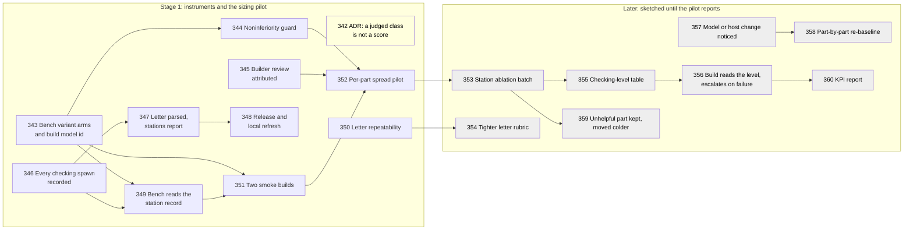

# The Cost of Checking Follows the Task and the Model

Numbers are task ids (provisional until approval); the yellow task is yours. A stage (written "Wave" in the section headings, which Compass's tools read) is a group of tasks planned in detail together; the grey ones stay one-line sketches until Stage 1's measurements are in.

## Goal

This plan implements [[specs/tooling/SPEC-027-compass-uses-fewer-tokens/SPEC-034-checking-cost-follows-task-and-model|The Cost of Checking Follows the Task and the Model (SPEC-034)]] from the findings of [[research/whole-overhead/checking-cost/REVIEW-checking-cost]] and its gap pass [[RESEARCH-axis-5-gap-pass]]. Today every task gets the same checking (pre-build tester, post-build tester, the builder's code review, the validator), nothing records what each station caught, and a model change is measured for Compass as a whole, never part by part. The plan first builds the instruments that can show what each station buys, then sizes the measurement that would earn lighter checking, and only after that measurement adds a rule that sets checking from a task's recorded difficulty class and the model.

## The waves

**Stage 1, instruments and the sizing pilot.** Lighter checking may only follow a measurement showing defects caught do not fall, and no such measurement can run today: the bench knows two arms only, its quality guard blocks on any difference instead of allowing a margin, the builder's review tokens are filed under the wrong agent, and no record says which station caught what on which task and model. Stage 1 builds those instruments, tests whether the planner's size letter is repeatable enough to key anything on, confirms in two smoke builds that a variant Compass survives a headless build, and runs a small pilot with the post-build tester removed to measure how much a per-part effect varies. No checking level changes in this stage. It ends at the pilot report, which gives the batch size of the real station ablation; you confirm the manual checks before anything else starts.

**Later stages** run the station ablation at that batch size, tighten the letter's rubric from what the repeatability test showed, add the checking-level table and the escalation rule, teach Compass to notice a model or host change, and re-measure the harness part by part. They stay sketched because each one's size depends on the pilot's spread and on which stations the ablation shows are carrying weight.

## Rulings this plan carries

The review's four decisions, each taken at its recommended option:

1. **A judged difficulty class is allowed.** [guess: [[ADR-011-sizing-is-a-procedure-not-a-score]] D-01 bans numeric scores and computed metrics only; a class assigned by judgment under a written rubric, with the harness owning the trigger and the record per its D-03 and D-08, is allowed.] TASK-342 records this as an ADR.
2. **Predict, then escalate.** [guess: the recorded class sets the starting check level, and a failing test or a fix cycle raises the task to full checking for the rest of its run.]
3. **The `complexity:` letter carries the class.** [guess: the existing letter, parsed by `planlib`, with its rubric tightened once the repeatability test shows where planners disagree.]
4. **Re-baseline stations first.** [guess: on a model or host change, the checking stations are re-measured first, then the parts set by environment variables (context thresholds, per-agent model and effort), then the parts that are text (phase splits, prompt rules, emphasis markers) as the harness support for each lands.]

Two choices the planner made from the research, also confirmed at approval:

- **Defects caught are measured two ways, without seeded defects.** [guess: ablation arms judged against the frozen goal lists give the escaped-defect difference per station, and the per-spawn station record gives what each station reported; a seeded-defect injector is built only if the goal counts prove too coarse in TASK-353.]
- **The first part removed is the post-build tester** [guess], since it is the costliest station (29.5% of a Compass build's weighted tokens in the second pilot against 2.0% for the validator, [[RESEARCH-whole-overhead-pilot]]).

## Prerequisites

- `plugin/` clean in git before any bench run (TASK-350 to TASK-352): the harness refuses a dirty `plugin/`, and the working tree holds uncommitted edits to `plugin/hooks/hooks.json` and `plugin/cli/tests/test_hooks_config.py` at the time of writing.
- The topic pool and frozen goals from [[PLAN-028-whole-overhead-on-real-projects]]'s pilot exist under `~/.compass/overhead/topics/`.
- The sandbox config is logged into the subscription (PLAN-028 TASK-244, done).
- Claude Code and Python 3.13 with pytest present, as for PLAN-028.

## Desired End State

- `bench/overhead/` runs a Compass arm with one harness part removed, from a committed patch, beside the full arm on the same topics, and records each build's model id and variant.
- `compare.py` gives a noninferiority verdict with a stated margin, and `token_profile.py` attributes the builder's review sub-agent to the builder's review station.
- Every checking spawn in a Compass project appends one row to `.compass/meta/station-log.jsonl` [guess: path] with task id, station, verdict counts and model; `compass stations` reports those rows per difficulty letter, model and station.
- Research documents in `research/whole-overhead/checking-cost/` give the letter's repeatability and the pilot's per-part spread with the batch size it implies.
- No checking station runs differently than it does today.

## What We're NOT Doing

- No change to any checking level, station or fix loop in Stage 1; TASK-356 is the first task that changes one, and only for a cell TASK-353 has earned.
- No numeric difficulty score or learned predictor (ruling 1).
- No per-spawn model override and no wiring of `compass resolve-model`; model stays per agent as [[ADR-008-model-resolution-table]] sets it.
- No seeded-defect injector in Stage 1.
- No deletion of any harness part: a part found unhelpful is reported and kept, its text moved whole to a colder file (TASK-359).
- No parallel builds: one build at a time, as in PLAN-028.

## Phases

### Wave 1 (detailed): instruments and the sizing pilot

TASK-342, TASK-343, TASK-345, TASK-346 and TASK-350 start in parallel; their files are disjoint. Contact points with other plans: PLAN-029's TASK-265 (a Compass arm loaded from a given commit) is the same mechanism TASK-343 builds, so TASK-265 reuses it [guess]; PLAN-028's later tasks extend `records.py` and `pilot.py` after TASK-343 lands; TASK-347 adds one `COMMAND_SPECS` entry to `plugin/cli/maincli.py`, merged after any other plan's open edit there.

- [x] TASK-342: ADR recording ruling 1: a task-difficulty class assigned by judgment under a written rubric and recorded by the harness is allowed under [[ADR-011-sizing-is-a-procedure-not-a-score]], whose D-01 reaches numeric scores and computed metrics; the ADR names the three options the review held live, the good and bad consequences (a judged class can drift between planners, which TASK-350 measures), and links [[specs/tooling/SPEC-027-compass-uses-fewer-tokens/SPEC-034-checking-cost-follows-task-and-model]]; its number is one past the highest ADR number under `.compass/decisions/` at build time - complexity: S, depends_on: none, files: [.compass/decisions/pipeline/ADR-024-difficulty-class-is-judged-not-scored.md, .compass/decisions/pipeline/index.md, .compass/index.md]
  - Automated verification: `python .claude/cli/compass validate` reports no error for the new file; `grep -n "D-01" .compass/decisions/pipeline/ADR-0*-difficulty-class*.md` finds the reach stated; the dash check below exits 0 over the file.
  - Manual verification: you approve the ADR.

- [x] TASK-343: Variant arms and the build's model, repo-local in `bench/overhead/`. `records.ARMS` keeps `compass` and `baseline` and accepts a variant id of the form `compass-minus-<part>`; each row gains `variant` and `build_model` (the main session's model with the most output tokens in `modelUsage`); `stats.py` and `pilot.py` aggregate by arm key and pair a variant with the full Compass arm by topic and run index; `pilot.py` gains `--arms` and `--topics <ids>` so a run replays pool topics with their frozen goals instead of picking new ones. `variants.py make <part>` creates a git worktree of HEAD under `~/.compass/overhead/variants/<part>/`, applies `bench/overhead/variants/<part>.patch`, commits it, and returns the worktree as the build's `repo_root`, so `check_plugin_clean` and `pin_commit` work unchanged; `variants.py discard <part>` removes the worktree. The first patch, `post-tester.patch`, removes the post-build and post-merge tester spawns from `plugin/skills/build/SKILL.md` and the "It always runs" line from `plugin/skills/autopilot/SKILL.md` in the variant only - complexity: L, depends_on: none, files: [bench/overhead/records.py, bench/overhead/stats.py, bench/overhead/pilot.py, bench/overhead/drive.py, bench/overhead/variants.py, bench/overhead/variants/post-tester.patch, bench/overhead/README.md, bench/overhead/tests/test_records.py, bench/overhead/tests/test_stats.py, bench/overhead/tests/test_pilot.py, bench/overhead/tests/test_variants.py], lessons: [LESSON-headless-worker-denies-tools-silently]
  - Automated verification: `python -m pytest bench/overhead/tests -q` passes: a row with an arm outside the accepted forms is refused; `build_model` comes from a canned `modelUsage` with two models; a variant pairs with the full arm by topic and run index, never with `baseline`; `variants.py make` on a temporary repo yields a worktree whose HEAD differs from the parent's by exactly the patch and whose `git status --porcelain plugin/` is empty; `git apply --check bench/overhead/variants/post-tester.patch` succeeds on HEAD; `git diff --stat HEAD -- plugin/` is empty after the tests (master untouched); the dash check exits 0.
  - Manual verification: none; TASK-351 runs a variant build.

- [x] TASK-344: A noninferiority guard in `compare.py`. With `--margin <fraction>`, the outcome check becomes: per paired build, the share of frozen goal items met in the variant minus the full arm; a one-sided 95% bootstrap lower bound (2000 resamples, fixed seed); the verdict "not worse" when the bound sits above minus the margin, "worse" otherwise, printed with the bound and the pair count. Without `--margin`, the exact-equality guard stays as it is. The README's "Comparing launches" section states both - complexity: S, depends_on: TASK-343, files: [bench/overhead/compare.py, bench/overhead/tests/test_compare.py, bench/overhead/README.md]
  - Automated verification: `python -m pytest bench/overhead/tests -q` passes: a fixture whose variant loses exactly the margin is "worse", one just inside is "not worse", one pair is refused as too few, and the default path still prints "outcome differs, so no token verdict" on any difference; the dash check exits 0.
  - Manual verification: none.

- [x] TASK-345: The builder's review attributed. `token_profile.py` reads `parentAgentId` from each subagent's `.meta.json`; a session whose parent is a `builder` session is filed as `subagent:builder-review`, every other session keeps `subagent:<agentType>`; `--by-agent` lists the new kind, and a review child's tokens stay out of `subagent:builder` and `subagent:general-purpose` - complexity: S, depends_on: none, files: [bench/overhead/token_profile.py, bench/overhead/tests/test_token_profile.py]
  - Automated verification: `python -m pytest bench/overhead/tests -q` passes: a fixture with a builder, its `general-purpose` review child and an unrelated `general-purpose` session files exactly one session as `subagent:builder-review`; a child whose parent id names no session in the build keeps its own type; a missing `.meta.json` does not raise; the dash check exits 0.
  - Manual verification: none.

- [x] TASK-346: Every checking spawn recorded, shipped in `plugin/`. `stationlib.py` turns a finished subagent's report into one row: time, agent type, station (`tester-pre` or `tester-post` from the tester report's Mode section, `validator`, `builder`, `debug`), task id from the report, verdict counts (tester post-build: items under "Bugs Found"; validator: the Result line and the FAIL rows of its Phase Results), and the model: the subagent transcript's model through `sessionslib.model_id` when the SubagentStop event names that transcript, else the agent's resolved model from `modelslib.resolve` with its source label (which event field carries the transcript is read from a recorded payload at build time). `capture-signal` appends the row to `.compass/meta/station-log.jsonl` beside the capture it already writes, best-effort as everything there is; `compass test-checkpoint cycle` appends a `fix-cycle` row with task id, cycle number and its helpful, neutral or harmful verdict. A report that matches no known form gets `station` from its agent type and `verdict: unparsed`. Rows hold no report text - complexity: M, depends_on: none, files: [plugin/cli/stationlib.py, plugin/cli/commands/capture_signal.py, plugin/cli/commands/test_checkpoint.py, plugin/cli/tests/test_stationlib.py, plugin/cli/tests/test_capture_signal_station.py, plugin/cli/tests/test_test_checkpoint_station.py], lessons: [LESSON-verify-wiring-by-call-site-grep]
  - Automated verification: `python -m pytest plugin/cli/tests -q` passes: a tester post-build report with three bugs gives `tester-post` with 3; a pre-build report gives `tester-pre`; a validator report gives its Result and FAIL count; a report with no Mode section is `unparsed`; a malformed event writes no row and still exits 0; `COMPASS_WORKER_SESSION` set writes no row; a row never contains a line of the report; `grep -n "stationlib" plugin/cli/commands/capture_signal.py plugin/cli/commands/test_checkpoint.py` finds both call sites; the dash check exits 0.
  - Manual verification: none; TASK-348 checks it live.

- [x] TASK-347: The letter parsed and the stations report, shipped in `plugin/`. `planlib` reads the `complexity:` value of each detailed task line (S, M, L, XS kept as written, absent as none) without changing `TASK_LINE`'s id capture. `compass stations [--plan PLAN-NNN]` joins station-log rows to their task's letter (from the plans) and prints, per letter, model and station: spawns, bugs found, FAIL items, fix cycles, unparsed rows, and rows whose task id matches no plan; it reads only, and exits 0 on an empty or missing log. One `COMMAND_SPECS` entry in `maincli.py` - complexity: M, depends_on: TASK-346, files: [plugin/cli/planlib.py, plugin/cli/commands/stations.py, plugin/cli/maincli.py, plugin/cli/tests/test_planlib_complexity.py, plugin/cli/tests/test_stations.py]
  - Automated verification: `python -m pytest plugin/cli/tests -q` passes: a task line with `complexity: M,` mid-line, one with it last, one without and one with `XS` parse as M, M, none, XS; a row for an unknown task is counted apart; `python plugin/cli/compass stations` runs against this vault and exits 0; the dash check exits 0.
  - Manual verification: none.

- [x] TASK-348: Release and local refresh: bump `plugin/.claude-plugin/plugin.json` to the next minor, run `python plugin/cli/compass self-update --force` so `.claude/` carries TASK-346 and TASK-347 in this repo, and confirm the hook writes rows here - complexity: S, depends_on: TASK-346, TASK-347, files: [plugin/.claude-plugin/plugin.json]
  - Automated verification: `diff -r plugin/cli .claude/cli` shows no difference in `stationlib.py`, `capture_signal.py` and `stations.py`; after one spawned tester in this repo, `.compass/meta/station-log.jsonl` has a row with station and model set; `python .claude/cli/compass stations` prints it.
  - Manual verification: none.

- [x] TASK-349: The bench reads the station record. At a build's close, `records.py` reads the project's `.compass/meta/station-log.jsonl` and writes into the build's row, as allowlisted counts only, the spawns and verdict counts per station and model; a baseline-arm build has none; the private-record leak tests cover the new fields - complexity: S, depends_on: TASK-343, TASK-346, files: [bench/overhead/records.py, bench/overhead/drive.py, bench/overhead/tests/test_records_stations.py]
  - Automated verification: `python -m pytest bench/overhead/tests -q` passes: a canned log gives the expected counts; a log row carrying an unexpected text field never reaches the record; a missing log gives zero counts, not an error; the dash check exits 0.
  - Manual verification: none.

- [x] TASK-350: Letter repeatability, measured. `bench/overhead/letters.py` draws [guess: 30] detailed task lines from this vault's plans, stratified by letter, strips each line's `complexity:` field, and gives each, with the current rubric table from `plugin/templates/agents/planner.md` and its plan's Goal paragraph, to isolated `claude -p` sessions from an empty folder with no tools, so no session sees the vault or the original letter: [guess: 3 sessions on the strong-tier model and 3 on the balanced-tier model]. It records each assigned letter and reports agreement within a model (exact agreement and Fleiss' kappa), between the two models, and against the original letter, plus the rubric words the sessions cite when they disagree. Results, aggregates only, go to `research/whole-overhead/checking-cost/RESEARCH-letter-repeatability.md` - complexity: M, depends_on: none, files: [bench/overhead/letters.py, bench/overhead/tests/test_letters.py, .compass/research/whole-overhead/checking-cost/RESEARCH-letter-repeatability.md, .compass/research/whole-overhead/checking-cost/index.md], lessons: [LESSON-blind-the-author-in-self-validation, LESSON-measure-the-procedures-intermediates]
  - Automated verification: `python -m pytest bench/overhead/tests -q` passes: the stripped task text contains no `complexity:` and no `S`, `M` or `L` standing alone as a field value; kappa matches a hand-computed fixture; the session command carries no tool and runs outside any git work tree; the research document lists every sampled task's letters and both agreement figures; `python .claude/cli/compass validate` has no error for it; the dash check exits 0.
  - Manual verification: you read the agreement figures and judge whether the letter is steady enough to key checking on.

- [x] TASK-351: Two smoke builds on the subscription, one at a time. First, one build of a pool topic in `compass-minus-post-tester`: it confirms `.claude/` in the project still matches the variant commit after the start-of-session self-update, that no post-build tester spawn appears in its profile, and that its station rows arrive in the record. Second, one full Compass build with `COMPASS_CONTEXT_THRESHOLD` set to [guess: 50]: it records whether the stop fired, what the simulated human answered, and whether the build went on. Both results go into a "Smoke builds" section of `research/whole-overhead/checking-cost/RESEARCH-checking-cost-pilot.md` - complexity: S, depends_on: TASK-343, TASK-346, TASK-349, files: [.compass/research/whole-overhead/checking-cost/RESEARCH-checking-cost-pilot.md, .compass/research/whole-overhead/checking-cost/index.md], lessons: [LESSON-plugin-dir-plus-setup-double-registers-hooks, LESSON-subscription-cost-is-an-estimate-not-a-budget]
  - Automated verification: the run log holds two closed builds or a usage-limit halt with its `resetsAt`; the variant build's row has `variant: compass-minus-post-tester`, a `build_model`, zero `tester-post` spawns and at least one station count; the threshold build's row records whether the stop fired; a scan of the report finds no topic text, path or session id; the dash check exits 0.
  - Manual verification: none.

- [ ] TASK-352: The per-part spread pilot. [guess: 3 pool topics, each built twice in the full Compass arm and twice in `compass-minus-post-tester`, 12 builds], judged against their frozen goals. The pilot report gives, per paired build, the difference in goal items met, in weighted tokens, and in station counts; the within-topic standard deviation of each; `stats.batch_size` for the ablation at the point estimate and at the upper 80% chi-square bound, for a drop to detect of [guess: one goal item in ten]; the noninferiority verdict from TASK-344 at [guess: a margin of 5% of goal items], marked as indicative at this size; the builder-review share from TASK-345; and the builds that hit a cap, reported apart and left out of the spread - complexity: M, depends_on: TASK-344, TASK-345, TASK-351, files: [bench/overhead/tests/test_pilot_variant.py, .compass/research/whole-overhead/checking-cost/RESEARCH-checking-cost-pilot.md], lessons: [LESSON-score-the-do-nothing-baseline-before-running, LESSON-subscription-cost-is-an-estimate-not-a-budget]
  - Automated verification: `python -m pytest bench/overhead/tests -q` passes, including a test that a capped build is left out of the spread and listed; the run log shows twelve closed builds or a usage-limit halt; every pair in the report has both arms; the record rows match the sandbox transcripts one for one; a scan of the report finds no topic text, path or session id; the dash check exits 0.
  - Manual verification: you read the pilot report and confirm the ablation batch it implies is a pace your subscription can carry.

The dash check, as in PLAN-028: `python -c "import pathlib,sys; bad=[str(p) for p in [*pathlib.Path('bench/overhead').rglob('*.py'), *pathlib.Path('bench/overhead').rglob('*.md'), *pathlib.Path('plugin/cli').rglob('*.py'), *pathlib.Path('.compass/research/whole-overhead/checking-cost').glob('*.md'), *pathlib.Path('.compass/decisions/pipeline').glob('*.md')] if any(chr(c) in p.read_text(encoding='utf-8') for c in (0x2013, 0x2014))]; print(bad); sys.exit(bool(bad))"` exits 0.

Harness fixes made while running TASK-350 to TASK-352, each test-first:

- `letters.py` sessions start through `launch.run_session` (no console window on Windows, the prompt on stdin, the process tree killed at the timeout) and run up to `--jobs` at once; TASK-350 ran at three.
- Every `git`, `claude purge`, `taskkill` and answer-command process the bench starts passes `launch.NO_WINDOW`; `tests/test_no_window.py` reads the bench's source and fails on a bare process start.
- `pilot.py --runs N --run-log FILE` builds N runs per arm on a run log of its own, so each TASK-351 smoke build is a one-build replay that never closes a slot of the pilot's log.
- `spread.py` computes TASK-352's per-pair differences, their within-topic spread, the batch sizes, the noninferiority verdict and the builders' review share, with capped, failed, unjudged and unpaired builds listed apart (`tests/test_pilot_variant.py`).
- `variants/post-tester.patch` also edits the builder agent, the tester agent and the methodology skill: with the build and autopilot skills alone patched, the first variant smoke build still spawned a post-build tester. `tests/test_variants.py` checks seven cue phrases are gone; smoke 1 ran again on the full patch.
- `records.build_model` names the main session's model from the first `system/init` event: the most-output rule filed the first smoke build, an Opus main session, under the Sonnet model of its builders.
- TASK-351's threshold build ran at 15%, then 10%, in place of 50%: the main sessions of these builds peak between 13% and 25% of Opus's 1,000,000-token window, and the 15% build ended without reaching its stop.
- `spread.py` also summarizes pairs whose two builds both hit the wall-time cap, as equal-time pairs: both variant smoke builds ran to the 150-minute cap, as did four of the second pilot's six Compass builds of the pool topics.
- The second pilot's run log, whose Compass builds ran an older Compass, moved whole to `run-log.second-pilot.jsonl` beside it, so TASK-352's full-arm builds are built fresh at this commit rather than paired from that log.

**Pause point:** when the automated checks pass, wait for you to confirm the manual checks of TASK-342, TASK-350 and TASK-352 before Stage 2 is detailed.

### Wave 2 (detailed): the letter's rubric

- [ ] TASK-354: Tighten the `complexity:` rubric at the three places TASK-350 showed blind raters and planners parting, the Scope column no longer than today's, re-run TASK-350's measurement on the same 30 tasks, seed and models, and keep the new rubric only if agreement rises. The candidate is `bench/overhead/rubrics/sizing-tests-apart.md`: a task's own tests do not count toward its size, M is 2-4 files so five files sit in L alone, and L also names a new subsystem (Scope column 75 characters against 88). `letters.py run --rubric <file>` measures a candidate without shipping it and keeps its progress apart by the rubric's hash. Kept when, against [[RESEARCH-letter-repeatability]]: Fleiss' kappa within each model does not fall below 0.80, the pooled kappa of both models does not fall below 0.70, and sessions giving the planner's letter rise above 47% on both models; then the table is copied into `plugin/templates/agents/planner.md` and the result appended to the research document either way - complexity: M, depends_on: TASK-350, files: [bench/overhead/letters.py, bench/overhead/tests/test_letters.py, bench/overhead/rubrics/sizing-tests-apart.md, plugin/templates/agents/planner.md, .compass/research/whole-overhead/checking-cost/RESEARCH-letter-repeatability.md], lessons: [LESSON-remove-context-before-adding]
  - Automated verification: `python -m pytest bench/overhead/tests/test_letters.py -q` passes, including a run that sees the candidate's table and not the shipped one, and a refusal to resume a progress file written under another rubric; the re-run's report lists all 30 tasks; the dash check exits 0.
  - Manual verification: you read the re-run's three figures against the old ones.
  - Built so far: `--rubric` and the candidate file (commit 7cfa1aa). Waiting: the re-run, 180 tool-less sessions on the subscription.

## Later (intent only)

- [ ] TASK-353: Station ablation at the batch size TASK-352 sets: the post-build tester, then the validator, each removed against full Compass on pool topics, with the noninferiority margin fixed before the batch runs; defects caught per station from the station rows and the goal-count difference, broken down by the tasks' letters; a station is lighter-eligible for a letter only where the verdict is "not worse" - files: [bench/overhead/variants/validator.patch, .compass/research/whole-overhead/checking-cost/RESEARCH-station-ablation.md]
- [ ] TASK-355: The checking-level table: `compass checking-level <TASK-NNN>` resolves (letter, model) to a level from a built-in table where every cell is full checking, then `.compass/meta/checking.yaml`, then environment, with the precedence and source label of [[ADR-008-model-resolution-table]]; the level is written into each station row - files: [plugin/cli/checkinglib.py, plugin/cli/commands/checking_level.py, plugin/cli/maincli.py, plugin/cli/stationlib.py]
- [ ] TASK-356: The build and autopilot skills read the level; a failing post-build test or a fix cycle raises the task to full checking for the rest of its run; a cell's built-in value drops below full only where TASK-353 showed defects caught do not fall - files: [plugin/skills/build/SKILL.md, plugin/skills/autopilot/SKILL.md, plugin/cli/checkinglib.py]
- [ ] TASK-357: A model or host change is noticed: a `doctor` advisory row when the model or Claude Code version in recent station rows differs from the last re-baseline's, naming the re-baseline to run - files: [plugin/cli/commands/doctor.py, plugin/cli/tests/test_doctor.py]
- [ ] TASK-358: The part-by-part re-baseline in ruling 4's order: stations, then context thresholds and per-agent model and effort set before setup, then phase splits, prompt rules and emphasis markers as patches; one with-against-without result per part - files: [bench/overhead/rebaseline.py, bench/overhead/variants/]
- [ ] TASK-359: A part found unhelpful is reported and kept: its text moves whole to a colder file the report links, the shipped file points to it, and a test checks the moved text is byte-identical to what left - files: [.compass/research/whole-overhead/checking-cost/index.md]
- [ ] TASK-360: The KPI report: checking-station tokens per letter against the full-checking baseline, with defects caught on L tasks beside them, after each re-baseline

## Risks

- **The pilot's spread rests on three topics again.** The first two pilots' spreads were unusable (capped builds, three topics); TASK-352 leaves capped builds out, reports the upper bound beside the point estimate, and calls its noninferiority verdict indicative.
- **Goal counts are a coarse defect measure.** A station may catch defects that never move a goal item; TASK-353 reads the station rows beside the goal difference, and a seeded-defect injector enters only if both stay flat.
- **Report parsing drifts with the templates.** A tester or validator report in a new form becomes `unparsed`, counted by `compass stations`, so drift shows up as a number rather than as silence.
- **The station log grows in every user's vault.** One short row per checking spawn; it holds counts and ids, no report text.
- **A variant could be overwritten by self-update.** TASK-351's first build checks `.claude/` against the variant commit before any pilot build runs.
- **Subscription pace.** Fourteen builds at about three per five-hour window take several windows; runs are one at a time and halt at the first usage-limit event.
- **The letter may prove too unsteady to key on.** Then TASK-354 tightens the rubric, and if agreement stays low, Stage 2 keys checking on escalation alone, the other half of ruling 2.

## Wave 2 elaborated

No intent line is promoted. Every one of them waits on a Stage 1 outcome that has not been observed: TASK-350 and TASK-352 have not run, and [[ADR-024-difficulty-class-is-judged-not-scored]] awaits approval. The pause point already places Stage 2's detail after those three manual checks.

- TASK-353 waits on TASK-352: its batch size, the noninferiority margin and the per-part spread all come from the pilot report.
- TASK-354 waits on TASK-350: the rubric is tightened only where the repeatability test shows planners disagree.
- TASK-355 waits on TASK-350 and on ADR-024's approval: whether the table is keyed on the letter at all, or checking keys on escalation alone (the last risk above), depends on the letter's measured agreement, and keying on a judged class rests on ruling 1.
- TASK-356 waits on TASK-353: a cell drops below full checking only where the ablation shows defects caught do not fall.
- TASK-357 waits on TASK-358, and so on TASK-352: the advisory names a re-baseline and compares against its record, and both are defined by the re-baseline TASK-358 runs, whose per-part batch size comes from the pilot's spread. The re-baseline runs in the repo-local `bench/overhead/`, so whether a shipped `doctor` row should name it is settled by TASK-358's shape. The 45 rows now in `.compass/meta/station-log.jsonl` carry a model on every row and no Claude Code version, so a host change cannot be noticed from them yet; the transcripts carry one in their `version` field.
- TASK-358 waits on TASK-352 and TASK-353: the pilot's spread sizes each part's batch, and ruling 4 re-measures the stations first.
- TASK-359 waits on TASK-353 or TASK-358 finding a part that does not help.
- TASK-360 waits on TASK-356: the KPI compares checking-station tokens per letter against full checking, which differs only once levels are read.

What the station log shows after Wave 1, read with `compass stations`: 45 rows over S, M and L tasks, all on one model apart from two test-fixture rows; 17 of the 19 builder rows are `unparsed`, since a builder report has no verdict form; 13 rows match no plan task, 10 with no task id and 3 with `TASK-40`, which names no task. 32 of the 45 rows are 16 spawns written twice within the same second, and two `tester-post` rows for TASK-346 with model `claude-env-pin-7` and source `env` are the fixture of `plugin/cli/tests/test_capture_signal_station.py`, whose report and capture file reached this vault's `.compass/meta/` and `.compass/tmp/subagent-captures/` during a test run.

## Wave 2 elaborated, after the Wave 1 runs

TASK-350 and TASK-351 have run; TASK-352 is running. One intent line is promoted.

- **TASK-354, promoted.** TASK-350 found the letter repeatable under the written rubric (kappa 0.88 and 0.84 within a model, 0.70 across the two) but not the letter planners wrote (43% and 47% of sessions agree with it), and it located the parting at three places in the table. That is the condition the line names. Its harness part is built; the re-run spends subscription sessions and waits for your go.
- **TASK-355 stays.** A table keyed on the letter needs the letter planners write to be the rubric's letter. Today it is not, so the key waits on TASK-354's result; if the re-run does not raise agreement, checking keys on escalation alone and the table is keyed on the model only.
- **TASK-353 waits on TASK-352's report**, which gives its batch size and margin.
- **TASK-356 to TASK-360** keep the reasons of the section above: each waits on TASK-353 or TASK-358, and neither has run.

