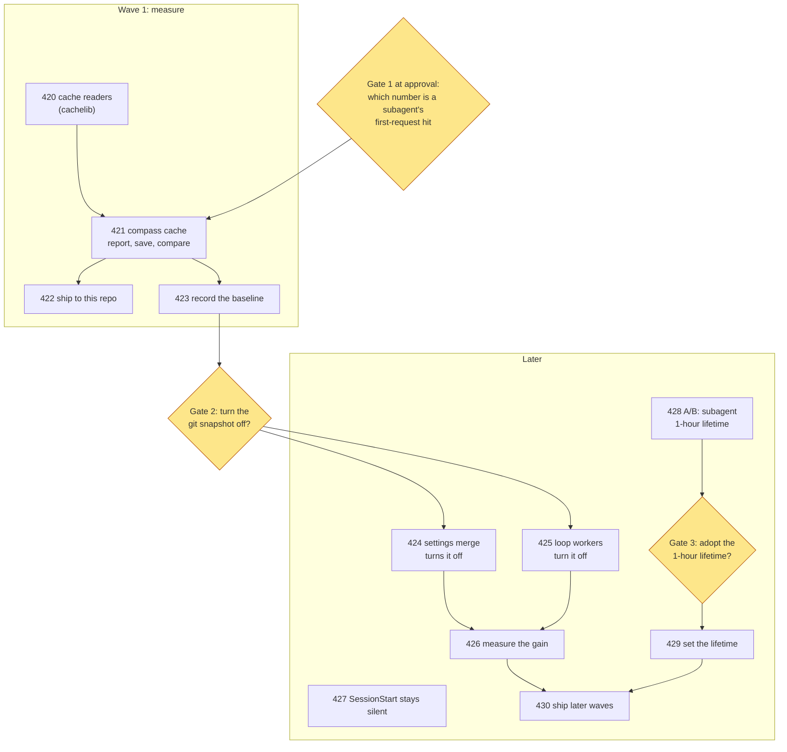

# The Prompt Cache Is a Design Input

## Goal

This plan implements [[SPEC-033-prompt-cache-is-a-design-input]] from the findings consolidated in [[REVIEW-prompt-cache]]. Compass gains a report of how much of its repeated input the provider's prompt cache serves, per kind of agent and across sequential sessions, and records the first baseline. Only then do design changes follow: turning off the host's git-status snapshot, which the research found breaks the cache first in 89% of comparable session pairs here, and a 1-hour cache lifetime for subagents, tried only after an A/B shows it pays.

## The waves

**Wave 1 measures.** No Compass tool computes a cache hit rate today, and the whole-session rate (96-99%) cannot see the break that matters: a new session reuses only the ~7.8k-token system and tools prefix and rewrites the 27k-35k tokens after it. Wave 1 builds a read-only report over the host's local transcripts that shows the first request of each session, how two sessions in a row share their start and which block differs first, each subagent type's rate, each loop's rate and the cache-write tier. It then records the baseline. The wave ends at Gate 2, where you read the baseline and decide whether Compass turns the git snapshot off.

**Later waves change the design, each checked by the same report.** If Gate 2 says yes, the installed settings and loop workers turn the snapshot off, and a before/after run measures the gain in a real Compass project. Separately, an A/B on builder waves measures whether a 1-hour cache lifetime for subagents saves more than it costs; Gate 3 decides from that result.

## Gates

Each gate is a question to you, its recommended option first. A choice that removes a capability names what is lost.

**Gate 1, at plan approval: which number is a subagent's first-request hit (the review's Divergent 1).** The two research axes used different metrics on the same data. TASK-421 builds the report's headline line on the answer.
1. Tokens-weighted read share as the KPI, the binary "read anything" share printed beside it as a diagnostic (Recommended). It is the spec's own measure, the share of repeated input read from the cache.
2. Binary share as the KPI, the tokens-weighted share beside it.
3. Both as KPIs, with no single headline.

**Gate 2, after TASK-423: turn the git snapshot off in the projects Compass installs into (review candidate 2).** Lost, in the main session and every subagent: the startup branch, `git status` and recent-commits orientation; the host's built-in commit and pull-request instructions in the Bash tool description; and one full cache rewrite on the first launch after the switch. No shipped Compass agent, skill, rule or hook reads the snapshot or relies on the host's commit text (the review's check of `plugin/`); Compass's commit rules live in the `methodology` skill and the builder agent, and handoff, pr-describe, validator and debug run git themselves.
1. Turn it off by default, a project's own `includeGitInstructions` value left as it is so `true` keeps the snapshot (Recommended).
2. Turn it off in this repo only, measured, and decide on shipping after TASK-426.
3. Keep the snapshot.

Answered 2026-11-24: option 1. `includeGitInstructions: false` is written only when the project's settings lack the key, so a project's `true` keeps the snapshot. TASK-424 and TASK-425 build it; TASK-428's subscription run is allowed.

**Gate 3, after TASK-428: adopt a 1-hour cache lifetime for subagents (review candidate 4, Divergent 2).** Nothing functional is lost; the risk is about 15% higher subagent cost if reuse does not rise (A3 F13), and the setting has no effect while a subscription draws usage credits (A3 F2).
1. Adopt it only where the A/B shows a lower weighted cost at equal judged outcome, in the form the A/B tested (Recommended).
2. Adopt it for every subagent type regardless.
3. Do not adopt it.

## Prerequisites

- Gate 1 answered at approval; without an answer TASK-421 takes the recommended option.
- No PLAN-028 or PLAN-034 bench batch is running when a `plugin/` commit of this plan merges: each bench build records the plugin sha, so a build that straddles a merge measures a mixed Compass.
- The host writes `api-request` and `api-request-blob` records into transcripts (host 2.1.330 does). Older transcripts without them still give every number except the first differing block, which reads `unknown`.

## Desired End State

- `python .claude/cli/compass cache` prints, for the project or for every Compass project on the machine: main-session whole and first-request hit, the median first-request read in tokens, the share of next sessions 5-60 minutes later reading 60% or more of their first request, the first differing block across comparable consecutive pairs, per subagent type the whole hit, the first-request hit (both metrics, the Gate 1 one as headline) and the first differing block between same-type siblings, each loop's hit from its ledger, and the 5-minute versus 1-hour split of cache writes, main and subagent apart.
- `--save` writes those aggregates outside any git work tree; `--compare` prints each measure's change against a saved file and exits 1 when a first-request measure falls past its band, so a Compass change that lowers reuse is seen.
- The baseline sits in the vault as a research document beside the review.
- After Gate 2 (if yes): installed projects and loop workers run with the snapshot off, and the measured gain is recorded. After Gate 3: subagent cache lifetime matches the A/B's verdict.

## What We're NOT Doing

- **Dropping the `paths: ["**"]` header from the three always-loaded rules (review candidate 5).** Left out: the rules load at launch either way (A2 F9), so the change does not move cache reuse; its only effect is at compaction, which [[PLAN-033-compaction-keeps-the-session-state]] covers. Its gap (compaction behavior unobserved) therefore gates nothing here.
- **Loop worker cache lifetime and judge spacing (candidate 7).** Left out: at the default daily schedule both lifetimes expire anyway (converged finding 10), the setting acts only under API-key billing, where this machine has no telemetry, and the loop worker's first request is not recorded by the host's headless result. TASK-421's loop rows give the whole-run rate; a loop that runs more often than hourly is the trigger to revisit.
- **`omitClaudeMd` for subagents (candidate 6).** It removes the pipeline rules and CLAUDE.md from those agents, an accuracy trade, and [[PLAN-029-crafted-agent-context]] owns its measurement.
- **A rule for human gates waiting over an hour (candidate 8).** The research names no mechanism; TASK-421 reports the share of main-session cost after gaps over an hour so its size stays visible.
- **Staging parallel builders (candidate 9).** It spends wall-clock time, the cost the human ranks first, to save at most the 14-19% of first-request input that siblings share.
- **Gitignoring regenerated vault files (candidate 10).** It moves files out of version history.

## Phases

### Wave 1 (detailed): measure

TASK-420 runs first; TASK-421 follows it; TASK-422 and TASK-423 run in parallel after TASK-421, their files disjoint. Files other plans also edit: `plugin/cli/maincli.py` (one line per new command; this plan adds its line in TASK-421 only) and `plugin/cli/sessionslib.py`, which [[PLAN-033-compaction-keeps-the-session-state]] extends; this plan only imports from it.

- [x] TASK-420: Cache readers over host transcripts, in a new `plugin/cli/cachelib.py`, standard library only, read-only, never raising on a malformed record (the `sessionslib.records` contract). Before writing code, the builder reads one real main transcript and one subagent folder of this repo to confirm the record shapes this task names, and states any difference in its report. Readers: (a) per transcript, the assistant requests deduplicated by `requestId`, all-zero usage dropped, boolean or non-numeric usage values rejected as `context_check._used_of` does, each with timestamp, model, `input_tokens`, `cache_creation_input_tokens`, `cache_read_input_tokens` and the `usage.cache_creation` split into `ephemeral_5m_input_tokens` and `ephemeral_1h_input_tokens` (absent split is `None`, never 0); (b) hit = read / (read + creation + input), tokens-weighted over a set, and a binary any-read share over first requests; (c) per session the first request and the whole session, its entrypoint and start time; (d) per subagent, through `sessionslib.subagent_transcripts`, its type from the beside `.meta.json` `agentType` (`unknown` when the file is missing or malformed), first request, whole hit, and minutes since the previous same-type sibling started; (e) a pair of consecutive sessions (or same-type siblings): gap minutes, comparable when the first `api-request` of each has equal `params` and `shapeHash`, and the first differing block of the first request, compared block by block through `tail` and `api-request-blob` hashes, named by kind only (`system-or-tools`, `instruction-files`, `git-snapshot`, `memory-index`, `environment`, `other`, `none`, `unknown`) and, inside the instruction block, the kind of the first file that differs (`project-claude-md`, `rule-file`, `user-claude-md`, `memory-index`), never a path or text; (f) a loop ledger's runs summed from their `cache_read_tokens`, `cache_creation_tokens` and `input_tokens`. Every returned object holds counts, kinds and times only - complexity: M, depends_on: none, files: [plugin/cli/cachelib.py, plugin/cli/tests/test_cachelib.py, plugin/cli/tests/fixtures/transcripts/cache/], lessons: [LESSON-hook-payloads-observe-before-coding, LESSON-deterministic-fixtures-survive-scratch-wipes]
  - Automated verification: `python -m pytest plugin/cli/tests/test_cachelib.py -q` passes, with fixtures written by code in the test module so a wiped folder rebuilds identically: a request repeated under one `requestId` counts once; an all-zero row is dropped; a `true` usage value is rejected; a request without `usage.cache_creation` gives a `None` split; a missing and a malformed `.meta.json` each give `unknown`; a pair crossing a model change is not comparable; a pair whose snapshot block alone differs names `git-snapshot`; a pair whose rule-file text differs names `instruction-files` / `rule-file`; a transcript without request records names `unknown`; a truncated last line is skipped; a leak test asserts no fixture path, session id, cwd or message text appears in any returned value. `python -m pytest plugin/cli/tests -q` still passes.
  - Manual verification: none; TASK-423 shows the readers on real data.

- [x] TASK-421: `compass cache [--all-compass] [--days N] [--json] [--save [FILE]] [--compare FILE]` in `plugin/cli/commands/cache.py`, registered in `COMMAND_SPECS`. Without `--all-compass` it reads this project's transcript folder (`sessionslib.transcripts_dir` of the main checkout); with it, every project folder whose recorded `cwd` holds a `.compass/` vault, and prints only how many projects it read. `--days` defaults to 30. It prints the measures of the Desired End State, each with its n, plus the share of modeled main-session cost that follows gaps over 1 hour; the headline line per subagent type uses the Gate 1 metric. `--save` writes the aggregates as JSON, default `~/.compass/cache/<machine>.json` (`sensorlib.machine_id`), and refuses a path inside a git work tree. `--compare FILE` prints before, after and change per measure and exits 1 when the first-request hit or the next-session 60%-read share falls by more than 5 points [guess: band set from the baseline's spread in TASK-423]. Transcripts and ledgers are only read; every failure prints on stderr and exits 1, never 2; the module docstring describes the command for a reader with only the code - complexity: M, depends_on: TASK-420, files: [plugin/cli/commands/cache.py, plugin/cli/maincli.py, plugin/cli/tests/test_cache_command.py]
  - Automated verification: `python plugin/cli/compass cache --help` exits 0 and `python plugin/cli/compass` lists `cache`; `python -m pytest plugin/cli/tests/test_cache_command.py plugin/cli/tests/test_maincli.py -q` passes: on the fixture folder (`CLAUDE_CONFIG_DIR` pointed at a temporary tree) the printed numbers equal hand-computed values; `--all-compass` skips a project folder whose cwd has no `.compass/`; `--save` into a temporary git repo is refused; `--compare` against a file with a higher first-request hit exits 1 and against an equal one exits 0; `--json` output holds no path, session id or project name. `python -m pytest plugin/cli/tests -q` passes; the dash check (`python -c "import pathlib,sys; bad=[p for p in pathlib.Path('plugin/cli').rglob('*.py') if any(chr(c) in p.read_text(encoding='utf-8') for c in (0x2013,0x2014))]; print(bad); sys.exit(bool(bad))"`) exits 0.
  - Manual verification: none beyond TASK-423.

- [x] TASK-422: Ship Wave 1 to this repo: bump the minor version in `plugin/.claude-plugin/plugin.json` from its value at merge, and copy `cachelib.py`, `commands/cache.py` and `maincli.py` into the matching paths under `.claude/cli/`, since `/compass:update` fetches from GitHub and sees nothing unpushed - complexity: S, depends_on: TASK-421, files: [plugin/.claude-plugin/plugin.json]
  - Automated verification: `python .claude/cli/compass cache --days 1` exits 0; `diff plugin/cli/cachelib.py .claude/cli/cachelib.py` and the same for `commands/cache.py` and `maincli.py` print nothing; `python .claude/cli/compass doctor` reports no FAIL.
  - Manual verification: none.

- [x] TASK-423: Record the baseline. Run `compass cache --days 70 --save` for this repo and `--all-compass --days 90 --save <second file under ~/.compass/cache/>`, and write `research/whole-overhead/prompt-cache/RESEARCH-cache-baseline-measured.md`: the KPI's first values per kind of agent (main, each subagent type with n of 20 or more, loops) and across sequential sessions, aggregates only; the first differing block among comparable session pairs and among same-type subagent siblings (the review's subagent-snapshot gap); the 1-hour gap cost share; each number set against the review's table, with any difference over 3 points explained by a method difference or marked unexplained; and the `--compare` band TASK-421 should keep, from the spread across weekly windows. Link it from the folder `index.md` - complexity: S, depends_on: TASK-421, files: [.compass/research/whole-overhead/prompt-cache/RESEARCH-cache-baseline-measured.md, .compass/research/whole-overhead/prompt-cache/index.md], lessons: [LESSON-measure-the-procedures-intermediates]
  - Automated verification: `python .claude/cli/compass validate` reports no error for the new file; both saved files exist under `~/.compass/cache/` and `git status --porcelain` lists no file outside `.compass/research/whole-overhead/prompt-cache/`; `python .claude/cli/compass cache --compare <saved this-repo file>` exits 0 on an immediate re-run.
  - Manual verification: you read the baseline document and answer Gate 2.

**Pause point:** when automated verification passes, wait for your confirmation of TASK-423's manual check and your Gate 2 answer before Wave 2 is detailed.

### Wave 2 (detailed): the cached start stays stable

One task, the only Later line that needs neither Gate 2 nor a subscription run. It adds tests only, so it ships with the next wave that changes shipped code (TASK-430). `plugin/cli/tests/test_hooks_config.py` is the one file it edits; no open task of another plan edits it.

- [x] TASK-427: SessionStart prints nothing when nothing happened. The host adds a SessionStart hook's stdout to the session's first request, so any text a hook prints there, and any change in that text, becomes part of the cached start. A new `SessionStartSilenceTests` class in `plugin/cli/tests/test_hooks_config.py` pins two things. (a) The manifest: the commands of every `SessionStart` group except `compact` (the `startup` group and the group with no matcher) are exactly `self-update --hook`, `drift --hook` and `capture-check --hook`; the check is a helper applied to the real `plugin/hooks/hooks.json` and to an in-test copy with a fourth command added to the `startup` group, and the copy must fail, so a new SessionStart command fails the test until it is listed here with a silence case. The `compact` group's `session-state --hook` is left out: it prints the state block by design, after a compaction has already rewritten the cache. (b) Each of the three commands, run as a real process (`sys.executable` on `plugin/cli/compass`, `CLAUDE_PROJECT_DIR` and the working directory set to a temporary project holding a `.compass/` vault, as `test_drift_hook_post.HookSilenceTests` does), exits 0 and prints nothing on stdout or stderr on a no-op run: `self-update --hook` in local mode against a plugin tree of the installed version, network unreachable (the setup of `test_self_update`'s `test_local_mode_same_version_is_silent`); `capture-check --hook` fed a SessionStart payload on stdin, below its turn interval and with no signal recorded; `drift --hook` in a git repo whose newest drift-log row holds the current HEAD - complexity: S, depends_on: none, files: [plugin/cli/tests/test_hooks_config.py], lessons: [LESSON-hook-payloads-observe-before-coding, LESSON-deterministic-fixtures-survive-scratch-wipes]
  - Automated verification: `python -m pytest plugin/cli/tests/test_hooks_config.py -q` passes, including the doctored-manifest case failing the helper; `python -m pytest plugin/cli/tests -q` passes; `git diff --name-only` after the task lists only `plugin/cli/tests/test_hooks_config.py`; the dash check (`python -c "import pathlib,sys; p=pathlib.Path('plugin/cli/tests/test_hooks_config.py'); bad=[c for c in (0x2013,0x2014) if chr(c) in p.read_text(encoding='utf-8')]; print(bad); sys.exit(bool(bad))"`) exits 0.
  - Manual verification: none; the task adds tests and changes no behavior.
  - Entry point: none: the task adds tests only and changes no executable path.

**Pause point:** when automated verification passes, Wave 2 is done; the next wave waits on your Gate 2 answer and on permission for TASK-428's subscription run.

## Later (intent only)

- [ ] TASK-424: If Gate 2 says off: `merge_settings` sets `includeGitInstructions: false` in the project's `.claude/settings.json` only when the key is absent, so it reaches every install at its next self-update and a project's `true` keeps the snapshot; the setup and update skills say what the setting removes - files: [plugin/cli/commands/self_update.py, plugin/cli/tests/test_self_update.py, plugin/skills/setup/SKILL.md, plugin/skills/update/SKILL.md]
- [ ] TASK-425: If Gate 2 says off: `looprunner.launch_session` sets `CLAUDE_CODE_DISABLE_GIT_INSTRUCTIONS=1` for workers and judges unless the environment already sets it - files: [plugin/cli/looprunner.py, plugin/cli/tests/test_looprunner.py]
- [ ] TASK-426: The gain in a real Compass project: after the switch lands in this repo, a week of sessions compared with the baseline through `compass cache --compare`, the change in first-request read and next-session reuse recorded in the baseline document; the subagent rows show whether subagents gain too
- [ ] TASK-428: A/B of a 1-hour subagent cache lifetime on builder waves, repo-local in `bench/overhead/`, through [[PLAN-034-checking-cost-follows-task-and-model]]'s variant arms (TASK-343): one arm adds `subagentPromptCacheTtl: 1h` to the project settings, the other is unchanged Compass, same topics, within plan usage; `compass cache --json` per build gives subagent first-request and after-gap reads, cross-agent reuse 5-60 minutes apart, and list-price weighted cost at equal judged outcome, recorded in a research document - files: [bench/overhead/variants/, .compass/research/whole-overhead/prompt-cache/RESEARCH-subagent-ttl-ab.md], lessons: [LESSON-subscription-cost-is-an-estimate-not-a-budget, LESSON-blind-the-author-in-self-validation]
- [ ] TASK-429: Per Gate 3, set the 1-hour lifetime in the form the A/B tested, for the types where it paid - files: [plugin/cli/commands/self_update.py, plugin/templates/agents/builder.md]
- [ ] TASK-430: Ship each later wave: version bump and local install refresh - files: [plugin/.claude-plugin/plugin.json]

## Risks

- The host renames or drops the `api-request` records: the first differing block reads `unknown` and every other number still prints; TASK-420's tests pin the `unknown` path.
- Heterogeneous launches (model and parameter changes in 35% of this repo's pairs) blur the pairing: only comparable pairs count toward the first differing block, and the report prints how many pairs were comparable.
- Turning the snapshot off removes orientation an agent used without saying so: TASK-426 watches judged outcome as well as reuse, and Gate 2 option 1 leaves a per-project way back.
- The A/B runs on a subscription, where cost is an estimate: TASK-428 compares list-price weighted tokens, not billed dollars.
- Baseline data ages: `~/.compass/cache/` keeps dated files, and TASK-426 compares against the saved baseline, not against a fresh window.

## Inherited Questions (from spec)

The spec leaves none open. Its KPI is marked a guess; Gate 1 fixes the metric it uses for subagents.

## Wave 2 elaborated

What Wave 1 settled: the baseline in [[RESEARCH-cache-baseline-measured]] is approved; the snapshot is the first differing block in 90% of comparable next-session pairs here; weekly first-request hit swings about 8.5 points, so `--compare`'s 5-point band holds only for windows of 30 days or more. Gate 2 is not answered, so the git snapshot stays on, and TASK-428's subscription run is not yet allowed.

Promoted:
- TASK-427: changed. The intent named `self-update --hook` and `capture-check --hook`; `drift --hook`, which [[PLAN-032-consolidation-grounded-in-sources]] TASK-311 added to the `startup` group after this plan was written, is pinned too. The test also fixes the set of non-compaction SessionStart commands, so a new one cannot join unproven, and leaves out `session-state --hook`, whose output after a compaction is its purpose.

Held in Later, with what each waits on:
- TASK-424 and TASK-425: Gate 2.
- TASK-426: TASK-424 or TASK-425 landing in this repo, then a week of sessions. Its comparison must use a window of 30 days or more, or a band of about 17 points for a weekly one (the baseline's Finding 5).
- TASK-428: your permission for a subscription run.
- TASK-429: Gate 3, which needs TASK-428's result.
- TASK-430: a wave that changes shipped code; Wave 2 adds tests only, so it ships nothing.
