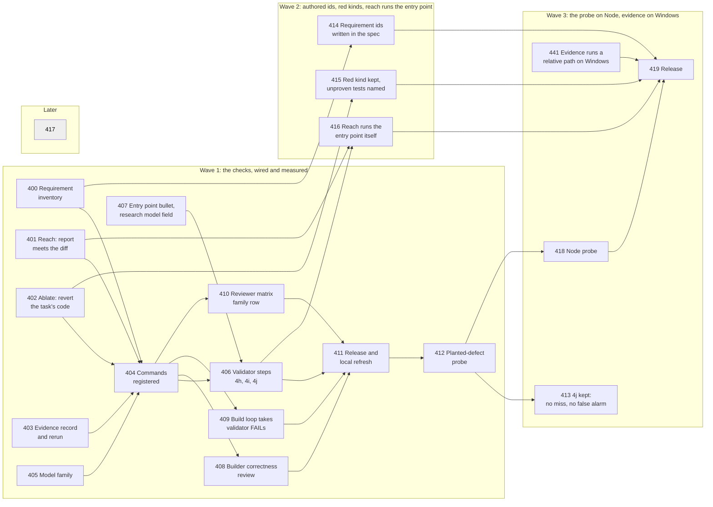

# Verification Goes Beyond Passing Tests

Numbers are task ids. A wave is a group of tasks planned in detail together; the grey box stays a one-line sketch until the station log names the research report each row came from.

## Goal

This plan implements [[SPEC-034-verification-beyond-test-pass]] based on [[research/test-quality/beyond-test-pass/REVIEW-beyond-test-pass]] and its axis files, plus review items B8 and B9 of [[research/llm-research/REVIEW-llm-research-for-compass]]. A task counts as done when the validator shows, with records anyone can rerun, that its changed lines run from the program's real entry point, that its tests fail once its code is reverted, and that each requirement of its spec is met; a requirement found unmet returns as fix work or as a proposed task, never as silence.

## The waves

**Wave 1** builds four mechanical `compass` commands and wires them into the agents. One lists a spec's requirements with stable ids. One reads a coverage report from a run of the task's entry-point command and names every changed line that did not run, refusing to call a missing measurement 0%. One reverts the task's code in a scratch copy and reports which of its tests stay green. One wraps any check so its command, commit, exit code and full output are kept, and can rerun it later. The validator gains three per-task steps that use them; the builder's review adds a second reviewer that judges the diff against the spec; the build loop sends the validator's new FAIL items back to fix builders; the research reviewer's matrix records each agent's model family. The wave ends with a release into this repo and a probe on a small seeded project with one planted instance of each failure, which measures the spec's KPI. It stops at the human's reading of the probe's numbers.

**Wave 2** builds what Wave 1's merged commands already make possible, none of it waiting on the probe. A spec can carry its own requirement ids, so an id stays put when a line is added above it. The test checkpoint keeps why each test was red before the build, so a test that only ever failed to import is named unproven instead of passing as evidence. `compass reach` can run the entry point under coverage itself instead of the validator assembling each recipe by hand. It stops when its automated checks pass.

**Later** waves act on what the probe shows: how much of the spec check a command can carry, a second probe on a Node project, and the verified per-spawn model once [[PLAN-034-checking-cost-follows-task-and-model]] records it.

## Rulings this plan carries

1. **D1, where the entry point is named:** [guess: an `Entry point:` bullet under each code task, beside Automated verification, holding one command; `none: <reason>` for a task with no runnable entry]. The spec stays free of solution detail.
2. **D2, ablation cost:** [guess: ablation runs only the task's own tests (checkpointed plus added in the task diff), measured at seconds; the full suite is never rerun for it].
3. **D3, unit of reachability:** [guess: changed lines from `git diff -U0`, plus LCOV function records (`FNDA:0`) for a function whose name sits on a changed line, which closes the one-line-function blind spot of finding 15 of the reachability gap pass]. No symbol extractor.
4. **D4, ablation station:** [guess: the validator, per task, on that task's merge commit]; it alone sees every task's final merged diff, and the build loop is unchanged by it.
5. **D5, B9 cap rule:** [guess: flag only. Counts stay; each claim's agreement cell adds "n of m share a family" when agreeing agents share one]. One vote per family would collapse every default Compass run, all one family, to single-voter claims.
6. **D6, B8 replace or add:** [guess: add. The correctness reviewer runs beside the style reviewer], so unused imports, debug leftovers, error handling and copy-paste keep their check.
7. **D7, how much an LLM judges:** [guess: a requirement expressible as a test, grep or command goes to that command; the judge, with Read, Grep and Bash in a fresh context, takes the rest]. TASK-412 measures the split.
8. **D8, duplicate number SPEC-034:** [guess: no renumber; numbering is local per folder under [[ADR-003-drop-counter-file-jit-compute]], and prose names the spec by its full stem].
9. **Unmet work appended to an approved plan:** [guess: needs the human's approval again. An unmet requirement owned by a task goes to that task's fix builder under the 3-cycle cap, as a tester bug does; one owned by no task is written as a proposed task line under a `## Proposed by validation` heading, which `/compass:plan iterate` presents for approval before any line reaches `active.md`].
10. **Intersection tool:** [guess: Compass intersects the report with the diff itself, stdlib only, reading Cobertura XML and LCOV]. diff-cover was the measured tool, but it reads `DA` records only and would need installing in every project; the plan's tests replay the research's measured cases.
11. **Evidence location:** [guess: `.compass/evidence/<TASK-NNN>/<check>.json` plus `<check>.out`, committed with the task]. `.compass/tmp/` is gitignored and loses the record.
12. **Validator at build step 8:** [guess: it runs for every phase holding a code task, instead of being offered]. This adds a station; nothing is removed.

## Prerequisites

- `coverage` and `diff-cover` are not needed by Compass; the projects measured by TASK-412 need `coverage` in their venv (the probe creates its own with uv).
- Git 2.x with `git worktree` (used by TASK-402 and TASK-403).

## Desired End State

- `compass requirements`, `compass reach`, `compass ablate` and `compass evidence` run from `plugin/` and `.claude/`.
- The validator report carries Reachability, Change Dependence and Spec Conformance sections per task, each check backed by an evidence record that `compass evidence rerun` reproduces.
- A requirement judged partial, missing or contradicted becomes a fix-loop item or a proposed task.
- The builder's review spawns a correctness reviewer beside the style reviewer.
- Research reports carry `model:`; the reviewer matrix shows family and flags same-family agreement.
- The probe report states, per planted failure, whether the checks flagged it and whether the green suite did.

## What We're NOT Doing

- No change in Wave 1 to the pre-build tester station, the checkpoint format or `compass test-checkpoint`; the red kind is TASK-415 in Wave 2, which adds one key and leaves every other field as it is.
- No mutation gate; per-function stubbing stays an on-demand diagnostic.
- No scaling of checks by task difficulty; that is [[PLAN-034-checking-cost-follows-task-and-model]].
- No edit to any approved spec to add ids; TASK-400 derives ids from the existing text.
- No Playwright, `.pth` or server driver authoring helpers in Wave 1; the validator step documents the recipes and guards.

## Phases

### Wave 1 (detailed): the checks, wired and measured

TASK-400, TASK-401, TASK-402, TASK-403, TASK-405 and TASK-407 start in parallel; their files are disjoint. Contact points with other plans: TASK-404 adds four `COMMAND_SPECS` lines to `plugin/cli/maincli.py`, merged after any open edit there by PLAN-032, PLAN-033 or PLAN-034 TASK-347. TASK-409 edits `plugin/skills/build/SKILL.md` steps 5 and 8; PLAN-034's TASK-343 patch touches only its tester spawns and PLAN-032's edits, whichever lands second rebases on the first. TASK-407 edits `plugin/skills/obsidian/templates.md`, which PLAN-032 also edits; same rule. PLAN-034 TASK-345 files every child session of a builder as `builder-review`, which now includes the correctness reviewer; no change needed there. TASK-402 imports the run-output parser from `plugin/cli/commands/test_checkpoint.py` without editing it, so PLAN-034 TASK-346 owns that file alone.

- [x] TASK-400: `compass requirements <spec>` lists a spec's requirements. `requirementslib.py` reads the spec body and emits one row per requirement: `D-NN` bullets keep their ids through `decisionslib`; every bullet or sentence under `## Desired Outcome`, `## Success Criteria`, `## Constraints` and the `KPI:` line gets `O-n`, `S-n`, `C-n`, `K-1` by section order. Each row carries id, section, text and a 12-hex sha256 of the whitespace-normalized text, so an id whose text changed is visible. `--json` prints rows as JSON; `--for-task TASK-NNN --plan <plan>` filters to the task's `decisions:` plus every non-D row. A `[deferred]` or `[informational]` decision is listed with that tag. Exits 1 on a missing spec, 0 otherwise, also with zero rows - complexity: M, depends_on: none, files: [plugin/cli/requirementslib.py, plugin/cli/commands/requirements.py, plugin/cli/tests/test_requirementslib.py, plugin/cli/tests/test_requirements_command.py], lessons: [LESSON-untestable-criterion-is-a-spec-defect, LESSON-test-delimited-blocks-with-the-delimiter-quoted]
  - Automated verification: `python -m pytest plugin/cli/tests/test_requirementslib.py plugin/cli/tests/test_requirements_command.py -q`; tests cover [[SPEC-034-verification-beyond-test-pass]] itself (no D-NN, yields O-1, C-1, K-1), a spec with D-NN plus a tagged `[deferred]` bullet, a section with a bullet that quotes a heading, and an edit to one sentence changing only that row's hash.
  - Manual verification: none.

- [x] TASK-401: `compass reach --report <file> --diff <range> [--repo <dir>]` intersects a coverage report with a diff. `reachlib.py` reads Cobertura XML (`xml.etree`) and LCOV (`DA` and `FN`/`FNDA` records), maps report paths to repo-relative POSIX paths, and takes added and changed lines from `git diff -U0 <range>` on non-test paths (`tests/`, `test_*`, `*_test.*`, `*.test.*`, `*.spec.*`). It prints per file `path: N of M changed lines run`, names each unrun line, and names each function on a changed line with `FNDA:0`. Guards, each its own verdict and never a percentage: no report file is `SKIP: no measurement`; a report naming none of the diff's files is `SKIP: measurement missed the changed files` (a killed server, an unmeasured child); a diff with no executable change is `N/A`. Verdict line `REACH: PASS|FINDING|SKIP|N/A`; exit 0 for all four, exit 1 for bad arguments only - complexity: L, depends_on: none, files: [plugin/cli/reachlib.py, plugin/cli/commands/reach.py, plugin/cli/tests/test_reachlib.py, plugin/cli/tests/test_reach_command.py, plugin/cli/tests/fixtures/reach/], lessons: [LESSON-revert-to-prove-a-regression-test, LESSON-suite-size-is-not-coverage]
  - Automated verification: `python -m pytest plugin/cli/tests/test_reachlib.py plugin/cli/tests/test_reach_command.py -q`; tests replay the research's measured cases as fixtures: a reached function plus an unreferenced helper (unrun lines named), a one-line JS arrow with `DA:1` and `FNDA:0` (named unreached), an empty report and a report naming other files (both SKIP, never 0%), a CRLF diff, a Windows-style report path, and a diff of only test files (N/A).
  - Manual verification: none.

- [x] TASK-402: `compass ablate TASK-NNN --cmd "<test command with {tests}>" [--refactor] [--merge <sha>]` checks that the task's tests depend on its code. It finds the task's merge commit (`Merge TASK-NNN:` on the current branch, or `--merge`), takes `git diff <merge>^1 <merge>`, splits test paths (the checkpoint's files from `.compass/tmp/test-checkpoints/TASK-NNN.json` when present, plus the TASK-401 test patterns) from the rest, and selects the task's tests: checkpointed files plus test files the diff adds or changes. In `git worktree add` under `.claude/worktrees/ablate-TASK-NNN` at the merge commit it runs the command once (baseline; a red test is reported `baseline-red` and left out), reverts the non-test diff with `git apply -R --ignore-whitespace`, runs again, and reruns once any test that flipped. Per-test outcomes come from the parser in `commands/test_checkpoint.py`, imported unchanged. It prints flipped, unflipped and `collection-error` tests and a verdict: unflipped new tests on a behavior task, or any flip under `--refactor`, is `FINDING`; otherwise `PASS`; a revert that fails to apply is `SKIP` with git's message. The worktree is removed at the end, also on error - complexity: L, depends_on: none, files: [plugin/cli/ablatelib.py, plugin/cli/commands/ablate.py, plugin/cli/tests/test_ablatelib.py, plugin/cli/tests/test_ablate_command.py], lessons: [LESSON-revert-to-prove-a-regression-test, LESSON-verify-wiring-by-call-site-grep]
  - Automated verification: `python -m pytest plugin/cli/tests/test_ablatelib.py plugin/cli/tests/test_ablate_command.py -q`; tests build throwaway git repos with merge commits: a dependent test flips (PASS), a test whose assertion holds without the code stays green (FINDING, named), a refactor with one flip under `--refactor` (FINDING), a baseline-red test (excluded, named), a new module the tests import (reported `collection-error`), a CRLF working tree, and no `.claude/worktrees/ablate-*` left after a forced failure.
  - Manual verification: none.

- [x] TASK-403: `compass evidence run --task TASK-NNN --check <slug> -- <command...>` keeps a check rerunnable; `compass evidence rerun <record>` reruns it; `compass evidence show TASK-NNN` lists records. `run` executes the command, streams nothing, and writes `.compass/evidence/<TASK-NNN>/<slug>.json` (command as argv, cwd relative to the repo, `HEAD` sha, clean or dirty tree with the dirty paths, exit code, start and end time, Python version, `git --version`, sha256 of the output) and `<slug>.out` (full combined output, never truncated), then prints the output's last 40 lines and the record path, and exits with the command's exit code. `rerun` creates a scratch worktree at the recorded sha under `.claude/worktrees/evidence-<slug>`, reruns the argv there, and prints `match` when the exit code equals the recorded one and, for output whose last line starts `REACH:`, `ABLATE:` or `REQ:`, that line is equal too; else `mismatch` with both; it never writes into the record. A dirty-tree record reruns with a warning that the tree held uncommitted changes - complexity: M, depends_on: none, files: [plugin/cli/evidencelib.py, plugin/cli/commands/evidence.py, plugin/cli/tests/test_evidencelib.py, plugin/cli/tests/test_evidence_command.py]
  - Automated verification: `python -m pytest plugin/cli/tests/test_evidencelib.py plugin/cli/tests/test_evidence_command.py -q`; tests cover a passing and a failing command (exit code passed through), 10,000 lines of output kept whole, a rerun that matches, a rerun after the code changed upstream of the sha (still matches, since it reruns at the sha), a rerun whose verdict line differs (mismatch), a dirty-tree record, and a slug with path separators rejected.
  - Manual verification: none.

- [x] TASK-405: Model family. `modelslib.family(model)` maps a model name or id to `claude` (opus, sonnet, haiku, `claude-*`), `gpt` (`gpt-*`, `o1`, `o3`, `o4` and their suffixed forms), `gemini`, `llama`, `qwen`, `deepseek`, `mistral`, else `unknown`; `inherit` maps to `inherit`. `compass resolve-model --family <agent>` prints `<model> <effort> <family>`; without the flag the output stays the two fields - complexity: S, depends_on: none, files: [plugin/cli/modelslib.py, plugin/cli/commands/resolve_model.py, plugin/cli/tests/test_modelslib_family.py]
  - Automated verification: `python -m pytest plugin/cli/tests/test_modelslib_family.py plugin/cli/tests/ -q -k "model"`; tests cover each family, mixed case, a date-suffixed id, an empty string (`unknown`), and the unchanged two-field output of `resolve-model` without the flag.
  - Manual verification: none.

- [x] TASK-404: Register the commands: four `COMMAND_SPECS` lines in `plugin/cli/maincli.py` for `requirements`, `reach`, `ablate` and `evidence`, in the plain words the help tests require - complexity: S, depends_on: TASK-400, TASK-401, TASK-402, TASK-403, TASK-405, files: [plugin/cli/maincli.py]
  - Automated verification: `python plugin/cli/compass requirements .compass/specs/pipeline/SPEC-034-verification-beyond-test-pass.md` prints rows O-1 and C-1; `python plugin/cli/compass reach --help`, `ablate --help` and `evidence --help` exit 0; `python -m pytest plugin/cli/tests -q` is green, including `test_plain_words.py`.
  - Manual verification: none.

- [x] TASK-407: The entry point is named in the plan, and research reports name their model. In `plugin/templates/agents/planner.md` (both task-block examples) and the Plan template of `plugin/skills/obsidian/templates.md`, a code task gains `- Entry point: <one command a user or program runs that reaches the new code>` or `- Entry point: none: <reason>`, with one sentence on what counts (a CLI command, a server start plus a request, a UI script, a hook command line; a test runner is never one). The Research template's frontmatter gains `model: "<exact model id>"` - complexity: S, depends_on: none, files: [plugin/templates/agents/planner.md, plugin/skills/obsidian/templates.md]
  - Automated verification: `grep -c "Entry point:" plugin/templates/agents/planner.md` prints 2 or more; `grep -n "Entry point:" plugin/skills/obsidian/templates.md` finds the Plan template; `grep -n "^model:" plugin/skills/obsidian/templates.md` finds the Research frontmatter; `grep -n "test runner is never" plugin/templates/agents/planner.md` matches.
  - Manual verification: none.

- [x] TASK-406: Validator steps 4h, 4i and 4j in `plugin/templates/agents/validator.md`, each per task, each run through `compass evidence run --task TASK-NNN --check <reach|ablate|req-<id>> -- ...`, each with the `Check / Command run / Output observed / Result` block. **4h Reachability:** run the task's `Entry point:` command under the language's coverage tool with tests excluded and export Cobertura or LCOV (recipes: Python `coverage run --source=<pkg>` then `coverage xml`; Node `c8 --reporter=lcov`; a server started under coverage, driven by a request, stopped through its graceful path; Python children with `[run] patch = subprocess` then `coverage combine`; Pool workers with `concurrency = multiprocessing`; a host-launched hook with the `.pth` plus `COVERAGE_PROCESS_START` route; a UI action with Playwright on Chromium plus server coverage), then `compass reach`. A missing `Entry point:` bullet on a code task is a FAIL of the plan, `none:` is N/A with its reason, `SKIP` is never PASS. **4i Change dependence:** `compass ablate TASK-NNN --cmd "<the project's test command>"`, `--refactor` when the task says so; a FINDING is reported, never a FAIL. **4j Spec conformance:** `compass requirements <spec> --for-task TASK-NNN --plan <plan>`; each requirement a test, grep or command can show goes to that command, the rest is judged against the code in the task's `files:` with Read and Grep; each row gets met, partial, missing, contradicts or unrequested (surfaced, never removed) with severity and file evidence; partial, missing or contradicts is a FAIL item naming the requirement id and its owning task, or `unowned`. Steps 4h and 4i apply to tasks whose `files:` hold executable source; 4j applies to every task. The report gains Reachability, Change Dependence and Spec Conformance sections (`Requirement | Status | Evidence | Task` with counts); step 9's PASS list requires an evidence record path for every check; the read-only paragraph says the evidence records are written by `compass evidence`, the harness's own command; `maxTurns` rises to [guess: 40] - complexity: M, depends_on: TASK-404, TASK-407, files: [plugin/templates/agents/validator.md], lessons: [LESSON-manual-verification-is-judgment-only]
  - Automated verification: `grep -n "^\*\*4h\.\*\*\|^\*\*4i\.\*\*\|^\*\*4j\.\*\*" plugin/templates/agents/validator.md` finds three steps; `grep -c "compass evidence run" plugin/templates/agents/validator.md` is 3 or more; `grep -n "### Reachability\|### Change Dependence\|### Spec Conformance" plugin/templates/agents/validator.md` finds three report sections; `grep -n "never PASS" plugin/templates/agents/validator.md` matches in 4h; `grep -n "^maxTurns: 40" plugin/templates/agents/validator.md` matches; the step 9 list holds "evidence record".
  - Manual verification: none; TASK-412 runs it.

- [x] TASK-408: The builder's review adds correctness against the spec. Step 8 of `plugin/templates/agents/builder.md` keeps the style reviewer unchanged and spawns a second sub-agent, with Read and Grep, given the diff, the task line, and `compass requirements <spec> --for-task TASK-NNN --plan <plan>` output; its charter: per requirement a verdict met, partial, missing or contradicts with file evidence, unrequested code surfaced and never removed, findings it cannot ground in a file dropped, style skipped. The builder fixes partial, missing and contradicts items before handing off; the two reviews' findings go into the build report under their own headings - complexity: S, depends_on: TASK-404, files: [plugin/templates/agents/builder.md]
  - Automated verification: `grep -n "flag unused imports" plugin/templates/agents/builder.md` still matches (style charter kept); `grep -n "compass requirements" plugin/templates/agents/builder.md` matches in step 8; `grep -n "skip style\|Skip style" plugin/templates/agents/builder.md` and `grep -n "never removed" plugin/templates/agents/builder.md` match.
  - Manual verification: none.

- [x] TASK-409: The build loop takes the validator's new FAILs. In `plugin/skills/build/SKILL.md`, step 8 runs the validator for every phase holding a code task [guess, ruling 12] instead of offering it; its Reachability and Spec Conformance FAIL items owned by a task go to a targeted fix builder on the merged branch with the FAIL text only, then the validator reruns those checks through `compass evidence rerun` and the step itself, capped at 3 cycles per task, then escalation. Unowned unmet requirements are appended to the plan under `## Proposed by validation` as `- [ ] TASK-NNN: <gap> per <spec>/<id>` lines with no `decisions:` field and never written to `active.md`; the phase pause names them and `/compass:plan iterate` presents them for approval [guess, ruling 9]. A clean validator run leaves the plan byte-identical. Change Dependence findings go into the phase report only - complexity: M, depends_on: TASK-404, files: [plugin/skills/build/SKILL.md]
  - Automated verification: `grep -n "## Proposed by validation" plugin/skills/build/SKILL.md` matches; `grep -n "compass evidence rerun" plugin/skills/build/SKILL.md` matches; `grep -n "Validate (optional)" plugin/skills/build/SKILL.md` no longer matches; `grep -n "byte-identical" plugin/skills/build/SKILL.md` matches; `grep -n "Max 3 cycles" plugin/skills/build/SKILL.md` still matches.
  - Manual verification: none.

- [x] TASK-410: The reviewer matrix records model family. `plugin/templates/agents/reviewer.md` adds a `Model (family)` row under the matrix header, filled from each input's `model:` frontmatter through `compass resolve-model --family` or, when a report has none, `unknown`; when every agent agreeing on a claim shares one family, its Agreement cell adds `(n of m share <family>)` and the convergence summary counts those claims apart [guess, ruling 5]; counts never change. `plugin/templates/agents/researcher.md` writes `model:` with the exact model id from its own environment line - complexity: S, depends_on: TASK-404, TASK-407, files: [plugin/templates/agents/reviewer.md, plugin/templates/agents/researcher.md]
  - Automated verification: `grep -n "Model (family)" plugin/templates/agents/reviewer.md` matches inside the matrix example; `grep -n "share <family>\|share a family" plugin/templates/agents/reviewer.md` matches; `grep -n "^model:\|model:" plugin/templates/agents/researcher.md` finds the frontmatter instruction.
  - Manual verification: none.

- [x] TASK-411: Release and local refresh: bump `plugin/.claude-plugin/plugin.json` to the next minor, run `python plugin/cli/compass self-update --force` so `.claude/` carries TASK-400 to TASK-410 - complexity: S, depends_on: TASK-406, TASK-408, TASK-409, TASK-410, files: [plugin/.claude-plugin/plugin.json]
  - Automated verification: `python .claude/cli/compass reach --help` and `python .claude/cli/compass evidence --help` exit 0; `grep -n "4j" .claude/agents/validator.md` matches; `grep -n "compass requirements" .claude/agents/builder.md` matches; `python -m pytest plugin/cli/tests -q` is green.
  - Manual verification: none.

- [x] TASK-412: The planted-defect probe, the spec's KPI. `bench/verification/planted.py` builds a throwaway Python project in a temp folder with its own uv venv holding `coverage`, a CLI entry point, a one-spec vault and a three-task plan, and lands each task as a `Merge TASK-NNN:` commit with a suite that stays green: task A adds a helper the CLI never calls; task B adds a behavior whose test passes without it; task C meets two of its spec's three Constraints. The script runs the suite, then `compass reach` and `compass ablate` per task, each through `compass evidence run`, and prints per task whether the green suite flagged anything and whether each check flagged the planted instance. The orchestrator then spawns the validator on the probe plan to run 4j for task C. Results, per planted failure flagged or missed, the verdicts on the unplanted tasks as false positives, each record's `compass evidence rerun` result, wall time and validator tokens, go to `research/test-quality/beyond-test-pass/RESEARCH-planted-defect-probe.md` - complexity: M, depends_on: TASK-411, files: [bench/verification/planted.py, bench/verification/README.md, bench/verification/tests/test_planted.py, .compass/research/test-quality/beyond-test-pass/RESEARCH-planted-defect-probe.md, .compass/research/test-quality/beyond-test-pass/index.md], lessons: [LESSON-revert-to-prove-a-regression-test]
  - Automated verification: `python -m pytest bench/verification/tests/test_planted.py -q` (the project builds, its suite is green, its three merge commits exist); `python bench/verification/planted.py` prints `reach A: FINDING` and `ablate B: FINDING`, and `PASS` for both checks on the tasks without a planted instance of that failure; every record it names reruns to `match`.
  - Manual verification: read the probe report and judge whether the validator's verdict on task C's unmet constraint, and any false positives, are good enough to keep 4j's split between commands and judgment as it is.

**Pause point:** when the automated checks pass, wait for the human to confirm TASK-412's manual check before the next wave is detailed.

### Wave 2 (detailed): authored ids, red kinds, reach runs the entry point

TASK-414, TASK-415 and TASK-416 start in parallel; their files are disjoint. Each keeps the Wave 1 command behavior TASK-412 measures: `compass requirements` on a spec without authored ids, `compass ablate` on a test whose red was its own failure, and `compass reach --report` print what they print today, so the probe's numbers stay comparable whichever lands first. Contact point: TASK-416 edits step 4h of `plugin/templates/agents/validator.md`, and TASK-413 later edits step 4j of the same file. None of the three adds a command, so `plugin/cli/maincli.py` is untouched; a `COMMAND_SPECS` one-liner that `test_plain_words.py` then flags is reworded in the same task.

- [x] TASK-414: Requirement ids written at spec time. A bullet under `## Desired Outcome`, `## Success Criteria` or `## Constraints` may open with an authored id in the D-NN bullet shape, `- **O-01:** text`, `- **S-01:** text` or `- **C-01:** text` (a checkbox bullet as `- [ ] **S-01:** text`); `requirementslib.py` keeps that id for the row and strips it from the row's text before hashing, so an id survives a bullet inserted above it. Authored and derived ids compare by prefix and number (`O-3` equals `O-03`), a derived id skips every number an authored id of its prefix already holds in the spec, and the `KPI:` line stays `K-1`. Two rows with the same id exit 1 naming both line numbers [guess: an error, since a duplicate id makes a citation ambiguous]. An authored id inside a fenced block is text. The Spec template in `plugin/skills/obsidian/templates.md` shows one authored id in each of the three sections and one sentence: ids are optional, written once, never renumbered, and a new bullet takes the next unused number. `plugin/skills/spec/SKILL.md` adds the same rule in one sentence beside its Decisions paragraph - complexity: M, depends_on: TASK-400, files: [plugin/cli/requirementslib.py, plugin/cli/commands/requirements.py, plugin/cli/tests/test_requirementslib_authored.py, plugin/skills/obsidian/templates.md, plugin/skills/spec/SKILL.md], lessons: [LESSON-untestable-criterion-is-a-spec-defect, LESSON-test-delimited-blocks-with-the-delimiter-quoted]
  - Automated verification: `python -m pytest plugin/cli/tests/test_requirementslib_authored.py plugin/cli/tests/test_requirementslib.py plugin/cli/tests/test_requirements_command.py -q`; tests cover a bullet inserted above an authored `O-02` (its id and hash unchanged, the derived ids below it shift), a section mixing `C-01` authored with two unauthored bullets (derived `C-2`, `C-3`), `O-3` beside an authored `O-03` (duplicate, exit 1 naming both lines), the checkbox form, an authored id inside a fence (text), a spec with D-NN bullets beside authored O ids (`compass coverage` on it prints the same summary line as on the spec without them), and [[SPEC-034-verification-beyond-test-pass]] itself (rows unchanged from TASK-400's output); `grep -n "\*\*O-01:\*\*" plugin/skills/obsidian/templates.md` and `grep -n "never renumbered" plugin/skills/spec/SKILL.md` match; `python -m pytest plugin/cli/tests -q` is green.
  - Manual verification: none.
  - Entry point: `python plugin/cli/compass requirements <a spec carrying an authored id>`

- [x] TASK-415: The checkpoint keeps the kind of each red, and `compass ablate` names a test whose only red was a collection error as unproven. `compass test-checkpoint record` with `--red-evidence <path>` parses that file with `_parse_run_evidence` and stores `red_kinds` in the record, one entry per checkpointed test id: `fail` or `error` from its status line, `collection` when the id is absent and the evidence carries a collection-error line for its file (pytest `ERROR collecting <path>` or `ImportError while importing test module`, unittest `Failed to import test module: <module>`), `passed` when it shows `ok`, `absent` otherwise. The collection-error line shapes are read from a real pytest and unittest run before the patterns are written. An unreadable or missing evidence file still writes the record, without `red_kinds`, and warns on stderr; `verify`, `open-ids` and `cycle` read a record with or without the key exactly as today. `ablatelib.py` reads `red_kinds` from the checkpoint it already loads: a test whose kind is `collection` and that does not flip is printed `unproven: <id>` instead of under `unflipped` or `collection-error`, and leaves the verdict as it is [guess: reported, never a FINDING, since every task that adds a new module would otherwise read FINDING on revert]; a test whose kind is `fail` keeps today's handling. `plugin/templates/agents/tester.md` step 5 asks for the runner's verbose output (`pytest -v`, `unittest -v`, TAP) as the red evidence so each test's kind can be read - complexity: M, depends_on: TASK-402, files: [plugin/cli/commands/test_checkpoint.py, plugin/cli/ablatelib.py, plugin/cli/commands/ablate.py, plugin/templates/agents/tester.md, plugin/cli/tests/test_test_checkpoint_red_kind.py, plugin/cli/tests/test_ablate_unproven.py], lessons: [LESSON-revert-to-prove-a-regression-test, LESSON-hook-payloads-observe-before-coding]
  - Automated verification: `python -m pytest plugin/cli/tests/test_test_checkpoint_red_kind.py plugin/cli/tests/test_ablate_unproven.py -q`; tests cover a pytest `-v` evidence file holding one FAILED test, one ERROR test and a collection error in a second file (kinds `fail`, `error`, `collection`), the unittest import-failure form, a test green in the red run (`passed`), evidence saved as UTF-16 and as cp1252, a missing evidence path (record written, no `red_kinds`, warning), a pre-existing record without the key (verify unchanged, ablate prints no `unproven` line), a throwaway repo whose task adds a new module with a checkpointed `collection` test (`unproven:` line, verdict PASS), and the same test with kind `fail` that stays green on revert (`unflipped`, FINDING as today); `python -m pytest plugin/cli/tests -q` is green; `grep -n "pytest -v" plugin/templates/agents/tester.md` matches in step 5.
  - Manual verification: none.
  - Entry point: `python plugin/cli/compass test-checkpoint record TASK-NNN <test files> --commit <sha> --red-evidence <red-run output>`, then `python plugin/cli/compass ablate TASK-NNN --cmd "python -m pytest -v {tests}"`

- [x] TASK-416: `compass reach --run "<command>" --lang python|node --diff <range> [--repo <dir>] [--python <interpreter>]` produces the coverage report itself, then intersects it as `--report` does; `--run` and `--report` are exclusive. Python: [guess: one route for the measured recipes, the `.pth` plus `COVERAGE_PROCESS_START` route] Compass writes an rc file under `.compass/tmp/reach/<UTC>/` (`source` the repo, the TASK-401 test patterns omitted, `parallel = true`, `concurrency = thread, multiprocessing`, `data_file` in that folder), writes `compass_reach_cov.pth` into the interpreter's site-packages for the run and removes it in a `finally`, runs the command through the shell with `COVERAGE_PROCESS_START` set to the rc's absolute path, so the command itself, its Python children, Pool workers and a shell-wrapped hook process are all measured, then runs `coverage combine` and `coverage xml`. The interpreter is `--python`, else `venv/` or `.venv/` in the repo, else `python` on PATH. Node: `npx --no-install c8 --reporter=lcov --report-dir <that folder> <command>`, then the LCOV path. Guards, each its own `SKIP` reason and never a percentage: an interpreter outside a virtual environment (the `.pth` would reach every Python process on the machine), coverage missing or older than 7.10, c8 not installed, a `.pth` of that name already present, and no data file after the run (a hard-killed server). A server is measured when the command is a driver that starts it, sends its requests and stops it through its graceful path. The command's exit code prints as `run exit: N` and leaves the verdict to the report. Step 4h of `plugin/templates/agents/validator.md` names `compass reach --run` as the route for the CLI, child process, Pool, hook and server-driver recipes and keeps the hand recipes for a UI action - complexity: L, depends_on: TASK-401, TASK-406, files: [plugin/cli/reachlib.py, plugin/cli/commands/reach.py, plugin/cli/tests/test_reach_run.py, plugin/templates/agents/validator.md], lessons: [LESSON-suite-size-is-not-coverage, LESSON-verify-wiring-by-call-site-grep]
  - Automated verification: `python -m pytest plugin/cli/tests/test_reach_run.py plugin/cli/tests/test_reach_command.py plugin/cli/tests/test_reachlib.py -q`; tests run in a throwaway repo with a venv created in the test's temp folder (`--system-site-packages`, skipped when the running interpreter lacks coverage 7.10 or later) and cover a CLI script calling the new function (PASS), a new helper it never calls (FINDING naming its lines), a Python child started through `subprocess` and a Pool worker (their lines reached), a shell wrapper launching Python as a hook does (reached), a driver that hard-kills its server child (`SKIP`, no data), an interpreter outside a venv (`SKIP`), a pre-existing `compass_reach_cov.pth` (`SKIP`, the file left as it was), no `compass_reach_cov.pth` left in site-packages after a command that fails, and `--run` with `--report` (exit 1); a Node case runs only when `npx --no-install c8 --version` succeeds; the TASK-401 tests pass unchanged; `grep -n "compass reach --run" plugin/templates/agents/validator.md` matches in 4h; `python -m pytest plugin/cli/tests -q` is green.
  - Manual verification: none.
  - Entry point: `python plugin/cli/compass reach --run "python -m <package> <args>" --lang python --diff HEAD~1..HEAD`

**Pause point:** when Wave 2's automated checks pass, it is done; the next wave is detailed after TASK-412's probe report and the human's reading of it.

### Wave 3 (detailed): the probe on Node, evidence on Windows, release

The probe of TASK-412 flagged each planted failure in six of six builds with no false alarm on the corrected seed ([[research/test-quality/beyond-test-pass/RESEARCH-planted-defect-probe]]). TASK-441 and TASK-418 start in parallel; their files are disjoint. TASK-419 follows both.

- [x] TASK-413: Tune 4j's split between commands and judgment where TASK-412 showed a miss or a false positive. The probe showed neither: the planted constraint was flagged in six of six runs, and the corrected seed's 18 control rows held no false alarm, so step 4j stays as it is and no file changes - complexity: S, depends_on: TASK-412, files: []
  - Automated verification: `grep -n "0 of 18 control rows" .compass/research/test-quality/beyond-test-pass/RESEARCH-planted-defect-probe.md` matches; `git diff <wave base> -- plugin/templates/agents/validator.md` is empty.
  - Manual verification: none.
  - Entry point: none: no code changes.

- [ ] TASK-441: `compass evidence run` and `rerun` start a command whose first word is a relative path written with forward slashes, as `.venv/Scripts/python.exe`, on Windows. `_execute` in `evidencelib.py` runs such a first word with its separators turned to backslashes, resolved against the command's working directory; the record keeps the argv exactly as given, so a rerun on any platform starts the same command. A first word with no separator, an absolute path, or any later argument is passed unchanged; on POSIX nothing changes. A first word that names no file still records exit 127 with the system's message, as today - complexity: S, depends_on: none, files: [plugin/cli/evidencelib.py, plugin/cli/tests/test_evidence_relative_argv.py], lessons: [LESSON-verify-wiring-by-call-site-grep]
  - Automated verification: `python -m pytest plugin/cli/tests/test_evidence_relative_argv.py plugin/cli/tests/test_evidencelib.py plugin/cli/tests/test_evidence_command.py -q`; tests cover, on Windows (skipped elsewhere), a relative forward-slash path to a Python interpreter copied into the throwaway repo that exits 0 and prints its output, the record's argv holding the forward-slash text unchanged, a rerun of that record printing `match`, a missing relative file recording exit 127, and a bare command name (`git --version`) and an absolute path running as before; on every platform a later argument holding `/` is passed unchanged; `python -m pytest plugin/cli/tests -q` is green.
  - Manual verification: none.
  - Entry point: `python plugin/cli/compass evidence run --task TASK-001 --check t -- .venv/Scripts/python.exe -c "print(1)"`

- [ ] TASK-418: A second planted-defect probe on a Node project. `python bench/verification/planted.py --lang node` builds the same three-task plan and spec as the Python probe on a Node package: `src/core.js` defines each function as its own `exports.<name> = ...` statement so a later task appends without moving an earlier task's lines; `bin/tally.js` is the command line; tests use `node:test`. Task A appends the one-line arrow `exports.formatTotal = (n) => n.toLocaleString("en-US");`, whose line runs when the module loads while the function never runs (the one-line-function case, LCOV `DA` hit with `FNDA:0`); task B replaces the one counting line and its tests pass without it; task C appends `exports.top` and adds `src/server.js`, an HTTP server whose `/top?text=` route answers with the most frequent word (C-3 unmet as in the Python seed), with `scripts/drive.js` as its entry point: it starts the server on port 0, sends one request, prints the answer and closes the server through `server.close()`. Every changed line of task C runs from that entry point. c8 is installed from npm into `<root>/.tools` with `npm install -g --prefix`, and every check and rerun runs with `npm_config_prefix` set to that folder, so `compass reach --run --lang node` finds c8 also in the scratch worktree of `compass evidence rerun`; the test command is `node --test --test-reporter=tap {tests}`. `EXPECTED` for Node is the Python one; if reach answers PASS on task A, the run reports it as a miss and the research page records it, never adjusted to pass. `--lang python` stays the default and its output is unchanged. The results go to a "Node project" section of the research page - complexity: L, depends_on: TASK-412, files: [bench/verification/planted.py, bench/verification/README.md, bench/verification/tests/test_planted_node.py, .compass/research/test-quality/beyond-test-pass/RESEARCH-planted-defect-probe.md], lessons: [LESSON-suite-size-is-not-coverage, LESSON-revert-to-prove-a-regression-test]
  - Automated verification: `python -m pytest bench/verification/tests -q -p no:cacheprovider`; the Node tests skip when `node` or `npm` is missing or the c8 install fails, and cover: the build's suite green under `node --test`, three `Merge TASK-00N:` commits, `compass requirements` on the seed listing the same seven rows, the reach report of task A naming `formatTotal` as an unreached function, the driver's request answered and the server closed (the run exits 0 with no process left), every record rerunning to `match`, and `--lang python` output unchanged; `python bench/verification/planted.py --lang node` prints `reach A: FINDING` and `ablate B: FINDING`, `PASS` for the other four checks and `match` for every rerun.
  - Manual verification: none.
  - Entry point: `python bench/verification/planted.py --lang node`

- [ ] TASK-419: Release of the later wave and local refresh: bump `plugin/.claude-plugin/plugin.json` to the next minor, run `python plugin/cli/compass self-update --force` so `.claude/` carries TASK-414 to TASK-441 - complexity: S, depends_on: TASK-441, TASK-418, files: [plugin/.claude-plugin/plugin.json]
  - Automated verification: `python .claude/cli/compass reach --help` exits 0 and prints the `--run` form; `grep -n "compass reach --run" .claude/agents/validator.md` matches; `python -m pytest plugin/cli/tests -q` is green.
  - Manual verification: none.
  - Entry point: none: a release has no new code path.

**Pause point:** when Wave 3's automated checks pass, it is done; TASK-417 stays under Later until the station log holds rows that name the research report they came from.

## Later (intent only)

- [ ] TASK-417: The reviewer reads each agent's verified model from the station log of [[PLAN-034-checking-cost-follows-task-and-model]] TASK-346 instead of the report's self-stated `model:`, and flags a mismatch between the two - files: [plugin/templates/agents/reviewer.md]

## Risks

- **The judge in 4j misses or invents gaps.** Research has no accuracy figure for 2025-2026 models on this task; TASK-412 measures it on a planted case, and TASK-413 acts on the result.
- **Derived requirement ids shift when a spec is edited above them.** The text hash makes a shift visible; TASK-414 adds authored ids.
- **A coverage run fails silently upstream of the report.** TASK-401's guards turn a missing or foreign report into SKIP, never 0% or PASS; a measured-but-wrong child process is still possible, so 4h lists each recipe's silent failure.
- **The validator's turn budget.** Three more steps per task may exceed it on a large wave; TASK-406 raises `maxTurns`, and TASK-412 records turns used.
- **The `.pth` file of `reach --run` outlives a killed run.** It loads coverage into every process of that interpreter; TASK-416 confines it to a virtual environment, removes it in a `finally`, gives it one fixed name, and refuses to run while a file of that name is present, so a leftover is reported on the next run.
- **Evidence files grow the repo.** Outputs are text and kept per task; a later move to a colder home stays possible under the Data rule, since `rerun` needs only the JSON and the sha.

## Inherited Questions (from spec)

None open. The review's eight disagreements and its gate question are settled by the rulings above, pending the human's approval.

## Wave 2 elaborated

Inputs read: the Wave 1 merge (01bff99, TASK-400 to TASK-410 checked, suites green at CLI 2766 and bench 1129), `compass coverage` (no trackable decisions, PASS) and `compass lesson-coverage` (6 cited, 1 surfaced but uncited, PASS). TASK-411 and TASK-412 have not run. Three intent lines rest only on commands Wave 1 merged and tested, so they are promoted; four wait on something not yet observed and stay under Later.

- **TASK-414:** the intent named `O-NN`/`C-NN` ids for three sections; the detail adds `S-NN` for Success Criteria, the section the intent listed, since TASK-400 derives `S-n` rows there. The bullet shape is the D-NN one because `decisionslib` scans bold-id bullets only inside a Decisions section, so `- **O-01:**` under Desired Outcome cannot read as a malformed decision (checked in `plugin/cli/decisionslib.py`, `extract_decisions`). The duplicate-id error and the numeric comparison of `O-3` and `O-03` are new, from TASK-400's derived numbering, which an authored id could otherwise collide with.
- **TASK-415:** the intent's "unproven until it flips" became a reported line that leaves the verdict alone, from TASK-402's code: `ablatelib.py` already prints `collection-error` for a test that vanishes once the task's code is reverted, which is every test of a task that adds a new module, so a FINDING there would fire on every such task. `test_checkpoint.py` was owned by [[PLAN-034-checking-cost-follows-task-and-model]] TASK-346 during Wave 1; that task is done, so the file is free. `ablate.py` joins the file list for its output docstring. [[LESSON-hook-payloads-observe-before-coding]], surfaced but uncited by `compass lesson-coverage`, is cited here for reading the real collection-error lines before writing patterns.
- **TASK-416:** the intent's five recipes collapse into one Python route, the `.pth` plus `COVERAGE_PROCESS_START` route that [[research/test-quality/beyond-test-pass/RESEARCH-reachability]] measured on a hook stand-in, since with it every Python process the command starts measures itself; the virtual-environment guard and the leftover-file guard are new, from that route writing into site-packages. The intent's guard "the data file exists and names the source files" is split: no data file is a new `SKIP`, and a report naming none of the changed files is TASK-401's existing `SKIP`, reused. `validator.md` joins the file list so 4h calls the new route; without a call site the flag would ship unused.
- **TASK-413 stays:** it tunes 4j from the misses and false positives TASK-412 reports.
- **TASK-417 stays:** the station log of TASK-346 records tester, validator, builder and debug stations (`plugin/cli/stationlib.py`), and a row carries no field naming the research report it came from, so the reviewer cannot yet match a row to a report's `model:`; PLAN-034 TASK-348, which checks the rows live in this repo, has not run.
- **TASK-418 stays:** it reuses `bench/verification/planted.py`, which TASK-412 writes.
- **TASK-419 stays:** it releases the later wave, TASK-413 included, so it waits on TASK-413; Wave 2's changes reach `.claude/` through it.

## Wave 3 elaborated

Inputs read: TASK-412's probe ([[research/test-quality/beyond-test-pass/RESEARCH-planted-defect-probe]]): reach, ablate and 4j each flagged their planted failure in six of six builds, the green suite flagged none, 0 of 18 control rows were judged unmet on the corrected seed, and 56 records reran to `match`. The station log of [[PLAN-034-checking-cost-follows-task-and-model]] holds 55 rows from builder, tester, tester-pre, tester-post and planner stations, none naming a research report.

- **TASK-413:** the intent made the tuning conditional on a miss or a false positive, and the probe found neither, so the task closes with no file changed. The first seed's `partial` rows were real gaps in that seed, not false alarms, and the seed was corrected rather than the check.
- **TASK-441:** new, from the probe: one 4j session passed `.venv/Scripts/python.exe` to `compass evidence run`, which on Windows could not start it and recorded exit 127. Python's `subprocess` hands a forward-slash relative path to `CreateProcess`, which does not find it; the same path with backslashes runs (checked on the probe project).
- **TASK-418:** the intent named a server route and a one-line function through c8 LCOV; the detail keeps both and adds the c8 install into a prefix folder, since a scratch worktree of `compass evidence rerun` holds no `node_modules` and `npx --no-install` there would answer that c8 is missing (checked: c8 12.0.0 runs from such a prefix through `npm_config_prefix`). It replays the mechanical checks on Node and adds no judge run; 4j reads the code the same way in either language.
- **TASK-419:** unchanged - intent held; its depends_on now names TASK-441 and TASK-418.
- **TASK-417 stays:** the station log holds no row that names the research report it came from.
