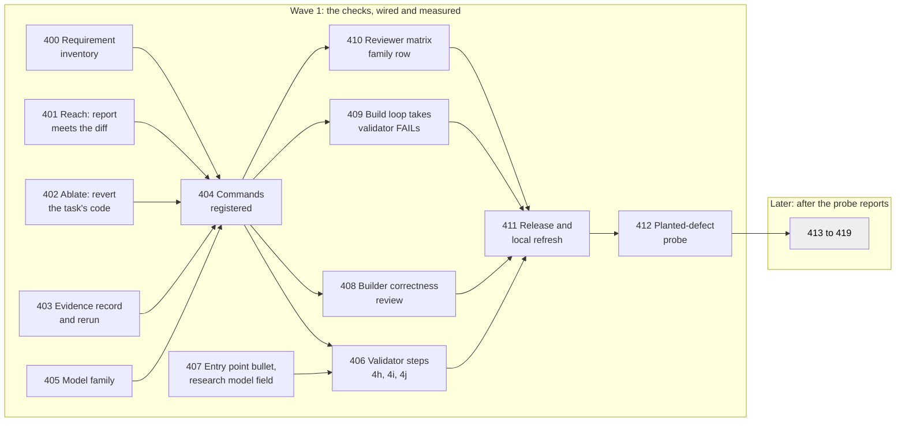

# Verification Goes Beyond Passing Tests

Numbers are task ids (provisional until approval). A wave is a group of tasks planned in detail together; the grey box stays one-line sketches until the probe in TASK-412 reports.

> [!IMPORTANT]
> You decide: approve this plan, including the twelve rulings under "Rulings this plan carries". Each is the research review's recommended option or the planner's, taken as the default and marked [guess] where it is used; approving confirms all twelve, and a note on any one changes it.

## Goal

This plan implements [[SPEC-034-verification-beyond-test-pass]] based on [[research/test-quality/beyond-test-pass/REVIEW-beyond-test-pass]] and its axis files, plus review items B8 and B9 of [[research/llm-research/REVIEW-llm-research-for-compass]]. A task counts as done when the validator shows, with records anyone can rerun, that its changed lines run from the program's real entry point, that its tests fail once its code is reverted, and that each requirement of its spec is met; a requirement found unmet returns as fix work or as a proposed task, never as silence.

## The waves

**Wave 1** builds four mechanical `compass` commands and wires them into the agents. One lists a spec's requirements with stable ids. One reads a coverage report from a run of the task's entry-point command and names every changed line that did not run, refusing to call a missing measurement 0%. One reverts the task's code in a scratch copy and reports which of its tests stay green. One wraps any check so its command, commit, exit code and full output are kept, and can rerun it later. The validator gains three per-task steps that use them; the builder's review adds a second reviewer that judges the diff against the spec; the build loop sends the validator's new FAIL items back to fix builders; the research reviewer's matrix records each agent's model family. The wave ends with a release into this repo and a probe on a small seeded project with one planted instance of each failure, which measures the spec's KPI. It stops at the human's reading of the probe's numbers.

**Later** waves act on what the probe shows: how much of the spec check a command can carry, spec-time requirement ids, per-language driver help for servers, hooks and UI actions, and the verified per-spawn model once [[PLAN-034-checking-cost-follows-task-and-model]] records it.

## Rulings this plan carries

1. **D1, where the entry point is named:** [guess: an `Entry point:` bullet under each code task, beside Automated verification, holding one command; `none: <reason>` for a task with no runnable entry]. The spec stays free of solution detail.
2. **D2, ablation cost:** [guess: ablation runs only the task's own tests (checkpointed plus added in the task diff), measured at seconds; the full suite is never rerun for it].
3. **D3, unit of reachability:** [guess: changed lines from `git diff -U0`, plus LCOV function records (`FNDA:0`) for a function whose name sits on a changed line, which closes the one-line-function blind spot of finding 15 of the reachability gap pass]. No symbol extractor.
4. **D4, ablation station:** [guess: the validator, per task, on that task's merge commit]; it alone sees every task's final merged diff, and the build loop is unchanged by it.
5. **D5, B9 cap rule:** [guess: flag only. Counts stay; each claim's agreement cell adds "n of m share a family" when agreeing agents share one]. One vote per family would collapse every default Compass run, all one family, to single-voter claims.
6. **D6, B8 replace or add:** [guess: add. The correctness reviewer runs beside the style reviewer], so unused imports, debug leftovers, error handling and copy-paste keep their check.
7. **D7, how much an LLM judges:** [guess: a requirement expressible as a test, grep or command goes to that command; the judge, with Read, Grep and Bash in a fresh context, takes the rest]. TASK-412 measures the split.
8. **D8, duplicate number SPEC-034:** [guess: no renumber; numbering is local per folder under [[ADR-003-drop-counter-file-jit-compute]], and prose names the spec by its full stem].
9. **Unmet work appended to an approved plan:** [guess: needs the human's approval again. An unmet requirement owned by a task goes to that task's fix builder under the 3-cycle cap, as a tester bug does; one owned by no task is written as a proposed task line under a `## Proposed by validation` heading, which `/compass:plan iterate` presents for approval before any line reaches `active.md`].
10. **Intersection tool:** [guess: Compass intersects the report with the diff itself, stdlib only, reading Cobertura XML and LCOV]. diff-cover was the measured tool, but it reads `DA` records only and would need installing in every project; the plan's tests replay the research's measured cases.
11. **Evidence location:** [guess: `.compass/evidence/<TASK-NNN>/<check>.json` plus `<check>.out`, committed with the task]. `.compass/tmp/` is gitignored and loses the record.
12. **Validator at build step 8:** [guess: it runs for every phase holding a code task, instead of being offered]. This adds a station; nothing is removed.

## Prerequisites

- `coverage` and `diff-cover` are not needed by Compass; the projects measured by TASK-412 need `coverage` in their venv (the probe creates its own with uv).
- Git 2.x with `git worktree` (used by TASK-402 and TASK-403).

## Desired End State

- `compass requirements`, `compass reach`, `compass ablate` and `compass evidence` run from `plugin/` and `.claude/`.
- The validator report carries Reachability, Change Dependence and Spec Conformance sections per task, each check backed by an evidence record that `compass evidence rerun` reproduces.
- A requirement judged partial, missing or contradicted becomes a fix-loop item or a proposed task.
- The builder's review spawns a correctness reviewer beside the style reviewer.
- Research reports carry `model:`; the reviewer matrix shows family and flags same-family agreement.
- The probe report states, per planted failure, whether the checks flagged it and whether the green suite did.

## What We're NOT Doing

- No change to the pre-build tester station, the checkpoint format or `compass test-checkpoint` (red kind is a Later line).
- No mutation gate; per-function stubbing stays an on-demand diagnostic.
- No scaling of checks by task difficulty; that is [[PLAN-034-checking-cost-follows-task-and-model]].
- No edit to any approved spec to add ids; TASK-400 derives ids from the existing text.
- No Playwright, `.pth` or server driver authoring helpers in Wave 1; the validator step documents the recipes and guards.

## Phases

### Wave 1 (detailed): the checks, wired and measured

TASK-400, TASK-401, TASK-402, TASK-403, TASK-405 and TASK-407 start in parallel; their files are disjoint. Contact points with other plans: TASK-404 adds four `COMMAND_SPECS` lines to `plugin/cli/maincli.py`, merged after any open edit there by PLAN-032, PLAN-033 or PLAN-034 TASK-347. TASK-409 edits `plugin/skills/build/SKILL.md` steps 5 and 8; PLAN-034's TASK-343 patch touches only its tester spawns and PLAN-032's edits, whichever lands second rebases on the first. TASK-407 edits `plugin/skills/obsidian/templates.md`, which PLAN-032 also edits; same rule. PLAN-034 TASK-345 files every child session of a builder as `builder-review`, which now includes the correctness reviewer; no change needed there. TASK-402 imports the run-output parser from `plugin/cli/commands/test_checkpoint.py` without editing it, so PLAN-034 TASK-346 owns that file alone.

- [ ] TASK-400: `compass requirements <spec>` lists a spec's requirements. `requirementslib.py` reads the spec body and emits one row per requirement: `D-NN` bullets keep their ids through `decisionslib`; every bullet or sentence under `## Desired Outcome`, `## Success Criteria`, `## Constraints` and the `KPI:` line gets `O-n`, `S-n`, `C-n`, `K-1` by section order. Each row carries id, section, text and a 12-hex sha256 of the whitespace-normalized text, so an id whose text changed is visible. `--json` prints rows as JSON; `--for-task TASK-NNN --plan <plan>` filters to the task's `decisions:` plus every non-D row. A `[deferred]` or `[informational]` decision is listed with that tag. Exits 1 on a missing spec, 0 otherwise, also with zero rows - complexity: M, depends_on: none, files: [plugin/cli/requirementslib.py, plugin/cli/commands/requirements.py, plugin/cli/tests/test_requirementslib.py, plugin/cli/tests/test_requirements_command.py], lessons: [LESSON-untestable-criterion-is-a-spec-defect, LESSON-test-delimited-blocks-with-the-delimiter-quoted]
  - Automated verification: `python -m pytest plugin/cli/tests/test_requirementslib.py plugin/cli/tests/test_requirements_command.py -q`; tests cover [[SPEC-034-verification-beyond-test-pass]] itself (no D-NN, yields O-1, C-1, K-1), a spec with D-NN plus a tagged `[deferred]` bullet, a section with a bullet that quotes a heading, and an edit to one sentence changing only that row's hash.
  - Manual verification: none.

- [ ] TASK-401: `compass reach --report <file> --diff <range> [--repo <dir>]` intersects a coverage report with a diff. `reachlib.py` reads Cobertura XML (`xml.etree`) and LCOV (`DA` and `FN`/`FNDA` records), maps report paths to repo-relative POSIX paths, and takes added and changed lines from `git diff -U0 <range>` on non-test paths (`tests/`, `test_*`, `*_test.*`, `*.test.*`, `*.spec.*`). It prints per file `path: N of M changed lines run`, names each unrun line, and names each function on a changed line with `FNDA:0`. Guards, each its own verdict and never a percentage: no report file is `SKIP: no measurement`; a report naming none of the diff's files is `SKIP: measurement missed the changed files` (a killed server, an unmeasured child); a diff with no executable change is `N/A`. Verdict line `REACH: PASS|FINDING|SKIP|N/A`; exit 0 for all four, exit 1 for bad arguments only - complexity: L, depends_on: none, files: [plugin/cli/reachlib.py, plugin/cli/commands/reach.py, plugin/cli/tests/test_reachlib.py, plugin/cli/tests/test_reach_command.py, plugin/cli/tests/fixtures/reach/], lessons: [LESSON-revert-to-prove-a-regression-test, LESSON-suite-size-is-not-coverage]
  - Automated verification: `python -m pytest plugin/cli/tests/test_reachlib.py plugin/cli/tests/test_reach_command.py -q`; tests replay the research's measured cases as fixtures: a reached function plus an unreferenced helper (unrun lines named), a one-line JS arrow with `DA:1` and `FNDA:0` (named unreached), an empty report and a report naming other files (both SKIP, never 0%), a CRLF diff, a Windows-style report path, and a diff of only test files (N/A).
  - Manual verification: none.

- [ ] TASK-402: `compass ablate TASK-NNN --cmd "<test command with {tests}>" [--refactor] [--merge <sha>]` checks that the task's tests depend on its code. It finds the task's merge commit (`Merge TASK-NNN:` on the current branch, or `--merge`), takes `git diff <merge>^1 <merge>`, splits test paths (the checkpoint's files from `.compass/tmp/test-checkpoints/TASK-NNN.json` when present, plus the TASK-401 test patterns) from the rest, and selects the task's tests: checkpointed files plus test files the diff adds or changes. In `git worktree add` under `.claude/worktrees/ablate-TASK-NNN` at the merge commit it runs the command once (baseline; a red test is reported `baseline-red` and left out), reverts the non-test diff with `git apply -R --ignore-whitespace`, runs again, and reruns once any test that flipped. Per-test outcomes come from the parser in `commands/test_checkpoint.py`, imported unchanged. It prints flipped, unflipped and `collection-error` tests and a verdict: unflipped new tests on a behavior task, or any flip under `--refactor`, is `FINDING`; otherwise `PASS`; a revert that fails to apply is `SKIP` with git's message. The worktree is removed at the end, also on error - complexity: L, depends_on: none, files: [plugin/cli/ablatelib.py, plugin/cli/commands/ablate.py, plugin/cli/tests/test_ablatelib.py, plugin/cli/tests/test_ablate_command.py], lessons: [LESSON-revert-to-prove-a-regression-test, LESSON-verify-wiring-by-call-site-grep]
  - Automated verification: `python -m pytest plugin/cli/tests/test_ablatelib.py plugin/cli/tests/test_ablate_command.py -q`; tests build throwaway git repos with merge commits: a dependent test flips (PASS), a test whose assertion holds without the code stays green (FINDING, named), a refactor with one flip under `--refactor` (FINDING), a baseline-red test (excluded, named), a new module the tests import (reported `collection-error`), a CRLF working tree, and no `.claude/worktrees/ablate-*` left after a forced failure.
  - Manual verification: none.

- [ ] TASK-403: `compass evidence run --task TASK-NNN --check <slug> -- <command...>` keeps a check rerunnable; `compass evidence rerun <record>` reruns it; `compass evidence show TASK-NNN` lists records. `run` executes the command, streams nothing, and writes `.compass/evidence/<TASK-NNN>/<slug>.json` (command as argv, cwd relative to the repo, `HEAD` sha, clean or dirty tree with the dirty paths, exit code, start and end time, Python version, `git --version`, sha256 of the output) and `<slug>.out` (full combined output, never truncated), then prints the output's last 40 lines and the record path, and exits with the command's exit code. `rerun` creates a scratch worktree at the recorded sha under `.claude/worktrees/evidence-<slug>`, reruns the argv there, and prints `match` when the exit code equals the recorded one and, for output whose last line starts `REACH:`, `ABLATE:` or `REQ:`, that line is equal too; else `mismatch` with both; it never writes into the record. A dirty-tree record reruns with a warning that the tree held uncommitted changes - complexity: M, depends_on: none, files: [plugin/cli/evidencelib.py, plugin/cli/commands/evidence.py, plugin/cli/tests/test_evidencelib.py, plugin/cli/tests/test_evidence_command.py]
  - Automated verification: `python -m pytest plugin/cli/tests/test_evidencelib.py plugin/cli/tests/test_evidence_command.py -q`; tests cover a passing and a failing command (exit code passed through), 10,000 lines of output kept whole, a rerun that matches, a rerun after the code changed upstream of the sha (still matches, since it reruns at the sha), a rerun whose verdict line differs (mismatch), a dirty-tree record, and a slug with path separators rejected.
  - Manual verification: none.

- [ ] TASK-405: Model family. `modelslib.family(model)` maps a model name or id to `claude` (opus, sonnet, haiku, `claude-*`), `gpt` (`gpt-*`, `o1`, `o3`, `o4` and their suffixed forms), `gemini`, `llama`, `qwen`, `deepseek`, `mistral`, else `unknown`; `inherit` maps to `inherit`. `compass resolve-model --family <agent>` prints `<model> <effort> <family>`; without the flag the output stays the two fields - complexity: S, depends_on: none, files: [plugin/cli/modelslib.py, plugin/cli/commands/resolve_model.py, plugin/cli/tests/test_modelslib_family.py]
  - Automated verification: `python -m pytest plugin/cli/tests/test_modelslib_family.py plugin/cli/tests/ -q -k "model"`; tests cover each family, mixed case, a date-suffixed id, an empty string (`unknown`), and the unchanged two-field output of `resolve-model` without the flag.
  - Manual verification: none.

- [ ] TASK-404: Register the commands: four `COMMAND_SPECS` lines in `plugin/cli/maincli.py` for `requirements`, `reach`, `ablate` and `evidence`, in the plain words the help tests require - complexity: S, depends_on: TASK-400, TASK-401, TASK-402, TASK-403, TASK-405, files: [plugin/cli/maincli.py]
  - Automated verification: `python plugin/cli/compass requirements .compass/specs/pipeline/SPEC-034-verification-beyond-test-pass.md` prints rows O-1 and C-1; `python plugin/cli/compass reach --help`, `ablate --help` and `evidence --help` exit 0; `python -m pytest plugin/cli/tests -q` is green, including `test_plain_words.py`.
  - Manual verification: none.

- [ ] TASK-407: The entry point is named in the plan, and research reports name their model. In `plugin/templates/agents/planner.md` (both task-block examples) and the Plan template of `plugin/skills/obsidian/templates.md`, a code task gains `- Entry point: <one command a user or program runs that reaches the new code>` or `- Entry point: none: <reason>`, with one sentence on what counts (a CLI command, a server start plus a request, a UI script, a hook command line; a test runner is never one). The Research template's frontmatter gains `model: "<exact model id>"` - complexity: S, depends_on: none, files: [plugin/templates/agents/planner.md, plugin/skills/obsidian/templates.md]
  - Automated verification: `grep -c "Entry point:" plugin/templates/agents/planner.md` prints 2 or more; `grep -n "Entry point:" plugin/skills/obsidian/templates.md` finds the Plan template; `grep -n "^model:" plugin/skills/obsidian/templates.md` finds the Research frontmatter; `grep -n "test runner is never" plugin/templates/agents/planner.md` matches.
  - Manual verification: none.

- [ ] TASK-406: Validator steps 4h, 4i and 4j in `plugin/templates/agents/validator.md`, each per task, each run through `compass evidence run --task TASK-NNN --check <reach|ablate|req-<id>> -- ...`, each with the `Check / Command run / Output observed / Result` block. **4h Reachability:** run the task's `Entry point:` command under the language's coverage tool with tests excluded and export Cobertura or LCOV (recipes: Python `coverage run --source=<pkg>` then `coverage xml`; Node `c8 --reporter=lcov`; a server started under coverage, driven by a request, stopped through its graceful path; Python children with `[run] patch = subprocess` then `coverage combine`; Pool workers with `concurrency = multiprocessing`; a host-launched hook with the `.pth` plus `COVERAGE_PROCESS_START` route; a UI action with Playwright on Chromium plus server coverage), then `compass reach`. A missing `Entry point:` bullet on a code task is a FAIL of the plan, `none:` is N/A with its reason, `SKIP` is never PASS. **4i Change dependence:** `compass ablate TASK-NNN --cmd "<the project's test command>"`, `--refactor` when the task says so; a FINDING is reported, never a FAIL. **4j Spec conformance:** `compass requirements <spec> --for-task TASK-NNN --plan <plan>`; each requirement a test, grep or command can show goes to that command, the rest is judged against the code in the task's `files:` with Read and Grep; each row gets met, partial, missing, contradicts or unrequested (surfaced, never removed) with severity and file evidence; partial, missing or contradicts is a FAIL item naming the requirement id and its owning task, or `unowned`. Steps 4h and 4i apply to tasks whose `files:` hold executable source; 4j applies to every task. The report gains Reachability, Change Dependence and Spec Conformance sections (`Requirement | Status | Evidence | Task` with counts); step 9's PASS list requires an evidence record path for every check; the read-only paragraph says the evidence records are written by `compass evidence`, the harness's own command; `maxTurns` rises to [guess: 40] - complexity: M, depends_on: TASK-404, TASK-407, files: [plugin/templates/agents/validator.md], lessons: [LESSON-manual-verification-is-judgment-only]
  - Automated verification: `grep -n "^\*\*4h\.\*\*\|^\*\*4i\.\*\*\|^\*\*4j\.\*\*" plugin/templates/agents/validator.md` finds three steps; `grep -c "compass evidence run" plugin/templates/agents/validator.md` is 3 or more; `grep -n "### Reachability\|### Change Dependence\|### Spec Conformance" plugin/templates/agents/validator.md` finds three report sections; `grep -n "never PASS" plugin/templates/agents/validator.md` matches in 4h; `grep -n "^maxTurns: 40" plugin/templates/agents/validator.md` matches; the step 9 list holds "evidence record".
  - Manual verification: none; TASK-412 runs it.

- [ ] TASK-408: The builder's review adds correctness against the spec. Step 8 of `plugin/templates/agents/builder.md` keeps the style reviewer unchanged and spawns a second sub-agent, with Read and Grep, given the diff, the task line, and `compass requirements <spec> --for-task TASK-NNN --plan <plan>` output; its charter: per requirement a verdict met, partial, missing or contradicts with file evidence, unrequested code surfaced and never removed, findings it cannot ground in a file dropped, style skipped. The builder fixes partial, missing and contradicts items before handing off; the two reviews' findings go into the build report under their own headings - complexity: S, depends_on: TASK-404, files: [plugin/templates/agents/builder.md]
  - Automated verification: `grep -n "flag unused imports" plugin/templates/agents/builder.md` still matches (style charter kept); `grep -n "compass requirements" plugin/templates/agents/builder.md` matches in step 8; `grep -n "skip style\|Skip style" plugin/templates/agents/builder.md` and `grep -n "never removed" plugin/templates/agents/builder.md` match.
  - Manual verification: none.

- [ ] TASK-409: The build loop takes the validator's new FAILs. In `plugin/skills/build/SKILL.md`, step 8 runs the validator for every phase holding a code task [guess, ruling 12] instead of offering it; its Reachability and Spec Conformance FAIL items owned by a task go to a targeted fix builder on the merged branch with the FAIL text only, then the validator reruns those checks through `compass evidence rerun` and the step itself, capped at 3 cycles per task, then escalation. Unowned unmet requirements are appended to the plan under `## Proposed by validation` as `- [ ] TASK-NNN: <gap> per <spec>/<id>` lines with no `decisions:` field and never written to `active.md`; the phase pause names them and `/compass:plan iterate` presents them for approval [guess, ruling 9]. A clean validator run leaves the plan byte-identical. Change Dependence findings go into the phase report only - complexity: M, depends_on: TASK-404, files: [plugin/skills/build/SKILL.md]
  - Automated verification: `grep -n "## Proposed by validation" plugin/skills/build/SKILL.md` matches; `grep -n "compass evidence rerun" plugin/skills/build/SKILL.md` matches; `grep -n "Validate (optional)" plugin/skills/build/SKILL.md` no longer matches; `grep -n "byte-identical" plugin/skills/build/SKILL.md` matches; `grep -n "Max 3 cycles" plugin/skills/build/SKILL.md` still matches.
  - Manual verification: none.

- [ ] TASK-410: The reviewer matrix records model family. `plugin/templates/agents/reviewer.md` adds a `Model (family)` row under the matrix header, filled from each input's `model:` frontmatter through `compass resolve-model --family` or, when a report has none, `unknown`; when every agent agreeing on a claim shares one family, its Agreement cell adds `(n of m share <family>)` and the convergence summary counts those claims apart [guess, ruling 5]; counts never change. `plugin/templates/agents/researcher.md` writes `model:` with the exact model id from its own environment line - complexity: S, depends_on: TASK-404, TASK-407, files: [plugin/templates/agents/reviewer.md, plugin/templates/agents/researcher.md]
  - Automated verification: `grep -n "Model (family)" plugin/templates/agents/reviewer.md` matches inside the matrix example; `grep -n "share <family>\|share a family" plugin/templates/agents/reviewer.md` matches; `grep -n "^model:\|model:" plugin/templates/agents/researcher.md` finds the frontmatter instruction.
  - Manual verification: none.

- [ ] TASK-411: Release and local refresh: bump `plugin/.claude-plugin/plugin.json` to the next minor, run `python plugin/cli/compass self-update --force` so `.claude/` carries TASK-400 to TASK-410 - complexity: S, depends_on: TASK-406, TASK-408, TASK-409, TASK-410, files: [plugin/.claude-plugin/plugin.json]
  - Automated verification: `python .claude/cli/compass reach --help` and `python .claude/cli/compass evidence --help` exit 0; `grep -n "4j" .claude/agents/validator.md` matches; `grep -n "compass requirements" .claude/agents/builder.md` matches; `python -m pytest plugin/cli/tests -q` is green.
  - Manual verification: none.

- [ ] TASK-412: The planted-defect probe, the spec's KPI. `bench/verification/planted.py` builds a throwaway Python project in a temp folder with its own uv venv holding `coverage`, a CLI entry point, a one-spec vault and a three-task plan, and lands each task as a `Merge TASK-NNN:` commit with a suite that stays green: task A adds a helper the CLI never calls; task B adds a behavior whose test passes without it; task C meets two of its spec's three Constraints. The script runs the suite, then `compass reach` and `compass ablate` per task, each through `compass evidence run`, and prints per task whether the green suite flagged anything and whether each check flagged the planted instance. The orchestrator then spawns the validator on the probe plan to run 4j for task C. Results, per planted failure flagged or missed, the verdicts on the unplanted tasks as false positives, each record's `compass evidence rerun` result, wall time and validator tokens, go to `research/test-quality/beyond-test-pass/RESEARCH-planted-defect-probe.md` - complexity: M, depends_on: TASK-411, files: [bench/verification/planted.py, bench/verification/README.md, bench/verification/tests/test_planted.py, .compass/research/test-quality/beyond-test-pass/RESEARCH-planted-defect-probe.md, .compass/research/test-quality/beyond-test-pass/index.md], lessons: [LESSON-revert-to-prove-a-regression-test]
  - Automated verification: `python -m pytest bench/verification/tests/test_planted.py -q` (the project builds, its suite is green, its three merge commits exist); `python bench/verification/planted.py` prints `reach A: FINDING` and `ablate B: FINDING`, and `PASS` for both checks on the tasks without a planted instance of that failure; every record it names reruns to `match`.
  - Manual verification: read the probe report and judge whether the validator's verdict on task C's unmet constraint, and any false positives, are good enough to keep 4j's split between commands and judgment as it is.

**Pause point:** when the automated checks pass, wait for the human to confirm TASK-412's manual check before the next wave is detailed.

## Later (intent only)

- [ ] TASK-413: Tune 4j's split between commands and judgment where TASK-412 showed a miss or a false positive, then rerun the probe and keep the change only if it flags more with no new false positive - files: [plugin/templates/agents/validator.md, .compass/research/test-quality/beyond-test-pass/RESEARCH-planted-defect-probe.md]
- [ ] TASK-414: Requirement ids written at spec time: the spec template gives Desired Outcome, Success Criteria and Constraints bullets optional `O-NN`/`C-NN` ids that `requirementslib` prefers over derived ones, so an id survives an edit above it - files: [plugin/skills/obsidian/templates.md, plugin/cli/requirementslib.py, plugin/skills/spec/SKILL.md]
- [ ] TASK-415: The checkpoint records the kind of each red (own failure, or import or collection error), and `compass ablate` reports a test whose only red was a collection error as unproven until it flips - files: [plugin/cli/commands/test_checkpoint.py, plugin/templates/agents/tester.md, plugin/cli/ablatelib.py]
- [ ] TASK-416: `compass reach --run "<command>" --lang python|node` produces the report itself for the measured recipes (CLI, server with graceful stop, subprocess, Pool, hook `.pth` route), with the guard that the data file exists and names the source files - files: [plugin/cli/reachlib.py, plugin/cli/commands/reach.py]
- [ ] TASK-417: The reviewer reads each agent's verified model from the station log of [[PLAN-034-checking-cost-follows-task-and-model]] TASK-346 instead of the report's self-stated `model:`, and flags a mismatch between the two - files: [plugin/templates/agents/reviewer.md]
- [ ] TASK-418: A second planted-defect probe on a Node project with a server route and a one-line function, through c8 LCOV - files: [bench/verification/planted.py, .compass/research/test-quality/beyond-test-pass/RESEARCH-planted-defect-probe.md]
- [ ] TASK-419: Release of the later wave and local refresh - files: [plugin/.claude-plugin/plugin.json]

## Risks

- **The judge in 4j misses or invents gaps.** Research has no accuracy figure for 2025-2026 models on this task; TASK-412 measures it on a planted case, and TASK-413 acts on the result.
- **Derived requirement ids shift when a spec is edited above them.** The text hash makes a shift visible; TASK-414 adds authored ids.
- **A coverage run fails silently upstream of the report.** TASK-401's guards turn a missing or foreign report into SKIP, never 0% or PASS; a measured-but-wrong child process is still possible, so 4h lists each recipe's silent failure.
- **The validator's turn budget.** Three more steps per task may exceed it on a large wave; TASK-406 raises `maxTurns`, and TASK-412 records turns used.
- **Evidence files grow the repo.** Outputs are text and kept per task; a later move to a colder home stays possible under the Data rule, since `rerun` needs only the JSON and the sha.

## Inherited Questions (from spec)

None open. The review's eight disagreements and its gate question are settled by the rulings above, pending the human's approval.
