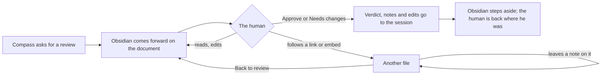

# Review in Obsidian: Mockup

What the human sees while reviewing a document in Obsidian, follows a link or an embed out of it, leaves feedback on what he finds there, and answers. It serves [[SPEC-030-review-documents-open-in-obsidian]]: one click answers, the original question stays in view, feedback can land on any file, and nothing is asked again in the terminal.

## The journey



## Layout A: a bar on every page

The reviewed document carries the full bar:

```
+------------------------------------------------------------------------+
| Review: Approve this spec?                                             |
| [ Notes for Claude ...................... ] [Approve] [Needs changes] |
+------------------------------------------------------------------------+
| # Documents Use Obsidian's Richer Markdown                             |
| ## Problem                                                             |
| ... see [[SPEC-030-review-documents-open-in-obsidian]] ...             |
```

Any other file opened during the review, here SPEC-030 reached through that link, carries a slim bar naming the review; the verdict buttons stay on the reviewed document:

```
+------------------------------------------------------------------------+
| Reviewing: Approve this spec?   [ Note on this file ...... ] [< Back]  |
+------------------------------------------------------------------------+
| # Review Documents Open in Obsidian                                    |
```

- The verdict buttons live only on the reviewed document; Back returns there.
- A note on this file travels with the verdict.
- Needs changes is greyed until a note, a note on another file, or an edit exists.
- Notes left on other pages are not visible from the reviewed document.

## Layout B: one review panel at the side

A panel in Obsidian's right sidebar stays put while the human moves around the vault:

```
+--------------------------------------------------+--------------------------+
| # Review Documents Open in Obsidian              | REVIEW                   |
|                                                  | Approve this spec?       |
| ## Problem                                       | Reviewing: SPEC-031 (>)  |
| ...                                              |                          |
|                                                  | Notes for Claude         |
|                                                  | [....................]   |
|                                                  |                          |
|                                                  | On this file: SPEC-030   |
|                                                  | [....................]   |
|                                                  |                          |
|                                                  | Feedback so far          |
|                                                  |  - SPEC-030: "merge D-03"|
|                                                  |  - edited: SPEC-031      |
|                                                  |                          |
|                                                  | [Approve] [Needs changes]|
+--------------------------------------------------+--------------------------+
```

- The question, the reviewed file and both buttons are visible from any page; answering never needs a trip back.
- "On this file" follows the page in view; "Feedback so far" lists every note and every edited file, each a link.
- Two pending reviews show as two cards in the panel, newest on top.
- The reviewed document keeps a one-line bar on top pointing at the panel, so a review never goes unnoticed when the sidebar is collapsed.

## Recommendation

Layout B. The question and every piece of feedback sit in one place that never scrolls away, and the answer is one click from any page. Layout A takes less screen width and needs no sidebar.

## Choices inside either layout

- Needs changes with nothing written: greyed out (Recommended), or allowed and the session asks what to change.
- A note on an embed: lands on the embedded file (Recommended), or on the reviewed document with the embed named.
