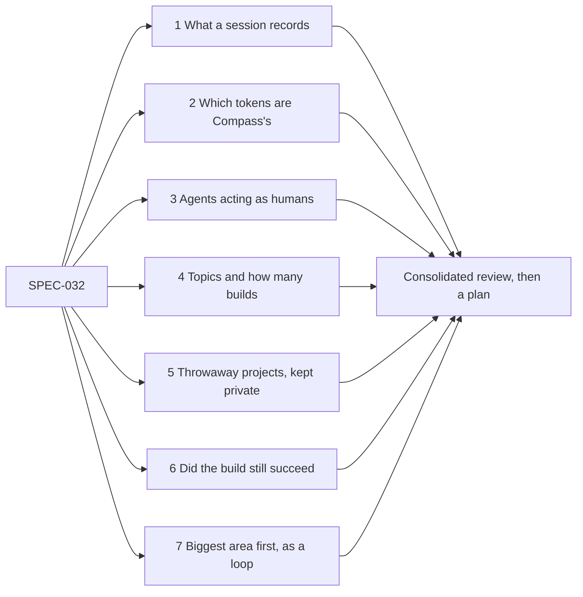

# Compass's Whole Overhead: Research Axes

> [!IMPORTANT]
> You decide: should research run on these seven axes? Approving starts one researcher per axis on your subscription; their findings come back as one consolidated review before any plan. Write your own questions under "Your questions": they lead the list.

## Your questions

-

## Axes

1. **What a session records.** Which token counts Claude Code keeps per request, per subagent and per headless run (input, output, cache read, cache write), and how reliable they are. Sought in: Claude Code documentation, the session transcripts on this machine, `claude -p --output-format json`.
2. **Which tokens are Compass's.** How to split a build's tokens into Compass overhead and the work itself: by source (rules, skills, agents, hooks, command output, vault reads) or by building the same project with and without Compass. Sought in: the `bench/` harness, [[compass-cli/research/RESEARCH-cli-token-reduction-measurement]], the LOOP-003 sensor, published agent-cost studies.
3. **Agents acting as humans.** How an agent plays the human through a whole Compass build headless: answering the questions, approving reviews, steering like a person would. Sought in: Claude Code and Agent SDK documentation, user-simulator work in agent evaluation (for example tau-bench), Compass's own review and question commands.
4. **Topics and how many builds.** How agents pick varied project topics so the measure stays generic (D-01), and how many builds it takes for the overhead share to be a stable number rather than noise. Sought in: agent benchmark design papers, the variance seen in `bench/` runs.
5. **Throwaway projects, kept private.** Where the projects live, how they stay apart from your real settings and projects, how they run on your subscription, what one build costs, and how a really cool one is kept (D-02). Sought in: Claude Code documentation on settings, sandboxing and headless runs, the `bench/` harness.
6. **Did the build still succeed.** How to judge that a build reached what the agent set out to build, so a lower overhead never comes from doing less. Sought in: agent evaluation literature, Compass's validator and tester agents.
7. **Biggest area first, as a loop.** How a control loop ranks overhead areas, changes the biggest one and verifies the share dropped with quality held (D-03). Sought in: the loop machinery of [[PLAN-021-control-loops]], [[SPEC-026-control-theory-for-loops]], the LOOP-003 record.

## Grading

- [x] Researchers grade each finding's evidence (GRADE-style certainty: high, moderate, low), on the basis that some axes rest on published studies and others on local measurement. Untick to refuse grading; research still runs.
