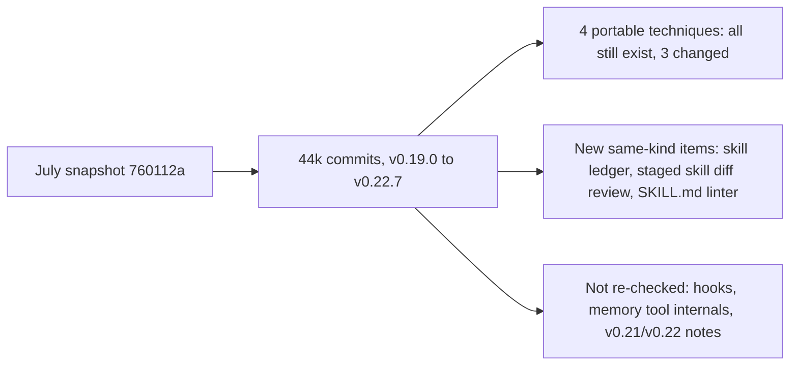

# Hermes changes since the July snapshot

> [!IMPORTANT]
> You decide: whether the portable-technique list in [[RESEARCH-hermes-vs-compass-fit]] is amended with the new items in Finding 12 through 15, and whether the unchecked areas under Gaps need another pass before planning.

## Question

What changed in hermes-agent between commit 760112a (2026-07-25, v0.19.0) and commit a212421d (2026-11-04) in memory, skills, context compression, session search, the curator, background review and hooks, and do the four portable techniques named in [[RESEARCH-hermes-vs-compass-fit]] still hold?

## Methodology

Repository mining: current source at a212421d read directly, plus the GitHub releases list, the compare API and per-file commit history. Chosen because the question is how an existing codebase behaves and how it moved. The brief carried no `grading:` field, so no disclosure reached this run: findings are marked and ungraded. Every finding carries the same source mark: official NousResearch/hermes-agent repository (organization owner checked), code, not retracted, not a preprint, citation count not applicable, one source unless noted.

## Findings

### Scale and shape of the change

1. **The window is very large and cannot be paged commit by commit** (confidence: high)
   The compare API for 760112a...a212421d reports status `ahead`, `ahead_by` 44171, `total_commits` capped at 10000 and 300 files listed (API caps). The v0.20.0 release notes state about 3,650 commits since v0.19.0. The releases list holds 46 records from v0.2.0 to v0.22.7; v0.19.0 is 2026-07-20, v0.22.7 is 2026-11-03.
   - `gh api repos/NousResearch/hermes-agent/compare/760112a...a212421d` - totals above
   - Release notes v0.20.0 header - commit count
   - Marks: code and release notes, owner checked; not retracted; not preprint; n/a citations; 2 sources agree on scale

2. **Source was decomposed into many small modules, so July file:line citations no longer resolve** (confidence: high)
   Compression now spans `agent/context_compressor.py` plus `context_compressor_{prellm,window,prune,summary,retry,tail,telemetry}.py`, `agent/conversation_compression_*.py` and `agent/micro_compaction.py`. The state layer is about 80 `hermes_state_*.py` modules. `tools/memory_tool.py` is 477 lines and `tools/skill_manager_tool.py` is 943 lines, against July citations at lines 1152 and 1451.
   - `agent/context_compressor.py:36-47` - imports of the split modules
   - `hermes_state_fts.py:1-4`, `hermes_state_schema.py:27` - state split
   - Marks: code, owner checked; 1 source

3. **The package version moved off pyproject** (confidence: low)
   `pyproject.toml:7` now reads `version = "0.0.0"`; releases are tagged v0.22.x. How the version is derived was not traced.
   - `pyproject.toml:7`
   - Marks: code, owner checked; 1 source

### The four portable techniques, re-checked

4. **FTS5 session search: still exists, still no LLM, schema grew to version 32** (confidence: high)
   The tool docstring still says "No LLM calls", with the same four shapes (discovery, scroll, read, browse). Storage: external-content FTS5 tables over views (`messages_fts`, `messages_fts_trigram`), SQL triggers gated by rebuild high-water markers, `SCHEMA_VERSION = 32`. Tool-role rows index only a content prefix. An optional loadable tokenizer `cjk_unicode61` adds CJK bigram search (config `sessions.cjk_fts`, default on, only when the `.so` is present). A stale index detaches its triggers rather than risk corruption.
   - `tools/session_search_tool.py:1-9` - docstring
   - `hermes_state_common.py:289,941-959,1066` - schema version, base view and table, trigram
   - `hermes_state_fts.py:1-30,88-110` - CJK index, tokenizer loader
   - `hermes_state_schema.py:411-440` - trigram view excludes cron rows (migration v29)
   - Marks: code, owner checked; 1 source

5. **Session search tool gained time bounds, adaptive detail, exclusion and title match** (confidence: high)
   New arguments: `sort` (newest or oldest bias), `detail` (adaptive hydrates only the top hit; full hydrates all), `after` and `before` (ISO or relative like 7d), `exclude_session_ids` (cap 20, lineage-aware). A query that matches a session title returns a discovery-shaped hit. Sources `kanban`, `subagent`, `tool` are hidden; `cron` is demoted below interactive sessions. Read-shape messages are capped at 2000 chars. The discovery payload reports `index_rebuild` percent while the index backfills.
   - `tools/session_search_tool.py:20-52,664-780` - constants and schema
   - `tools/session_search_tool.py` (`_title_match_result`, `_discover_payload`) - title match, rebuild note
   - Marks: code, owner checked; 1 source

6. **Compaction archives stay searchable because compaction is now in place by default** (confidence: high)
   `compression.in_place: True` rewrites the message list without rotating the session id; pre-compaction turns are soft-archived (`active=0, compacted=1`) and remain `session_search`-able. Lean-tail stubs and the lean summary point back at `session_search` to recover demoted output.
   - `hermes_cli/config_defaults.py:668-672` - in_place
   - `agent/context_compressor_tail.py:46-52` - stub text with `session_search(query=..., session_id=...)`
   - `tools/session_search_tool.py` (`_is_compacted_state`) - archived rows discoverable
   - Marks: code, owner checked; 1 source

7. **Compression trigger: 0.50 default remains, but a raise-only 0.75 floor applies to windows under 512K** (confidence: medium)
   `compression.threshold` defaults to 0.50 and the constructor default is 0.50. A comment and a constant (`_SMALL_CTX_THRESHOLD_PERCENT = 0.75`) floor it for models with windows below 512K, so 50% effectively governs only large windows unless the user sets above 0.75. New knobs: absolute `threshold_tokens` cap (lower of ratio and count), per-model `model_thresholds`, a Codex 85% auto-raise. The condition that selects the floor (`_effective_threshold_percent`) was read only as a comment and a one-line return, hence medium.
   - `hermes_cli/config_defaults.py:573-580,651-657,673-677`
   - `agent/context_compressor.py:1151,2764-2768,2813-2814`
   - Marks: code, owner checked; 1 source

8. **Head/tail protection: head unchanged, tail is now token-bounded "lean" mode by default** (confidence: high)
   Head: `protect_first_n: 3` non-system messages plus the system prompt. Tail: `protect_last_n: 20` is a minimum honoured only up to a small count; the default `tail_mode: "lean"` budgets 2.5% of the window clamped to 10K floor and 25K cap, held to 50% of the trigger, and never above 20% of the window. `legacy` keeps the July 0.20 x threshold tail. `min_tail_user_messages` (default 1) guarantees real user messages survive. Summary target ratio stays 0.20.
   - `hermes_cli/config_defaults.py:582-593,644-646`
   - `agent/context_compressor_tail.py:19-38`, `agent/context_compressor.py:924-929,826`
   - Marks: code, owner checked; 1 source

9. **New compression mechanisms around the trigger** (confidence: high)
   - Proactive no-LLM tool-result prune, opt-in (`proactive_prune_tokens: 0`), with a minimum-reclaim gate so cache breaks stay episodic (`config_defaults.py:597-608`).
   - Micro-compaction folds the oldest exchange into a rolling summary each Nth turn, off by default because it breaks the cache prefix (`config_defaults.py:609-618`, `agent/micro_compaction.py`).
   - Old tail tool results become one-line recovery stubs (`context_compressor_tail.py:9-17,46-52`).
   - `[SKILL_PRUNED: ...]` markers and a Skill Safety Rule re-inject so a pruned skill cannot silently haunt a session (`context_compressor.py:855-878`).
   - Opt-in idle compaction, `abort_on_summary_failure`, `checkpoint_required`, progress-aware timeouts, strict redaction across the compaction boundary (`config_defaults.py:566-568,638-650,678-681`; `context_compressor.py:1168`).
   - Marks: code, owner checked; release notes v0.20.0 name the same items; 2 sources agree

10. **Offline trajectory compressor: still exists, same strategy, only refactored** (confidence: medium)
    Docstring and defaults match July: protect the first system, human, gpt and tool turns and the last N turns, summarize only as many middle turns as needed into one human summary turn. Defaults: `target_max_tokens` 15250, `summary_target_tokens` 750, `protect_last_n_turns` 4. File history since July is refactors, lint, truncated-summary handling (d8f8a07e) and the shared compression marker (f7122daa). Line-level behavior was not re-read beyond docstring and config.
    - `trajectory_compressor.py:1-12,107-120`
    - `gh api .../commits?path=trajectory_compressor.py` - history list
    - Marks: code, owner checked; 1 source

11. **Curator snapshot and rollback: still exists, keep default dropped from 5 to 2** (confidence: high)
    Before a mutating pass the skills tree is tar.gz'd under `.curator_backups/<utc-iso>/` with `manifest.json`; rollback first snapshots the current tree, then restores. Snapshots now also copy cron `jobs.json` so rollback restores cron skill references. Excluded: `.hub`, `.git`, `.locks`, `.archive`, the ledger and transient dirs (venv, node_modules); an exclusion fix followed snapshots that grew to hundreds of MB. `DEFAULT_KEEP = 2` (July doc says keep=5).
    - `agent/curator_backup.py:1-8,30,43-56,406-422`
    - Marks: code, owner checked; 1 source

### New items of the same kind as the portable list

12. **Per-mutation skill ledger with single-edit rollback** (confidence: high)
    Added 2026-08-17 (efe41abd). Every skill mutation by any actor (`curator`, `agent`, `user`) appends one JSONL entry with before and after file manifests; contents are stored content-addressed (sha256, deduped) as blobs. Entries store only changed paths. `rollback_entry` is fail-closed: all before-blobs must exist first, and a pre-rollback safety entry captures current state so the rollback is itself undoable. The ledger is telemetry, not a gate: write paths swallow errors. Size-capped (default 5 MB) with compaction and blob GC.
    - `tools/skill_ledger.py:1-9,35,286-295,298-323,569-620`
    - Marks: code, owner checked; 1 source

13. **Staged skill writes reviewed as a gist plus a unified diff** (confidence: high)
    `skills.write_approval` (default false) stages every skill write, from foreground or background review, to `pending/skills/<id>.json` instead of committing. Each record has a one-line heuristic gist (no model call). `/skills pending|approve|reject|diff <id>` lists, applies, drops, or shows the full content (create) or unified diff (edit, patch, write_file). Batch writes render per-operation diffs. A patch preview is folded through the same fuzzy matcher approval runs, so the preview matches what commits. Desktop and TUI surfaces for the same review landed 2026-10-01. Memory writes in the foreground prompt inline instead.
    - `tools/write_approval.py:1-10,48-55,215-237,257-275,305-345`
    - `hermes_cli/write_approval_commands.py:17-33,35-57,157-169`
    - Marks: code, owner checked; commit messages 036c577c, b46f182f, 1a142d4e agree; 2 sources

14. **Advisory SKILL.md convention linter on create** (confidence: medium)
    Added 2026-08-08 (fce314ea). It returns findings and never blocks; the hard validator stays `skill_manager_tool._validate_frontmatter`. Rules seen: shell utilities named in prose where native tools exist, marketing words, POSIX-only scripts without `platforms:`. The create-time call site was taken from the commit message, not read.
    - `tools/skill_linter.py:1-30`
    - Marks: code, owner checked; 1 source

15. **Skill write origin and attendedness are tracked per write** (confidence: medium)
    A context variable separates `foreground` writes from `background_review` writes; the curator curates only skills the review fork created. Attendedness is orthogonal: an explicit user-requested `/refine` fork counts as background review for guards but is attended.
    - `tools/skill_provenance.py:1-36`
    - Marks: code, owner checked; 1 source

### Background review and triggers

16. **Triggers unchanged: two integer counters, both default 10** (confidence: high)
    Memory nudge counts user turns (`memory.nudge_interval`); skill nudge counts tool-loop iterations (`skills.creation_nudge_interval`), reset when `skill_manage` is used. Finalization spawns the review only for a non-interrupted final response. Review forks and the curator fork set both intervals to 0.
    - `agent/agent_init.py:1215-1217,1244,1286-1288`, `agent/turn_iteration_prep.py:166-167`, `agent/turn_finalizer.py:863-874`, `agent/turn_context.py:761-772`, `hermes_cli/config_defaults.py:1309`
    - `agent/background_review.py:1009`, `agent/curator.py:1124-1125`
    - Marks: code, owner checked; 1 source

17. **Review prompts kept the "Be ACTIVE" bias and gained shape rules** (confidence: high)
    The skill prompt still says a pass that does nothing is a missed opportunity, with "Nothing to save" a real option but not the default. Added: a lesson-layer block (class-level skills; procedure first; pitfall = rule plus one clause of why; no PR numbers, dates or quoted incidents; the same lesson twice is one rule; do not restate AGENTS.md or tool schemas; fix wrong sentences in place); an extended do-not-capture list (environment failures, negative tool claims, transient errors, one-off narratives, unresolved failures presented as workflows); a memory routing block (one fact, one store; save only facts grounded in the conversation); read-before-write (skill_manage refuses a patch unless `skill_view` ran in the same review).
    - `agent/background_review.py:370-389,401-428,431-454,456-527`
    - Marks: code, owner checked; 1 source; the read-before-write enforcement code (`tools/skill_manager_guards.py`) was not read, so enforcement is medium

18. **Review fork is bounded and routable** (confidence: high)
    `_REVIEW_MAX_ITERATIONS = 16`; aggregate input budget defaults to 75% of the fork's window capped at 600K (`auxiliary.background_review.max_input_tokens`, <= 0 disables); `auxiliary.background_review.{provider,model}` routes the fork to another model, which then replays a compact digest instead of the full conversation. Disabled for finite one-shot turns and safe-worker mode; fail-open otherwise.
    - `agent/background_review.py:167-182,204-250`
    - Marks: code, owner checked; 1 source

### Curator

19. **Curator defaults changed: stale after 14 days, archive after 30** (confidence: high)
    July docs recorded 30 and 90. Interval (7 days), minimum idle (2 hours) and `consolidate` default (False) are unchanged. Day and hour values below 1 fall back to defaults with a warning. The deterministic transition walk still runs whenever the curator is enabled; the LLM fork is opt-in.
    - `agent/curator.py:30-34,100-125`
    - Marks: code, owner checked; 1 source

20. **Release notes name hooks-adjacent and migration features not code-verified here** (confidence: low)
    v0.20.0 notes list signed outbound webhooks for lifecycle events (session activity, turn completions, tool events), `hermes import-agent` (one-command migration from Claude Code or Codex CLI setups) and a `grounded-citations` skill with a fact-checking mode. None were opened in source.
    - Release notes v0.20.0, Highlights and CLI sections
    - Marks: release notes only, owner checked; 1 source

## Technique status table

| Technique (from [[RESEARCH-hermes-vs-compass-fit]]) | Exists | Changed |
|---|---|---|
| FTS5 session search (findings 14 and 22) | yes | schema v32, CJK index, time bounds, adaptive detail, title match, archived rows searchable |
| Curator snapshot and rollback (finding 24) | yes | keep 5 to 2, cron link restore, exclusions; plus new per-edit ledger rollback |
| 50% compression trigger with head/tail protection (finding 20) | yes | 0.75 floor under 512K windows, lean token-bounded tail, in-place compaction, new prune and micro-compaction options |
| Offline trajectory compressor (finding 21) | yes | refactor only |

## Contradictions

- Findings 17 and 15 vs [[RESEARCH-hermes-memory-mechanics]] findings 9 and 13: the July text lists bundled, hub, pinned and user-authored skills as protected from the reviewer. The current skill prompt says hand-written, installed, bundled and pinned skills are all patchable by the reviewer, excepting skills a user locked with `hermes curator lock`. The curator itself still curates only review-created skills. Which statement the guard code enforces was not read.
- Finding 19 vs [[RESEARCH-hermes-vs-compass-fit]] finding 13: stale and archive windows were 30 and 90 days, now 14 and 30.
- Finding 11 vs [[RESEARCH-hermes-vs-compass-fit]] finding 24: snapshot keep was 5, now 2.

## Gaps

- Hooks: `agent/shell_hooks.py` (now 858 lines) and `post_tool_call` dispatch were not re-read; the July hook findings are unverified at a212421d.
- Memory tool: `tools/memory_tool.py` shrank to 477 lines; whether caps, drift guard and batch semantics moved to other modules was not traced.
- Release notes for v0.21.0, v0.22.0 (118K characters) and the patch releases were not read; only v0.20.0 was searched by keyword.
- Skill guard enforcement (`tools/skill_manager_guards.py`, `skills_guard.py`) and the curator LLM consolidation prompt were not read.
- The condition inside `_effective_threshold_percent` (context_compressor.py:2764-2768) was seen only as a comment and a return line.
- Trajectory compressor behavior beyond docstring and config; no runtime test of any mechanism.
- Commit-by-commit history is unavailable (44171 commits ahead, API cap 10000); per-file history was used for the files named above.
