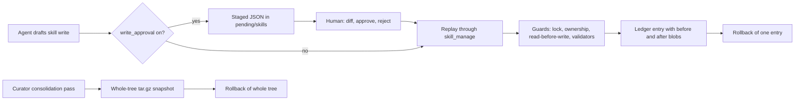

# hermes-agent: Safety Around Automatic Skill and Memory Changes

Hermes commit `a212421d` (2026-11-04), read directly. The earlier round read version 0.19.0 (July 2026). Findings marked NEW or CHANGED differ from [[RESEARCH-hermes-agent-capabilities]], [[RESEARCH-hermes-memory-mechanics]] and [[RESEARCH-hermes-vs-compass-fit]].

> [!IMPORTANT]
> You decide: which of the documented safety techniques (staged write with diff review, per-mutation ledger with single-edit rollback, read-before-write, ownership and lock guards, hard caps) go into the plan for automatic skill creation. Approving this document changes nothing by itself; it records what Hermes does.

## Question

What protects Hermes against a bad automatic change to its skills and memory (snapshots, rollback, validation, per-run limits, conflicts, detecting and undoing a harmful or stale skill), and how does that compare with Compass's guards?

## Scope

Included: `agent/curator.py`, `agent/curator_backup.py`, `agent/learning_mutations.py`, `agent/background_review.py`, `tools/skill_manager_tool.py`, `tools/skill_manager_guards.py`, `tools/skill_manager_batch.py`, `tools/skill_ledger.py`, `tools/skill_linter.py`, `tools/skill_lock.py`, `tools/skill_usage.py`, `tools/write_approval.py`, `tools/memory_tool.py`, `tools/memory_tool_store.py`, `hermes_cli/curator.py`, `hermes_cli/write_approval_commands.py`, `hermes_cli/config_defaults.py`. Compass side: `plugin/cli/commands/guard.py`, the Data rule in `plugin/templates/rules/compass-pipeline.md`, `plugin/skills/consolidate/SKILL.md`. Test files were located, not read line by line.

## Methodology

Repository mining (empirical study of an artifact), read in source: code over documentation, since config comments and prompts drift. No grading was requested: no `grading:` disclosure reached this run, so findings carry marks and no grade.

## Findings

### A. The pre-write gate (NEW, closest to the human's goal)

1. **Skill writes can be staged for human approval instead of committed** (confidence: high)
   - `skills.write_approval` (default false) makes every `skill_manage` mutation, from the foreground turn or the background review fork, stage a JSON record under `<home>/pending/skills/<id>.json` and return `staged: true` to the agent.
   - The record holds the exact replay payload, a one-line gist, `origin` (`foreground` or `background_review`), and `created_at`.
   - Skills always stage and never prompt inline, because "SKILL.md too large for an inline prompt".
   - `tools/write_approval.py:1-10,64-83,201-216`, `tools/skill_manager_tool.py:672-701,792-796`, `hermes_cli/config_defaults.py:1455-1458`
   - Marks: code, owner checked (NousResearch org repo); not retracted; not a preprint; 1 source; single implementation

2. **Review surface is `/skills pending`, `/skills diff <id>`, `/skills approve|reject <id|all>`** (confidence: high)
   - `diff` renders full content for create, a unified diff against the on-disk file for edit/patch/write_file, and per-op diffs for a batch (each op diffs against what earlier ops left).
   - Patch previews fold through the same fuzzy matcher approve uses, so a patch that would fail shows "(patch would fail: ...)" instead of an invented result.
   - Pending list tags background items `[auto]`.
   - `tools/write_approval.py:305-413`, `hermes_cli/write_approval_commands.py:34-46,136-141`
   - Marks: code, owner checked; 1 source

3. **Approve replays the staged payload through `skill_manage` with the gate bypassed; reject deletes the record** (confidence: high)
   - `apply_skill_pending` sets a context flag so the replay is not re-staged, then runs the normal guards, validators and ledger.
   - Failures at approve time are returned as `Failed:` lines and the record stays.
   - `tools/skill_manager_tool.py:716-722`, `hermes_cli/write_approval_commands.py:65-119` (function `_approve`)
   - Marks: code, owner checked; 1 source

4. **Staged writes carry no base-content hash; a stale staged patch is caught only when the matcher fails** (confidence: medium)
   - `stage_write` stores action, name, payload, summary, origin, timestamp. A grep for `base_hash`, `expected_sha` and `stale` in `tools/write_approval.py`, `tools/skill_manager_tool.py` and `tools/skill_manager_batch.py` found nothing.
   - A staged full rewrite (`edit`) replays over whatever the file holds at approve time.
   - Medium because absence was established by grep, not by reading tests.
   - `tools/write_approval.py:75-83`
   - Marks: code, owner checked; 1 source

5. **Memory deletes by an unattended review fork are always staged, never applied** (confidence: high)
   - For memory, `add` stays direct; `patch`/`remove`/`replace` from an unattended fork (single or inside a batch) are staged for `/memory pending` even when `memory.write_approval` is off.
   - Each staged destructive op is pinned to the full matched entry text; approve shows what was overwritten or removed "re-add anything you still need".
   - A skill-triggered review gets no memory tool at all; only a memory-triggered review does.
   - `tools/memory_tool.py:173-216`, `hermes_cli/write_approval_commands.py:100-112,142-150`, `agent/background_review.py:1102-1117`
   - Marks: code, owner checked; 1 source

6. **Foreground memory approval prompts inline when a human can answer, else stages** (confidence: high)
   - `evaluate_gate`: skills always stage; memory + background stages; memory + foreground prompts via the CLI approval callback, falling back to staging when no callback or no user can answer (cron, kanban, `chat -q`, webhook).
   - Staging failure loses the write by design ("safe failure for an approval gate").
   - `tools/write_approval.py:201-248,68-83`
   - Marks: code, owner checked; 1 source

### B. Per-edit audit and rollback (NEW)

7. **Every skill mutation by any actor appends one ledger row with before and after file manifests** (confidence: high)
   - `<skills>/.curator_ledger.jsonl`; file contents stored content-addressed (sha256) under `<home>/.curator_backups/blobs/`; actor is `curator`, `agent` or `user`.
   - `skill_manage` captures the pre-state under a per-skill lock before the handler runs and records after success. Delete/archive captures the complete package, filled from the newest tarball if support files were already re-homed.
   - Ledger is "telemetry, not a gate": capture failures never block the mutation.
   - `tools/skill_ledger.py:1-9,60-70,159-185,362-398`, `tools/skill_manager_tool.py:746-763,805-826`
   - Marks: code, owner checked; 1 source

8. **`hermes curator rollback <entry-id>` undoes one edit and is itself undoable** (confidence: high)
   - Fails closed: validates entry paths stay under the home dir, pre-checks that every before-blob exists, then appends a `pre-rollback` safety entry of the current state before restoring files and removing files the mutation created.
   - A `rollback` entry is appended after.
   - `tools/skill_ledger.py:430-492` (function `rollback_entry`), `hermes_cli/curator.py:545` (`_cmd_rollback`)
   - Marks: code, owner checked; 1 source

9. **Ledger size is bounded by compaction then dropping the oldest rows** (confidence: high)
   - `skills.ledger_max_bytes` default 5 MB. Past it, the next append drops unchanged paths per entry, and if still over, drops oldest lines; blobs are garbage-collected only when unreferenced and older than one hour.
   - `hermes_cli/config_defaults.py:1474-1478`, `tools/skill_ledger.py:204-232,278-290,314-330`
   - Caveat: oldest-entry trimming means old edits become non-rollbackable. This is a documented trade-off in the code, not an error.
   - Marks: code, owner checked; 1 source

### C. Whole-tree snapshots (CHANGED defaults)

10. **Snapshot is taken only before the LLM consolidation pass; the prune-only pass takes none** (confidence: high)
    - CHANGED: the July round recorded a snapshot "before curator runs". Now `consolidate` defaults to false, the deterministic prune only renames directories into `.archive/` (its own undo), and only `consolidate=true` calls `snapshot_skills("pre-curator-run")`.
    - Snapshot is a tar.gz of `skills/` plus `manifest.json` and a copy of `cron/jobs.json`. Excludes `.curator_backups`, `.hub`, `.locks`, `.git`, `.archive`, the ledger, and transient dirs (venv, node_modules).
    - Snapshot failure is logged and does not block the run.
    - `agent/curator.py:146-150,891-905`, `agent/curator_backup.py:30,41-52,153-192`
    - Marks: code, owner checked; 1 source

11. **Retention default is 2 snapshots (was 5)** (confidence: high)
    - `curator.backup.keep` default 2, floor 1; older snapshots are deleted by prune.
    - `agent/curator_backup.py:30,118-122,200-221`, `hermes_cli/config_defaults.py:1508-1511`
    - Marks: code, owner checked; 1 source; CHANGED from the July round

12. **Tree rollback is staged and itself undoable, and restores cron links** (confidence: high)
    - Order: pre-rollback safety snapshot (abort if it fails), move current entries to a staging dir, extract with a traversal check, re-carry excluded nested dirs, delete staging.
    - Failure moves staged entries back; if that fails the staging dir is kept under a non-prunable name.
    - Only the `skills`/`skill` fields of cron jobs that still exist are restored.
    - `agent/curator_backup.py:264-326,406-481`
    - Marks: code, owner checked; 1 source

### D. Guards on who may change what

13. **The curator and review fork cannot reach skills they do not own** (confidence: high)
    - A background delete is refused for pinned, external-dir, protected built-in, hub-installed and bundled skills, and for any skill without `created_by: agent`.
    - Unreadable provenance fails closed ("ownership could not be verified"). `hermes curator adopt <skill>` is the opt-in.
    - Content writes are not ownership-gated: the code states "every write is ledgered and reversible, while an archive removes a skill the user relies on".
    - `tools/skill_manager_guards.py:164-208`, `tools/skill_usage.py:290-345`
    - Marks: code, owner checked; 1 source

14. **User lock makes a skill immutable to the agent; it fails closed for autonomous passes** (confidence: high)
    - NEW: `hermes curator lock <skill>` refuses every mutating `skill_manage` action (not `create`), `write_file`/`patch` into the dir, and terminal commands whose write targets fall inside it. An unreadable sidecar fails closed for the review/curator and open for normal turns.
    - The lock module calls itself "a policy check, not a sandbox".
    - The review prompt tells the fork to put a suggested change in its summary instead of retrying or recreating the skill under another name.
    - `tools/skill_manager_guards.py:224-263`, `tools/skill_lock.py:1-15`, `agent/background_review.py:480-486`
    - Marks: code, owner checked; 1 source

15. **Pin guards deletion and automatic transitions only; patches stay allowed** (confidence: high)
    - `_pinned_guard` blocks foreground delete; curator transitions skip pinned. A pin does not block a patch.
    - User-initiated journey delete of a pinned skill is refused because background actors have "no user in the loop to consent".
    - `tools/skill_manager_guards.py:143-161`, `agent/learning_mutations.py:168-180`, `agent/curator.py:209-225`
    - Marks: code, owner checked; 1 source

16. **Read-before-write is enforced in code for the review fork** (confidence: high)
    - A patch, edit, overwrite or remove of an existing file by the fork is refused unless `skill_view`/`read_file` loaded that exact path in the same review; marks are shared across copied worker contexts.
    - A comment records that denying reads once starved the loop (about 204 read-before-write refusals over two days on one deployment) so read tools are whitelisted.
    - `tools/skill_manager_guards.py:35-73,211-221`, `agent/background_review.py:1118-1128`
    - Marks: code, owner checked; 1 source

17. **Consolidation deletes need a verified forwarding target** (confidence: high)
    - A consolidation-pass delete without `absorbed_into=<umbrella>` is refused ("fail-open behavior reported in #29912": whole clusters archived with zero verified consolidations). Delete routes to the recoverable archive, never `rmtree`.
    - The consolidation fork has no terminal tool, so every filesystem change passes through the ledgered tool.
    - `tools/skill_manager_guards.py:266-286`, `agent/curator.py:1111-1118`, `tools/skill_manager_tool.py:765-776`
    - Marks: code, owner checked; 1 source

### E. Validation of a drafted skill

18. **Hard validators reject a malformed draft; linter findings are advisory** (confidence: high)
    - Rejected: invalid name (`[a-z0-9][a-z0-9._-]*`, 64 chars), missing or unparseable frontmatter, missing `name`/`description`, description over 1024 chars, empty body, SKILL.md over 100,000 chars, supporting file over 1 MiB, path traversal, supporting files outside `references/templates/scripts/assets`, a name that already exists.
    - Index budget: a description written by the call must fit the skill-index width; an unchanged legacy long description stays editable.
    - `tools/skill_manager_tool.py:108-115,146-200,367-385,468-475`
    - Marks: code, owner checked; 1 source

19. **The linter returns warnings attached to the tool result, never a block** (confidence: high)
    - Rules: name/dir mismatch, description length and marketing words, missing metadata, body over 24,000 chars, dangling `references/` links, missing "When to Use" section, incident-log shape (4+ PR/issue refs at 0.5/kchar), over 60 reference files, POSIX-only scripts without `platforms:`, forbidden scaffolding files.
    - On patch only rules the write introduced are attached.
    - `tools/skill_linter.py:1-10,57-70,109-215`, `tools/skill_manager_tool.py:441-460`
    - Marks: code, owner checked; 1 source

20. **Security scan of agent-written skills is opt-in and off by default** (confidence: high)
    - `skills.guard_agent_created` false: reasoning in config is that the agent can run the same code through `terminal()` ungated. When on, a "dangerous" verdict restores the original file (or unlinks the new one) and returns an error. Hub installs are always scanned.
    - `tools/skill_manager_tool.py:41-65,407-430`, `hermes_cli/config_defaults.py:1456-1460`
    - Marks: code, owner checked; 1 source

21. **Memory content is scanned on write and again on load** (confidence: high)
    - Write: injection/exfil pattern scan refuses the entry. Load: a hit is replaced by a `[BLOCKED: ...]` placeholder in the system-prompt snapshot only; the raw entry stays for explicit removal.
    - Previously recorded; confirmed unchanged. `tools/memory_tool_store.py:29-32,230-240`
    - Marks: code, owner checked; 1 source; convergence with [[RESEARCH-hermes-memory-mechanics]]

22. **Memory drift guard saves a `.bak.<ts>` snapshot and refuses a write that would discard foreign text** (confidence: high)
    - Triggered when one parsed entry exceeds the whole-store limit (free text appended without delimiters). Deleting an oversized entry first snapshots the file; a failed snapshot blocks the delete.
    - Every mutation re-reads under an exclusive cross-process lock.
    - `tools/memory_tool_store.py:350-395,716-740`
    - Marks: code, owner checked; 1 source; convergence with [[RESEARCH-hermes-memory-mechanics]]

### F. Limits per run

23. **Review fork is bounded by iterations, input tokens, tools and cadence** (confidence: high)
    - 16 iterations; aggregate input tokens default 75% of the fork's context window capped at 600,000 (fallback 120,000; `max_input_tokens` <= 0 disables).
    - Tool dispatch whitelist: skills toolset plus `read_file`/`search_files`; memory toolset only for memory-triggered reviews. Writes via file tools or terminal are denied.
    - Nudge counters and recursion: the fork sets its own nudge intervals to 0. Skill nudge default 10 tool-loop iterations.
    - Idle deferral queues one review per session on a local runtime; a live turn cancels a running review.
    - `agent/background_review.py:173-182,1102-1117,1009`, `agent/agent_init.py:1286-1288`, `agent/review_idle_queue.py:1-12`
    - Marks: code, owner checked; 1 source

24. **Atomic batch: at most 20 ops, snapshot of touched skills, full rollback on any failure** (confidence: high)
    - Op shapes are validated before any effect; a destructive op on a file an earlier op touched is rejected; `delete` must be the sole op.
    - Rollback moves the broken state aside before restoring; a failed restore keeps the snapshot dir.
    - `tools/skill_manager_batch.py:12-14,80-120,226-285`
    - Marks: code, owner checked; 1 source

25. **No per-run cap on the number of skills the curator may archive** (confidence: medium)
    - A grep for `max_archive`, `max_changes`, `max_per_run` in `agent/`, `tools/`, `hermes_cli/` found none. The consolidation prompt asks for the opposite pressure ("fewer than 10 archives, you stopped too early").
    - The only count-related protection is config flooring: `interval_hours`, `stale_after_days`, `archive_after_days` below 1 fall back to defaults because they would mass-transition every skill.
    - Protection against mass loss is therefore recoverability (archive dir, ledger, snapshot, `absorbed_into`), not a quota.
    - `agent/curator.py:122-135,401-452`
    - Marks: code, owner checked; 1 source; absence by grep

### G. Staleness, harmful skills, conflict handling

26. **Stale detection is date math on usage, with evidence guards** (confidence: high)
    - CHANGED: defaults are stale after 14 days and archive after 30 (July round: 30 and 90). Run gate: 7 days between runs and 2 idle hours; the first observation seeds `last_run_at` and defers one interval.
    - A skill with `use_count == 0` and younger than `stale_after_days` is never archived ("absence of evidence"). Cron-referenced and locked skills are skipped like pinned ones. A stale skill used again returns to active.
    - `agent/curator.py:30-35,160-182,209-265`
    - Marks: code, owner checked; 1 source; CHANGED from the July round

27. **No signal of a skill being harmful or failing is recorded; usage counters count loads, views and patches** (confidence: medium)
    - `.usage.json` keeps `use_count`, `view_count`, `patch_count`, `patch_generation`, `last_reused_patch_generation`, timestamps, state, pinned, locked, `created_by`. `bump_use` tracks whether a skill was reused after a patch.
    - A grep for failure, feedback, thumbs and harm in `tools/skill_usage.py` found no outcome field. Detection of a bad skill is by the human (ledger, `/skills diff`, `curator status`) or by age.
    - `tools/skill_usage.py:493-519`
    - Marks: code, owner checked; 1 source; absence by grep

28. **Concurrency: per-skill mutation locks, a cross-process run claim, and a context copy into the fork thread** (confidence: high)
    - `skill_manage` holds a per-skill lock across capture, handler and record. The curator claims a run with an `O_EXCL` file (stale after one hour) because two CLIs started seconds apart both pruned.
    - Memory uses an exclusive lock plus drift check; the journey editor resolves the target entry by text fingerprint inside the lock and refuses a stale node id.
    - `tools/skill_manager_tool.py:93-106,796-812`, `agent/curator.py:1164-1198`, `agent/learning_mutations.py:27-50,85-119`
    - Marks: code, owner checked; 1 source

29. **Dry run and per-run reports give a preview and an after-the-fact diff** (confidence: high)
    - `curator run --dry-run` skips transitions, prepends a report-only banner, still writes REPORT.md and run.json, and does not advance `last_run_at`.
    - Each real run records before and after skill reports, classifies removed skills as consolidated or pruned from the model's YAML block reconciled against `absorbed_into` tool calls, and rewrites cron skill references that pointed at consolidated names.
    - `agent/curator.py:268-290,917-1003,584-650,677-690`
    - Marks: code, owner checked; 1 source

30. **Archive is the maximum destructive action; purge is explicit-only and ledgered** (confidence: high)
    - Archive moves the directory into `.archive/` (`curator restore <skill>` returns it). `archive_ttl_days` default 0 (never); `curator purge` deletes older archives only on explicit invocation and records a ledger row.
    - A delete-target guard refuses symlinks, junctions, paths outside skills roots, and the root itself before any `rmtree`.
    - `agent/curator.py:6-7`, `hermes_cli/config_defaults.py:1500-1504`, `hermes_cli/curator.py:509`, `tools/skill_manager_guards.py:105-130`
    - Marks: code, owner checked; 1 source

### H. Scope of the files named in the brief

31. **`hermes_state_mutation_guards.py` and `hermes_state_rewind.py` guard conversation transcripts, not skills or memory** (confidence: high)
    - The first refuses transcript mutations while a turn lease or compression lock is live (`session_busy`); the second implements `/undo` and `/retry` over the persisted transcript. Neither touches `skills/` or `memories/`.
    - `hermes_state_mutation_guards.py:1-40`, `hermes_state_rewind.py:1-30`
    - Marks: code, owner checked; 1 source

32. **`agent/learning_mutations.py` is the user-initiated edit and delete path for the journey graph** (confidence: high)
    - Deleting a skill archives it (`hermes curator restore` recovers); editing calls the same `_edit_skill` validators; memory edits go through the locked store mutate with the same character cap on replace and no cap on remove.
    - `agent/learning_mutations.py:1-12,164-207`
    - Marks: code, owner checked; 1 source

### I. Compass side (for comparison, facts only)

33. **`compass guard` is a PreToolUse hook that denies subagent deletions and discards** (confidence: high)
    - Denies Bash removal and git discard, a Write that empties a file or keeps under half of a vault document, an Edit that blanks a long vault passage, and a subagent Write or Edit to a document under pending review. The main agent working with the human is never judged. Scratch areas stay open.
    - `plugin/cli/commands/guard.py:1-20,291-323,347-367`
    - Marks: code, owner checked (repo owner); 1 source

34. **Compass's Data rule and consolidate skill make loss structurally impossible rather than recoverable** (confidence: high)
    - Rule: nothing destroys information; too big for its tier means break up or move colder. Consolidate archives lessons (`status: archived`, moved to `.compass/archive/lessons/`), preserves displaced text in a `## Record (preserved)` section, records `merged_from`, never `rm`s, and never archives escalated lessons.
    - `plugin/templates/rules/compass-pipeline.md:104-106`, `plugin/skills/consolidate/SKILL.md:12,62,69,85,194,198`
    - Marks: code and docs, owner checked (repo owner); 1 source

35. **Compass has no pre-write staging for lessons or skills; the human verdict path is `compass review` on documents** (confidence: medium)
    - Searched `plugin/cli` for guard-like code: `guard.py` is the deny hook; the review surface is `plugin/cli/commands/review.py`. A staged-write-then-replay mechanism with diff review was not found in Compass; lessons are written through `lesson-write` after capture. Not exhaustively verified across all of `plugin/`.
    - Marks: code, owner checked (repo owner); 1 source; absence by search

## Taxonomy

| Layer | Hermes mechanism | Reversible by | Default state |
|---|---|---|---|
| Before commit | write_approval staging with diff | human reject | off |
| Before commit | validators (hard), linter (advisory), scan | agent retry | validators on, scan off |
| Before commit | ownership, pin, lock, read-before-write, absorbed_into | agent retry or human unlock | on |
| At commit | ledger row with before/after blobs | `curator rollback <entry>` | on |
| Before bulk pass | whole-tree tarball | `curator rollback` | on, consolidation only |
| Bulk archive | `.archive/` | `curator restore` | on |
| Bounds | 16 iterations, input-token budget, batch of 20, tool whitelist | none needed | on |
| Staleness | 14/30-day date math with evidence guard | `restore`, pin, lock | on |

## Contradictions

- [[RESEARCH-hermes-vs-compass-fit]] states snapshots are taken "before curator runs" with keep=5; current code snapshots only before the consolidation pass and keeps 2 (findings 10, 11). Version drift, not an error in the earlier round.
- [[RESEARCH-hermes-memory-mechanics]] gives stale 30 and archive 90 days; current defaults are 14 and 30 (finding 26).
- None found within the current commit; the three differences above are version drift against the 0.19.0 round.

## Gaps

- Tests were located (`tests/agent/test_curator*.py`, `tests/tools/test_skill_ledger.py`, `test_write_approval.py`, `test_skill_lock.py`) but not read; what edge cases they pin is unverified.
- Whether `write_approval` is on in any shipped profile or documented as recommended: only the default (false) was read.
- Real-world incidence of bad automatic skills (issue numbers cited in comments such as #29912, #96962, #79686, #25839) was not fetched from GitHub.
- Memory has `.bak` snapshots only on drift; no ledger or tree rollback for memory deletes that a human approves was found. Not searched beyond `tools/memory_tool*.py`.
- How Compass's existing `compass review` verdicts would map onto a staged-write record was not investigated (planner question).
