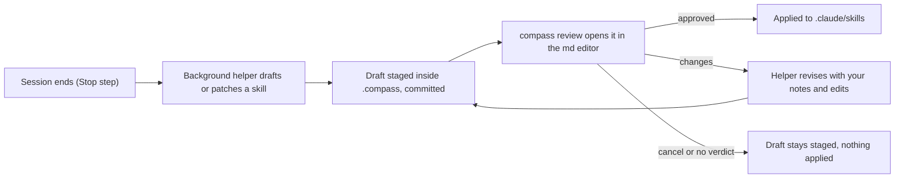

# Review: Hermes automatic skill creation and a reviewed Compass flow

> [!IMPORTANT]
> You decide: does Compass build automatic skill creation with a review of every draft in the md editor, as pictured? Approving makes these choices binding, so each needs your answer:
> 1. Where a staged draft lives inside `.compass` so `compass review` accepts it (today no path exists for a new skill).
> 2. What the helper may change: new skills only, or also patches to existing skills (Hermes lets its reviewer patch any skill a user has not locked).
> 3. How eager the helper is: Hermes tells its reviewer most sessions should produce a skill update; Compass lesson capture writes nothing unless a fixed trigger fired.
> 4. Whether the gaps listed below get another research pass before a plan (spec (what we need): [[SPEC-012-learning-loop]]).

## Inputs

5 research documents (axes), all reading hermes-agent commit a212421d (2026-11-04) and Compass at e331edd. Question: how Hermes creates skills automatically, what guards a skill change, how a human reviews it, what changed since the July 0.19.0 study, and what fits Compass.

| Axis | Document |
|---|---|
| 1 creation | [[research/hermes/RESEARCH-hermes-skill-creation\|skill creation]] |
| 2 safety | [[research/hermes/RESEARCH-hermes-skill-safety\|skill safety]] |
| 3 review | [[research/hermes/RESEARCH-hermes-skill-review-gate\|review gate]] |
| 4 changes | [[research/hermes/RESEARCH-hermes-changes-since-july\|changes since July]] |
| 5 fit | [[research/hermes/RESEARCH-hermes-fit-2026-11\|fit with Compass]] |

## Correction applied

- Axis 3 finding 20 says `compass review` withdraws a request no surface claims within 60 s. That holds on master at e331edd (`plugin/cli/commands/review.py:98,310`). An approved fix, commit e2fa732 on branch `fix/review-and-numbering` (issue #53), removes it: a request stays open until a verdict, a cancel, a newer request for the same document, or `--timeout`. Axis 5 does not describe the 60 s rule.
- Consequence for axis 3 finding 21 (open point, low): a background helper can send a draft and end; the request no longer lapses when nobody is at the editor.
- Per-document verdicts in a review of several documents are being built (issue #54). Axis 3 finding 19 reads per-file verdict handling in the CLI (`plugin/cli/commands/review.py:213-217,240-245`); how far the editor surfaces return them was not checked by any axis.

## Where the sources agree

YES / NO with the axis's confidence; `open` = raised, left unsettled; `-` = not addressed. Agreement counts only the axes that took a position.

| Claim | 1 | 2 | 3 | 4 | 5 | Agreement |
|---|---|---|---|---|---|---|
| H1 Skill trigger counts tool-loop iterations, default 10, resets on a skill write | YES (h) | YES (h) | 15 in example config | YES (h) | - | 100% on code default |
| H2 Review runs as a forked agent over the whole conversation, 16 iterations, input budget 75% of window capped at 600K | YES (h) | YES (h) | - | YES (h) | YES (h) | 100% |
| H3 The fork writes only through the skill tool; no terminal; dangerous commands auto-deny | YES (h) | YES (h) | YES (h) | - | YES (h) | 100% |
| H4 Review prompt pushes toward writing ("Be ACTIVE"), with a do-not-capture list and content-shape rules | YES (h) | - | - | YES (h) | YES (h) | 100% |
| H5 Create-time dedup is by name only; meaning-level dedup is left to the prompt and an opt-in curator pass | YES (h) | YES (h) | - | - | - | 100% |
| H6 Read-before-write is enforced in code for the fork | YES (h) | YES (h) | - | YES (m, guard unread) | YES (h) | 100%, settled high |
| H7 Hard validators (name, properties, 100K chars, 1 MiB file, 60-char description budget); linter is advisory | YES (h) | YES (h) | - | YES (m) | YES (h) | 100% |
| H8 `skills.write_approval`, default off, stages every skill write from any origin as JSON with a replay payload | YES (h) | YES (h) | YES (h) | YES (h) | YES (h) | 100% |
| H9 The staged preview is a unified diff through the same matcher approval runs | YES (h) | YES (h) | YES (h) | YES (h) | YES (h) | 100% |
| H10 Approve replays; reject discards; no "changes" verb, no human edit of the draft | YES (h) | YES (h) | YES (h) | YES (h) | YES (h) | 100% |
| H11 Review surface is slash commands only (CLI, chat, Desktop, TUI); no editor surface | open | YES (h) | YES (m) | YES (h) | - | 100% |
| H12 Every skill change goes to a ledger with before/after copies and single-entry rollback | YES (h) | YES (h) | YES (h) | YES (h) | YES (h) | 100% |
| H13 The fork may patch any skill a user has not locked; only deletes are ownership-guarded | YES (h) | YES (h) | - | open | YES (h) | 100% of positions; conflicts with July study |
| H14 Only skills the background fork created (`created_by: agent`) are curator-managed | YES (h) | YES (h) | YES (h) | YES (m) | YES (h) | 100% |
| H15 Curator: stale at 14 days, archive at 30 (July: 30, 90); consolidation off by default | YES (h) | YES (h) | - | YES (h) | YES (h) | 100% |
| H16 Snapshot keep is 2 (July: 5), taken only before the consolidation pass | YES (h) | YES (h) | - | YES (h, keep 2) | - | 100% |
| H17 Cost is about 30K tokens per review, a code comment, not a measurement | YES (m) | - | - | - | YES (m) | 100% |
| K1 Compass's lesson-capture rail (Stop step, `capture-check`, background helper) can carry a skill-writing pass | YES (h) | - | YES (h) | - | YES (h, m mapping) | 100% |
| K2 `compass review` refuses a file outside `.compass` or uncommitted, so a SKILL.md under `.claude/skills` cannot go out today | - | - | YES (h) | - | open | 1 answered, 1 open |
| K3 Compass has no staging or apply step for skills; applying after approval is unbuilt | - | YES (m) | YES (m) | - | YES (m) | 100% |
| K4 A Compass "changes" verdict returns notes and your editor edits, which Hermes cannot | - | - | YES (m) | - | YES (m) | 100% |
| K5 Compass capture writes nothing unless a fixed trigger fired, the opposite of Hermes's bias | - | - | YES (h) | - | YES (h) | 100% |

## Converged (high confidence)

1. **Hermes separates three choices: when to review (a counter), what to write (the model, guided by a prompt), whether it lands (an approval switch, off by default)** - axes 1, 2, 3, 4, 5
   - Counter `agent/turn_finalizer.py:863-869`; writes `tools/skill_manager_tool.py:793-801`; switch `hermes_cli/config_defaults.py:1469`.
2. **Hermes's approval point stages a JSON record, shows a gist plus a unified diff, and replays on approve** - 5/5
   - `tools/write_approval.py:74-90,305-366`; replay `tools/skill_manager_tool.py:716-722`.
   - The record holds no reason, no session, no transcript excerpt (axis 3 finding 4, high) and no hash of the file it was drafted against (axis 2 finding 4, medium, absence by search).
3. **Hermes has no editor review and no "changes" verdict: reject discards, edits mean hand-editing JSON or asking again** - 4/4
   - `hermes_cli/write_approval_commands.py:64-154` (axis 3 finding 7, high); no web or editor surface found (axis 3 finding 9, medium, absence by search).
4. **Guards on the fork: read-before-write, user lock, deletes only for curator-owned skills, consolidation deletes need a named target** - 4/4
   - `tools/skill_manager_guards.py:164-286`; read-before-write calls at `tools/skill_manager_tool.py:414,544,658`.
5. **Every change is recoverable: ledger with single-entry rollback, archive instead of delete from the background, tree snapshot before consolidation** - 5/5
   - `tools/skill_ledger.py:1-12,430-492`; `tools/skill_manager_tool.py:595-611`; `agent/curator_backup.py:264-326`.
6. **Hermes's reviewer is told to write most of the time; its content rules push back on narrow skills** - 3/3
   - "Be ACTIVE ... A pass that does nothing is a missed learning opportunity" (`agent/background_review.py:456-459`); do-not-capture list `:431-454`; class-level naming `:476-507`.
7. **Compass already owns the trigger and the background helper; what it lacks is a skill-writing contract, staging, an apply step and a provenance mark** - 3/3
   - Rail `plugin/cli/capturelib.py:62-65,291-318`, `plugin/cli/commands/capture_worker.py:1-60,95-117` (axis 5 item 9); writing contract today is `lesson-write`, 5-line lessons only.
8. **Compass's review can do what Hermes's cannot: notes, comments, your editor edits and a diff since the sent commit come back** - 2/2
   - `plugin/cli/commands/review.py:274-291`; `plugin/cli/reviewlib.py:17-26,443-461` (axis 3 finding 15, high).
9. **Each automatic skill adds one description line to every session, which is why Hermes caps descriptions at 60 characters** - 2/2
   - `tools/skill_manager_tool.py:173-184`, `agent/learn_prompt.py:24-34` (axis 1 finding 15, axis 5 item 18).

## Partial (needs attention)

1. **Can `compass review` carry a skill file?** - axis 3 answered, axis 5 left it open
   - Axis 3 (high, code reading): no. The check refuses a file with no `.compass` ancestor, uncommitted or untracked (`plugin/cli/commands/review.py:335-356`); `.claude/` is gitignored in this repo (`.gitignore:17`).
   - Axis 5 (medium): listed as unverified, needing a run on a skill path.
   - Why they differ: axis 3 read the validation; axis 5 read only the file header. No axis ran the command.
2. **Skill trigger default: 10 or 15** - code default 10 (axes 1, 2, 4, high); axis 3 finding 13 cites `skills.creation_nudge_interval: 15` in `cli-config.yaml.example`. The example file sets 15; the code default is 10 (`agent/agent_init.py:1286-1288`).
3. **Where a staged draft could live** - no axis found an existing path
   - Axis 3 (finding 17, high): `.compass/meta/local/skills/` holds additions to shipped skills only, applied by `compass overlay`; a new skill has no path there.
   - Axis 5 (item 10, medium): a committed staging place is needed, naming a branch, a worktree or a tracked path as options.

## Settled conflict: which skills the Hermes reviewer may patch

- July study ([[research/hermes/RESEARCH-hermes-memory-mechanics]] finding 9): bundled, hub, pinned and user-authored skills are protected from the reviewer.
- Axis 4 (contradiction note): the current prompt says all are patchable; guard code unread, so left open.
- Axes 1, 2, 5 (high): content writes are not ownership-gated; only deletes are.
- Reviewer check of the guard code at a212421d confirms axes 1, 2, 5 (high):
  - `_background_review_delete_guard` runs only for `delete` (`tools/skill_manager_tool.py:403`; `tools/skill_manager_guards.py:259-263`). Its docstring: "Content writes are not gated by ownership" (`tools/skill_manager_guards.py:165-167`).
  - The one guard on every mutating action from every actor is the user lock; `create` is exempt (`tools/skill_manager_guards.py:224-252`, called at `tools/skill_manager_tool.py:793`).
  - A pin blocks deletion only: "Pin only guards DELETION; patches/edits stay allowed" (`tools/skill_manager_guards.py:143-146`).
  - The prompt matches: "hand-written, installed, bundled, and pinned skills are all yours to improve" (`agent/background_review.py:481-483`).
- The July text describes 0.19.0; the change is a version change.

## Hermes facts each found alone (not contradicted)

- Staged background skill writes produce no notification; the user finds them by running `/skills pending` (axis 3 finding 10, medium, control-flow reading).
- Staged records never expire (axis 3 finding 12, medium).
- No signal records a skill as harmful or failing; a bad skill is found by a human or by age (axis 2 finding 27, medium).
- No cap on how many skills one curator pass may archive (axis 2 finding 25, medium).
- Hermes logs a review's result as a log line, so "reviewed, nothing to save" and "never ran" look alike; Compass's background-helper log already separates them (axis 5 item 23, high).
- The Compass helper runs in its own process, so it reads its evidence cold instead of reusing the session's prompt cache (axis 5 item 9, medium).

## Ranked candidate Compass changes

Ranking, goals and main-session token cost come from axis 5 (the only axis that ranks); axes 1, 2 and 3 supply the parts named in each row. Build size is the reviewer's guess, marked (guess). Goals: 1 accuracy, 2 perfect memory, 3 almost zero cache misses, 4 low token usage.

| Rank | Change | Goals | Main-session tokens | Build size (guess) |
|---|---|---|---|---|
| 1 | Skill-writing pass on the existing capture rail: draft staged at a committed path in `.compass`, sent through `compass review` with an evidence note riding along (axis 3 finding 18), applied to `.claude/skills` on approval, revised on changes | 2, 1, 4 | 0 | large |
| 2 | Skill guards as automatic steps: read-before-write, linter, 60-char description budget, lock flag | 1, 4 | 0 | medium |
| 3 | Provenance mark for automatic skills plus a per-change ledger with single-entry rollback | 2, 1 | 0 | medium |
| 4 | Written skill-authoring standard plus a user-started "turn this into a skill" command, like Hermes `/learn` | 2, 1 | paid in the session, on request | small |
| 5 | Skill-use signal feeding capture signals, plus a date-based stale and archive walk | 4, 3 | 0 | medium, rests on an unverified Claude Code event |
| 6 | Full-text index over session transcripts behind `compass sessions` | 2, 4 | 0 to build; snippets per query | medium |
| 7 | Recovery footer and script-built anchor index in handoffs (notes to resume next session) | 3, 4 | 0 | small |
| 8 | Skill nodes in the vault graph and canvas | 2 | 0 | small |

Not mappable to Claude Code (axis 5 items 6, 8, 17): prepared, micro and native compaction, cache-parity forks, the idle queue; they act on requests the host builds.

## Gaps

- No axis ran Hermes with `skills.write_approval: true`; the silent-staging and no-expiry findings rest on reading code (axis 3).
- No axis ran `compass review` on a skill path (axes 3, 5).
- What consumes a verdict after the background helper has ended, and who applies the approved skill: no code connects them (axis 3 finding 21, axis 5 item 10); [[SPEC-029-human-verdicts-reach-compass]] covers verdicts reaching Compass.
- Whether the headless helper may write under `.claude/skills` (axis 5 gap; `capture_worker.py` read only to line 120).
- Claude Code events Compass does not use today (a skill-load matcher, SessionEnd, PreCompact) are unverified (axis 5); rank 5 depends on one.
- Whether Claude Code picks up a skill added to `.claude/skills` mid-session, the role Hermes's per-turn skill note plays (axis 1 finding 28): no axis checked.
- Whether a reviewed skill draft should open with a picture and a "You decide" callout like other reviewed documents (axis 3 finding 18, open).
- [[SPEC-012-learning-loop]] was not read in full; its stated scope for skills was not extracted (axis 3).
- Hermes skills in external dirs: the write path for them was not traced; only the delete guard names them.

CONVERGENCE: HIGH
