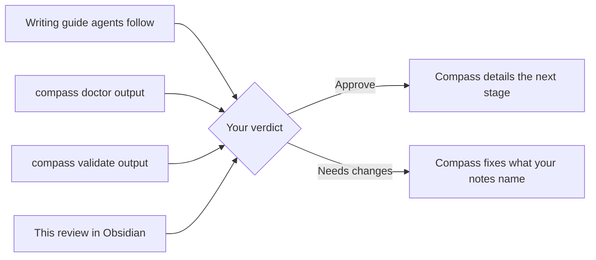

# Plain Output: Checks for You



> [!important] You decide
> You decide: do these four pieces read plainly and match what you approved? The second stage of [[PLAN-024-working-in-compass-is-visual]] changed how Compass writes documents and command output; these are the checks the plan leaves to you.
>
> | Check | Where to look | Question |
> | --- | --- | --- |
> | The writing guide every agent follows for documents you read | [[#Writing guide]] | Does it describe the documents you approved in [[research/human-surface/RESEARCH-visual-documents-mockup]]? |
> | `compass doctor`, the install health check | [[#Doctor output]] | Does it read plainly? |
> | `compass validate`, the vault check | [[#Validate output]] | Does it read plainly? |
> | How this review reached you | This document, and the terminal, which showed one line naming its title, id and commit | Does it match [[research/human-surface/RESEARCH-terminal-output-mockup]]? |
>
> Approve if all four hold; a note on any row says what to change.

## Writing guide

The "Documents the human reads" section of the obsidian skill (`plugin/skills/obsidian/SKILL.md`), the guide every agent follows when it writes a spec, plan or research, as it stands in commit b351c33:

````markdown
## Documents the human reads

A spec, plan or research document is read by a person who decides. It opens under its title with a picture of what is approved, then a callout saying what the person decides, then its text in plain words.

- **Opening picture.** A Mermaid diagram sized to one glance: for a spec the problem, the outcome and the rulings; for a plan its stages and the task dependencies; for research the findings by confidence and what they mean for the spec.
- **You decide callout.** Directly under the picture, a `> [!IMPORTANT]` callout whose text begins `You decide:` and asks the one question approving answers, naming what becomes binding. The callout leaves the file at approval, since an approved document states what is.
- **Callout types.** Five types, the ones GitHub draws as well as Obsidian: `[!NOTE]` for background (`[!NOTE]-` folds it), `[!TIP]` for a suggestion, `[!IMPORTANT]` for what the reader must decide, `[!WARNING]` for a risk, `[!CAUTION]` for harm that cannot be undone. Any other type shows on GitHub as a plain quote, so documents use these five.
- **Decisions in a callout.** The `- **D-NN:**` bullets sit in a callout under the Decisions heading. A callout cannot hold a block id a link could reach, so a document citing a decision links that heading (`[[SPEC-001-name#Decisions]]`).
- **Block ids.** A line cited from another document that sits outside a callout gets a block id, ` ^d-01`, at its end, and the citation links `[[doc#^d-01]]`. A block id inside a callout is not reachable by a link; link the heading instead.
- **Embed, never copy.** A section another document holds appears through `![[doc#Heading]]`, never copied, so one source stays true. A folded `> [!NOTE]-` callout holding embeds carries the rest of a long document below its opening.
- **Bytes.** A visual stays when it removes as many bytes as it adds, or when the human keeps it knowing its cost. A visual that only decorates is cut. A table that replaces prose passes this test; a diagram that restates a paragraph the reader still needs does not. A mockup of a document carries a byte table: bytes added against bytes removed.

### Plain words

Coined terms reach the human as plain words. Where a program reads a word, the files that hold it stay unchanged: field names (`complexity:`, `depends_on:`), warning codes, heading grammar (`## Decisions`, `Automated verification`) and command names. A view or a report shows the plain word; the file keeps the one the program parses. A warning prints as a sentence first and its code last in brackets: "A link points to a document that does not exist. (broken_wikilink)".

Some terms stay, explained once at first use in each document: ids lead with the title and follow with the id ("Working in Compass Is Visual (SPEC-031)"); the core nouns spec, plan, research, vision, lesson, handoff and vault carry a gloss ("spec (what we need)", "handoff (notes to resume next session)"); ADR reads "decision record (ADR-017)"; D-NN reads "decision D-01 (a numbered ruling)"; a source name takes one clause ("Reinertsen (product-flow author)"). Events and roles that only agents and hooks read (`PreToolUse`, `PostToolUse`, `SubagentStop`, `Stop`, `additionalContext`, `stopReason`, subagent, orchestrator, worktree) stay as written.

| Coined term | Say instead |
|---|---|
| frontmatter | properties |
| wikilink | link |
| hot path | start-here files |
| warm, cold, hot tier | start-here files, folder summaries, full documents |
| unit, unit folder, `make-unit`, `unit-check` | workstream folder |
| unit-promotion candidates | workstreams that could get their own folder |
| domain, domain folder | topic folder |
| scope note, "Class here:", "Class elsewhere:" | "What belongs here:", "Goes instead to:" |
| promote, demote | turn into a folder, turn back into a file |
| sweep | move to the done list |
| elaborate, elaboration | add detail |
| rolling wave | staged plan |
| Wave 1, Wave 2 | Stage 1, Stage 2 |
| facet | topic tag |
| folksonomy | free-form tags |
| admission control, `admit-check` | start-here size check |
| overlay | local additions |
| ledger | run log |
| escalated | flagged: came back three times, needs your review |
| capture opportunity | a moment to record a lesson |
| capture signal, strong signal | hint that a lesson is worth recording, strong hint |
| detached worker | background helper |
| hook | automatic step |
| gate | approval point |
| changeability walk | split check: what must change together |
| taxonomy_hint | filing hint |
| type-spread | kinds of document tied to one spec |
| sizing_id, sizing log | shape record |
| materialization, host | install for each tool (Claude Code and others) |
| trackable | the plan must cover it |
| surfaced-but-uncited | relevant lesson, not cited |
| complexity: S, M, L | size: small, medium, large |
| depends_on: | needs first: |
| files: [...] | touches: |
| decisions: [...] | carries decisions: |
| lessons: [...] | applies lessons: |
| commit-upfront: | decided now because: |
| Automated verification, Manual verification | Checks Compass runs, Checks for you |
| Convergence matrix | Where the sources agree |
| Marks, Grade | Source checks, Weight of evidence |
| covered, scoped, uncovered, PASS | carried in the plan, left for a later stage, missing; result ok or gap |
| source-qualified citation | cite as document-name/D-01 |
| capability usage, NEVER USED | commands you have not run |
| worker ledger | background helper log |
| capture posture | how lesson recording is set up |

````

## Doctor output

`compass doctor` run on this repository at commit b351c33:

```text
status  check                                        detail
OK      plugin.yaml                                  version 0.29.0
OK      automatic step registration                  PreToolUse, PostToolUse, Stop, SubagentStop all registered
OK      CLI completeness                             47 commands, all modules present
OK      agents                                       13 present
OK      skills                                       34 present
OK      lessons-catalog.yaml                         .compass\meta\lessons-catalog.yaml present
WARN    workstreams that could get their own folder  25 candidate(s): active-holds-only-active-work, capabilities-are-reachable-and-measured, capture-in-the-humans-words, central-model-resolution-table, clone-old-sessions, compass-updates-itself, control-theory-for-loops, decision-coverage-tracing, hierarchical-vault-organization, index-auto-maintained-and-mirrored-per-folder, learning-loop, lessons-and-index-subsystem, multi-host-agent-cli-support, research-covers-the-whole-spec, review-documents-open-in-obsidian, rolling-wave-planning, scaffolding-invisible-to-the-human, sizing-work-beyond-one-spec, stop-and-suggest-handoff-at-80-percent-context, test-quality, universal-hybrid-hierarchy, update-safe-customizations, vault-graph-queries, vault-organized-per-domain, working-in-compass-is-visual
WARN    commands you have not run                    9 command(s) not run in 44 days of measurement
OK      local additions                              none
OK      background helper log                        90 started, 88 finished, 2 failed; last failure: exit 0 (opportunity not closed)
OK      session retention                            cleanupPeriodDays is 3650 (user settings)
OK      obsidian review                              Compass Review is on; if no review bar appears, in Obsidian, open Settings, then Community plugins; if it shows "Turn on community plugins" (restricted mode), click it; then switch on Compass Review
OK      install for each tool                        tools: claude-code, dsh; dsh automatic steps, skills, bundle (0.29.0), rules section all present
OK      how lesson recording is set up               claude on PATH - background helper runs through claude

fixes:
  workstreams that could get their own folder: run `compass unit-check` for the member list
  commands you have not run: run `compass usage` for the list of commands you have not run
```

## Validate output

`compass validate` run on this vault at commit b351c33:

```text
compass validate: 0 error(s), 2 warning(s)
  warning compass-cli: this folder was made before the shape record existed. (sizing_unrecorded)
  warning research/pipeline: this folder holds 16 items, more than the 12 that read easily; Compass will propose topic folders. (folder_over_ceiling)
```
