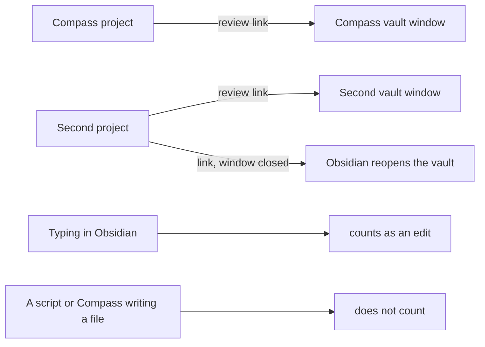

# Review Live Checks

Runs of `compass review` with this vault and a scratch second project's vault open in the same Obsidian, checking whether each review reaches its own project's window ([[PLAN-025-review-across-files-and-sessions]], open checks G1 to G4 of [[research/human-surface/RESEARCH-review-across-files-and-sessions]]).

## Setup

| Item | Value |
| --- | --- |
| Obsidian | 1.14.5 (`obsidian-1.14.5.asar`), Windows 11 |
| Second project | a git repository at `.compass/tmp/trials/second-project/`, its vault `.compass` registered in Obsidian, Compass Review installed with `compass review --install` |
| Each run | `compass review .compass/scratch-note.md` from the second project, on a committed note; the Compass project's own review sent at the same moment |

## Two vaults, each review to its own window (G1)

| Run | Sent from | Answer written in | Window that came forward, in the human's words |
| --- | --- | --- | --- |
| 20261027T165416-efedb5 | second project | the second vault's `tmp/review/` | "two, one obsidian and tghen another with the scratch-node.md" |
| 20261027T165416-f61145 | Compass project, same second | pending | pending |

The second project's answer was written by the second vault's plugin, so its link reached its own vault.

## Vault closed (G2)

| Run | State when sent | Result |
| --- | --- | --- |
| 20261027T165529-d1bb84 | the second vault's window closed by the human, the Compass window open | approved: the window reopened by itself with the card |

## Link to a vault whose window is open (G3)

Run 20261027T165416-efedb5 went to a vault whose window was already open, the case a forum report describes as doing nothing. The card arrived and the answer was written.

## Second link while Obsidian runs (G4)

Every run went to an Obsidian already running, two of them in the same second to two vaults. Each link reached the running Obsidian: no second Obsidian started, and each answer was written in its own vault.

## Seen beside the checks

Two answers listed `scratch-note.md` as edited although the human only approved. In the second, the edit is one space added before the note's heading (`# Did this vault reopen?` became ` # Did this vault reopen?`). The check below shows which writes come from typing.

## Whose writes count as edits (G5, G17)

A throwaway plugin in the second vault logged every file-changed event (`vault.on("modify")`) and every editor-changed event (`workspace.on("editor-change")`) with its path and time, while four writes ran during one review (run 20261027T171015-08f7f1). The log is `.compass/tmp/trials/review-edits/events.jsonl`; the plugin was turned off afterwards.

| Write | Who | Editor-changed events | File-changed events |
| --- | --- | --- | --- |
| `note-a.md` rewritten by a script | outside Obsidian | 0 | 1 |
| `meta/usage.yaml` rewritten by `compass sync` | outside Obsidian | 0 | 1 |
| one word typed in `note-b.md` | the human | 5, then the save | 1 |
| a table cell changed from `1` to `2`, and the table editor padding the divider row | the human, then Obsidian | 3, then the save | 2 |

The review's answer listed `note-a.md` and `note-b.md` as edited: today's plugin counts the script's write as the human's edit.

**Result:** an editor-changed event comes only from typing in Obsidian, including the table editor's padding that follows the human's own edit; writes from outside Obsidian fire a file-changed event alone. A review can list as edits only the files with an editor-changed event, which is the "only edits typed in Obsidian's editor" choice of [[PLAN-025-review-across-files-and-sessions]].

## Two projects and two sessions at once (TASK-219)

Run on Compass 0.30.0 with the review panel. Three reviews were sent in the same second: three files from this repository, one file from a second session id in this repository, and three files from the second project.

| Review | Sent from | Answer written in | Session on the card | Files in the answer |
| --- | --- | --- | --- | --- |
| 20261027T231502-362a8d | this repository | this vault | this session | all three, read |
| 20261027T231503-06247c | this repository, second session id | this vault | `other-` | one-file answer, no `files` list |
| 20261027T231502-b136d4 | second project | the second vault | `second` | all three, unread: approved without walking |
| 20261027T232835-553ad3 | second project, sent again with Obsidian closed | the second vault | `second` | all three, read; the renamed file under its new path `step-3-renamed.md` |

- Obsidian, closed, started by itself when the last review was sent.
- Each answer was written by its own vault's plugin, and the two cards in this vault carried different sessions.
- The panel followed the rename: the answer names `step-3-renamed.md`. The terminal then printed the old name as unread; `compass review` now matches a renamed file to its place in the request and prints `file step-3-renamed.md read (renamed from step-3-rename-me.md)`.
- Each change report printed full diffs only for its own review's files and named every other file.

Not observed: no answer carried a note on the outside file, and the human did not recall whether one was written or how each window was reached. Whether an "On this file" note travels in a real answer is checked at the Wave 2 pause of [[plans/PLAN-025-review-across-files-and-sessions]]; the harness test for it passes.

## VS Code and Cursor windows (TASK-220)

Run on VS Code 1.143.1 and Cursor 1.1.3 (engine 1.96.2), Windows 11, with a throwaway extension (`compasstrial.probe`, engine `^1.85.0`, packaged by `vsce` as a `.vsix`) installed with `code --install-extension` and `cursor --install-extension` and removed with `--uninstall-extension` afterwards. It registers a URI handler and appends `{"at","uri","folder","app"}` plus the window's `focused` state to `.compass/tmp/trials/vscode-probe/events.jsonl`. `probe.py` sent each link or command and recorded the desktop (foreground window, every editor window, minimized or not) before and 4 to 5 seconds after into `sent.jsonl`; `lineup.py` lines each send up with the window that logged it. Two windows of mine were open, one on this repository ("repo") and one on `.compass/tmp/trials/second-project/` ("second-project"). The human's own VS Code windows (`projects-md` and the `.compass` vault) stayed open and were never closed or driven.

The human worked in a browser and Slack during the run, so the desktop's foreground often moved within seconds of a send. "Came forward" below is read from the window's own `focused: true` event right after the send, with the desktop's foreground in the first seconds as the second signal.

### First link (VS Code)

The first link a window receives shows a dialog: "Allow 'Compass window probe' extension to open this URI?" with Open, Cancel and a "Do not ask me again for this extension" box. The link was logged only after Enter pressed Open, 100.8 s after the send. Every later link, in either window, was logged within 0.5 s with no dialog, though the box stayed unticked.

### Case 1: a link naming a folder (G10, 3.10)

Every link carried `folder=<other window's folder>`; no window used it.

| Link | Window in front when sent | Window that logged it | Came forward |
| --- | --- | --- | --- |
| c1a, names repo | second-project | second-project, after the dialog | already in front |
| c1b, names second-project | repo | repo, 0.5 s | already in front |
| c1c, names second-project | the human's Slack; repo was the last VS Code window used | repo, 0.5 s | yes: `focused` went true 0.05 s later and the desktop's front became the repo window |
| c1d, names repo | the human's Slack; second-project was the last used; both of mine minimized | second-project, 0.4 s | yes: restored from minimized and in front; repo stayed minimized; the human's visible `.compass` window did not take it |

A link goes to the last VS Code window used, whatever its folder, and brings it forward, restoring it if minimized.

### Case 2: `code <folder>` and `code -r <folder>` (G10, 3.15)

| Command | Window in front when sent | Window that logged `focused: true` | Result |
| --- | --- | --- | --- |
| `code <repo>` | second-project | repo, +0.5 s | existing window raised; still four VS Code windows |
| `code <second-project>` | repo (the human's browser had taken the front) | second-project, +0.6 s | existing window raised; four windows |
| `code -r <repo>` | second-project | repo, +0.6 s | repo window raised; second-project kept its folder; four windows |
| `code -r <second-project>` | repo | second-project, +0.6 s | second-project window raised; repo kept its folder; four windows |

With the folder already open in a window, `code` and `code -r` both raise that window and replace nothing.

### Case 3: editor closed (G11)

VS Code: not run. The human's VS Code was open, and closing it was not allowed. The last-used-window behaviour above is what a link does while VS Code runs.

### Window-state calls (G12, 3.12)

`vscode.window` offers `state` (`focused`, `active`) and `onDidChangeWindowState`; `vscode.env` offers nothing for windows. Of 65 registered commands matching window, raise, minimize, maximize, front or fullscreen, two touch the operating system window: `workbench.action.toggleFullScreen` and `workbench.action.focusWindow`. The probe called each on a window that was not in front, timed, with a one-second watcher on the desktop.

| Window state | Call | `focused` before, after | Desktop |
| --- | --- | --- | --- |
| behind another window or app (3 runs) | `focusWindow` | false, true | the window reported itself focused; the desktop's front stayed on the other app in the two watched runs |
| minimized (2 runs) | `focusWindow` | false, true in one run; true, true in the other | restored from minimized in both; in front in one run, in the other the human's browser took the front at the same second |
| behind, and minimized | `toggleFullScreen` | unchanged | no effect on focus; a minimized window stayed minimized |
| any | no call minimizes a window | - | - |

### Cursor 1.1.3 (G14)

| Check | Result |
| --- | --- |
| Extension with engine `^1.85.0` | installed, activated, logged links |
| `cursor://` link with Cursor closed | Cursor started and opened one window with no folder; the extension activated there and logged the link 0.05 s later, no dialog, window focused |
| Link naming a folder, other window in front (2 sends) | the window in front logged it, 20.9 s and 11.1 s after the send; no dialog |
| `cursor <folder>` and `cursor -r <folder>`, both directions (4 sends) | the window holding that folder logged `focused: true` at +2.0 to +2.2 s; no window opened or replaced |
| Window-state calls | same `state` API; `workbench.action.focusWindow` is not registered; `toggleFullScreen` changed nothing; 50 matching commands |

Not run: remote and WSL windows (G13), VS Code with the editor closed (G11), and a higher engine floor against Cursor.

## A review of three files in VS Code and Cursor (TASK-224)

Compass 0.31.0, `review_editor` set in `.compass/meta/plugin.yaml`, the extension installed with `compass review --install`. Both editors were closed when each review was sent.

| Review | Editor | What came forward | Answer |
| --- | --- | --- | --- |
| 20261028T115644-5ce09b | VS Code (`review_editor: vscode`) | VS Code started on the repository folder with the first file open | approved 35 s after the send, all three files read |
| 20261028T115738-8f3e88 | Cursor (`review_editor: cursor`) | Cursor started on the repository folder | approved about 100 s after the send, all three files read |

- Each answer was written by the editor's extension beside its request, in the Obsidian panel's shape, with the three files in request order.
- `compass doctor` named the editor reviews went to, and with the setting removed it names Obsidian again.
- A self-update with no setting installed nothing into VS Code or Cursor.

Not observed: neither answer carried a note on a file outside the review, though each review's steps asked for one, so whether the "On this file" box shows in the editors is unconfirmed. Across this document no real answer, in Obsidian or in the editors, has carried such a note; the harness tests for it pass in both.
