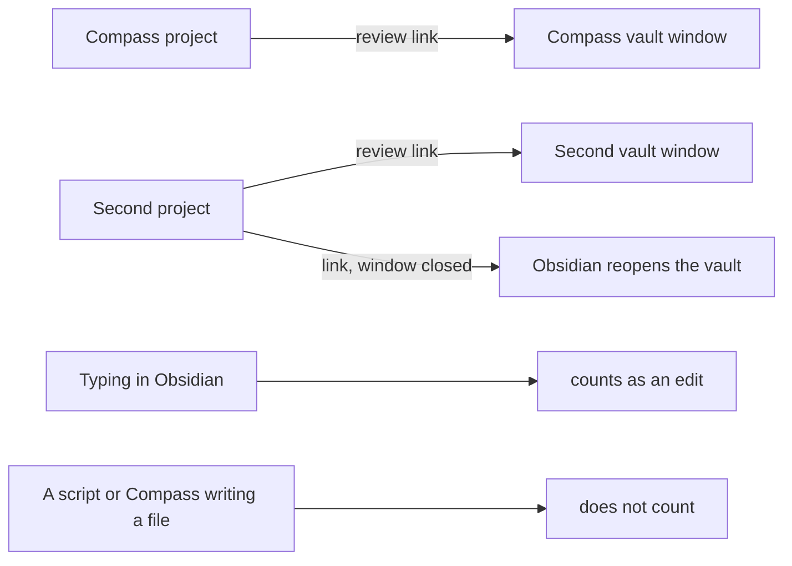

# Review Live Checks

> [!IMPORTANT]
> You decide: do these results hold as you saw them? Each review reached its own project's window, a closed vault reopened by itself, and only typing in Obsidian fires the event that marks an edit. Approving lets Compass detail the next stage of [[PLAN-025-review-across-files-and-sessions]]: the review panel that walks several files, edits counted from typing only, and each window stepping aside on its own.

Runs of `compass review` with this vault and a scratch second project's vault open in the same Obsidian, checking whether each review reaches its own project's window ([[PLAN-025-review-across-files-and-sessions]], open checks G1 to G4 of [[research/human-surface/RESEARCH-review-across-files-and-sessions]]).

## Setup

| Item | Value |
| --- | --- |
| Obsidian | 1.14.5 (`obsidian-1.14.5.asar`), Windows 11 |
| Second project | a git repository at `.compass/tmp/trials/second-project/`, its vault `.compass` registered in Obsidian, Compass Review installed with `compass review --install` |
| Each run | `compass review .compass/scratch-note.md` from the second project, on a committed note; the Compass project's own review sent at the same moment |

## Two vaults, each review to its own window (G1)

| Run | Sent from | Answer written in | Window that came forward, in the human's words |
| --- | --- | --- | --- |
| 20261027T165416-efedb5 | second project | the second vault's `tmp/review/` | "two, one obsidian and tghen another with the scratch-node.md" |
| 20261027T165416-f61145 | Compass project, same second | pending | pending |

The second project's answer was written by the second vault's plugin, so its link reached its own vault.

## Vault closed (G2)

| Run | State when sent | Result |
| --- | --- | --- |
| 20261027T165529-d1bb84 | the second vault's window closed by the human, the Compass window open | approved: the window reopened by itself with the card |

## Link to a vault whose window is open (G3)

Run 20261027T165416-efedb5 went to a vault whose window was already open, the case a forum report describes as doing nothing. The card arrived and the answer was written.

## Second link while Obsidian runs (G4)

Every run went to an Obsidian already running, two of them in the same second to two vaults. Each link reached the running Obsidian: no second Obsidian started, and each answer was written in its own vault.

## Seen beside the checks

Two answers listed `scratch-note.md` as edited although the human only approved. In the second, the edit is one space added before the note's heading (`# Did this vault reopen?` became ` # Did this vault reopen?`). The check below shows which writes come from typing.

## Whose writes count as edits (G5, G17)

A throwaway plugin in the second vault logged every file-changed event (`vault.on("modify")`) and every editor-changed event (`workspace.on("editor-change")`) with its path and time, while four writes ran during one review (run 20261027T171015-08f7f1). The log is `.compass/tmp/trials/review-edits/events.jsonl`; the plugin was turned off afterwards.

| Write | Who | Editor-changed events | File-changed events |
| --- | --- | --- | --- |
| `note-a.md` rewritten by a script | outside Obsidian | 0 | 1 |
| `meta/usage.yaml` rewritten by `compass sync` | outside Obsidian | 0 | 1 |
| one word typed in `note-b.md` | the human | 5, then the save | 1 |
| a table cell changed from `1` to `2`, and the table editor padding the divider row | the human, then Obsidian | 3, then the save | 2 |

The review's answer listed `note-a.md` and `note-b.md` as edited: today's plugin counts the script's write as the human's edit.

**Result:** an editor-changed event comes only from typing in Obsidian, including the table editor's padding that follows the human's own edit; writes from outside Obsidian fire a file-changed event alone. A review can list as edits only the files with an editor-changed event, which is the "only edits typed in Obsidian's editor" choice of [[PLAN-025-review-across-files-and-sessions]].
