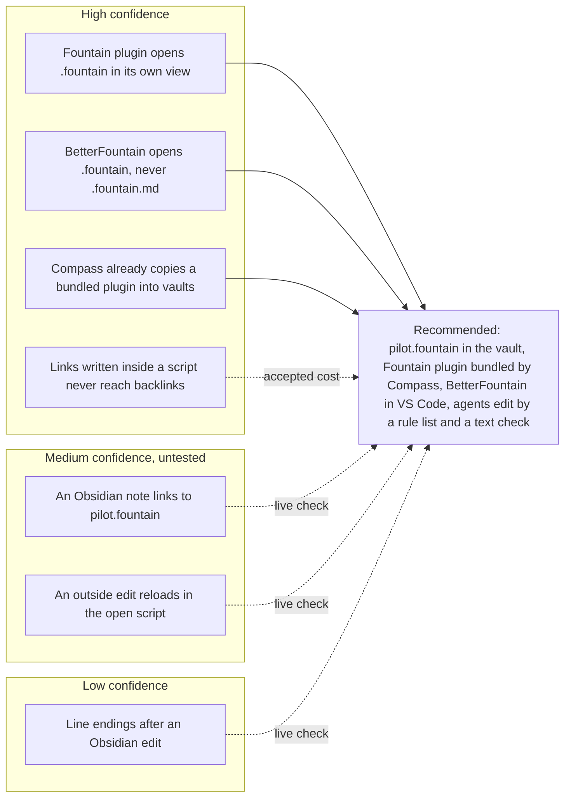

# Screenplays in the Vault

> [!note] Approved 2026-11-19
> The recommended option holds on every fork.

## Question

How can the human write and preview Fountain screenplays in Obsidian, keep editing the same files in VS Code with BetterFountain, link them like any document, and let agents read and edit them, set up by Compass in every vault (a project's document folder), as the spec (what we need) [[SPEC-032-screenplays-in-the-vault]] asks?

## Axes

1. Which Obsidian plugins write and preview Fountain today, and are they maintained: the Obsidian community plugin list, each plugin's GitHub repo, issues and last release.
2. Does a `.fountain` file round-trip (opened and saved in one editor, it comes back byte-for-byte the same in the other) unchanged between the chosen plugin and BetterFountain: both plugins' source code, tested on one sample script in both editors.
3. Can a `.fountain` file be a link target, show in backlinks and the graph, and embed: Obsidian's API docs and the plugin's source, tested in this vault.
4. Can agents read and edit scripts without breaking either editor: the Fountain syntax spec (fountain.io) and a live edit-then-reopen check.
5. How Compass installs and checks the plugin in every project, the way it ships `compass-review`: `plugin/` install code and `compass doctor`.

## Methodology

A technology landscape (axis 1) and repository mining (axes 2 to 5) of plugin source, Obsidian's API typings, the Fountain syntax at fountain.io and Compass's CLI, read 2026-11-19. Commits read: Fountain `9ce172b` (v0.34.3), fountain-editor `c333086` (v1.4.9), Fountain Stage `49b9a7b`, First Draft `b282fb0` (v0.13.1), BetterFountain `4f109ec` (v1.14.2). Axis 4 ran Compass's validator and three Python parsers on samples. No plugin ran in Obsidian and BetterFountain did not run in VS Code; those behaviours are the live checks below.

Findings carry source checks and no grade.

## Where the sources agree

Each row counts the axes that addressed the claim; a dash means the claim was outside that axis. Y = supports, with that axis's confidence (h high, m medium, l low); ? = the axis named the point and left it unread.

| # | Claim | A1 | A2 | A3 | A4 | A5 | Agree |
|---|---|---|---|---|---|---|---|
| 1 | Fountain (bgrundmann) opens `.fountain` in its own view | Y h | Y h | Y h | Y m | - | 4/4 |
| 2 | Only one plugin can own `.fountain` | Y h | Y h | Y h | - | - | 3/3 |
| 3 | `[[ ]]` is a Fountain note (a comment inside the script); Fountain links out of a script with `[[>target]]` | Y h | Y m | Y h | Y h | - | 4/4 |
| 4 | Links inside a `.fountain` never reach backlinks, graph or Obsidian's link index | Y h | Y m | Y h | Y h | - | 4/4 |
| 5 | An Obsidian note's link to `pilot.fountain` (extension written) resolves | Y m | - | Y m | - | - | 2/2, untested |
| 6 | The script's backlinks pane lists Obsidian notes linking to it | ? | - | Y m | - | - | 1/1, untested |
| 7 | Following a link to a missing `.fountain` creates `x.fountain.md`; Fountain renames it back | Y m | Y m | Y h | - | - | 3/3 |
| 8 | Fountain Reference Panel lists `[[>target]]` references for the open Obsidian note | Y m | - | Y h | - | - | 2/2 |
| 9 | BetterFountain opens `.fountain` and `.spmd` only | Y h | Y h | Y h | - | - | 3/3 |
| 10 | fountain-editor styles Obsidian notes (`.md`); Obsidian links win over Fountain notes | Y h | Y h | Y h | Y h | - | 4/4 |
| 11 | Fountain inside a `.md` file gets links, backlinks, graph, search and embeds | Y h | - | Y h | - | - | 2/2 |
| 12 | Fountain inside a `.md` file is not pure Fountain: properties sit where the title page (the `Key: value` block of title and author that opens a script) must come first | - | - | Y h | Y h | - | 2/2 |
| 13 | fountain-editor has the most downloads but cannot open `.fountain` | Y h | Y h | - | - | - | 2/2 |
| 14 | Fountain Stage is days old, claims mobile, hides `[[...]]` | Y h | ? | Y h | Y h | - | 3/3 |
| 15 | BetterFountain never rewrites a file unprompted | - | Y h | - | - | - | 1/1 |
| 16 | Fountain and BetterFountain read title pages, boneyard (text between `/*` and `*/`, kept in the file and left out of the script) and snippets differently | - | Y m-h | - | - | - | 1/1 |
| 17 | BetterFountain's title-page match is unanchored and loose | - | Y m | - | Y h | - | 2/2 |
| 18 | Line endings after an Obsidian edit are unverified | - | Y l | - | Y h | - | 2/2 |
| 19 | Fountain reloads an outside edit into its open view | Y m | - | - | - | Y m | 2/2, untested |
| 20 | Core search skips `.fountain` text; embeds have no public hook | - | - | Y h, m | - | - | 1/1 |
| 21 | No Fountain linter exists; BetterFountain's parser needs VS Code | - | - | - | Y m, h | - | 1/1 |
| 22 | Compass scans only `.md`; a `.fountain` is a link target only | - | - | Y h | Y h | Y h | 3/3 |
| 23 | Compass validate needs the extension; a bare `[[pilot]]` is a link to a missing document | - | - | Y h | Y h | Y h | 3/3 |
| 24 | The sync automatic step runs only for `.compass/**/*.md` | - | - | - | - | Y h | 1/1 |
| 25 | `compass guard` covers `.fountain` by path | - | - | - | - | Y h | 1/1 |
| 26 | Compass ships only compass-review, as bundled files, installer keyed to one id | Y h | - | - | - | Y h | 2/2 |
| 27 | Third-party plugins (dataview) are hand-installed, untracked by Compass | Y m | - | - | - | Y h | 2/2 |
| 28 | A folder of scripts only raises no Compass warning | - | - | - | - | - | added code read |
| 29 | Fountain (bgrundmann) fits the outcome best | Y | Y | - | - | - | 2/2 |

No axis contradicts another on a fact. The open disagreements sit inside sources and are listed under Contradictions.

## Findings

### A. Plugins

1. **Fountain (id `fountain`, bgrundmann) is the plugin that best fits the outcome** (confidence: high; axes 1, 2, 3, 4)
   Registers `.fountain` to its own CodeMirror 6 view: live formatting, read-only print view, index cards, outline, PDF, scene numbers, a ribbon button for new scripts. MIT, 11,928 downloads, repo since 2025-01.
   - `src/main.ts:32-33` registers view and extension; README Highlights.
   - Source checks: code and README, owner checked (35 stars); four axes agree.
2. **Fountain is maintained by one person and has been quiet for 12 weeks** (confidence: high; axis 1)
   v0.34.3 and last commit 2026-08-29; seven issues opened Oct-Nov 2026 have no reply, older ones got replies; 15 open.
   - GitHub releases and issues, read 2026-11-19. Source checks: repo metadata, single source.
3. **Only one plugin can own `.fountain`** (confidence: high; axes 1, 2, 3)
   Fountain, Fountain Stage, First Draft and the Fountain Plus fork all call `registerExtensions(["fountain"], ...)`; Obsidian has no unregister call. Fountain's README says the Custom File Extensions plugin set to `.fountain` crashes it.
   - Fountain Stage README "Only one plugin can open .fountain files"; `obsidian.d.ts:7225,7248`. Three independent statements agree.
4. **Fountain Stage (id `fountain-stage`) is the closest alternative, with no track record** (confidence: high; axes 1, 3, 4)
   Own `.fountain` view with Live Preview, source and reading modes; states desktop and mobile; MIT. Created 2026-11-17, four releases on 2026-11-18, 7 downloads. Hides every `[[...]]` as a Fountain note (`src/fountain/parser.ts:116`); links are out of its scope.
   - `src/main.ts:40-72`. Source checks: code and README, single owner, no community signal yet.
5. **fountain-editor (id `fountain-editor`) styles Obsidian notes and never opens `.fountain`** (confidence: high; axes 1, 2, 3, 4)
   An Obsidian note counts as Fountain when named `*.fountain.md`, tagged `fountain`, or given `cssclasses: fountain`. Obsidian links replace Fountain notes (its decision record ADR 001). No reading view (#49); dual dialogue (two characters speaking side by side, marked with `^`) and page breaks unhandled. 19,459 downloads, most of the editors; quiet since May 2026.
   - `src/tracker.ts:11-26`; `docs/.../syntax-parity.md`. Source checks: code and docs agree.
6. **Other candidates fall short of the outcome** (confidence: medium; axes 1, 2, 3)
   First Draft opens `.fountain` in Obsidian's markdown editor with no live formatting found and a preview that skips sections, Fountain notes and boneyard. Fountain Codeblock renders fenced blocks inside Obsidian notes; there is no `.fountain` file. Fountain Plus (fork, 7 commits ahead) is outside the community list.
   - First Draft `docs/PDF_COMPATIBILITY.md:28-29`; Fountain Codeblock `src/main.ts:11`.
7. **Mobile is unclaimed by Fountain, claimed by Fountain Stage** (confidence: medium; axis 1)
   Fountain's manifest has `isDesktopOnly: false` and no mobile statement; behaviour is unknown, not known-broken. [[SPEC-032-screenplays-in-the-vault]] does not ask for mobile.
   - Fountain `manifest.json`. Source checks: manifest and a search of source and README, single source.

### B. Round-trip with BetterFountain

1. **BetterFountain opens `.fountain` and `.spmd` only** (confidence: high; axes 1, 2, 3)
   A `.fountain.md` file is Markdown in VS Code unless mapped with `files.associations` (inferred, untested).
   - BetterFountain `package.json:455-457`. Three axes agree.
2. **Neither editor rewrites a file unprompted** (confidence: high; axis 2)
   BetterFountain writes only through scene-number and scene-shift commands, or on save when `fountain.general.numberScenesOnSave` is on (default off). Fountain saves only after a document change, from the editor text.
   - BetterFountain `src/extension.ts:100-106`, `package.json:129-133`; Fountain `src/views/editor_view_state.ts:100-105`.
3. **Line endings after an Obsidian edit are unverified** (confidence: low; axes 2, 4)
   BetterFountain reads LF, CR and CRLF. Fountain's grammar matches `\n`; whether CodeMirror saves a CRLF file as LF after one edit was recalled, not tested. Compass writes vault text with LF (`vaultlib.py` `write_text_lf`).
   - Fountain `src/fountain/parser.peggy` (`NewLine`). Caveat: a search for `\r` handling in Fountain's source returned no usable result.
4. **The two parsers read some syntax differently** (confidence: medium to high; axes 2, 4)
   - Title page: Fountain requires continuation lines indented 3+ spaces or a tab; BetterFountain accepts unindented ones, knows a fixed key list, and its match is unanchored, so `date:` anywhere in an early line starts a title page.
   - Boneyard: BetterFountain nests `/* */`, Fountain does not.
   - Fountain-only markup reads as plain content in BetterFountain: a `# Snippets` section (text kept aside for reuse), a `# boneyard` section, note kinds `[[+`, `[[-`, `[[>`, `[[todo:`; these survive as Fountain notes.
   - Dual dialogue: Fountain allows spaces around `^`; BetterFountain needs it at line end.
   - Fountain `parser.peggy:30-45`; BetterFountain `afterwriting-parser.ts:42, 425-448`.

### C. Links, backlinks, search and embeds

1. **`[[ ]]` is a Fountain note, so an Obsidian link cannot sit inside a script** (confidence: high; axes 1, 2, 3, 4)
   Fountain adds `[[>target]]` and `[[>target|text]]`: clickable, rewritten on rename, kept in its own index. BetterFountain and Fountain Stage see it as a Fountain note. fountain-editor takes the opposite side: Obsidian links win and Fountain notes go. A file written for one convention reads as damage in the other.
   - Fountain `src/fountain/links.ts:1-35`, `design/links.md`; fountain-editor decision record ADR 001.
2. **Links written inside a `.fountain` never reach backlinks, graph or Obsidian's link index** (confidence: high; axes 1, 3, 4)
   `metadataCache` is built for `.md` and offers no public way to add links from other files. Fountain's author will not patch internals (an earlier attempt elsewhere broke in Obsidian 1.8.3).
   - `obsidian.d.ts:6475,6506,6512`; Fountain `design/links.md`; issue #26 "unlikely to happen". Three independent sources.
3. **An Obsidian note's link into a script works when the extension is written** (confidence: medium, untested; axes 1, 3)
   `[[pilot.fountain]]` resolves; a 2022 forum test saw the script's backlinks pane list the Obsidian notes linking to it. Without a plugin that registers `.fountain`, the file needs "Show all file types" to be visible and linkable; Compass sets no such option.
   - Forum thread 50209 (Dec 2022); Fountain `src/main.ts:49-56`; obsidian.md/help/settings.
4. **Following a link to a missing script makes `pilot.fountain.md`; Fountain renames it back** (confidence: high; axes 1, 2, 3)
   - Fountain `src/main.ts:49-100`.
5. **Fountain Reference Panel fills part of the backlinks gap** (confidence: high; axes 1, 3)
   Scans every `.fountain` for `[[>target]]` and lists, on the open Obsidian note, each script line pointing at it with its scene heading. Lists references to Obsidian notes only, not to other scripts; needs a viewer plugin; a "Pro" tier exists (what it holds was not read); 86 downloads, released 2026-11-15.
   - `src/view.ts:49-50`, `src/main.ts:116,125`.
6. **Core search skips script text and embeds have no public hook** (confidence: high for search, medium for embeds; axis 3)
   Search reads Obsidian notes and canvases only; `file:` and `path:` still find a script by name. `![[pilot.fountain]]` needs the undocumented `app.embedRegistry`; no Fountain plugin read registers one; Fountain's own fenced blocks render in reading view only.
   - obsidian.md/help/plugins/search; forum request 115280.
7. **Graph: a script appears, if at all, as an attachment node with inbound edges only** (confidence: medium; axis 3)
   - obsidian.md/help/plugins/graph. Caveat: forum posters disagree on whether the file appears.
8. **Fountain inside a `.md` file gets every Obsidian feature, and stops being pure Fountain** (confidence: high; axes 1, 3, 4)
   As an Obsidian note, a `.fountain.md` is indexed, searched, embedded and linked both ways. Its properties block sits where Fountain requires the title page first, and one without properties fails Compass validate with a missing properties block, an error (frontmatter_error, tested).
   - `obsidian.d.ts:2391-2420`; fountain.io Title Page; axis 4 validator run.

### D. Agent edits

1. **Rules an agent must keep when editing a script** (confidence: high; axis 4, from fountain.io and BetterFountain's regexes)
   - Keep every line break and blank line; a line of two spaces holds a dialogue block or a Fountain note together, so trailing-whitespace stripping breaks it.
   - A character cue is an all-uppercase line with a blank line before and text after; an uppercase action line followed by text becomes a cue, `!` forces Action.
   - Scene headings start INT, EXT, EST, INT./EXT, INT/EXT or I/E then `.` or space; `.` forces one; `#1A#` is a scene number.
   - Transitions end `TO:`; `>text<` is centered; a `>` line without `<` becomes a transition.
   - The title page comes first, `Key: value`, ends at the first blank line; an unknown key first ends BetterFountain's title page.
   - An unclosed `/*` swallows the rest of the file; keep Fountain notes on one line, since BetterFountain matches them per line.
   - `_text_` is underline, never italics; no typographic substitution; `#` is a section and `=` a synopsis.
   - Write `[[>target]]` for an outward link and never a plain `[[target]]`, which is a Fountain note.
   - `afterwriting-parser.ts:42-62, 370-390, 524-576`; fountain.io syntax.
2. **No Fountain linter exists that matches either editor** (confidence: medium; axis 4)
   BetterFountain's parser imports `vscode` and cannot run outside it. `fountain-parser` 0.1.1 (Python, no dependencies) parsed a sample into typed elements but read `>THE END<` as Action and left Fountain notes as raw text. `fountain-py` 0.3.0 has a `validate` command whose checks were not seen. Jouvence hung.
   - BetterFountain `afterwriting-parser.ts:3-5`; axis 4 runs of the three Python packages.
3. **Compass sees nothing inside a script** (confidence: high, tested; axis 4)
   A `.fountain` holding a Fountain note with links to an existing and a missing document produced no validate warning.
   - Axis 4 ran `compass validate` on that sample; `plugin/cli/vaultlib.py:113-128`, `plugin/cli/commands/validate.py:266-303`.
4. **`compass guard` already covers scripts by path** (confidence: high; axis 5)
   A subagent Write that empties a script, or keeps under half its length, and an Edit that blanks 10 or more lines are denied inside `.compass/`.
   - `plugin/cli/commands/guard.py:50-56, 291-365`.
5. **An outside edit should reload in Fountain's open view** (confidence: medium, untested; axes 1, 5)
   Fountain's view extends `TextFileView`; `setViewData` handles Obsidian's reload and was hardened in v0.34.3 against a second open pane saving the old text over a new one (issue #36). Compass already assumes Obsidian merges an outside write into an open editor.
   - Fountain `src/views/fountain_view.ts:660-700`; `plugin/cli/commands/guard.py:17-19`.

### E. Compass install and tools

1. **Compass ships one Obsidian plugin, as committed files** (confidence: high; axes 1, 5)
   `compass-review` lives as `main.js`, `manifest.json`, `styles.css` under `plugin/obsidian/compass-review/`; setup and update copy it to `.claude/obsidian/`, then into `<vault>/.obsidian/plugins/<id>/`, appending the id to `community-plugins.json` atomically and keeping other entries. Nothing downloads a plugin.
   - `plugin/cli/review_surfaces/obsidian.py:31, 216-283`; `plugin/cli/tests/test_review.py:366-376`.
2. **The installer is keyed to that one plugin** (confidence: high; axis 5)
   `PLUGIN_ID`, `PLUGIN_FILES`, `install_plugin`, `plugin_state`, `plugin_current` and the doctor row all name `compass-review`; `SURFACES` lists review editors, not plugins.
   - `plugin/cli/review_surfaces/obsidian.py:30-32`; `review_surfaces/__init__.py:42`.
3. **Updates overwrite plugin files to the shipped bytes** (confidence: high; axis 5)
   `plugin_current` compares bytes, never the manifest version; update reinstalls whenever bytes differ. Obsidian Bases views (saved table views, `.base` files) are the exception: copied only when absent.
   - `obsidian.py:98-146, 222-265`.
4. **Third-party plugins are hand-installed and untracked** (confidence: high; axes 1, 5)
   dataview sits in this vault's `.obsidian/plugins/`, untracked; no `plugin/` code names it outside tests.
   - `plugin/cli/tests/test_review.py:369`; `git ls-files .compass/.obsidian`.
5. **Enabling a plugin needs the human** (confidence: medium; axis 5)
   After the files land, Obsidian needs a reload and the human switches the plugin on, turning off restricted mode first; Compass relays the steps. Install skips a vault Obsidian never opened.
   - `obsidian.py:33-38, 155-181, 250-252`.
6. **Compass's scans read `.md` only; a script is a link target, never a vault document** (confidence: high; axes 3, 4, 5)
   No index line, properties check, tag index entry or graph node for a `.fountain`; links inside it count nowhere. `attachment_names` lists every non-`.md` file by name with extension and by vault path, so an Obsidian note's link to `pilot.fountain` resolves; a bare `[[pilot]]` is reported as a link to a missing document (broken_wikilink, tested).
   - `plugin/cli/vaultlib.py:113-146, 375`; `commands/validate.py:75-96`; `vaultgraph.py:75-110`.
7. **The sync automatic step skips scripts** (confidence: high; axis 5)
   PostToolUse entries match `Write|Edit|MultiEdit(.compass/**/*.md)`, so a script edit runs no `compass sync` and records no lesson hint.
   - `plugin/hooks/hooks.json`; `plugin/cli/commands/sync.py:1057-1064`.
8. **`compass move` renames every file in a moved folder** (confidence: medium; axis 3)
   Whether it rewrites Obsidian notes' links to a moved script was not read to the end.
   - `plugin/cli/commands/move.py:127, 140-153, 293`.
9. **A folder holding only scripts raises no warning; a mixed folder follows its markdown** (confidence: high; code read of the Compass CLI)
   Validate, tree, sync and doctor say nothing about a folder with no `.md`, and its scripts still resolve as link targets. A folder mixing scripts with untyped markdown is reported as an unclassified folder (unclassified_root_folder); with typed markdown it becomes a type folder whose scripts are ignored.
   - `plugin/cli/vaultlib.py:69-96, 137-145, 446-453`; `commands/validate.py:274-279`.

## Forks

Each fork lists its options with the recommended one first.

### 1. Which Obsidian plugin

1. **Fountain by bgrundmann (Recommended).** Own `.fountain` view, live formatting, read-only preview, `[[>target]]` links, the only candidate with a release history and thousands of users; costs: one maintainer, quiet 12 weeks, mobile unclaimed (findings A1, A2, A7).
2. **Fountain Stage.** Live Preview, source and reading modes, mobile claimed; costs: two days old, 7 downloads, hides every `[[...]]`, no links (finding A4).
3. **fountain-editor on `.fountain.md`.** Full Obsidian linking and the most downloads; costs: the file is Markdown, so BetterFountain needs a VS Code mapping, Fountain notes are dropped, no reading view (findings A5, C8).

Axes 1 and 2 rank option 1 first; options 1 and 2 cannot run together (finding A3).

### 2. `.fountain` or `.fountain.md` on disk

1. **`.fountain` (Recommended).** The same bytes open in BetterFountain and Obsidian, as [[SPEC-032-screenplays-in-the-vault]] asks ("the same file opens in both, with nothing converted"); costs: links inside scripts miss backlinks and graph, core search skips script text, no embed (findings B1, C2, C6).
2. **`.fountain.md`.** Backlinks, graph, search and embeds both ways; costs: BetterFountain opens it only through `files.associations` (untested), the properties block clashes with the title page, Compass validate errors without properties (finding C8).

Choosing option 3 in fork 1 forces option 2 here.

### 3. How scripts and Obsidian notes link

1. **Obsidian notes link in with the extension, scripts link out with `[[>target]]` (Recommended).** Both work under Fountain today; outward links survive as Fountain notes in BetterFountain; costs: the target Obsidian note's backlinks pane does not show them (findings C1, C2, C3).
2. **Option 1 plus Fountain Reference Panel.** Each Obsidian note lists the script lines pointing at it; costs: a second third-party plugin, released 2026-11-15, with an unread "Pro" tier (finding C5).
3. **Obsidian notes link in only; scripts hold no links.** Nothing is invisible; costs: a script cannot point at the character, location or research notes it draws on, so those references live only in the Obsidian notes (finding C3).

### 4. How Compass ships a third-party plugin

1. **Bundle the plugin's release files and widen the installer to a list of plugins (Recommended).** Reuses the copy, `community-plugins.json` append and doctor rows, as [[SPEC-032-screenplays-in-the-vault]] asks ("set up the way Compass sets up its other Obsidian pieces"); Fountain is MIT; costs: Compass pins a version and each Compass update reverts a newer copy the human took through Obsidian (findings E1, E2, E3).
2. **Download the release from GitHub at install time.** Tracks upstream; costs: no such code exists and setup needs the network (finding E1).
3. **Hand install, with a doctor row that warns when it is missing.** Smallest change; costs: nothing ships, as with dataview today (finding E4).

### 5. Whether Compass's own tools change

1. **No CLI change; scripts stay link targets and documents link with the extension (Recommended until the live checks show a need).** Validate resolves `pilot.fountain` today; costs: an agent's script edit runs no sync and Compass checks nothing inside a script (findings D3, E6, E7).
2. **Narrow changes.** Extend the sync automatic step to `.fountain` writes and add a validate hint when a bare link names an existing script; costs: changes to the automatic step's matcher and to validate, each with tests, for a sync run that finds nothing in a script to index (findings E6, E7).
3. **Make scripts full vault documents.** Index lines, tag index entries, links read inside scripts; costs: every `.md`-only scan changes (validate, tree, sync, graph, tag index), and a script has no properties block to supply a summary or tags, since the title page must come first (findings C8, E6, E9).

### 6. What guards agent edits

1. **The rule list plus a text check that needs no parser (Recommended).** Agents read the rules in finding D1 before editing a script; after an edit, a check compares old and new text for the breaks those rules name that plain text shows: an unclosed `/*`, a two-space line emptied, a plain `[[target]]` added, the title page no longer first, line endings changed. Costs: it misses breaks that depend on how a parser reads a line, such as a new uppercase action line turning into a character cue; no tool exists yet, and this option is drawn from the rules in finding D1 rather than from an axis.
2. **The rule list plus a `fountain-parser` comparison.** Parses before and after and reports element types that changed; costs: that parser matches neither editor, reads `>THE END<` as Action and leaves Fountain notes as raw text, so it reports false breaks and misses real ones (finding D2).
3. **The rule list only.** `compass guard` still blocks gutting a script (finding D4); costs: nothing checks Fountain structure.

## Contradictions

- **Graph node for a script:** forum posters disagree on whether a `.fountain` file appears in the graph with the Attachments filter on (axis 3, finding C7). Live check 2 settles it.
- **Downloads against capability:** fountain-editor leads on downloads (19,459 against 11,928), Fountain leads on opening `.fountain` files; the rank depends on which criterion counts (axes 1, 2).
- **Backlinks into a script:** axis 3 cites a 2022 forum test that they show; axis 1 lists the same point as untested. Live check 2 settles it.

## Live checks the plan must run

1. **Round-trip hashes.** Fixtures: BetterFountain's `big_fish_crlf.fountain` and `brick_and_steel_crlf.fountain` (`src/test/scripts`), plus a file with `# Snippets`, nested `/* /* */ */`, `[[>link]]`, synopses, dual dialogue, `#1#`, a BOM variant (a file starting with the invisible byte-order mark) and one without a trailing newline. SHA-256 each; open and close, then type and delete one character and save, in Obsidian with Fountain and in VS Code with BetterFountain (with and without `numberScenesOnSave`); hash after each step.
2. **Links on the current Obsidian build, Fountain enabled.** An Obsidian note's `[[pilot.fountain]]` resolves, appears in the `[[` suggester, shows in the script's backlinks pane and as a graph node; a bare `[[pilot]]`; whether "Show all file types" is needed; what `![[pilot.fountain]]` shows.
3. **Agent edit reload.** With the script open in Fountain's view and in VS Code, an agent Edit shows in both, and no pane saves the old text back.
4. **Install.** Bundled files copied into a fresh vault, reload, toggle on; the `.fountain` view opens; Obsidian keeps the Compass-added entry in `community-plugins.json` after the human toggles another plugin.
5. **Preview parity.** The fixtures side by side in BetterFountain's preview and Fountain's read-only view.
6. **Text check** (if fork 6 takes option 1). A fixture with one deliberate break per rule the check names; it reports each break, and nothing on an edit that keeps the rules.

## Gaps

- No plugin ran in Obsidian and BetterFountain did not run in VS Code; every behaviour above is read from source or docs.
- What Fountain Reference Panel's "Pro" tier holds.
- Whether Obsidian rereads `community-plugins.json` while running, or rewrites it from memory when the human toggles a plugin.
- What `fountain-py validate` reports.
- Whether `compass move` rewrites Obsidian notes' links to a moved script.

## Live check results

> [!warning] Since your last review
> Round 1 came back approved 22 seconds after it opened, and the scratch folder shows Obsidian never opened it: no `workspace.json` appeared in its `.obsidian` folder, and every script is byte-identical. Nothing is recorded yet. Please do the four steps below, then approve; if you would rather skip the live checks for now, say so in the notes.

> [!todo] You do, round 1: open and close in Obsidian
> 1. In Obsidian: **Open another vault**, then **Open folder as vault**, and pick the `fountain-live` folder, open in File Explorer now (a scratch folder outside every vault).
> 2. If it asks about restricted mode, turn it off. In the notes, say whether Fountain was already on or you switched it on in Settings, Community plugins.
> 3. Open each of the 8 `.fountain` scripts, look at it, and close it. Change nothing.
> 4. Approve. I fingerprint every script, record the rows below, and send round 2.
>
> Rounds 2 to 5 finish check 1: a typed-and-deleted character in each script in Obsidian, then the same in VS Code, then once more in VS Code with scene numbering on. Rounds 6 to 9 cover links, an agent edit while the scripts are open, install, and the two previews side by side. The scratch folder is not one of your vaults.

Versions: Fountain 0.34.3 (bundled), BetterFountain 1.14.3. BetterFountain's two `_crlf` samples arrive from GitHub with LF line endings; the kit's `kit-crlf` copies hold CRLF.

| Id | Step | Script | Result |
|---|---|---|---|
