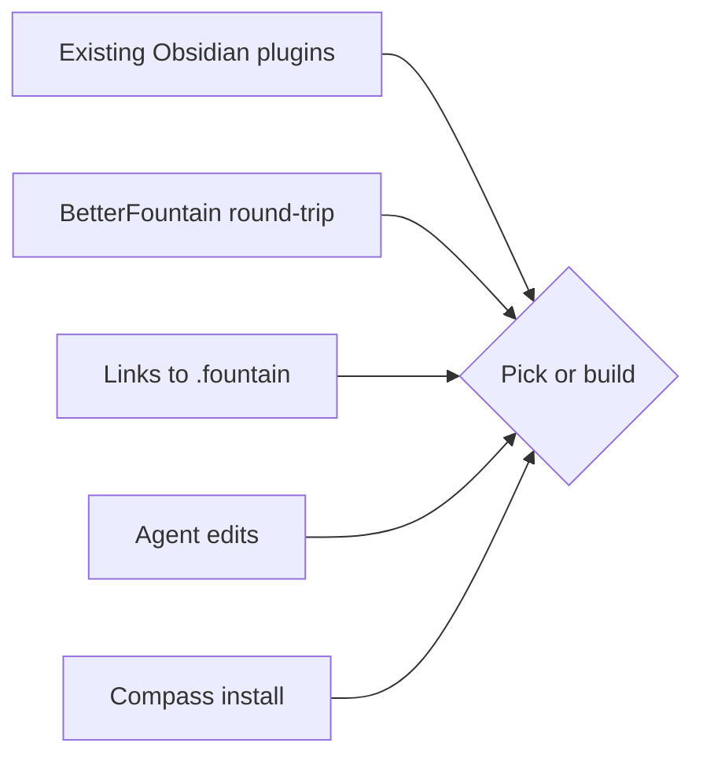

# Screenplays in the Vault: Research Axes

> [!important] You decide
> Run research on these axes? Add your own questions below; they lead the list.

## Your questions

-

## Axes

1. Which Obsidian plugins write and preview Fountain today, and are they maintained: the Obsidian community plugin list, each plugin's GitHub repo, issues and last release.
2. Does a `.fountain` file round-trip unchanged between the chosen plugin and BetterFountain: both plugins' source code, tested on one sample script in both editors.
3. Can a `.fountain` file be a `[[wikilink]]` target, show in backlinks and the graph, and embed: Obsidian's API docs and the plugin's source, tested in this vault.
4. Can agents read and edit scripts without breaking either editor: the Fountain syntax spec (fountain.io) and a live edit-then-reopen check.
5. How Compass installs and checks the plugin in every project, the way it ships `compass-review`: `plugin/` install code and `compass doctor`.

- [ ] Grading allowed (a cheap sub-agent scores how completely the findings cover the spec)
