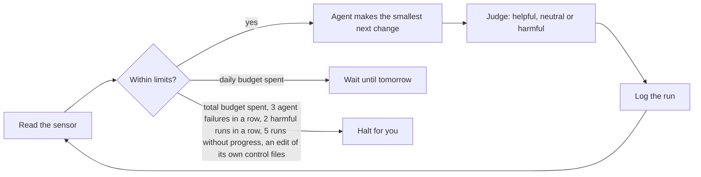

# Terminal Output: Mockup

This page mocks up, for ten moments, what Compass shows a person who reads and approves a spec, plan or research document, set against what it showed before.

When a review surface is configured (Obsidian through the Compass Review plugin, or another markdown editor), every moment of reading and approving a spec, plan or research document happens in the editor: the draft, the research axes and the grading choice, the plan's choices, and the follow-up after a verdict. The terminal says one line naming the document. Terms used here: a review surface is a markdown editor set up to receive reviews; a gate is a point where the person must answer; a verdict is the answer, Approve or Needs changes; the panel is the review card in the editor holding those two buttons. This follows [[specs/human-surface/SPEC-030-review-documents-open-in-obsidian]]: a document that needs review opens in the configured editor, and approving there is never asked again in the terminal (D-04).

The terminal carries the content as plain text, and gates go through `AskUserQuestion`, only when `compass review` answers `not configured`. That is the fallback, in its own part below.

Each moment shows a real transcript line (before), what the editor carries, the one terminal line, and the fallback rewrite. Fallback rewrites use the words of [[research/human-surface/RESEARCH-plain-words-mockup]]: the title before the id, one fact per line, a choice as numbered options; the terminal is plain text with no color or symbols. This page belongs to [[specs/human-surface/SPEC-031-working-in-compass-is-visual]]. The word "wave" is written "stage" in every rewrite.

## Counts

Every excerpt is a file in `.compass/tmp/mockups/terminal-loop/` with LF line endings; the folder is uncommitted scratch, and the fenced blocks below hold the same text. Lines are newline characters and bytes are UTF-8 bytes, so the fenced blocks are the record; `wc -lc *.before.txt *.editor.md *.terminal.txt *.fallback.txt` in that folder reproduces each number. The before files are text blocks and hook records copied from the transcripts in this project's Claude Code session folder, `~/.claude/projects/<project>/` (assistant text blocks, with the question fields of the `AskUserQuestion` call for moment 8); the line number in each Source line is the transcript line. Paths are shown from the project folder down. Each editor file holds the text the editor adds around the document's own sections, which are not counted because they exist whether or not a person reads them. Where the editor adds new content, it is counted: the axes page in moment 3 and the picture in moment 6.

Cells are lines / bytes.

| Moment | Before | In the editor | In the terminal | Fallback terminal |
|---|---|---|---|---|
| 1. A spec draft is walked through | 18 / 1,701 | 4 / 399 | 1 / 144 | 21 / 1,740 |
| 2. A spec returns after a changes verdict | 14 / 1,533 | 8 / 482 | 1 / 96 | 10 / 676 |
| 3. Research axes go up for approval | 22 / 1,766 | 17 / 1,441 | 1 / 119 | 16 / 1,711 |
| 4. Research goes for review | 16 / 1,501 | 9 / 575 | 1 / 108 | 11 / 739 |
| 5. Work starts after a changes verdict | 5 / 619 | 1 / 35 | 1 / 206 | 5 / 531 |
| 6. A plan draft is walked through | 50 / 2,561 | 14 / 818 | 1 / 94 | 25 / 2,016 |
| 7. A plan goes for review | 5 / 652 | 4 / 407 | 1 / 107 | 8 / 612 |
| 8. A gate on a document | 5 / 286 | 4 / 238 | 1 / 94 | 5 / 300 |
| 9. A report after an approved verdict | 6 / 562 | 2 / 43 | 1 / 154 | 6 / 512 |
| 10. Hook lines in the loop | 3 / 138 | none | 3 / 158 | same as terminal |
| Total | 144 / 11,319 | 63 / 4,438 | 12 / 1,280 | 110 / 8,995 |

With a review surface the terminal shows 12 lines instead of 144, 92% fewer, and 1,280 bytes instead of 11,319, 89% fewer; the reading moves to the editor, which adds 63 lines and 4,438 bytes, so the person reads 75 lines and 5,718 bytes in all. The fallback keeps the plain-text rewrites at 110 lines and 8,995 bytes, 24% fewer lines and 21% fewer bytes than the originals.

## With a review surface (the default)

The panel in the editor carries the gate: the title of the review is the question, and the person answers with Approve or Needs changes. Notes written on any file, and edits made in the files, come back to the agent with the verdict. The terminal never repeats a document's content and never asks the answer again.

### 1. A spec draft is walked through

Needs: What the spec says, in the person's own decisions, and the one reading to confirm; then the answer.

Source: SPEC-023, session c0fc3fc7, line 158 (2026-09-13). Files: `01-*`.

Before:

```text
The draft spec is written and indexed at `.compass\specs\pipeline\SPEC-023-research-covers-the-whole-spec.md`. Here it is in plain language, built from your sentences.

**Problem.** Research focuses only on the questions the spec lists. It must cover the whole spec, not just the open questions, and those questions are usually AI filler. The cause is that nothing in the pipeline says how research axes derive from a spec, so the orchestrator takes the Open Questions list because it is already a list.

**Decisions, six of them:**

- **D-01** Research is about the whole spec, always, with multiple agents. The question field is just a question field.
- **D-02** Open questions are fine and need no gate. They must not become the center of gravity. Your questions weigh more.
- **D-03** Sources are curated: ACM, arXiv, GitHub from reliable owners. Never a bunch of blogs only. A specialist's blog is completely fine.
- **D-04** Reading code is valid research. For an API, download it and read the code. Never go with documentation, it is always outdated.
- **D-05** Research completely informs the plan. It may reveal more research is needed. It is a super critical step.
- **D-06** Agents follow a methodology chosen per kind of question. How to define research scope is itself a research question.

**Desired outcome.** A plan written from the research finds nothing it still needs to look up. A gap the research cannot close spawns another research pass, not a plan.

One transcription check: I read "it can be a bunch of blogs ONLY" as "it can't be a bunch of blogs only". Tell me if that reversed your meaning.

Approve, needs changes, or reject. On approval I present the research axes next.
```

In the editor: The draft spec itself: Problem, Desired outcome and the six decisions in the person's sentences. The document is not repeated here; the editor adds a box at the top and the one guess inline, where the spec skill puts it.

```markdown
> [!IMPORTANT]
> You decide: is this the problem, and are the six decisions the rules research follows? Approving makes the spec approved; the research axes come next.

- **D-03:** Sources are curated: ACM, arXiv, GitHub from reliable owners. Never a bunch of blogs only. [guess: "it can be a bunch of blogs ONLY" read as "it can't be a bunch of blogs only"] A specialist's blog is completely fine.
```

In the terminal:

```text
Spec "Research Covers the Whole Spec, From Curated Sources, Until the Plan Is Fully Informed" (SPEC-023) is open in Obsidian for your approval.
```

Change: The spec's own sections are the walkthrough, the one reading to confirm sits inline, and the answer is the panel's Approve or Needs changes.

### 2. A spec returns after a changes verdict

Needs: The revised spec is back; what changed after the person's note; what is still the person's to rule.

Source: SPEC-031, session 388ddc01, line 4439 (2026-10-26). Files: `02-*`.

Before:

```text
Reviews now wait for your answer with no time limit, and the revised SPEC-031 is back in Obsidian:
`.compass\specs\human-surface\SPEC-031-working-in-compass-is-visual.md`

- **No timeout:** `compass review` waits until you answer, however long that takes. `--timeout` still sets a limit when a caller passes one. A new test checks that the wait lasts through several days. The full suite passes (1802 tests), and the change is in commit `5ca766e`.
- **SPEC-031, after your edits:**
  - It's renamed "Working in Compass Is Visual", and its summary now covers both the CLI and the documents, plus the jargon.
  - Your Problem and Outcome text stays as you wrote it. I only fixed capitalisation and punctuation.
  - It now links SPEC-029, the spec on clear and visual questions, since that one overlaps.
  - The human-surface domain line and the mockup's sample title follow the new name. This is in commit `4fae4f7`.
  - The SPEC-031 file rename itself went into `5ca766e` instead of `4fae4f7`.
- **Still undecided:**
  - D-01 still lists only Obsidian features. Your new text also covers the terminal and Claude artifacts, so D-01 may need to widen. I didn't add a decision you haven't made.
  - Your note said other documents might need to change. Besides the SPEC-029 link, I found none; if you meant particular ones, name them in your verdict.
- **TASK-172:** your verdict and edit came through the panel correctly. The one path not yet tested is a note left on another file, so the review title asks you to leave one on SPEC-030.
```

In the editor: The revised spec, opening with two boxes: the open ruling, and what changed since the last review.

```markdown
> [!IMPORTANT]
> You decide: D-01 lists only Obsidian features, but the Outcome also covers the terminal and Claude artifacts. Should D-01 widen?

> [!NOTE] Since your last review
> - Renamed; the summary now covers the terminal, the documents and the jargon.
> - Problem and Outcome are as you wrote them; only capitalization and punctuation changed.
> - Related adds "Questions to the Human Are Clear and Visual" (SPEC-029), which overlaps.
> - No other document needed changing.
```

In the terminal:

```text
The revised spec "Working in Compass Is Visual" (SPEC-031) is open in Obsidian for your review.
```

Change: The change list and the open ruling sit in boxes at the top of the document; the terminal carries only the approval request.

### 3. Research axes go up for approval

Needs: Each axis as a question plus where the answer is sought, the person's own questions leading, the grading choice the person may refuse, and the answer.

Source: SPEC-029, session ae974588, line 5514 (2026-10-19). Files: `03-*`.

Before:

```text
SPEC-029 is approved (4c483c1). Here are the research axes I plan, each with where its answers will come from:

1. **Every place Compass asks you something.** The skills, agents and rules in `plugin/` that stop for the human: approvals, gates, forks, escalations. This list becomes the loop's sensor items. Source: the code.
2. **What can show a question as a UI.**
   - Claude Code's `AskUserQuestion` tool (a multiple-choice prompt).
   - The desktop app's browser pane.
   - A local HTML page.
   - VS Code, Obsidian, and Claude Docs.
   - What works on the other hosts Compass supports: dsh, and later Codex.

   Sources: Claude Code docs, `claude --help`, and small local probes.
3. **What makes a question clear.** One question at a time, a recommendation first, showing rather than describing (a diff, a picture), and the cost of reading. Sources: research on survey design, decision prompts and human-computer interaction.
4. **How other agent tools ask humans.** HumanLayer's approval tools, Codex, Devin, Copilot's agent and Cursor. Sources: GitHub and their docs.
5. **How to measure clarity for the loop.**
   - Deterministic checks: one question per message, the UI was used, a recommendation is given, the options are listed.
   - A judge rubric for the rest.
   - How to test that every gate goes through the UI.
6. **Evidence from this project.** Past sessions where you were asked several things at once or had to ask what was wanted, like "waiting for me to do what specifically?". Source: this project's session transcripts, read in place and never copied out.

Each finding gets a confidence level, and papers get an evidence grade by source type. You can refuse grading and the research still runs.

Approve the axes, or add your own questions?
```

In the editor: A draft of the research document holding the axes. The person adds questions under Your questions and unticks the last box to refuse grading; both come back as edits.

```markdown
> [!IMPORTANT]
> You decide: do these six axes cover the spec? Add your own questions under Your questions; they lead the list. Untick the last box to refuse grading; the research still runs.

## Your questions

-

## Axes (the angles research takes)

1. Every place Compass asks you something: approvals, choices, stops that need you. Sought in the code under plugin/.
2. What can show a question as a screen: Claude Code's multiple-choice prompt, the desktop app's browser pane, a local web page, VS Code, Obsidian, Claude Docs, and the other tools Compass supports. Sought in the Claude Code docs, `claude --help` and small local tests.
3. What makes a question clear: one at a time, a recommendation first, showing instead of describing, the cost of reading. Sought in research on survey design, decision prompts and human-computer interaction.
4. How other agent tools ask humans: HumanLayer, Codex, Devin, Copilot's agent, Cursor. Sought on GitHub and in their docs.
5. How to measure clarity: checks a program can run (one question per message, the screen was used, a recommendation is given, options are listed) plus a judge rubric for the rest. Sought by design, tested on this project.
6. Evidence from this project: past sessions where you were asked several things at once. Sought in this project's session transcripts, read in place.

- [x] Grade each paper by its source type. Every finding gets a confidence level either way.
```

In the terminal:

```text
The research axes for "Questions to the Human Are Clear and Visual" (SPEC-029) are open in Obsidian for your approval.
```

Change: The axes, the person's own questions and the grading choice become one page the person edits. Refusing grading is an unticked box.

### 4. Research goes for review

Needs: Which document waits, what it found, what is the person's to decide, what is unanswered.

Source: SPEC-031 research, session 388ddc01, line 5007 (2026-10-26). Files: `04-*`.

Before:

```text
The SPEC-031 research is done and waiting for you in Obsidian: `.compass\research\human-surface\RESEARCH-working-in-compass-is-visual.md`

- **Main findings:**
  - Most of the terminal text comes from three `compass` commands, the longest printing 503 lines.
  - Plans run about 2,400 words.
  - There is no glossary for Compass's own terms.
  - Obsidian has everything D-01 lists built in except charts.
  - Claude artifacts only open in a browser on claude.ai, and showing anything like them inside Obsidian would need a plugin.
- **Fixed along the way:** the research turned up three bugs in the `compass` command, and I reproduced and fixed all of them in commit `b9ad849`:
  - Links inside some code blocks (ones fenced with `~~~` or four backticks) were checked and rewritten as if they were real links.
  - A link with an alias inside a table was reported broken, and `compass move` skipped it.
  - Image, canvas and Bases embeds were reported as broken links.

  I added 19 tests, and 18 of them fail on the old code. The full suite passes (1821 tests).
- **Your call:** the document has a table of choices only you can make, such as decisions inside callouts, which chart approach to use, and artifacts in a browser versus inside Obsidian.
- **Still unknown:** the Gaps section is long. Many items need a live Obsidian or a real person reading Compass documents, which no researcher can supply. Planning waits until the gaps you care about are closed, so tell me which ones to research next.
```

In the editor: The research document, opening with a box naming what the person decides and a short summary of the findings.

```markdown
> [!IMPORTANT]
> You decide: the choices in the table below (decisions inside callouts, which chart approach, artifacts in a browser or inside Obsidian), and which gaps to research next. Planning waits for your answer.

## In brief

- Most terminal text comes from three compass commands; the longest prints 503 lines.
- Plans run about 2,400 words, and nothing explains Compass's own terms.
- Obsidian has everything the spec's decision D-01 lists built in, except charts.
- Claude artifacts open only in a browser on claude.ai; showing them inside Obsidian needs a plugin.
```

In the terminal:

```text
The research "Working in Compass Is Visual: Evidence" is open in Obsidian for your review (commit 3971a04).
```

Change: The findings and the table of choices live in the document; the terminal carries only the review request.

### 5. Work starts after a changes verdict

Needs: The note was understood as research work; what runs; where the result comes back; the person's edit is saved.

Source: SPEC-031 research, session 388ddc01, line 5048 (2026-10-27). Files: `05-*`.

Before:

```text
Both researchers are running:
- **Catalog:** what existing Obsidian plugins already draw, and what Compass's own data (plans, loops, reviews, lessons) could show the same way.
- **Our plugin:** how the compass-review plugin could render custom artifacts that Claude writes. This covers the chart format Claude would write, which libraries can run offline, live updates, buttons that send answers back, and security. It may build a small proof of concept.

Their findings will be merged into the SPEC-031 research, which then comes back to you in Obsidian. The table edit you made in Obsidian is committed as `7dd6b88`.
```

In the editor: The panel's notice after the Needs changes button. The person's note and edits are already in the files.

```markdown
Changes requested - sent to Claude
```

In the terminal:

```text
Two researchers are on your note about what else a plugin could draw inside Obsidian; their findings join the research document, which returns to you in Obsidian. Your table edit is saved (commit 7dd6b88).
```

Change: One line says what runs, where the result returns and that the edit is saved; each researcher's brief is part of the research document when it comes back.

### 6. A plan draft is walked through

Needs: What the plan builds, when it stops on its own, what stage 1 delivers, cost and what a reviewer found; then the answer.

Source: PLAN-021, session ae974588, line 3341 (2026-10-18). Files: `06-*`.

Before:

```text
PLAN-021 is drafted and waiting for your approval: `.compass\plans\PLAN-021-control-loops.md`

**What a loop is:** a folder under `.compass/loops/LOOP-NNN-name/`. It holds:
- what "done" looks like;
- the sensor command;
- the actuator's instructions;
- golden patterns;
- a feedback file you edit to steer it;
- a baseline that blocks regressions (the dampener);
- the loop's current state and a log of every run.

**What one run does:** `compass loop run` takes the loop through a fixed set of states:
1. Reads the sensor.
2. Checks the caps: turns, the budget per run, the daily and total spend the loop adds up itself, and how many changes it may have open.
3. Hands the controller's choice of the smallest next change to a headless agent.
4. Reads the sensor again and judges the change helpful, neutral or harmful.
5. Logs it all.

**When it stops on its own:**
- **Waits until tomorrow:** when the daily budget runs out.
- **Halts for you:**
  - the total budget runs out;
  - the agent fails 3 times in a row;
  - 2 runs in a row are harmful;
  - 5 runs make no progress;
  - the agent tries to edit its own control files.

**Wave 1 (detailed):**
- **The machinery and the `compass loop` command:** new, status, pause, resume, review, run, and dry run.
- **Compass's own fix loop:** learns to tell a cycle that helped from one that made things worse, and shows you a harmful cycle before the next one starts.
- **Four experiments, each with its verdict criteria fixed in advance:**
  - how `--max-turns` and the budget cap behave past one turn and across resume;
  - how accurate an agent judge is on violations we plant;
  - how accurate ast-grep rules drafted by an agent are;
  - what still runs in a fresh CI checkout.
- **Close:** ship v0.28.0 and let a real loop run in a scratch project until it throttles and stops on its own.

**Wave 2 (outlined; details follow from wave 1's results):**
- judge sensors;
- scheduling with GitHub Actions or the local scheduler;
- the guided `/compass:loop` skill that walks a user through steps 0 to 7;
- a real code loop that removes a bad pattern on a repo you choose;
- the Maya recipe, marked untested because Maya isn't on this machine.

**Cost and review:**
- **Cost:** a few dollars for the experiments and the live run. A real GitHub Actions run happens only if you say so.
- **Coverage:** every decision and cited lesson is covered.
- **Review:** an adversarial reviewer found 5 blocking defects in the draft, and all are fixed. The worst was that the agent could edit its own budget files.

Approve?
```

In the editor: The plan itself, opening with a picture of one loop run and a box naming what the person decides. The phases and tasks are the document.

````markdown


> [!IMPORTANT]
> You decide: approve stage 1 (the loop machinery, Compass's own fix loop, four experiments, release v0.28.0) and the outline of stage 2. Cost: a few dollars; a real GitHub Actions run happens only if you say so.
> Every decision and cited lesson is covered. A reviewer found 5 blocking defects, all fixed; the worst was that the agent could edit its own budget files.
````

In the terminal:

```text
The plan "Control Loops as Vault Artifacts" (PLAN-021) is open in Obsidian for your approval.
```

Change: The step lists are one picture, the cost and the review result sit in the top box, and the answer is the panel's.

### 7. A plan goes for review

Needs: Which plan waits and which two recommendations are narrower than the person's spec text.

Source: PLAN-024, session 388ddc01, line 5237 (2026-10-27). Files: `07-*`.

Before:

```text
PLAN-024 is waiting for your approval in Obsidian: `.compass\plans\PLAN-024-working-in-compass-is-visual.md`

Two of its 14 recommendations narrow what your SPEC-031 text asked for, so check them first:
- **Claude artifacts:** the plan says "never claude.ai" and keeps everything inside Obsidian. Your text said it doesn't have to be only Obsidian, so artifacts on claude.ai were in scope.
- **Terminal:** the plan recommends no colour or graphics in the terminal, only shorter plain text. Your text asked for code snippets with colours. The plan's reasons are that you only see collapsed command output, and that graphics characters break on Windows.
```

In the editor: The plan, opening with a box that names the two narrower recommendations.

```markdown
> [!IMPORTANT]
> You decide: the plan and its 14 choices. Two are narrower than the spec text (SPEC-031); check them first.
> - Claude artifacts: kept inside Obsidian, never on claude.ai. The spec text allowed claude.ai.
> - Terminal: short plain text, no color or graphics. The spec text asked for colored code snippets. Only collapsed command output reaches you, and graphics characters break on Windows.
```

In the terminal:

```text
The plan "Working in Compass Is Visual" (PLAN-024) is open in Obsidian for your approval (commit 26b88b1).
```

Change: The two recommendations to check first move into the plan's top box; the terminal names the plan and the commit.

### 8. A gate on a document

Needs: What the person is approving and what each answer does.

Source: PLAN-023, session 388ddc01, line 2406 (2026-10-25). The original is the call's header, question and option fields, one per line. Files: `08-*`.

Before:

```text
PLAN-023
Approve PLAN-023 (taxonomy review at spec creation)?
1. Approve (Recommended): Marks the plan approved and puts TASK-179 to 182 in active.md; building can start.
2. Needs changes: You say what to change; I edit and show the changed lines.
3. Reject: The plan stays unapproved.
```

In the editor: The plan's top box and the review panel: the gate's question and its two buttons.

```markdown
> [!IMPORTANT]
> You decide: approve the plan. Approving marks it approved and puts tasks 179 to 182 on the task list; building can start.

Review panel: Approve "Taxonomy Review at Spec Creation" (PLAN-023)?   [Approve]  [Needs changes]
```

In the terminal:

```text
The plan "Taxonomy Review at Spec Creation" (PLAN-023) is open in Obsidian for your approval.
```

Change: The gate is the panel's question and two buttons; what approving does is stated in the plan's top box.

### 9. A report after an approved verdict

Needs: The plan is approved, what is being built now, and what the person must do, if anything.

Source: PLAN-024, session 388ddc01, line 5341 (2026-10-27). Files: `09-*`.

Before:

```text
PLAN-024 is approved and its first wave has started:
- **What's committed:** the plan is marked approved, and the first-wave tasks are in the task list, trimmed to keep the files every session loads under their size cap.
- **Building now:**
  - A throwaway Obsidian plugin that runs three of the trials by itself after one reload of Obsidian: a code block that draws while editing, Obsidian's own Mermaid charts, and reading the loop's log file.
  - The plain-words mockup.
- **Your part:** when the plugin is ready, I'll ask you in one line to reload Obsidian.
```

In the editor: The panel's notice and the plan's new status. The tasks now building are the plan's own task lines.

```markdown
Approved - sent to Claude
status: approved
```

In the terminal:

```text
Approved: "Working in Compass Is Visual" (PLAN-024), commit 36ee6a6. Stage 1 is building; when the Obsidian plugin is ready I ask you to reload Obsidian.
```

Change: One line states the result and the one thing the person must do; what is building is listed in the plan's tasks.

### 10. Hook lines in the loop

Needs: What each status text says is happening, in plain words. The same with or without a review surface.

Source: status texts from session 01120465 lines 80 and 99 and session 388ddc01 line 5238. Files: `10-*`.

Before:

```text
PostToolUse:Write  Syncing .compass index
PostToolUse:Edit   Syncing .compass index
Stop               Checking for a capture opportunity
```

In the terminal:

```text
PostToolUse:Write  Updating the document index
PostToolUse:Edit   Updating the document index
Stop               Checking whether a lesson is worth recording
```

Change: Only the status text changes; the hook name and spacing are as recorded.

## Without a review surface (the fallback)

When `compass review` answers `not configured`, the terminal carries each moment's content as plain text and the gate goes through `AskUserQuestion`, one question per call, the recommended option first. The originals are the Before blocks above. Moments 2, 4 and 5 end in a statement and the person replies in free text. Moment 10 reads the same with or without a surface.

### 1. A spec draft is walked through

```text
The draft spec "Research Covers the Whole Spec, From Curated Sources, Until the Plan Is Fully Informed" (SPEC-023) is written:
.compass/specs/pipeline/SPEC-023-research-covers-the-whole-spec.md

Problem: research looks only at the questions the spec lists. It must cover the whole spec. Those questions are usually filler, and nothing says how research questions come from a spec, so the agent takes the Open Questions list because it is already a list.

Decisions:
- D-01: Research is about the whole spec, always, with multiple agents. The question field is just a question field.
- D-02: Open questions are fine and need no gate. They must not become the center of gravity. Your questions weigh more.
- D-03: Sources are curated: ACM, arXiv, GitHub from reliable owners. Never a bunch of blogs only. A specialist's blog is completely fine.
- D-04: Reading code is valid research. For an API, download it and read the code. Never go with documentation, it is always outdated.
- D-05: Research completely informs the plan. It may reveal more research is needed. It is a super critical step.
- D-06: Agents follow a methodology chosen per kind of question. How to define research scope is itself a research question.

Desired outcome: a plan written from the research finds nothing it still needs to look up. A gap the research cannot close spawns another research pass, not a plan.

Check my reading: I took "it can be a bunch of blogs ONLY" to mean "it can't be a bunch of blogs only". Tell me if that reverses your meaning.

Approve SPEC-023?
1. Approve (Recommended): the spec becomes approved; I show the research axes next.
2. Needs changes: you say what to change; I edit and show the changed lines.
3. Reject: the spec is archived.
```

### 2. A spec returns after a changes verdict

```text
The revised spec "Working in Compass Is Visual" (SPEC-031) is saved:
.compass/specs/human-surface/SPEC-031-working-in-compass-is-visual.md

What changed after your edits and note:
- Renamed; the summary now covers the terminal, the documents and the jargon.
- Your Problem and Outcome text is as you wrote it. I fixed only capitalization and punctuation.
- It links "Questions to the Human Are Clear and Visual" (SPEC-029), which overlaps.
- No other document needed changing. If you meant particular ones, name them in your answer.

Yours to rule: decision D-01 lists only Obsidian features, but your text also covers the terminal and Claude artifacts. It may need to widen.
```

### 3. Research axes go up for approval

```text
The spec "Questions to the Human Are Clear and Visual" (SPEC-029) is approved (commit 4c483c1).

Proposed research, six axes (the angles research takes). Each line: the question, then where the answer is sought.
1. Every place Compass asks you something: approvals, choices, stops that need you. Sought in the code under plugin/.
2. What can show a question as a screen: Claude Code's multiple-choice prompt, the desktop app's browser pane, a local web page, VS Code, Obsidian, Claude Docs, and the other tools Compass supports. Sought in the Claude Code docs, `claude --help` and small local tests.
3. What makes a question clear: one at a time, a recommendation first, showing instead of describing, the cost of reading. Sought in research on survey design, decision prompts and human-computer interaction.
4. How other agent tools ask humans: HumanLayer, Codex, Devin, Copilot's agent, Cursor. Sought on GitHub and in their docs.
5. How to measure clarity: checks a program can run (one question per message, the screen was used, a recommendation is given, options are listed) plus a judge rubric for the rest. Sought by design, tested on this project.
6. Evidence from this project: past sessions where you were asked several things at once. Sought in this project's session transcripts, read in place.

Each finding gets a confidence level, and papers get a grade by source type. You can refuse grading; the research still runs.

Run the research?
1. Approve (Recommended): research runs on these six axes, with grading.
2. Approve, refuse grading: research runs on these six axes, without grades.
3. Add my questions or change an axis: you say what to add or change; I fold it in and show the list again.
```

### 4. Research goes for review

```text
The research "Working in Compass Is Visual: Evidence" is saved (commit 3971a04):
.compass/research/human-surface/RESEARCH-working-in-compass-is-visual.md

What it found:
- Most terminal text comes from three compass commands; the longest prints 503 lines.
- Plans run about 2,400 words, and nothing explains Compass's own terms.
- Obsidian has everything the spec's decision D-01 lists built in, except charts.
- Claude artifacts open only in a browser on claude.ai; showing them inside Obsidian needs a plugin.

Yours to decide (a table in the document): decisions inside callouts, which chart approach, artifacts in a browser or inside Obsidian.
Unanswered: the Gaps section is long. Tell me which gaps to research next; planning waits.
```

### 5. Work starts after a changes verdict

```text
Your note asked what else a plugin could draw inside Obsidian. Two researchers are on it:
- What existing Obsidian plugins already draw, and what Compass's own data (plans, loops, reviews, lessons) could show the same way.
- How our plugin (Compass Review) could draw custom artifacts that Claude writes: the chart format, offline libraries, live updates, buttons that send answers back, and security. It may build a small working sample.

Their findings join "Working in Compass Is Visual: Evidence". I tell you when it is saved.
```

### 6. A plan draft is walked through

```text
The plan "Control Loops as Vault Artifacts" (PLAN-021) is waiting for your approval:
.compass/plans/PLAN-021-control-loops.md

What a loop is: a folder under .compass/loops/LOOP-NNN-name/ holding what "done" looks like, the sensor command (measures the problem), the actuator's instructions (what the agent may change), golden patterns, a feedback file you edit to steer it, a baseline that blocks regressions, and the loop's state with a log of every run.

One run (`compass loop run`): read the sensor, check the limits (turns, budget per run, daily and total spend, open changes), give the smallest next change to a headless agent, read the sensor again, judge the change helpful, neutral or harmful, log it.

It stops by itself:
- Waits until tomorrow when the daily budget runs out.
- Halts for you when the total budget runs out, the agent fails 3 times in a row, 2 runs in a row are harmful, 5 runs make no progress, or the agent tries to edit its own control files.

Stage 1 (detailed):
- The loop machinery and the `compass loop` command.
- Compass's own fix loop learns to tell a helpful cycle from a harmful one.
- Four experiments with pass criteria fixed in advance: turn and budget limits, an agent judge's accuracy, agent-drafted ast-grep rules, what runs in a fresh CI checkout.
- Release v0.28.0 and let a real loop run in a scratch project until it stops on its own.
Stage 2 (outline, detailed after stage 1): judge sensors, scheduling, the guided /compass:loop skill, a real code loop on a repo you choose, the Maya recipe (untested).

Cost: a few dollars. A real GitHub Actions run happens only if you say so.
Checks: every decision and cited lesson is covered. A reviewer found 5 blocking defects, all fixed; the worst was that the agent could edit its own budget files.

Approve PLAN-021?
1. Approve (Recommended): the plan becomes approved and stage 1 tasks join the task list.
2. Needs changes: you say what to change; I edit and show the changed lines.
3. Reject: the plan stays unapproved.
```

### 7. A plan goes for review

```text
The plan "Working in Compass Is Visual" (PLAN-024) is saved and waits for your approval (commit 26b88b1):
.compass/plans/PLAN-024-working-in-compass-is-visual.md

Two of its 14 choices are narrower than your spec text (SPEC-031). Check them first:
- Claude artifacts: the plan keeps them inside Obsidian and never on claude.ai. Your text allowed claude.ai.
- Terminal: the plan uses short plain text, no color or graphics. Your text asked for colored code snippets. The plan's reasons: you only see collapsed command output, and graphics characters break on Windows.

The approval choice follows as in moment 8.
```

### 8. A gate on a document

```text
Approve plan
Approve "Taxonomy Review at Spec Creation" (PLAN-023)?
1. Approve (Recommended): the plan becomes approved and its tasks 179 to 182 join the task list; building can start.
2. Needs changes: you say what to change; I edit and show the changed lines.
3. Reject: the plan stays unapproved.
```

### 9. A report after an approved verdict

```text
Approved: "Working in Compass Is Visual" (PLAN-024), commit 36ee6a6.
Stage 1 has started. Its tasks are on the task list, trimmed so the files read at every session start stay under their size limit.
Building now:
- A throwaway Obsidian plugin that runs three trials by itself after one reload of Obsidian: a code block that draws while editing, Obsidian's own Mermaid charts, and reading the loop's log file.
- The plain-words mockup.
Your part: none yet. When the plugin is ready I ask you to reload Obsidian.
```

## What the person decides

- Whether a document returned after a changes verdict opens with a "Since your last review" box (moment 2), and whether the top boxes ("You decide", "Since your last review") are removed from the file at approval (moments 1 to 8).
- Whether the research axes live in the draft research document, so one file carries the run from axes to findings (moment 3).
- Whether the review panel gets a third verdict, Reject; the panel has Approve and Needs changes (moments 1, 6 and 8).
- Whether a message that sends a document for review names the commit (moments 4, 7 and 9).
- Whether the two changed hook status texts (the index update and the lesson check) take the plain wording (moment 10).
