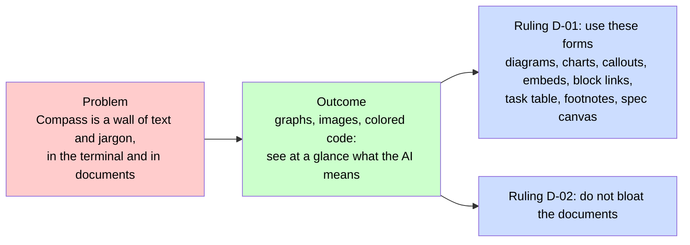
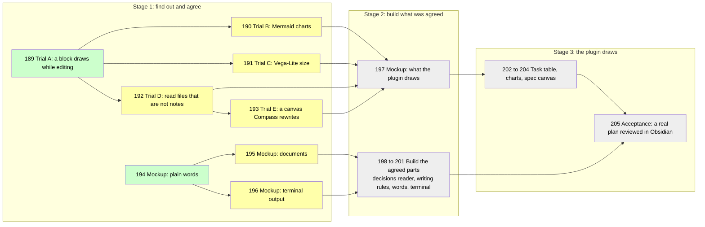
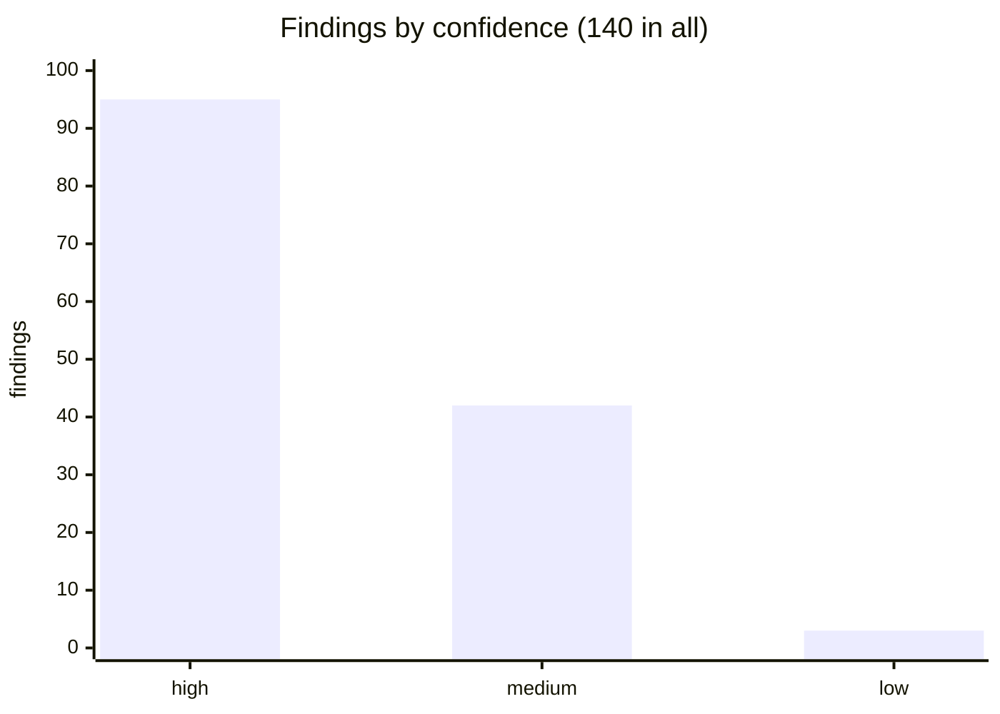
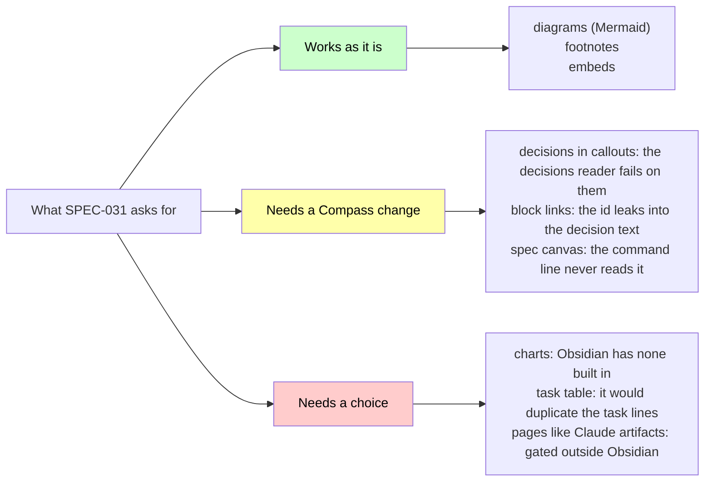

# Visual Documents: Mockup

Three documents as the human reads them to approve them: [[specs/human-surface/SPEC-031-working-in-compass-is-visual|the spec]], [[PLAN-024-working-in-compass-is-visual|the plan]] and [[research/human-surface/RESEARCH-working-in-compass-is-visual|the research]] for [[specs/human-surface/SPEC-031-working-in-compass-is-visual|Working in Compass Is Visual (SPEC-031)]]. Each opens with a picture of what is being approved and what the human decides, then its text in plain words (no coined terms; the word list is [[research/human-surface/RESEARCH-plain-words-mockup]]). Only forms Obsidian renders natively are used: Mermaid, callouts, tables, embeds. Each mocked document is a `##` section here. The plan and the research end with a folded block that embeds the sections the mock does not show.

## Byte table

| Document | Real file | Text replaced | Mocked text | Of which pictures | Real file after the change |
|---|---|---|---|---|---|
| Spec: SPEC-031 | 1696 | 1335 | 2153 | 539 | 2514 |
| Plan: PLAN-024 | 19191 | 5571 | 4041 | 1163 | 17661 |
| Research: working in Compass is visual | 64940 | 2508 | 2771 | 814 | 65203 |
| Total | 85827 | 9414 | 8965 | 2516 | 85378 |

Bytes with LF endings. "Real file" is the whole vault file. "Text replaced" is the part the mock rewrites: for the spec everything under its title, for the plan Goal through "How D-02 is measured", for the research the opening summary up to Question. "Mocked text" is its replacement and "Of which pictures" the Mermaid blocks inside it. "Real file after the change" is Real file minus Text replaced plus Mocked text. The text replaced, the mocked text and the pictures are saved in `.compass/tmp/mockups/documents/` as `spec`, `plan` and `research` with `.before.md`, `.after.md` and `.visual.md` endings; `wc -c` on them reproduces the table. The folded blocks are not counted: they stand for sections the document keeps as written.

Net change: spec +818, plan -1530, research +263, total -449. The plan shrinks because its choices become a table; the spec and research pictures add bytes and remove none, so the human decides whether they earn them.

## Working in Compass Is Visual (SPEC-031), a spec

> [!IMPORTANT]
> You decide: is this the problem, and are D-01 and D-02 (numbered rulings) the rules every later plan follows? Approving moves the spec from draft to approved and makes them binding on those plans.

### Problem

Right now everything in using Compass is a wall of text. A wall of text on both the CLI but also on the markdown files. It's very hard for humans to follow up and let them know what they think because there's also a lot of jargon that Compass puts in place.

### Desired Outcome

Working in Compass is a bliss for anyone, not like reading the phone book. We can see graphs, images and code snippets with colors, and in a very intuitive and visual way, understand exactly what the AI means.

This could also be something that we do using Claude artifacts, doesn't have to be only on Obsidian, in fact if we can get something like the artifacts working on Obsidian we should.

Related: [[specs/human-surface/SPEC-029-questions-to-the-human-are-clear-and-visual]], [[specs/human-surface/SPEC-030-review-documents-open-in-obsidian]].

### Decisions

- **D-01:** Documents use every one of these: diagrams (a plan's task dependencies, the pipeline and status flow, key metrics over time as charts), callouts for risks, open questions and decisions, embeds that show another document's section in place, block references so a cited decision is one click away, a table of a plan's tasks inside the plan, footnotes for research sources, and a canvas of the spec tree the human rearranges.
- **D-02:** Make sure we don't bloat the documents.

## Working in Compass Is Visual (PLAN-024), a plan

Numbers are task ids. Trials are experiments run in Obsidian; mockups are pages the human approves. Green is done, yellow is detailed and not started, grey is sketched.

> [!IMPORTANT]
> You decide: approve the plan and the 14 choices below, all recommended, or comment on a row to change that choice. Stage 1 is detailed; Stages 2 and 3 are sketched.

### Choices to approve

| Choice | The plan's answer (recommended) |
|---|---|
| Charts of metrics | Compass Review, the Obsidian plugin Compass ships, draws them from a short block naming a data file |
| Decisions in callouts | yes, and `compass decisions` learns to read them |
| Embeds | embed a section instead of copying it |
| Task table | drawn inside the plan by the plugin from the task lines; the file stores no table |
| Spec canvas | Compass owns which cards exist, the human owns where they sit |
| Pages like Claude artifacts | inside Obsidian, drawn by the plugin |
| Coined terms | plain words; a short definition at first use; no glossary file |
| Terminal visuals | none: no color or glyphs, shorter plain text instead |
| Lowest Obsidian version | 1.9.0, raised only if a trial needs more |
| Where visuals live | plugin-drawn blocks inside documents; Bases (Obsidian's tables of notes) for lists of whole notes |
| Chart format | a small Compass block drawn with Obsidian's Mermaid; Vega-Lite, a heavier chart library, only if Trial B fails |
| Library loading | no chart library is added unless Trial B fails |
| Data that is not notes | read ledgers and task lines directly |
| How much a drawing may do | declarative only: vault files, no script, no network |

> [!NOTE]- Why each choice
> ![[PLAN-024-working-in-compass-is-visual#Choices to approve]]

### Goal

This plan implements [[specs/human-surface/SPEC-031-working-in-compass-is-visual|Working in Compass Is Visual (SPEC-031)]], whose rulings are D-01 (use these forms) and D-02 (do not bloat), from the evidence in [[research/human-surface/RESEARCH-working-in-compass-is-visual|the research]]. Compass documents show diagrams, charts, callouts, embeds, block links, footnotes, a task table and a spec canvas where these replace text. Compass Review, the Obsidian plugin Compass ships, draws what Obsidian cannot. The terminal says less, in plain words. No document grows heavier than the same document written without pictures.

### How the plan keeps documents light

- Every mockup carries a byte table: the bytes a visual adds against the bytes of text it removes.
- A visual stays when it removes as many bytes as it adds, or when the human keeps it knowing its cost. A visual that only decorates goes.
- A drawn block costs only the bytes of its source block in the file. After the build the files every session loads (`index.md`, `active.md` and the rules) are no larger than before.

> [!NOTE]- The rest of the plan
> ![[PLAN-024-working-in-compass-is-visual#Prerequisites]]
>
> ![[PLAN-024-working-in-compass-is-visual#Desired End State]]
>
> ![[PLAN-024-working-in-compass-is-visual#What We're NOT Doing]]
>
> ![[PLAN-024-working-in-compass-is-visual#Phases]]
>
> ![[PLAN-024-working-in-compass-is-visual#Later (intent only)]]
>
> ![[PLAN-024-working-in-compass-is-visual#Risks]]

## Working in Compass Is Visual: Evidence (research)

> [!IMPORTANT]
> You decide: do these findings, the evidence for [[specs/human-surface/SPEC-031-working-in-compass-is-visual|Working in Compass Is Visual (SPEC-031)]], answer the spec well enough to plan from? Confidence in the research is medium: it rests on reading source code and documentation, and the plan's trials check the drawing claims in a running Obsidian.

### In short

- **Where the wall comes from.** Three `compass` commands print almost all terminal text; one prints 503 lines. Plans and research run about 2,400 words, and one task line reaches 1,910 characters. Dozens of coined terms (hot path, unit, sweep, rolling wave) appear with no glossary. Findings 1, 9, 10; high.
- **What Obsidian can show.** Everything D-01 lists is built in except charts, at a few dozen bytes per form. Three forms collide with the `compass` command: a decision inside a callout becomes unreadable to it, a block id leaks into the decision text, a canvas is invisible. A task table would duplicate the task lines. Findings 42, 53, 55, 59; high.
- **What a plugin can draw.** Community plugins already draw boards, timelines, charts and heat maps. Compass Review, Compass's Obsidian plugin, could draw charts from a short block an agent (a Claude session) writes. Findings 107, 121; high.
- **Claude artifacts.** A web page published to claude.ai and opened in a browser. It needs a paid plan and a login, and is off in runs with no screen. Findings 67, 71; high.
- **The terminal.** Plain text only. Color or glyphs would reach the model as raw bytes, and on Windows a glyph prints as a literal `\uXXXX`. Findings 4, 102, 103; high and medium.
- **Does visual help.** Pictures and diagrams improve reading comprehension by about a third of a standard deviation; decorative extras hurt. Every study measured learners, none measured people reviewing project documents. Findings 39, 40; high and medium.

> [!NOTE]- The rest of the document
> ![[research/human-surface/RESEARCH-working-in-compass-is-visual#Question]]
>
> ![[research/human-surface/RESEARCH-working-in-compass-is-visual#Methodology]]
>
> ![[research/human-surface/RESEARCH-working-in-compass-is-visual#Convergence matrix]]
>
> ![[research/human-surface/RESEARCH-working-in-compass-is-visual#Findings]]
>
> ![[research/human-surface/RESEARCH-working-in-compass-is-visual#Partial and split]]
>
> ![[research/human-surface/RESEARCH-working-in-compass-is-visual#Where the evidence meets the spec's decisions]]
>
> ![[research/human-surface/RESEARCH-working-in-compass-is-visual#Defects the probes exposed]]
>
> ![[research/human-surface/RESEARCH-working-in-compass-is-visual#Gaps]]
