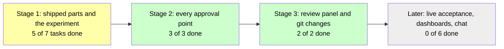

# Visual Documents: Mockup

Five passages from [[specs/human-surface/SPEC-030-review-documents-open-in-obsidian]], [[PLAN-022-review-in-obsidian]] and [[research/human-surface/RESEARCH-working-in-compass-is-visual]], each shown as written (quoted) and rewritten (below it) with the forms [[specs/human-surface/SPEC-031-working-in-compass-is-visual]] D-01 asks for, using the plain wording set out in [[research/human-surface/RESEARCH-plain-words-mockup]]. Judge each form on what it costs in bytes and what it shows.

Headings are left out of the passages; the text is otherwise verbatim except where the rewrite changes it. Passage 1 adds block ids to the decisions, and the links below point at them. A spec carrying block ids would write the fourth as `^d-04`; this page uses `^s30-d04` so ids stay unique.

## Byte table

| # | Passage | Forms | Before | After | Change |
|---|---|---|---|---|---|
| 1 | SPEC-030: the decisions | callout per decision, block id | 954 | 1068 | +114 |
| 2 | PLAN-022: the goal | section embed | 409 | 382 | -27 |
| 3 | PLAN-022: the stages | Mermaid status flow | 984 | 1393 | +409 |
| 4 | PLAN-022: the risks | callout, block link | 588 | 704 | +116 |
| 5 | Research: do visuals help | footnotes | 918 | 1009 | +91 |
| | Total | | 3853 | 4556 | +703 |

Counts are bytes of each passage's quoted text (Before) and rewritten text (After), measured with `wc -c`.

## 1. SPEC-030: the decisions

From [[specs/human-surface/SPEC-030-review-documents-open-in-obsidian]], the five decisions. Forms: callout per decision, block id. 954 bytes before, 1068 after (+114). Each decision is its own callout so it can carry an id; the human's sentences are unchanged. The id follows its callout on a line of its own.

**Before**

> - **D-01:** Obsidian is one of many possible visual md interfaces for Compass. Compass builds a generic one and Obsidian implements that one; in the future one could be built for VS Code.
> - **D-02:** Obsidian just opens, and if the human is doing something else he does whatever he needs there, clicks a button, and it takes him back where he was; he does not even need to come to Claude Code.
> - **D-03:** For embeds and navigating inside Obsidian, the review tracks it properly, so the human doesn't lose track of the original question, and he also has the possibility to give feedback on other files he is navigating. The review lives in one panel at the side (layout B of [[RESEARCH-review-mockup]]).
> - **D-04:** When the human approves something on Obsidian through the plugin, he does NOT have to approve again in the terminal.
> - **D-05:** Committing to git and reviewing git after should be a required step. It's how you'll really know the deltas.

**After**

> [!NOTE]
> - **D-01:** Obsidian is one of many possible visual md interfaces for Compass. Compass builds a generic one and Obsidian implements that one; in the future one could be built for VS Code.

^s30-d01

> [!NOTE]
> - **D-02:** Obsidian just opens, and if the human is doing something else he does whatever he needs there, clicks a button, and it takes him back where he was; he does not even need to come to Claude Code.

^s30-d02

> [!NOTE]
> - **D-03:** For embeds and navigating inside Obsidian, the review tracks it properly, so the human doesn't lose track of the original question, and he also has the possibility to give feedback on other files he is navigating. The review lives in one panel at the side (layout B of [[RESEARCH-review-mockup]]).

^s30-d03

> [!NOTE]
> - **D-04:** When the human approves something on Obsidian through the plugin, he does NOT have to approve again in the terminal.

^s30-d04

> [!NOTE]
> - **D-05:** Committing to git and reviewing git after should be a required step. It's how you'll really know the deltas.

^s30-d05

## 2. PLAN-022: the goal

From [[PLAN-022-review-in-obsidian]], the goal. Forms: section embed. 409 bytes before, 382 after (-27). The embed shows the spec's own outcome in place of the plan's paraphrase of it. A reader of the raw file sees the embed line only.

**Before**

> This plan implements [[SPEC-030-review-documents-open-in-obsidian]] based on [[RESEARCH-review-in-obsidian]]. When a project's vault is open in Obsidian with the Compass Review plugin on, every document Compass asks the human to review comes forward in Obsidian with Approve and Needs changes buttons; the click hands the verdict and the human's edits to the session and returns him to whatever he was doing.

**After**

This plan implements [[SPEC-030-review-documents-open-in-obsidian]] based on [[RESEARCH-review-in-obsidian]]. Its outcome is the spec's:

![[SPEC-030-review-documents-open-in-obsidian#Desired Outcome]]

Here every review comes forward with Approve and Needs changes buttons; the click hands the verdict and the human's edits to the session and returns him to whatever he was doing.

## 3. PLAN-022: the stages

From [[PLAN-022-review-in-obsidian]], the waves, written as stages. Forms: Mermaid status flow. 984 bytes before, 1393 after (+409). The flow adds a third stage and the task counts, taken from the plan's task lines.

**Before**

> **Wave 1** turns the prototype that passed the live round trip into shipped parts: the plugin itself, a `compass review` command that sends a document and waits for the verdict, an install path through setup and update, a doctor check that walks the human through turning the plugin on, a guard rule that keeps agents out of a file while it is under review, and two Bases views (a review inbox and a lessons table) that need no plugin code. Compass speaks one review protocol to any visual md interface; Obsidian is its first implementation, and a VS Code extension plugs in the same way. It also runs one experiment: whether a verdict that lands while a terminal question is open reaches the session, which decides how gates ask. Wave 1 ends when the human has run one real review through the shipped parts.
>
> **Wave 2** wires the review into every gate whose subject is a document, in the shape the experiment chose, and closes with a live spec approval done entirely from Obsidian.

**After**

**Stage 1** turns the prototype that passed the live round trip into shipped parts: the plugin, a `compass review` command that sends a document and waits for the verdict, an install step in setup and update, a `doctor` check that walks the human through turning the plugin on, a guard rule that keeps agents out of a file under review, and two Bases views (a review inbox and a lessons table) that need no plugin code. Compass speaks one review protocol to any visual markdown interface; Obsidian is the first, and a VS Code extension plugs in the same way. One experiment decides how approval points ask: does a verdict that lands while a terminal question is open reach the session? Stage 1 ends when the human has run one real review through the shipped parts.

**Stage 2** wires the review into every approval point whose subject is a document, in the shape the experiment chose, and closes with a live spec approval done entirely from Obsidian.

## 4. PLAN-022: the risks

From [[PLAN-022-review-in-obsidian]], the risks. Forms: callout, block link. 588 bytes before, 704 after (+116). The link points at the copy of SPEC-030 D-04 in passage 1.

**Before**

> - Obsidian auto-merges external writes into an open note: TASK-167 keeps agents out of a file under review.
> - An Obsidian update removes `electron.remote` access from plugins: the raise and step-aside fail with a notice and the review still completes by clicking; doctor reports the Obsidian version.
> - The experiment shows a verdict cannot land while a question is open: gates then send the review and end the turn, taking the terminal answer as plain text, which conflicts with [[SPEC-029-questions-to-the-human-are-clear-and-visual]] and goes to the human before TASK-171 is detailed.

**After**

> [!WARNING]
> - Obsidian auto-merges external writes into an open note: TASK-167 keeps agents out of a file under review.
> - An Obsidian update removes `electron.remote` access from plugins: the raise and step-aside fail with a notice and the review still completes by clicking; `doctor` reports the Obsidian version.
> - The experiment shows a verdict cannot land while a question is open ([[research/human-surface/RESEARCH-visual-documents-mockup#^s30-d04|SPEC-030 D-04]]): approval points then send the review and end the turn, taking the terminal answer as plain text, which conflicts with [[SPEC-029-questions-to-the-human-are-clear-and-visual]] and goes to the human before TASK-171 is detailed.

## 5. Research: do visuals help

From [[research/human-surface/RESEARCH-working-in-compass-is-visual]], findings 39 to 41. Forms: footnotes. 918 bytes before, 1009 after (+91). The findings stay; two column headers are spelled out and the full citations move to footnotes. Obsidian shows footnote text at the foot of the page.

**Before**

> | # | Finding | Conf. | Grade | Evidence |
> |---|---|---|---|---|
> | 39 | Graphics improve text comprehension by g about 0.3 to 0.4, with no difference among pictures, diagrams and flow diagrams. Organizational pictures g=0.52; purely informational pictures no significant effect; no effect on reading time. | high | high | Guo et al. 2020, AERA Open, doi:10.1177/2332858420901696 (86 citations); Hu et al. 2021, doi:10.1007/s10648-021-09610-z (summary only) |
> | 40 | A meta-analysis of Mayer's own studies finds g=0.37 overall, shrinking each year; text plus diagrams is "large and consistent". | medium | medium | Cromley & Chen 2025, doi:10.1016/j.edurev.2025.100730 (Mayer-only corpus; 9 citations) |
> | 41 | A diagram's advantage is conditional ("sometimes worth ten thousand words"). Only title and citation count read. | medium | medium | Larkin & Simon 1987, doi:10.1016/s0364-0213(87)80026-5 (3,735 citations) |

**After**

| # | Finding | Confidence | Weight of evidence | Evidence |
|---|---|---|---|---|
| 39 | Graphics improve text comprehension by g about 0.3 to 0.4, with no difference among pictures, diagrams and flow diagrams. Organizational pictures g=0.52; purely informational pictures no significant effect; no effect on reading time. | high | high | [^guo], [^hu] |
| 40 | A meta-analysis of Mayer's own studies finds g=0.37 overall, shrinking each year; text plus diagrams is "large and consistent". | medium | medium | [^cromley] |
| 41 | A diagram's advantage is conditional ("sometimes worth ten thousand words"). Only title and citation count read. | medium | medium | [^larkin] |

[^guo]: Guo et al. 2020, AERA Open, doi:10.1177/2332858420901696. 86 citations.
[^hu]: Hu et al. 2021, doi:10.1007/s10648-021-09610-z. Summary only.
[^cromley]: Cromley & Chen 2025, doi:10.1016/j.edurev.2025.100730. Mayer-only corpus; 9 citations.
[^larkin]: Larkin & Simon 1987, doi:10.1016/s0364-0213(87)80026-5. 3,735 citations.

## What the counts say

- Decisions as callouts with ids (1) adds 114 bytes and removes no text; the id is what makes each decision linkable.
- The section embed (2) saves 27 bytes; the reader sees the spec's whole outcome in place.
- The Mermaid flow (3) adds 409 bytes; it adds the stage order and task counts, which the prose did not carry.
- The risk callout with a block link (4) adds 116 bytes, mostly the link text.
- Footnotes (5) adds 91 bytes; the table gets narrower and the citations keep their full text.
- Outside Obsidian, a callout reads as a quoted bullet, an embed and a block link as bare links, and footnotes and Mermaid are plain text in the file and render on GitHub ([[research/human-surface/RESEARCH-working-in-compass-is-visual]] findings 46 and 56).
