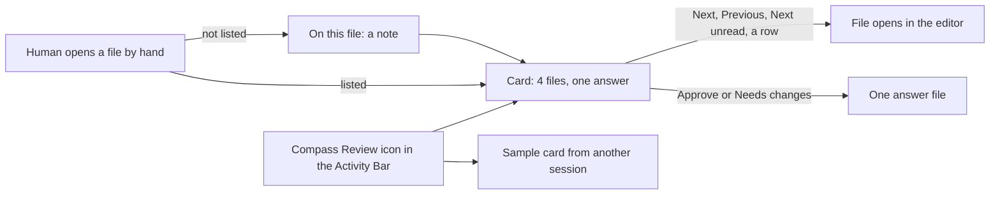

# Review Panel in VS Code: Mockup

> [!IMPORTANT]
> You decide: is the VS Code panel below the one to build for reviews answered in VS Code? Approving makes this card, in its own Activity Bar icon and with the limits listed under "What VS Code cannot do", the panel that the VS Code review surface of [[PLAN-025-review-across-files-and-sessions]] builds.
>
> To try it: switch to the VS Code window titled ".compass - Visual Studio Code" (open now), click the "Compass Review" icon in the left-hand icon bar, walk the four files and press Approve or Needs changes. Its answer is only a sample; your answer to this review is given in Obsidian.

The panel is a throwaway extension, `compass-mockup.compass-review-mockup`, installed in VS Code for this user. A window opened on the vault folder shows it in the Activity Bar under the icon "Compass Review". The card is the one the Obsidian panel shows, drawn from the same parts: heading "Reviews waiting on you", question, Project and Session, "File i of n" with Previous, Next and Next unread, one row per file, a note field, "On this file", and one Approve and one Needs changes. It reads this vault's real documents and sends nothing to Claude. Approve and Needs changes write one sample answer under `.compass/tmp/mockups/vscode/verdicts/`, in the answer shape of the Obsidian panel: the review id, the verdict, the notes, the comments on outside files, the edited files and, per file, whether it was read and its note.

A review is one question put to the human about one or more documents; a session is one running Claude Code conversation, and a project is the folder holding the vault. The Obsidian card and its click counts are in [[research/human-surface/RESEARCH-review-panel-mockup]]; the need is [[specs/human-surface/SPEC-030-review-documents-open-in-obsidian]].

Confidence is low. The click counts are read from the mockup and from the Obsidian card in `plugin/obsidian/compass-review/main.js`, never timed on a person. The screens below describe what the code draws; how they look is judged by trying the panel.

## 1. One review, four files

The card walks four real files of this vault: the spec [[specs/human-surface/SPEC-030-review-documents-open-in-obsidian]], the plan [[PLAN-025-review-across-files-and-sessions]], its detail file [[archive/PLAN-025-review-across-files-and-sessions-detail]] and the research [[research/human-surface/RESEARCH-review-across-files-and-sessions]]. It lets the human:

- See where he is ("File 2 of 4") and move with Previous, Next and Next unread, or with the Left and Right arrow keys while the card has focus. Each move opens that file in the editor, in the group that already shows it, and the card keeps keyboard focus.
- See every file in one list, each with a line saying why it is in the review, a mark for read or unread, and its note count. A click on a row opens that file.
- Open a listed file by hand, from the Explorer, Quick Open or a link, and find the walk has moved to it. A file is marked read the moment it comes into view, by the card or by hand.
- Write a note for the file he is on; the note field follows him from file to file.
- Answer once for the whole review: Approve, or Needs changes, which is disabled until a first note, an outside note or an edit exists.

There is no approve per file. The read marks and notes travel in the answer, so Claude sees which files were opened and what was said about each. Typing in a listed file while the review is open adds it to the files the answer lists as edited. Approve and Needs changes save the listed files before the answer is written.

## 2. A card from another session

The second card is a sample, labelled "sample from another session". It shows what a second session in the same project adds: a separate card with its own files, read marks and buttons. Both cards show the project name (the folder holding the vault) and a session code (the first six characters of the session's id). Its buttons show a message and send nothing.

## 3. A note on a file outside the review

When the open markdown file is not one of the four, the card gains an "On this file" box naming that file, with its own note field. The note goes in the same answer as a comment on that file and counts as a first note, so it also enables Needs changes. Opening a listed file hides the box again.

## 4. Where the panel lives

The panel sits in the primary side bar, behind its own Activity Bar icon. Choosing the icon shows the card; the side bar then shows the card and not the Explorer. A window opened on the vault folder reveals the panel at start-up and opens the first file, so the walk begins with one file read, the same start as the Obsidian panel.

## Clicks

A click is one press of a button, a file row, a link or an Activity Bar icon, and opening a file by hand counts as one. Typing is counted apart. Every row starts with the card in view and one file open. The Explorer is VS Code's file list; Quick Open is its search-by-name box (Ctrl+P).

| What the human does | VS Code panel | Obsidian panel |
|---|---|---|
| Read all four files and approve | 4 clicks: Next three times, Approve. One answer arrives. | 4 clicks, the same. |
| Approve without reading | 1 click: Approve. | 1 click. |
| Ask for changes on the third file, after reading the first two | 3 clicks and one note: Next twice, Needs changes. | 3 clicks and one note. |
| Leave a note on a file outside the review, then answer | 2 clicks and one note: open the file, Approve or Needs changes. | 2 clicks and one note. |
| The same, opening the outside file from the Explorer | 4 clicks and one note: Explorer icon, the file, Compass Review icon, Approve or Needs changes. | 2 clicks and one note: the file list sits in the left sidebar beside the card. |

The card costs the same clicks in both. The fifth row is where they differ: the Explorer and the card share one side bar in VS Code, so choosing a file there hides the card and a click on its icon brings it back. Quick Open and a link to the file need no icon click. Dragging the Compass Review icon to the side bar on the right, which VS Code allows, keeps both in view; whether the card works there is open.

## What VS Code cannot do

- **Raise its window.** An extension can read whether its window is focused (`vscode.window.state`) and has no call that raises or minimizes it. The panel is seen when the human is looking at that VS Code window. Whether any command moves a window in the installed VS Code 1.143 is the live check in [[research/human-surface/RESEARCH-review-live-checks]].
- **Draw the documents as rendered markdown.** A file opens as source text in the text editor. The card itself shows plain text, as the Obsidian card does; the rendered view of callouts, links and diagrams Obsidian gives is a separate preview pane in VS Code; which of them the built-in preview draws is open.
- **Show the card and the Explorer in one side bar.** See "Where the panel lives" and the fifth click row.
- **Tell typing from a reload.** The mockup lists a listed file as edited on any change event of its document. Whether that event also fires when another program rewrites a file the editor has open is unchecked; the Obsidian counterpart is in the live checks document.

## What it needs to ship

- The review request lists its files, each with its one-line reason, plus the project and session names; the mockup's session code is a fixed sample.
- Each VS Code window claims the requests under its own folder; the mockup reveals the panel in the window opened on the vault folder and nowhere else.
- The answer file keeps the Obsidian panel's shape, so `compass review` reads both the same way. Three sample answers (all four files read and approved; two read and a note on the third; a note on an outside file) pass that shape check.
