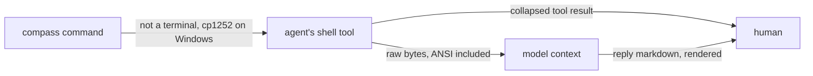

# Working in Compass Is Visual: Evidence

Evidence for [[specs/human-surface/SPEC-031-working-in-compass-is-visual]].

## Summary

- **Where the wall comes from.** Three `compass` commands print almost all terminal text (one prints 503 lines). Plans and research run a median of about 2,400 words, and a single plan task line reaches 1,910 characters. Dozens of coined terms ("hot path", "unit", "sweep", "rolling wave") appear with no glossary anywhere.
- **What Obsidian can show.** Everything the spec's D-01 lists is built into Obsidian except charts, and most of it costs a few dozen bytes per item. Three forms collide with the `compass` command: a decision inside a callout becomes unreadable to it, a task table is ignored by it, and a canvas is invisible to it.
- **Claude artifacts.** An artifact is a web page published from a session to claude.ai and opened in a browser. Publishing needs a paid plan and a claude.ai login and is off in headless runs. Artifact-like HTML inside Obsidian needs a plugin and a security choice, since Obsidian has no plugin sandbox.
- **The terminal.** The `compass` command prints plain text. Color or glyphs would reach the model as raw bytes through the agent's shell, and on Windows a glyph prints as a literal `\uXXXX`. Claude Code does offer visual surfaces (status line, output styles, mods), each with limits.
- **Does visual help.** Pictures and diagrams improve reading comprehension by about a third of a standard deviation, and decorative extras hurt. Every study measured learners; none measured people reviewing project documents.

Words used below: **CLI** is the `compass` command; **vault** is the `.compass/` folder of documents; **hook** is a command Claude Code runs on an event; **frontmatter** is the YAML block at the top of a document; a **D-NN bullet** is a numbered decision line (`- **D-01:** ...`) that `compass decisions` and `compass coverage` read; **agent** is a Claude session doing the work.

## Question

Where do the wall of text and the jargon come from, in the terminal and in the documents? What can Obsidian, Claude artifacts and the terminal show instead, at what cost in bytes and tooling friction? How can jargon be found, replaced and measured, and does evidence show visuals beat text?

## Methodology

Five researchers ran in parallel, one axis each, on 2026-10-26, and this document consolidates them.

| Axis | Question | Method |
|---|---|---|
| 1 | Where the wall of text and jargon come from | Repository mining: ran 22 CLI commands, measured output and documents, counted terms |
| 2 | What Obsidian can show | DESMET feature analysis: official docs, GitHub renderer trials (`gh api markdown`), CLI parsers run on probe files |
| 3 | Claude artifacts and artifact-like pages in Obsidian | DESMET feature analysis: vendor docs, Obsidian 1.14.5 bundle and `obsidian.d.ts` read, plugin sources |
| 4 | What Claude Code and the CLI can show | Systematic mapping: Claude Code docs as raw markdown, CLI code read and run, clig.dev |
| 5 | Plain language, brevity, readability measurement | Systematic mapping: government style guides, peer-reviewed studies with OpenAlex/Crossref marks, Vale and textstat code |

**Grading: allowed.** Each finding carries its confidence (how sure the claim is) and a grade (how much its kind of evidence should weigh for this topic). Executed probes, code read and official docs weigh high; forum posts, directory blurbs and search-engine summaries weigh low.

**Agreement rule.** The axes split the topic, so most findings come from one axis alone and rest on that axis's confidence. Agreement is counted among the axes whose evidence reached a claim; a claim reached by two or more axes is listed in the matrix.

## Convergence matrix

| Claim | A1 | A2 | A3 | A4 | A5 | Agreement |
|---|---|---|---|---|---|---|
| The CLI prints plain text: no color, glyphs or terminal check | YES (high) | - | - | YES (high) | - | 2/2 |
| `compass tree` and bare `compass` help are among the largest terminal outputs | YES (high) | - | - | YES (high) | - | 2/2 |
| Obsidian has every D-01 form built in except charts | - | YES (high) | YES (high) | - | - | 2/2 |
| The vault uses almost none of them today; only two Bases ship | YES (high) | YES (high) | - | - | - | 2/2 |
| An artifact is a claude.ai page from the `Artifact` tool, opened in a browser, plan- and login-gated | - | - | YES (high) | YES (high) | - | 2/2 |
| A styled artifact costs more output tokens than the same terminal text | - | - | YES (high) | YES (high) | - | 2/2 |
| Results return from an artifact by pasting or by comments | - | - | YES (high) | YES (high) | - | 2/2 |
| Compass's broadest jargon is common words used as house terms, which word-frequency tools miss, and no glossary or detector exists | YES (medium) | - | - | - | YES (medium) | 2/2 |
| Plan task lines are the densest text, and tables or callouts cannot hold them without breaking the CLI | YES (high) | YES (high) | - | - | - | 2/2 |
| How much a visual adds to clarity is measured only for learners, never for project documents | - | YES (medium) | - | - | YES (high) | 2/2 |
| Hook text addressed to the model stays off the human's screen | YES, untested (medium) | - | - | NO: `reason` is shown (high, docs) | - | Partial |
| Output leads with the most important information | - | - | - | MIXED (medium) | YES (medium) | Split 1/1 |
| Compass can read a human-rearranged canvas back | - | NO: CLI blind, undocumented (low) | - | - | - | Conflicts with [[RESEARCH-review-in-obsidian]] |

**CONVERGENCE: HIGH** where axes overlap; the three open rows are under [Partial and split](#partial-and-split).

## Findings

Numbering runs through the whole document. "Axis" names the researcher that produced the finding.

### A. Where the wall of text comes from (axis 1, axis 4)

| # | Finding | Conf. | Grade | Evidence |
|---|---|---|---|---|
| 1 | Three outputs hold almost all terminal volume: `unit-check` 503 lines / 53,818 B, `tree` 241 / 39,694 B, bare `compass` 134 / 8,534 B. The other 19 commands run print 1 to 50 lines (`validate` 3, `doctor` 19, `usage` 50). | high | high | 22 commands run in this repo; axis 4 measured `tree` and help the same |
| 2 | Each `tree` line is a path stem plus its full `summary:` copied verbatim: 57 of 241 lines exceed 200 characters, the longest 514. | high | high | `compass tree` |
| 3 | `unit-check` lists every member path of 24 candidates. `doctor` folds the same data into one 756-character row that points to `unit-check`. | high | high | `compass unit-check`, `compass doctor` |
| 4 | The CLI has no visual layer: standard library only, no ANSI codes, no `isatty`, `NO_COLOR` or `FORCE_COLOR`; tables are `ljust`-padded columns. Seven commands take `--json`; none takes `--verbose`, `--quiet` or `--no-color`. No glossary file exists. | high | high | grep of `plugin/cli`; `plugin/cli/commands/doctor.py:619-634`; `plugin/cli/maincli.py:76-90` |
| 5 | Bare `compass` lists 47 commands, including hook and worker entry points the human never runs. Help lines are dense ("...candidate/written/recurrence/rejected/revised/archived/error counts"). | high | high | `compass` |
| 6 | Diagnostics speak in internal codes: `sizing_unrecorded`, `folder_over_ceiling`, `unclassified_root_folder`, `ambiguous_wikilink`, `taxonomy_hint`, `surfaced-but-uncited`. | high | high | `compass validate`, `coverage`, `lesson-coverage` |
| 7 | `doctor` rows are single long sentences: the Obsidian row is a 233-character instruction paragraph; rows mix OK/WARN with internal nouns ("worker ledger", "host materializations", "capture posture"). | high | high | `compass doctor` |
| 8 | Hook text the human sees is short: `context-check` stops with two sentences, `sync` is silent. `capture-check` returns a ~480-character block reason addressed to the model. Whether the host shows that reason to the human was not tested here (see finding 104 and [Partial and split](#partial-and-split)). | medium | medium | `plugin/cli/commands/context_check.py:64-71`; `capture_check.py:100-139`; `sync.py:1037` |
| 9 | Median body words: specs 783, ADRs 500, lessons 85, plans 2,394 (13 of 22 over 2,000; max 10,919), research 2,475 (32 of 53 over 2,000; max 23,721). | high | high | `docstats.py` over `.compass/{specs,plans,research,decisions,lessons}` |
| 10 | A plan task line is the densest construct: one bullet carrying description, complexity, `depends_on`, `files:` and `decisions:`. Longest 1,910 characters (`plans/PLAN-007-test-quality.md:114`); 174 plan lines exceed 600 characters, 25 exceed 1,000; a plan holds a median 96.5 id references. | high | high | grep over `.compass/plans/` |
| 11 | Visual forms are nearly absent: of 245 documents, 1 has a mermaid block, 0 have callouts, 47 have a table. No plugin text tells agents to write diagrams or callouts; `plugin/skills/obsidian/SKILL.md` covers frontmatter, wikilinks, LaTeX and templates. | high | high | grep of `plugin/` and `.compass/` |
| 12 | The always-loaded files are text-only and long: `index.md` 1,467 words (longest line 426 characters), `active.md` 551 words, resident rules 35.6 KB. Spec D-02 applies to anything added there. | high | high | `wc` of each file |
| 13 | Index and active lines paste frontmatter summaries full of ids and process nouns ("implement ADR-022 in two waves: mechanism first (Contents sync + loop-guard fix, ...)"). | high | high | `.compass/index.md`, `.compass/active.md` |
| 14 | Skills rarely say how to present to the human; the format rules live in the pipeline rule ("Lead with the outcome. One line per fact."). What agents actually print in chat was not sampled. | medium | medium | `research/SKILL.md:51`, `build/SKILL.md:74,78`, `checkup/SKILL.md:68-88` |

### B. Jargon: what it is and how to catch it (axis 1, axis 5)

**15. Jargon census** (confidence medium, grade medium; axis 1). Lines / files containing each term. Counts include agent-only prose in skills and source comments; which occurrences a human reads was not separated. "Unit" counts are inflated by unit-test mentions.

| Term | `plugin/` (non-test) | vault |
|---|---|---|
| SPEC- / ADR- / PLAN- / TASK- ids | 101+52+12+13 lines | 1,219+524+380+696 lines |
| frontmatter | 231 / 50 | 175 / 61 |
| wikilink | 140 / 29 | 136 / 41 |
| hot path | 86 / 28 | 152 / 55 |
| unit (folder) | 180 / 24 | 306 / 52 |
| elaborate / elaboration | 27 / 10 | 196 / 20 |
| rolling wave | 7 / 5 | 165 / 20 |
| sweep | 49 / 13 | 106 / 28 |
| facet | 12 / 5 | 96 / 27 |
| admission (control) | 12 / 8 | 95 / 28 |
| promote / demote | 52+40 | 94+25 |
| ledger | 124 / 15 | 70 / 13 |
| overlay | 43 / 6 | 52 / 12 |
| scope note, "Class here" | 12 / 7 | 47 / 35 |
| D-NN, trackable | 36+35 | 58+36 |
| sizing_id | 44 / 8 | 31 / 28 |
| warm / cold / hot tier | 6 / 2 | 22 / 12 |
| RAPTOR, MemGPT, Reinertsen, DESMET, PRISMA | 16 / 6 | 122 / 21 |
| validate codes (finding 6) | 18 / 5 | 21 / 12 |
| others: detached worker, capture opportunity, strong signal, changeability walk, folksonomy, type-spread, materialization, surfaced-but-uncited | 0 to 17 each | 6 to 22 each |

| # | Finding | Conf. | Grade | Evidence |
|---|---|---|---|---|
| 16 | Density differs by surface. In `tree` output: loop 22 lines, capture 18, domain 11, host 9, worker 9. In `index.md`: capture 10, loop 9, taxonomy 7, domain 6. | medium | medium | substring counts per line (axis 1) |
| 17 | A technical term is not jargon; jargon is needless complication. Keep necessary terms, explain them on first use. | high | medium | plainlanguage.gov `avoid-jargon.md`; GOV.UK A to Z style guide. Marks: government guidance; 2 sources agree |
| 18 | Word-frequency detection is validated: the De-Jargonizer marks words under 50 uses per 90 million BBC words as jargon; r about .80 against standard word lists. | high | high | Rakedzon et al. 2017, PLoS ONE, doi:10.1371/journal.pone.0181742. Marks: peer-reviewed; not retracted; 115 citations |
| 19 | Frequency detection misses common words used as house terms. Zipf scores: hot 5.16, cold 5.02, gate 4.47, vault 3.90 read as ordinary; subagent 1.07, orchestrator 2.10, handoff 2.53, frontmatter 0, wikilink 0 are flagged. Axis 1's broadest terms (hot path, unit, sweep, domain, ledger) are of the missed kind. | medium | medium | Rakedzon 2017 limitations; own `wordfreq` run (not preserved) |
| 20 | The standard frequency data source, `wordfreq`, is frozen; its author says web text is now polluted by generated text. | high | medium | github.com/rspeer/wordfreq SUNSET.md. Marks: code, owner checked; 1,762 stars |
| 21 | Vale lints prose with rules as code: jargon and wordiness substitutions, a 30-word sentence limit, acronyms that need a definition, readability formulas. Its acronym rule catches capitals only, not coined phrases like "hot path". | high | medium | github.com/errata-ai/vale `internal/check/*.go`; errata-ai/Microsoft styles. Marks: code, owner checked; 6,290 stars |
| 22 | Replacement lists are published: plainlanguage.gov "don't say / say"; GOV.UK bans vague words (leverage, robust, streamline) and finds metaphors slow comprehension. | high | medium | plainlanguage.gov `use-simple-words-phrases.md`; GOV.UK A to Z |
| 23 | Define rarely, rename instead, one term per concept; prefer a plain nickname over an abbreviation. GOV.UK: spell out an abbreviation at first use. | high | medium | plainlanguage.gov `minimize-definitions.md`, `use-the-same-terms-consistently.md`; GOV.UK A to Z |
| 24 | Explain-at-first-use (GOV.UK) and define-rarely (plainlanguage.gov) are two positions on the same question. | medium | low | findings 17, 23; UK Department for Education page (search snippet only) |
| 25 | Text placed next to what it explains beats separated text (g=0.63, 58 comparisons, text with pictures). Reading this as "inline gloss beats a glossary" is an inference. | low | low | Schroeder & Cenkci 2018, Educational Psychology Review, doi:10.1007/s10648-018-9435-9 (g from search summary). Marks: peer-reviewed meta-analysis; 155 citations |
| 26 | Jargon impairs processing and trust, including for experts. | medium | medium (Bullock), low (expert quotes) | Bullock et al. 2019, doi:10.1177/0963662519865687 (n=650, 181 citations); GOV.UK research background; NN/g expert quotes (no statistics) |
| 27 | Experts underestimate novice difficulty, and debiasing does not fix it. No source tests whether an agent holding project context does the same. | medium | medium (humans), none (agents) | Hinds 1999, doi:10.1037//1076-898x.5.2.205. Marks: peer-reviewed; 397 citations |

### C. Keeping it short (axis 5)

| # | Finding | Conf. | Grade | Evidence |
|---|---|---|---|---|
| 28 | Front-load the main idea, exceptions after. Titles at most 65 characters; check sentences over 25 words; one sentence per bullet. | high | medium | plainlanguage.gov `organize/`; GOV.UK A to Z |
| 29 | Published limits: paragraphs 150 words or fewer, never over 250; sentences 25 words; reading age 9 even for specialists. A cited figure (90% comprehension at 14 words, under 10% at 43) is secondary and was once misread. | medium | medium (limits), low (figure) | plainlanguage.gov `write-short-paragraphs.md`; insidegovuk.blog.gov.uk 2014-08-04; Home Office readability manual |
| 30 | Concise, scannable and objective text together raised web usability 124% over a control (task time 359 s to 149 s; n=51, 1997). | medium | low | Morkes & Nielsen, nngroup.com. Marks: grey literature, not peer-reviewed |
| 31 | Summaries and chunking have mixed support: summaries helped readers aged 60 to 70 only; shorter pages aid understanding, longer pages aid overview. | medium | medium | GOV.UK content principles research background (secondary) |
| 32 | Segmenting, signaling and cutting extra material help in instruction, with independent effects (d 0.17 to 0.48) below Mayer's own medians (0.41 to 0.86). Decorative "seductive details" hurt (g=-0.33). This is the evidence behind D-02. | medium | medium | Rey 2019; Richter et al. 2016, doi:10.1016/j.edurev.2015.12.003 (219 citations); Sundararajan & Adesope 2020. Numbers via search summaries |

### D. Measuring readability (axis 5)

| # | Finding | Conf. | Grade | Evidence |
|---|---|---|---|---|
| 33 | Readability formulas count surface features and are documented as unreliable for technical text, lists and tables. | high | high | Redish 2000, doi:10.1145/344599.344637 (142 citations); doi:10.1145/344599.344638; Bruce, Rubin & Starr 1981 |
| 34 | UK government manuals still point to formula tools; `textstat` implements nine formulas including Flesch-Kincaid and Dale-Chall. | medium | medium | Home Office readability manual; github.com/textstat/textstat (1,392 stars) |
| 35 | Cognitively based measures (Coh-Metrix, word-list formulas) predict difficulty better than traditional formulas, for second-language readers. | medium | medium | Crossley et al. 2008 (306 citations); Graesser et al. 2011 (620 citations) |
| 36 | Direct reader testing is the standard formulas are judged against: paraphrase testing with 6 to 9 people, usability testing with 3. | high | medium | plainlanguage.gov `test/`; Redish 2000 |
| 37 | Default LLM text reads at US grade 10 to 13; asking for plain language lowers formula scores, and one simplified set had content errors in 59.7% of items. All medical, all formula-measured. | medium | low | PubMed 42390721; Springer s00198-024-07358-0; PMC13356772 (snippets only) |
| 38 | LLMs shift vocabulary measurably: at least 13.5% of 2024 PubMed abstracts show LLM style words. | medium | low | Kobak et al., arXiv 2406.07016, Science Advances 2025 |

### E. Do visuals help (axis 5)

| # | Finding | Conf. | Grade | Evidence |
|---|---|---|---|---|
| 39 | Graphics improve text comprehension by g about 0.3 to 0.4, with no difference among pictures, diagrams and flow diagrams. Organizational pictures g=0.52; purely informational pictures no significant effect; no effect on reading time. | high | high | Guo et al. 2020, AERA Open, doi:10.1177/2332858420901696 (86 citations); Hu et al. 2021, doi:10.1007/s10648-021-09610-z (summary only) |
| 40 | A meta-analysis of Mayer's own studies finds g=0.37 overall, shrinking each year; text plus diagrams is "large and consistent". | medium | medium | Cromley & Chen 2025, doi:10.1016/j.edurev.2025.100730 (Mayer-only corpus; 9 citations) |
| 41 | A diagram's advantage is conditional ("sometimes worth ten thousand words"). Only title and citation count read. | medium | medium | Larkin & Simon 1987, doi:10.1016/s0364-0213(87)80026-5 (3,735 citations) |

### F. What Obsidian can show (axis 2, axis 3)

| # | Finding | Conf. | Grade | Evidence |
|---|---|---|---|---|
| 42 | Mermaid, callouts, embeds, block ids, footnotes, canvas, images, Bases and code highlighting ship in Obsidian. Only charts need a plugin or Mermaid's `xychart-beta`. HTML is not a native file type. | high | high | obsidian.md/help/bases, /plugins/canvas, /file-formats; `.compass/.obsidian/core-plugins.json`. Axes 2 and 3 agree |
| 43 | Version gates: Bases needs 1.9.0 (public 1.9.10, 2025-08-18), Kanban view 1.14; newest public build 1.14.5 (2026-10-22). The shipped review plugin declares `minAppVersion` 1.4.0, a lower floor than Bases needs. | high | high | obsidian.md/changelog; `plugin/obsidian/compass-review/manifest.json` |
| 44 | Bases 1.9.0 dropped singular `tag`, `alias`, `cssclass`; the vault already uses `tags: [..]`. | high | high | changelog 2025-05-21 |
| 45 | The vault ships two Bases (`review-inbox.base`, `lessons.base`, about 590 B each), installed when absent, never overwritten. | high | high | `plugin/cli/review_surfaces/obsidian.py:25,164-182`; `plugin/cli/tests/test_vault_bases.py` |
| 46 | Mermaid is a fenced block. GitHub's docs say it renders on github.com; the markdown API probe returned highlighted source (likely API vs page). Links on mermaid nodes do not enter Obsidian's graph. | high (Obsidian), medium (GitHub) | high | obsidian.md/help/advanced-syntax; docs.github.com "creating diagrams"; `gh api markdown` trial |
| 47 | Mermaid is the cheapest diagram: a 3-task dependency chart 51 B, a 4-point line chart 77 B, a pie 44 B. As plain text it reads as an edge list an agent can parse. | high | high | `wc -c` of samples |
| 48 | Obsidian 1.15.0 (early access, 2026-10-22) replaces Mermaid with Pele, claiming Mermaid 12.1 syntax; whether `xychart-beta` renders under Pele is unstated. | medium | medium | obsidian.md/changelog 2026-10-22; pele.run |
| 49 | Obsidian 1.8 bundled Mermaid 11.3.0; a community plugin exists to load newer Mermaid "for newer diagram types like xychart-beta". `xychart-beta` was not run in Obsidian. | low | low | obsidianstats.com mermaid-elk-renderer; Obsidian forum; mermaideditor.lol |
| 50 | No core chart feature; Bases has no chart view. Options: `xychart-beta`; Charts plugin (last release 2024-01-26, 809 stars); Tracker (release 2026-02-21, 1,960 stars); Dataview has no charts. | high (dates), medium (list complete) | high | obsidian.md/help/bases/views; GitHub API for each repo |
| 51 | Callouts: Obsidian has 13 types, folding, nesting, titles. GitHub renders only 5 alert types; titled, folded and nested callouts showed as blockquotes with literal `[!...]` text. Obsidian's `important` means tip; GitHub's IMPORTANT is its own type. | high | high | obsidian.md/help/callouts; GitHub docs; `gh api markdown` trial |
| 52 | A callout costs 12 bytes over the same bullet and reads as a tagged blockquote. | high | high | `wc -c` |
| 53 | **Callouts and tables hide decisions and tasks from the CLI.** A D-NN bullet inside a callout, rewritten as callout text, or put in a table row returns `could-not-parse`, the state that hard-blocks `compass coverage`. A task inside a callout is not read; task table rows are ignored. A callout placed after normal decision bullets is harmless. | high | high | `plugin/cli/decisionslib.py:50-76`; `plugin/cli/planlib.py:53`; probe run |
| 54 | A section embed costs one line (52 B) instead of the copied text, but an agent reading the file and a GitHub reader see only the link, not the content. | high | high | obsidian.md/help/embeds, /links; `gh api markdown` trial |
| 55 | A block id costs 6 bytes and makes a decision one click away. It cannot sit inside callouts, quotes or tables; GitHub shows it as literal text; `validate` and `move` handle the links; the id ends up inside the decision text `compass decisions` returns. | high | high | obsidian.md/help/links; `validate.py:100`; `move.py:137-165`; probe |
| 56 | Footnotes cost 4 bytes plus a definition and render on GitHub (not in GitHub wikis). Inline `^[...]` footnotes render in Reading view only. | high | high | obsidian.md/help/syntax; GitHub docs; `gh api markdown` trial |
| 57 | A Bases table lists files, one row per note; it cannot list the task lines inside one plan. Dataview's `TASK` query can (community plugin). | high (files), medium (no Bases feature reaches lines) | high | obsidian.md/help/bases/views, /syntax; Dataview docs; agrees with [[RESEARCH-review-in-obsidian]] finding 7 |
| 58 | A `.base` file is YAML an agent can read; GitHub shows an inline base block as plain code; path-based filters survive moves. | medium | medium | obsidian.md/help/bases/syntax; trial |
| 59 | Canvas is JSON Canvas 1.0 (2 notes plus 1 edge = 240 B). The CLI reads only `*.md`: a `.canvas` is never indexed, validated, or rewritten by `compass move`. Whether regenerating a canvas keeps the human's arrangement is undocumented. | high (format, CLI), low (regeneration) | high | jsoncanvas.org/spec/1.0; `plugin/cli/vaultlib.py:113-128`; `move.py:137-165` |
| 60 | A standard image link (``, 29 B) works in Obsidian and GitHub. Obsidian's double-bracket image, canvas and base embeds print literally on GitHub and each draws a `broken_wikilink` warning from `validate` (exit code unchanged). | high | high | obsidian.md/help/embeds; `validate.py:66,83,298-304`; probe |
| 61 | A language tag on a code fence highlights it: Reading view uses Prism, Live Preview a smaller set, so a fence can be colored in one and plain in the other. GitHub highlights it. | high (Reading, GitHub), medium (Live Preview) | high / medium | obsidian.md/help/syntax; Obsidian forum; trial |
| 62 | **CLI defect:** `validate`, `move` and `vaultgraph` toggle on any line starting with three backticks, so a four-backtick fence holding a three-backtick one, or a `~~~` fence, is misread (a link inside code drew `broken_wikilink`). `vaultlib.strip_fenced_code` handles both correctly. | high | high | `vaultlib.py:491-540` vs `validate.py:89-102`, `move.py:152-158`, `vaultgraph.py:46-58`; probe |
| 63 | **CLI defect:** an aliased wikilink in a table cell, where Obsidian requires the pipe escaped as `\|`, draws `broken_wikilink` with a trailing backslash, and `compass move` does not rewrite it. Unaliased links in cells are fine. | high | high | `validate.py:100`; `move.py:141-146`; probe |
| 64 | Links on mermaid nodes and canvas file cards are outside the link graph: `compass graph`, `unit-check` and `move` see none of them. | high | high | `vaultgraph.py:46-58`; obsidian.md/help/advanced-syntax |
| 65 | Heading and block embeds of `.md` documents pass through the CLI unchanged: the link parser strips `#` and `|` suffixes. | high | high | `vaultgraph.py:33-34`; `move.py:141-146` |

**66. Cost and fidelity per form** (confidence medium, grade medium; axis 2). Bytes are measured samples. That a cheaper form is clearer for a human is an inference the sources do not measure.

| Form | Core? | Bytes | What an agent reading the file sees | GitHub | CLI friction |
|---|---|---|---|---|---|
| Mermaid diagram | yes | 44 to 77 | explicit edges | docs say rendered | node links invisible |
| Callout | yes | +12 over a bullet | tagged blockquote | 5 types; titles, folds, nesting literal | hides decisions and tasks |
| Block id | yes | 6 | trailing ` ^id` | literal | id lands in decision text |
| Section embed | yes | 52 | link only | literal | none |
| Footnote | yes | 4 + definition | `[^n]` marker | renders | none |
| Bases embed (file) | yes, 1.9.0+ | 25 | link only | literal | `broken_wikilink` warning |
| Bases inline block | yes, 1.9.0+ | 107 | readable YAML | plain code | none |
| Highlighted code | yes | ~10 over the code | unchanged | renders | none |
| Image, standard link | yes | 29 + image file | alt text | renders | none |
| Image, double-bracket | yes | 20 to 30 | file name | literal | `broken_wikilink` warning |
| Table of 2 tasks | yes | 83 | readable, duplicates the task lines | renders | rows ignored by the plan parser |
| Canvas | yes | 240 for 2 cards, separate file | JSON | not tested | never indexed or moved |
| Chart, `xychart-beta` | via Mermaid | 77 | the numbers | unclear | none |
| Chart, Charts plugin | community, last release 2024-01 | ~100 | YAML | plain code | none |

Cheapest forms that render in both Obsidian and GitHub: Mermaid, footnotes, highlighted code, standard image links, and the 5 GitHub-compatible callout types. Block ids and section embeds cost least but render only in Obsidian. Canvas and inline Bases cost the most per item.

### G. Claude artifacts (axis 3, axis 4)

| # | Finding | Conf. | Grade | Evidence |
|---|---|---|---|---|
| 67 | An artifact is a live, single, self-contained web page published from a Claude Code session to a private `claude.ai/code/artifact/<id>` URL; republishing updates it and keeps versions. | high | high | code.claude.com/docs/en/artifacts. Axes 3 and 4 agree |
| 68 | The `Artifact` tool publishes a `.html`, `.htm` or `.md` file; unless told otherwise Claude writes it to a temp folder outside the project. No slash command publishes. | high | high | artifacts docs; code.claude.com/docs/en/tools-reference |
| 69 | Artifacts open in a browser, never in the terminal or Obsidian: first publish opens the browser, `Ctrl+]` reopens, `/artifacts` lists. | high | high | artifacts docs "find an artifact again" |
| 70 | Page limits: scripts only from five CDNs, no external images, network calls only to the page's own origin, at most 16 MiB. A styled page costs more output tokens than the same text. | high | high | artifacts docs "page constraints"; axis 4 agrees on tokens |
| 71 | Publishing needs Pro, Max, Team or Enterprise plus a claude.ai login. It is unavailable for API-key, Bedrock, Vertex and Foundry sessions, off by default in the Agent SDK, GitHub Action and `claude -p`, and off for CMEK, HIPAA and ZDR organizations. | high | high | artifacts docs "availability" |
| 72 | A new artifact from a typed prompt publishes without asking; Claude Code asks first in plan mode, when a scheduled task triggered the turn, and for connectors, downloads or public artifacts. | high | high | artifacts docs "when Claude Code asks" |
| 73 | Artifacts are private by default; sharing to people, the org or a public link depends on plan and admin settings. A third-party source says public links reach every plan since 2026-07-13. | medium | medium | artifacts docs "share"; eesel.ai (snippet) |
| 74 | Results come back by (a) an export control whose text the human pastes into the terminal, (b) comments Claude Code watches and answers (v2.1.228+, 60 per hour), (c) claude.ai MCP connectors called at view time; local `.mcp.json` servers are unreachable. | high | high | artifacts docs "bring the result back", "comments", "connectors"; axis 4 agrees on (a) and (b) |
| 75 | claude.ai chat artifacts made before 2026-09-16 are "legacy"; new work routes to Docs, Slides and Design, reachable from Claude Code through a connector and `/slides`, `/design`. | medium | medium | support.claude.com article 17153992 |

### H. Artifact-like pages inside Obsidian (axis 3)

| # | Finding | Conf. | Grade | Evidence |
|---|---|---|---|---|
| 76 | Raw HTML in a note passes through DOMPurify with a fixed config that allows `iframe` but not `script` or `srcdoc`. Effect not run in a live note. | high (config), medium (effect) | high | Obsidian 1.14.5 `app.asar` (`sanitizeHTMLToDom` config); `obsidian.d.ts:8003` |
| 77 | Users report `<script>` stripped from notes; the help documents `<iframe src>` for web pages. | medium | low (forum), high (help) | forum.obsidian.md thread 24838; obsidian.md/help/embed-web-pages |
| 78 | The Web viewer core plugin (desktop) opens URLs as tabs. Whether it can show a login-gated claude.ai artifact was not tested. | medium | medium | obsidian.md/help/plugins/web-viewer; one curl observation |
| 79 | Plugins can host content four ways: a code-block processor, a post-processor, a custom view, or a custom view for a file extension such as `.html`. | high | high | `obsidian.d.ts:5858-7275`; docs.obsidian.md "Markdown post processing" |
| 80 | The Compass review plugin renders no content and has no iframe: one sidebar view, an `obsidian://compass-review` handler, DOM built with `createEl` only, desktop-only. | high | high | `plugin/obsidian/compass-review/main.js:40,89-100,269-283`; `manifest.json:8` |
| 81 | HTML Renderer turns a code block into an `srcdoc` iframe whose sandbox always includes `allow-same-origin`, with scripts on by default; 0 stars. | high (behavior), low (maturity) | high / low | github.com/gidragir/obsidian-html-renderer release `main.js` |
| 82 | Iframe Renderer loads a vault `.html` file into an iframe with no sandbox. | high | high | natarslan/obsidian-iframe-renderer `src/main.ts` |
| 83 | HTML Viewer and HTML Page Viewer open `.html` files in sandboxed iframes with a per-tab scripts toggle; Page Viewer never grants `allow-same-origin`. Directory blurbs only. | medium | low | community.obsidian.md listings (~4k and ~2k downloads) |
| 84 | Custom Frames embeds websites in panes or code blocks (desktop, 850 stars). | medium | medium | github.com/Ellpeck/ObsidianCustomFrames README |
| 85 | Dataview's `dataviewjs` and several code-runner plugins execute script with full app access; `dataviewjs` is off by default. | high (Dataview), low (others) | high / low | Dataview `inline-api.ts:350,415`, `settings.ts:104` |
| 86 | Obsidian has no plugin sandbox: once restricted mode is off, plugins have Obsidian's full access to files, network and programs. | high | high | obsidian.md/help plugin security |
| 87 | Plugin guidelines warn against `innerHTML` with user input; directory policies forbid obfuscation and telemetry and require network use to be disclosed. | high | high | docs.obsidian.md plugin guidelines; obsidian-developer-docs developer policies |
| 88 | An iframe with both `allow-scripts` and `allow-same-origin` on same-origin content can remove its own sandbox. Whether an `srcdoc` frame counts as same-origin with Obsidian's window is unknown. | high | high | MDN iframe reference; WHATWG HTML spec |
| 89 | Isolation differs: claude.ai enforces a CSP and a sandboxed origin on artifacts; the same HTML inside Obsidian gets whatever the hosting plugin imposes, and no CSP is documented. | high | medium | findings 70, 81 |
| 90 | Hand-over paths: an `.html` file written into the vault and opened by a plugin view; HTML carried in a code block; the artifact URL in a browser or Web viewer; Compass's own `obsidian://compass-review` link with request and verdict JSON files. | medium | medium | findings 68, 78-81; `main.js:6-19` |
| 91 | The only precedent for a sandboxed iframe talking back to Obsidian is a height message; the review plugin already writes a verdict file from button clicks. | medium | medium | finding 81; `main.js:416-444` |
| 92 | Reach differs: the review plugin is desktop-only; the HTML renderer plugins declare mobile; artifacts work in any logged-in browser. | high | medium | manifests and listings |

### I. What the terminal can show (axis 4)

How a `compass` command's output reaches the human when an agent runs it:

| # | Finding | Conf. | Grade | Evidence |
|---|---|---|---|---|
| 93 | Claude Code renders reply markdown: headings bold, inline code colored, code blocks highlighted, tables as a box grid at full width. No page lists every supported construct. | medium | high | code.claude.com mods gallery "Markdown"; settings-reference `maxProseWidth`; accessibility page |
| 94 | No Claude Code page says the terminal draws Mermaid or images in replies. Pictures appear only through mods: `Image` (kitty, Ghostty, iTerm2) and `Raster` (colored cells for a sparkline or heat map). | medium | medium | grep of nine doc pages; mods gallery; output-styles page |
| 95 | Hook stdout is never shown to the human; only `systemMessage`, `stopReason`, `reason` and `terminalSequence` reach the screen, and `systemMessage` is dropped on several events. | high | high | code.claude.com/docs/en/hooks "JSON output", "exit code output"; `plugin/hooks/hooks.json` |
| 96 | A `MessageDisplay` hook rewrites the assistant's text on screen only (transcript and model keep the original), per batch of lines, 10 s timeout. Documented uses only strip markdown or redact. | high | high | hooks docs "MessageDisplay" |
| 97 | Hook notifications go through `terminalSequence`, limited to OSC notification codes and the bell; color codes and OSC 8 links are rejected. | high | high | hooks docs "emit terminal notifications" |
| 98 | The status line is a shell command fed session JSON (model, context use, cost, worktree) that prints several ANSI-colored rows with links, refreshed on events. | high | high | code.claude.com/docs/en/statusline |
| 99 | Output styles are system-prompt instructions, not renderers. A plugin can ship one and force it; the docs say a style "doesn't guarantee" behavior, it does not reach other subagents, and changing it costs a prompt-cache miss. | high | high | code.claude.com/docs/en/output-styles |
| 100 | Mods draw panes, bands above the prompt, boxed tables, diffs, buttons, selects, `Raster` and `Image` in the interactive terminal, Desktop and VS Code only; they need v2.1.290+ and run unsandboxed. None was run. | medium | medium | mods overview and reference pages |
| 101 | Fullscreen rendering, the default for new users, adds click-to-expand tool results, `/diff` and `/focus`; Windows Terminal can leave stale fragments. | high | high | code.claude.com/docs/en/fullscreen; terminal-config |
| 102 | On Windows, piped output is cp1252: the CLI's guard turns each glyph into a literal `─`-style escape. `PYTHONUTF8=1` gives real UTF-8. Virtual-terminal color support is off when output is not a console. | high | high | run with Python 3.13.1; `plugin/cli/maincli.py:134-142`; stdlib `_colorize.can_colorize` |
| 103 | Through the agent's shell tool, output is not a terminal, terminal size falls back to 80x24, and ANSI bytes reach the model unchanged. Any color must key off `isatty`. Tested in Claude Code only. | medium | medium | `printf` + `od -c` probe; hooks docs silent on stripping |
| 104 | clig.dev: color only on an interactive terminal and never with `NO_COLOR` or `TERM=dumb`; red sparingly; offer `--json` and `--plain` for machines; keep success output brief, detail in verbose mode. | high | medium | clig.dev. Marks: community guideline, widely cited |
| 105 | clig.dev shows progressive disclosure through concise help and common commands first (`git`, `jq`), but puts the most important error information at the end and does not endorse summary-first output. | high | medium | clig.dev "Help", "Output", "Errors" |
| 106 | `git status --short -b` collapses state to one header line plus one coded line per file. | high (behavior), low (generalization) | high | run in this repo |

## Partial and split

1. **Does hook text written for the model reach the human?** Partial.
   - Axis 1: the long `capture-check` block reason (~480 characters, instructions to the model) is the machine-addressed part; whether the host shows it was untested (finding 8).
   - Axis 4: Claude Code's docs list `reason` among the four fields that reach the screen (finding 95), which would put that text in front of the human.
   - Possible explanation: the docs are per event and axis 4 did not test the Stop event. A live firing would settle it.

2. **Should output lead with the most important information?** Split.
   - Axis 5: front-load the main idea, exceptions after (finding 28, plainlanguage.gov and GOV.UK).
   - Axis 4: clig.dev puts the most important error information at the end and does not endorse summary-first output (finding 105).
   - Scope differs: the plain-language sources address documents; clig.dev addresses terminal errors.

3. **Can Compass read a rearranged canvas back?** Conflicts with the vault.
   - [[RESEARCH-review-in-obsidian]] finding 8: Compass can write a `.canvas` proposal and read the human's rearrangement back (medium, from doc knowledge, not run).
   - Axis 2: no CLI code reads `.canvas` files, and whether a regenerated canvas keeps the human's arrangement is undocumented (finding 59, low).

## Where the evidence meets the spec's decisions

D-01 asks for every listed form; D-02 asks that documents not bloat. The evidence bears on them as follows. Which way to go is the human's call.

| D-01 item | What the evidence says | Open choice |
|---|---|---|
| Diagrams (task dependencies, pipeline and status flow) | Mermaid: core, 44 to 77 B, readable as text, renders on GitHub per its docs (findings 46, 47) | None found |
| Charts of metrics over time | No core chart; `xychart-beta` unrun in Obsidian and changing under Pele; Charts plugin stale since 2024-01; Tracker active (48 to 50) | Which chart route, if any |
| Callouts for risks, open questions, decisions | Core and cheap, but a D-NN decision inside a callout breaks `compass decisions` and hard-blocks `compass coverage`; GitHub degrades titles and nesting (51 to 53) | Decisions in callouts (CLI change) or callouts beside decision bullets |
| Embeds of another document's section | One line instead of a copy, but an agent or GitHub reader sees only the link (54) | Whether agent readability of the raw file outweighs the saved bytes |
| Block references to decisions | 6 bytes; the id leaks into decision text; GitHub shows it literally (55) | None found beyond the leak |
| Table of a plan's tasks | A markdown table duplicates the task lines and the plan parser ignores it; Bases cannot list lines; Dataview `TASK` can, as a community plugin (53, 57) | How to show the table without duplicating the task lines |
| Footnotes for research sources | Core, 4 B, renders on GitHub (56) | None found |
| Canvas of the spec tree the human rearranges | CLI never reads, validates or moves `.canvas`; keeping the arrangement on regeneration undocumented (59, 64) | Who owns the canvas layout and how it stays in sync with moves |
| Artifact-like pages (spec Desired Outcome) | claude.ai artifacts: browser only, paid plan and login, off in `claude -p` (67 to 71). Inside Obsidian: needs a plugin, and a sandbox choice the platform does not make for you (76 to 89) | claude.ai artifact, HTML hosted in an Obsidian plugin, or core Obsidian forms only |

Other choices the evidence raises:

- **Compass's coined terms.** Rename to plain words, explain at first use, or keep a glossary. Sources split (findings 23, 24); the only evidence for inline over separate is an inference (25). No tool catches common-word house terms (19, 21).
- **Terminal visuals.** Color or glyphs need an `isatty` check and a Windows UTF-8 fix to avoid raw bytes or `\uXXXX` text (102, 103). Claude Code's own surfaces each carry a limit: the status line is small, output styles are not guaranteed, mods need v2.1.290+ and an interactive terminal (98 to 100).
- **Obsidian version floor.** Bases need 1.9.0 while the review plugin declares 1.4.0 (43).

## Defects the probes exposed

Each was reproduced and is fixed in the CLI (commit b9ad849); they were independent of SPEC-031:

- Fence handling in `validate`, `move` and `vaultgraph` misreads four-backtick and `~~~` fences (finding 62).
- An aliased wikilink in a table cell is reported broken and skipped by `compass move` (finding 63).
- Double-bracket embeds of images, canvases and bases each draw a `broken_wikilink` warning (finding 60).

## Gaps

Named precisely so a follow-up pass can close each one.

**Where the wall comes from (axis 1)**
- What agents print in chat between gates is unmeasured: sample session transcripts under `~/.claude/projects` or record a live run.
- Which jargon occurrences a human actually reads, versus agent-only skill and rule prose, is not separated beyond `tree`, `index.md`, help and `doctor`.
- A fresh project's vault and first-session output were not measured; only this mature repo (245 documents).

**Obsidian (axis 2)**
- No rendered github.com page was viewed: Mermaid, `xychart-beta`, `.base` and `.canvas` display there are unverified (commit samples to a scratch branch).
- Whether `xychart-beta` renders in public Obsidian 1.14.5 and under Pele in 1.15.0 was not run; the local Obsidian version was not confirmed by launching it.
- Whether Obsidian rewrites file paths inside a `.canvas` when a note is renamed outside the app (for example by `compass move`) is undocumented.
- How a regenerated canvas treats a human-rearranged one (node ids, positions) is undocumented.
- Whether a `diff` fence is colored in Live Preview is unconfirmed.
- The Charts plugin's documentation site (charts.phib.ro) was not read.
- Obsidian 1.15's CLI and URI commands ("add text under a heading") were not investigated.

**Artifacts and HTML in Obsidian (axis 3)**
- Whether the Web viewer can show an authenticated claude.ai artifact (cookies, `X-Frame-Options`, `frame-ancestors`) is untested.
- Whether an `srcdoc` iframe without `allow-same-origin` can still load React from a CDN is untested.
- Whether `srcdoc` documents inherit Obsidian's origin under its Electron config is unknown.
- A raw `<script>` and `<iframe srcdoc>` in a live note were not run.
- Whether a headless `claude -p` Compass run can publish artifacts: docs say off by default, and no opt-in was found.
- claude.ai chat-artifact types, libraries and CSP are not listed in the Help Center page read.
- Source code of HTML Viewer and HTML Page Viewer was not read; their sandbox claims are directory blurbs.
- No programmatic, non-session way to publish or list artifacts was found beyond the admin-scoped Compliance API.

**Terminal (axis 4)**
- Progressive-disclosure examples from gh, cargo, ripgrep and uv are unsourced. Next pass: read `cli/cli` `pkg/iostreams` (terminal and color detection), `rust-lang/cargo` `cargo-util` shell and `ColorChoice`, `astral-sh/uv` verbosity and `--color`, and run each tool piped versus in a terminal.
- Whether Claude Code's terminal draws Mermaid or other diagram fences is untested.
- Whether a `MessageDisplay` hook's `displayContent` is itself rendered as markdown, and whether it can add structure, is untested.
- ANSI in a real Windows console (legacy conhost versus Windows Terminal) and enabling virtual-terminal mode from Python were not tested.
- Unicode sparklines or block bars in the human-visible tool result with UTF-8 forced (`PYTHONIOENCODING=utf-8` or `sys.stdout.reconfigure`) were not tested.
- No mod or `MessageDisplay` hook was run (mods need v2.1.290+).
- How other hosts Compass targets (dsh, Codex) show hook and CLI output is unknown.

**Plain language (axis 5)**
- No detector for common words used as house terms was found; a glossary-membership check is undocumented in any source read.
- No study compares inline gloss, hover definition and end-of-document glossary for native readers of technical documents.
- No study compares diagrams with text for software specs, plans or review documents; UML comprehension studies were not searched.
- No study tests whether an agent holding project context shows the curse of knowledge, or measures reader comprehension of LLM jargon.
- Unread primaries: Redish & Selzer 1985, Klare, Chall & Dale 1995, Wylie's sentence-length study, Kobak's marker word list, Cloze procedure, Pöttker 2003 on the inverted pyramid.
- Several effect sizes (Guo trim-and-fill, Hu, Cromley & Chen per principle, Rey 2012 and 2019, Richter, Schroeder & Cenkci) come from search summaries because SAGE, ScienceDirect and Springer returned 403.
- Readability formulas were not run on Compass text; the planned `textstat` comparison was dropped, so finding 33 rests on the literature alone.

**Across axes**
- No axis tested a Compass document with a human reader, the standard every readability source points to (finding 36).
