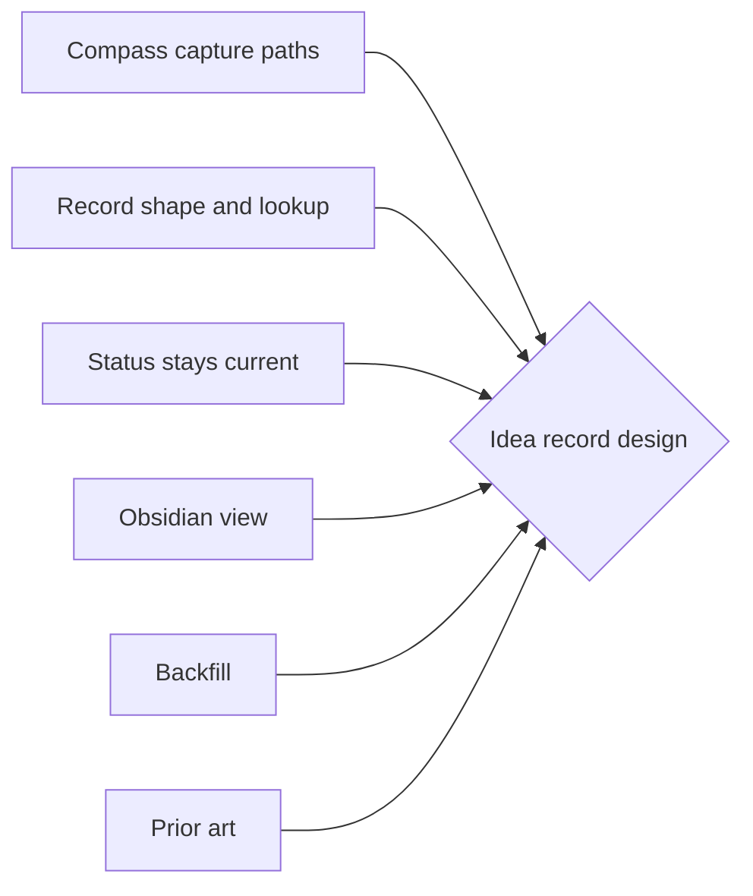

# Ideas Keep Their Status: Research Axes

> [!important] You decide
> Run research on these axes? Add your own questions below; they lead the list.

## Your questions

-

## Axes

1. Where an idea can be caught automatically today, and what each path loses of his words: the code behind `compass capture-note`, the Stop-hook capture worker, `extract-lessons`, and the spec and specs skills.
2. What shape lets any later session find an idea by topic, its status and its history within the hot-path limit: the lessons catalog, `tag-index.yaml`, `compass graph`, and [[SPEC-003-hierarchical-vault-organization]].
3. How status stays current without asking him (a spec citing an idea, a drop said in passing): `compass sync`, the PostToolUse hook, and the link graph.
4. How ideas show in Obsidian (list by status, links to where each led): the `compass-review` plugin and Dataview, already in this vault.
5. How a session backfills its own ideas from the transcript: [[PLAN-020-clone-old-sessions]] and the transcript format.
6. How idea-tracking tools keep status and provenance (Zettelkasten, product idea backlogs, IBIS): published practice and docs.

- [ ] Grading allowed (a cheap sub-agent scores how completely the findings cover the spec)
