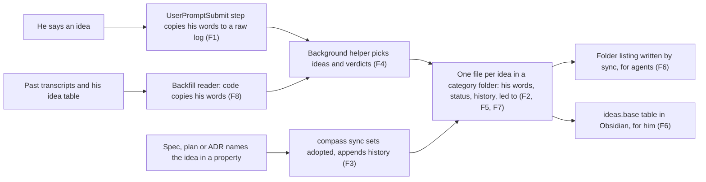

# Ideas Keep Their Status: Research

> [!note] Approved 2026-11-19
> The recommended option holds on every fork, F1 to F8.

"He" is the human whose ideas are tracked: the person working with Compass in a project. "His table" is a hand-made table of his past ideas from one project, written for backfill: one section per category, each with the columns number, his words, status, and where it led.

Terms used below:
- **Background helper:** the capture worker, a headless model session Compass starts after a turn when a hint says something is worth recording. It costs nothing in the main conversation.
- **Hint:** a signal Compass records (a vault write, a subagent finishing, an agent note); a strong hint opens a helper pass at once.
- **Start-here files:** `index.md`, `active.md` and `lessons/index.md`, which every session reads first, capped together at 5,000 tokens.
- **`clone-old`:** the `/compass:clone-old` command, which resumes past sessions as headless copies to mine them.
- **Obsidian Bases:** Obsidian's built-in table views over note properties, saved as `.base` files.
- **Dataview:** a community Obsidian plugin that queries notes; it installs separately.

## Question

[[SPEC-033-ideas-keep-their-status]]: where can an idea he says be caught automatically with his words intact, what record shape lets any later session find it with its status, history and category, how does status stay current without asking him, how do ideas show in Obsidian, how are past ideas backfilled, and how do other idea trackers keep status and provenance?

## Methodology

Six researchers, one per axis (list in [[#Axes]]): repository mining of the Compass code and this vault for axes 1, 2, 3 and 5, with scratch-vault experiments on axis 2 and transcript scans on axis 5; a feature analysis of four view options for axis 4; a grey-literature review for axis 6. Consolidated here by claim. Findings are ungraded. Agreement counts the axes that addressed a claim, since each axis covered its own part of the spec.

## Where the sources agree

Columns A1 to A6 are the axes: A1 capture paths, A2 record shape, A3 status upkeep, A4 Obsidian view, A5 backfill, A6 prior art.

| # | Claim | A1 | A2 | A3 | A4 | A5 | A6 | Agree |
|---|---|---|---|---|---|---|---|---|
| C1 | Today's automatic steps see tool events and subagent replies, never his messages | Y h | - | Y h | - | Y h | - | 3/3 |
| C2 | UserPromptSubmit hands a command his submitted text verbatim | Y m | - | Y h | - | - | - | 2/2 |
| C3 | Stop drops `transcript_path`; the helper reads only its evidence folder | Y h | - | Y h | - | Y h | - | 3/3 |
| C4 | Transcripts hold his words, mixed with tool results and injected text | Y h | - | - | - | Y h | - | 2/2 |
| C5 | `capture-note` carries the agent's sentence and needs the agent to notice | Y h | - | Y h | - | - | - | 2/2 |
| C6 | A helper pass opens only after a hint; talk alone leaves none | Y h | - | Y m | - | - | - | 2/2 |
| C7 | Lesson extraction filters out ideas; ideas need their own output | Y h | - | Y m | - | - | - | 2/2 |
| C8 | Words should be copied by code, structure added beside them | Y h | - | - | - | Y h | Y h | 3/3 |
| C9 | Transcripts expire; `clone-old` re-types his words at high cost | Y h | - | - | - | Y h | - | 2/2 |
| C10 | Category folders keep the start-here files small; flat `ideas/` overflows them | - | Y h | - | Y m | - | - | 2/2 |
| C11 | One file per idea gives table rows and per-idea links | - | Y m | - | Y h | - | - | 2/2 |
| C12 | "Where it led" is a link; plain text makes no edge | - | Y h | Y h | - | Y h | - | 3/3 |
| C13 | Reading every inbound link as adoption gives false adoptions | - | Y m | Y h | - | - | Y h | 3/3 |
| C14 | Status values are a convention, checked for presence only | - | Y m | Y m | - | Y h | - | 3/3 |
| C15 | A status change appends history and keeps the old value | - | - | Y h | - | - | Y h | 2/2 |
| C16 | sync can write a listing; the generator is fixed to lessons | - | Y h | - | Y h | - | - | 2/2 |
| C17 | More than one positive end state is in use | - | - | - | - | Y m | Y h | 2/2 |
| C18 | Every tracker found, and his table, works without a "parked" state | - | - | - | - | Y h | Y h | 2/2 |
| C19 | Dataview serves idea views with no install | - | Y m | - | N h | - | - | 1/2 |

Y yes, N no, h/m/l the researcher's confidence, - not addressed. C1 to C18 converge. C19 splits on which file each axis read; [[#F6. Where ideas show]] settles it from the files.

## Findings

### Catching his words

1. **Today's automatic steps see tool events and subagent replies, never his messages** (confidence: high; axes 1, 3, 5)
   - `plugin/hooks/hooks.json:4-125`: PreToolUse, PostToolUse, SessionStart, Stop, TeammateIdle, SubagentStop
   - SubagentStop copies a finishing subagent's last message: `capture_signal.py:90-108`
2. **UserPromptSubmit passes `prompt`, his submitted text, plus `session_id` and `transcript_path`** (confidence: medium on axis 1, high on axis 3; vendor docs only, untested here)
   - https://code.claude.com/docs/en/hooks, "UserPromptSubmit input"
   - Also fires for scheduled turns, background subagent reports and messages from other sessions, so a filter keeps his turns
   - Pasted text arrives wrapped in `<pasted_content>`; a slash command arrives as the typed line
   - Timeout 30 s, prompt goes through on timeout; `"async": true` is accepted
3. **The Stop step receives `transcript_path` and throws it away** (confidence: high; axes 1, 3)
   - `capture_check.py:403-420`: stdin read, "content is unused"; `context_check.py:261-268` already reads the path
   - Stop input carries `transcript_path` and `last_assistant_message`; the transcript may lag the latest messages (vendor docs, axis 3)
4. **The background helper reads an evidence folder of hint files** (confidence: high; axes 1, 3, 5)
   - `capturelib.py:334-370`, `capture_check.py:164-178`: evidence is hint refs only
   - `capture_worker.py:281`: tools include Read with no path limit, so a passed transcript path would be readable
5. **A helper pass opens only after a hint** (confidence: high; axes 1, 3)
   - `capturelib.py:62-65, 291-318`: due on a strong hint, or 12 turns with at least one hint
   - A conversation of ideas with no vault write, subagent or note leaves no hint
6. **`capture-note` holds the agent's one sentence** (confidence: high; axes 1, 3)
   - `capture_note.py:33, 44-78`: argv text only, no speaker, no turn ref; it fires when the agent notices
7. **Lesson extraction filters out what an unadopted idea is** (confidence: high; axis 1)
   - `lesson-write/SKILL.md:30-44`: the filter list rejects "unresolved or untested approaches" and "ephemeral session state"
   - The hint, pass-opening and helper steps work for any output; the skill and its writer set the output type
8. **Every capture command switches off inside the helper's own session; a new one needs the same switch** (confidence: high; axes 1, 3)
   - `COMPASS_WORKER_SESSION` checks: `capture_check.py:406-411`, `capture_signal.py:131`, `capture_note.py:65`
9. **A helper pass costs zero main-conversation tokens and about $0.33** (confidence: high for zero tokens, axis 1; medium for cost, axis 3)
   - Zero tokens: `capture_check.py:195-222, 451-456`, detached start, no output to the conversation
   - Cost over 57 logs: median $0.33, max $0.45, 17 turns, 65 s (`.compass/tmp/worker-logs`)
   - This vault: 156 passes, 52 wrote something (33.3%), from `compass capture-stats`
10. **Interview skills keep his words inside a spec or vision flow he starts** (confidence: high; axis 1)
    - `spec/SKILL.md:41-43`; [[ADR-016-capture-by-extraction]]: fidelity is instruction-level, his approval is the backstop
11. **Words copied by code stay faithful; model-typed quotes drift** (confidence: high; axes 1, 5, 6)
    - LongMemEval (a long-conversation memory benchmark): original text kept plus extracted facts as extra keys, +9.4% recall, +5.4% accuracy: https://arxiv.org/html/2410.10813v2
    - "Fidelity Before Structure": verbatim chunks beat extracted artifacts by 15.9 and 22.0 points: https://arxiv.org/abs/2601.00821
    - Frontier models fail literal quoting; attribute first, then generate: [[RESEARCH-humans-words-fidelity]]
    - Rationale research: structure after capture, capture as a by-product of work (Shipman and McCall 1997, http://web.cs.wpi.edu/~dcb/Papers/AID00-janet.pdf, via search summary)

### Record shape and finding an idea

12. **The start-here files have about 588 tokens of headroom** (confidence: high; axis 2)
    - `compass hot-path`: 4412 / 5000; `hot_path.py:24-25`
13. **Category topic folders hold the cap at 300 ideas; flat `ideas/` overflows it (measured)** (confidence: high; axes 2, 4)
    - Seven folders: root index 20 lines, 235 tokens. Flat: 315 lines, 9,147 tokens
    - `sync.py:359`: lessons are the one folder exempt from per-file root lines
14. **A new `ideas/` folder is scanned, validated, tag-indexed and linked as is** (confidence: high; axis 2)
    - `vaultlib.py:69-96`, `sync.py:36-44`, `sync.py:630-646`; validate checks title, type, status for `type: idea`
15. **Numbering `IDEA-NNN` takes adding `idea` to `next-num`; a slug works as is** (confidence: high; axis 2)
    - `next_num.py:21-29`, `vaultlib.py:21-30`; the scan already descends topic folders
16. **The lessons catalog shape is over its caps and its rows go stale** (confidence: high; axis 2)
    - 59 rows against a 50 cap, warning at `lessons-catalog.yaml:1`; rows are append-only: `sync.py:526-570`
17. **"Where it led" as a link is queryable** (confidence: high; axes 2, 3, 5)
    - `compass graph impact` lists inbound links by kind: `vaultgraph.py:69-128`, [[ADR-018-graph-queries-jit-over-markdown]]
    - His table: 11 of 22 "Where it led" cells are plain text (memory rules, installs), so a text field sits beside the links
18. **A category can be a folder, a property or a tag; each is per project** (confidence: medium; axes 2, 4, 5)
    - Folder: `make_domain.py:1-20`, the category set is the folder set, its scope note editable in Obsidian
    - Property: `category` is taken by lessons and `lessons.base`; `area` has a fixed list (`lessons.base:16-25`)
    - His table puts the category in the section heading (axis 5)
19. **Renaming a folder category today deletes its scope text** (confidence: medium, read from code; axis 2)
    - `make_domain.py:73-107`: `--undo` on an empty folder removes its `index.md`; rename is done by hand
    - `compass move` rewrites path-qualified links; bare-name links keep resolving
20. **Foldered ideas always count as linked, and the folder-size nudge covers four other folders** (confidence: medium; axis 2)
    - `graph.py:37`, `validate.py:59-60`: the folder index counts as an inbound link; the nudge covers specs, research, decisions, lessons

### Keeping status current

21. **`compass sync` runs on every vault write at zero model tokens and can rewrite one property line** (confidence: high; axis 3)
    - `sync.py:937-963`; `_sync_children_counts` at `sync.py:159-190` is the in-place, idempotent precedent
22. **A flag written by an author, moved by sync, is the established pattern** (confidence: high; axis 3)
    - [[ADR-014-active-sweep-on-sync]] D-01, D-07: a checked task is the flag, sync moves it to the done list, nothing is judged
23. **A property can make its own link kind** (confidence: high; axis 3)
    - `vaultgraph.py:98-101`: a plan's `lessons:` becomes a `citation` link, kept apart from body links
24. **Reading every inbound link as adoption gives false adoptions** (confidence: high; axes 2, 3, 6)
    - Body mentions from handoffs and lessons, folder indexes, generated listings: `vaultgraph.py:30, 94, 105-117`
    - Aha! (a product-roadmap tool): a promote link moves an idea's status; ideas merely linked keep theirs (https://www.aha.io/support/roadmaps/strategic-roadmaps/ideas/how-feature-status-drives-idea-status)
25. **An in-place status rewrite loses the previous value** (confidence: high; axes 3, 6)
    - `sync.py:159-190` replaces the line; append shapes exist: `sweep.py:184-194`, the lesson `seen` list
    - Prior art keeps the old state: ADR supersession (https://cognitect.com/blog/2011/11/15/documenting-architecture-decisions.html); Graphiti and Mem0g, two memory systems for language-model agents, mark changed facts invalid and keep them (https://github.com/getzep/graphiti/blob/main/README.md, https://arxiv.org/html/2504.19413)
26. **Status values are a convention, and `archived` already means "leave out" to sync** (confidence: medium; axes 2, 3, 5)
    - `validate.py:34` checks presence; `sync.py:354-357` leaves `archived` out of the root index
27. **A link added in Obsidian or by Bash takes effect at the next hooked vault write** (confidence: medium; axis 3)
    - Precedent: [[ADR-014-active-sweep-on-sync]] D-05, a `validate` drift warning
28. **A drop said in conversation reaches the record only through the agent, the helper or a new step** (confidence: high; axis 3)
    - `hooks.json` event list (finding 1) and the helper's evidence folder (finding 4)

### Showing ideas in Obsidian

29. **Bases is core Obsidian and Compass already ships two Bases files** (confidence: high; axis 4)
    - `plugin/obsidian/bases/*.base`; `obsidian.py:32, 227-237`; Bases needs Obsidian 1.9 (https://obsidian.md/help/bases/views)
30. **Bases reaches projects with an Obsidian vault, and a shipped file is written once** (confidence: high; axis 4)
    - `obsidian.py:249-252`: skipped with no `.obsidian/`; `install_bases` keeps an existing file
31. **A new base uses table views and keys listed in the obsidian skill** (confidence: high; axis 4)
    - `test_vault_bases.py:23-50`
32. **A Bases row is one note and its columns are properties** (confidence: high; axis 4)
    - His words show in a cell from a property; one group-by per view; `groupOrder` sets lifecycle order (https://obsidian.md/help/bases/syntax)
33. **A sync-written listing works in every project and is plain text for agents** (confidence: high; axis 4)
    - `_sync_lessons_indexes`, `sync.py:717-760`; a listing in `index.md` counts against the start-here cap
34. **The compass-review plugin shows one document at a time** (confidence: high; axis 4)
    - `main.js:311-340`: a review panel and a one-document view

### Backfill

35. **His table needs a heading-aware parser** (confidence: high; axis 5)
    - The table, read in full: seven sections, category in the heading, 22 rows, numbers out of file order, `\|` aliases in cells
    - `vaultlib.split_link` and `resolve_link` classify each cell as resolved, broken, ambiguous or plain text
36. **His table uses adopted 11, done 5, exploring 3, decided 1, and a compound value on 2 rows** (confidence: high; axis 5)
    - The table, counted; the compound value reads "spec approved, research running"; new, parked and dropped are unused
37. **20 of 22 table rows are found verbatim in that project's transcripts** (confidence: medium; axis 5)
    - 3 of the 20 sit only in `queued_command` records; the 2 misses are unexplained
38. **A reader of his messages keeps a small share of user records and reads `queued_command` records too** (confidence: high; axes 1, 5)
    - Largest session, scanned: 1736 of 2060 user records are tool results
    - `queued_command` records hold messages typed while the agent was working: 14 of 193 human messages, about 7%
    - Filters: `isMeta`, `isCompactSummary`, `isSidechain`, `entrypoint != cli`, `<task-notification>` and similar
    - Slash-command args and AskUserQuestion answers hold his words in other fields
    - Fields are undocumented: [[PLAN-020-clone-old-sessions]] risk at `:93`
39. **Compass's transcript readers serve session metrics and assistant text** (confidence: high; axis 5)
    - `sessions.py:339-342`: `sessions show` renders assistant records; `context_check.py:164-182` reads token usage
40. **`clone-old` is a poor fit for backfill** (confidence: high; axes 1, 5)
    - Writes in its own words: `clone-old/SKILL.md:19`
    - $167 to $656 per session, measured on 0.7M to 0.9M-token sessions: `sessions.py` `DEFAULT_USD_PER_MTOK` and its comment, [[PLAN-020-clone-old-sessions]] `:89`
    - His text is about 0.2 MB inside 182 MB of one project's transcripts
    - Claude Code keeps transcripts for `cleanupPeriodDays` (30 when unset): `setup/SKILL.md:303-318`

### Prior art

41. **Idea trackers share one skeleton: untriaged, considering, committed, done, and several "no" states** (confidence: high; axis 6)
    - Canny and Productboard (feedback and idea trackers), Aha!, and MADR (a markdown ADR template): https://help.canny.io/en/articles/673583-changing-post-statuses, https://support.productboard.com/hc/en-us/articles/360058171114-Customize-status-values-for-items, https://support.aha.io/aha-ideas/support-articles/ideas-management/customize-ideas~7444660316156182069, https://raw.githubusercontent.com/adr/madr/main/template/adr-template.md
    - Aha! keeps Will not implement apart from Already exists
42. **Rejected ideas are kept, so a later asker sees them** (confidence: high; axis 6)
    - Canny advises Closed over delete so a later requester sees "it has already been considered": https://help.canny.io/en/articles/3827592-managing-posts
    - Productboard keeps Won't do because an idea may "seem more interesting a year from now": https://support.productboard.com/hc/en-us/articles/360058171114-Customize-status-values-for-items
43. **Duplicates merge two ways: absorb with a trace, or keep and link** (confidence: high; axis 6)
    - Canny folds B into A: https://help.canny.io/en/articles/5776649-merging-and-unmerging-posts
    - Aha! keeps merged records labelled Merged, following the primary's status: https://support.aha.io/aha-ideas/support-articles/ideas-management/merge-ideas~7444660347097013324
44. **Zettelkasten, a note-taking method, discards the fleeting source once processed** (confidence: medium; axis 6)
    - Ahrens: fleeting notes thrown away "within a day or two" (p.43, via https://zettelkasten.de/posts/concepts-sohnke-ahrens-explained/; book not read)
45. **IBIS, a design-rationale notation, links an idea to the question it answers and defines no status** (confidence: medium; axis 6)
    - Issue, Position, Argument nodes with labelled links: https://eight2late.com/2009/07/08/the-what-and-whence-of-issue-based-information-systems/

### What UserPromptSubmit hands a command, observed

46. **UserPromptSubmit hands a command seven fields; a subagent or background-command report is told apart only by its text; the queued second message does fire the step; accents arrive intact; the step costs about 2 s of spawn plus 2 s of Python on this machine** (confidence: high for fields, origins, queued firing and encoding; medium for timing; observed on Claude Code 2.1.328, Windows 11, Git Bash, headless `claude -p`, 2026-11-19; settles the "untested here" caveat of finding 2 and three open questions)
    - Setup: a scratch project outside every repo, with its own `.claude/settings.local.json` holding only a `UserPromptSubmit` entry (the shell wrapper form of `plugin/hooks/hooks.json`: `[ -f ... ] || exit 0; ... python3 ... else python`) that ran a probe script appending stdin and a timestamp to a jsonl file. Driven with `claude -p --input-format stream-json --output-format stream-json --verbose`; the probe entry lived only in the scratch project, so the human's own settings were untouched. Fixtures: `plugin/cli/tests/fixtures/user_prompt_submit/` (one JSON per case; home, temp and project paths replaced by `<HOME>`, `<TEMP>`, `<PROJECT_DIR>`, `<PROJECT_SLUG>`)
    - **Fields, identical in every case:** `session_id`, `transcript_path`, `cwd`, `prompt_id`, `permission_mode` (`default` here), `hook_event_name` (`UserPromptSubmit`), `prompt`. Paths use backslashes, so in JSON they arrive escaped (`C:\\Users\\...`)
    - **Typed line, multi-line prompt, slash command:** `prompt` is the submitted text verbatim: newlines, blank lines, quotes, a backslash and a tab survive; `/probecmd alpha beta` arrives as that typed line, not as the command file's expanded body
    - **Encoding:** stdin is UTF-8; `ação, coração, não, você, à, é, ü, ç, ñ, —` and an emoji arrive byte-identical (verified from the raw bytes). A reader of the probe's jsonl on Windows must open it with `encoding="utf-8"`: Python's default there is cp1252 and shows mojibake (it misled the first read of this probe)
    - **Non-human turns fire the step, with no field marking them:** a finished background subagent (`<status>completed</status>`, subagent result in `<result>`) and a finished background command each arrive as a `prompt` starting `<task-notification>` and ending `</task-notification>`, with a `prompt_id` of their own. The payload has no `origin`, no `agent_id`, no source field. The transcript's user record for the same turn does carry `origin: {kind: "task-notification", ...}`, but whether that record is written before the hook runs was not checked. The reliable test on the payload is the leading `<task-notification>` tag; scheduled-prompt turns and messages from other sessions were not reproduced, so their shape is unobserved
    - **Queued second message:** a message sent while the first turn was running fired the step, but only when the harness drained it into the turn, 28 s after it arrived (the first turn was waiting on a command), not on arrival. Its `prompt_id` equals the first message's: one `prompt_id` can carry two human messages, so it is not a key per message. The transcript logs the pair as `queue-operation` enqueue then remove, matching finding 38's `queued_command` records
    - **Not reproduced headless:** `<pasted_content>` wrapping of pasted text (finding 2's vendor-doc claim stays vendor-doc only; a paste is an interactive-terminal action)
    - **Time per prompt, 20 runs each through a fresh `bash -c` with the payload on stdin, this machine:** shell spawn alone `true` 1790 ms; wrapper that exits at once (`[ -f ... ] || exit 0; input=$(cat); exit 0`) 1861 ms; wrapper plus the Python probe (reads stdin, appends one line) 4143 ms; bare `python3 -c pass` 1965 ms. Spawning a shell is the floor here (about 1.8 s, likely process-creation cost on this Windows machine); Python and one file append add about 2.3 s on top; the early exit adds about 70 ms. In place, the jsonl line landed 0.5 to 5.7 s after the transcript logged the prompt's enqueue (8 prompts that started a process, median about 1.8 s, process start-up included); the vendor docs say a prompt waits on this step, which was not separately checked. Under the helper's own session, an exit before Python starts saves the Python part (about 2.3 s measured)
    - Machine-specific: a faster machine has a lower floor; the ratio (Python start dominates the wrapper's own cost) is what carries over

## Forks

### F1. How his words are caught

- **Option 1 (Recommended):** a UserPromptSubmit step appends each prompt verbatim to a raw log and records a hint; the helper picks ideas from the log.
  - For: documented payload, captured at submit, independent of transcript lag and retention (findings 2, 3, 40).
  - Against: untested on Windows, per-prompt start-up time unmeasured; it must filter non-human turns (finding 2).
- **Option 2:** the Stop step passes `transcript_path` to the helper, which reads his turns.
  - For: one reader serves live capture and backfill (findings 38, 39); it adds no per-prompt step.
  - Against: undocumented fields, about 7% missed unless `queued_command` records are read, transcript may lag (findings 3, 38).
- **Option 3:** the main agent runs `capture-note`. Against: it holds the agent's sentence (finding 6).
- Options 1 and 2 both need a hint so idea-only talk opens a pass (5), an idea output (7), and the helper-session switch (8).

### F2. Record shape

- **Option 1 (Recommended):** one file per idea under `ideas/<category>/` topic folders; the folder is the category.
  - For: measured cap result (13), scanned and linked as is (14), one table row per idea (32).
  - Against: renaming today deletes scope text, to fix first (19); ideas always count as linked (20).
- **Option 2:** one flat `ideas/` with a category property.
  - For: moving an idea between categories is a property edit, so its path and every link stay put (19); the category set is free text per project (18).
  - Against: sync must skip ideas in the root index (13); the key needs a new name, since `category` and `area` are taken (18); renaming edits every file.
- **Option 3:** catalog file plus idea files, the lessons shape.
  - For: ranked lookup by tag and text. Against: already over caps, rows go stale (16).
- **Option 4:** one file listing every idea.
  - For: every idea in one read; nothing to scan or index (axis 2 finding 14).
  - Against: one file gives one table row, and no per-idea links or tags (32).

### F3. How adoption moves status

- **Option 1 (Recommended):** the adopting spec, plan or ADR names the idea in a dedicated property; sync sets `adopted`, appends a dated history entry, and moves status forward only, leaving `parked` and `dropped` as he set them.
  - For: author flag plus sync mover (22), its own link kind (23), adoption only where intended (24), the file stays true for Bases and grep (32).
  - Against: spec, plan and ADR templates must write the property; Obsidian edits wait for a hooked write (27).
- **Option 2:** status derived at read time by a command; the file stays as written.
  - For: always current for the command, nothing to lose ([[ADR-018-graph-queries-jit-over-markdown]] D-01).
  - Against: the file's own status reads `new` while the answer says `adopted`; Bases shows the file's value.
- **Option 3:** any inbound link counts. For: templates stay as they are. Against: false adoptions (24).

### F4. How a drop or park said in passing is recorded

- **Option 1 (Recommended):** the same helper pass that files new ideas also files verdicts on known ideas, quoting his sentence.
  - For: runs on its own; same source of his words as F1. Against: "drop that" referents and hypotheticals are model judgment; $0.33 a pass.
- **Option 2:** the main agent runs a command writing the verdict and his quote at once.
  - For: tens of tokens, current at once. Against: depends on the agent remembering (28).
- **Option 3:** a word-list filter in UserPromptSubmit (drop, park, shelve) opens a pass.
  - For: zero tokens until a match. Against: misses paraphrase and Brazilian Portuguese; fires on quoted text.

### F5. Done against adopted

- **Option 1 (Recommended):** keep `done` (an action he asked for was carried out) apart from `adopted` (shaped a spec, rule or document); `decided` maps to `adopted`.
  - For: his table keeps them apart (36; axis 5 finding 3); trackers separate committed from done (41).
  - Against: `done` also means "completed" in the document lifecycle.
- **Option 2:** one `adopted`; `led_to` carries the difference. For: matches the spec's list. Against: his distinction lives only in the link.

### F6. Where ideas show

- **Option 1 (Recommended):** both: sync writes a listing in each category folder's index for agents, and Compass ships an `ideas.base` for him.
  - For: the same properties feed both (33, 32); the listing works in VS Code projects too.
  - Against: the listing generator must be generalized beyond lessons (16); new keys enter the skill schema (31).
- **Option 2:** Bases only. Against: Obsidian projects only, and agents read the notes themselves (30).
- **Option 3:** sync listing only. Against: he gets a list, not a grouped table.
- **Option 4:** Dataview. The split in C19 comes from two files: axis 2 read `.obsidian/plugins/dataview/manifest.json` (the files are on disk); axis 4 read `.obsidian/community-plugins.json` (Dataview is absent from the enabled list), `plugin/obsidian/` (Compass ships Bases and compass-review only) and a past trial that turned it off. Both readings hold, so Dataview is an extra install and fails the spec's fit with Compass as shipped.
- **Option 5:** a list view in the compass-review plugin. Against: new JavaScript, Obsidian only (34).

### F7. Numbered or named ideas

- **Option 1 (Recommended):** `IDEA-NNN`, numbered across category folders.
  - For: a short id he and agents can say ("drop idea 12"); his table numbers ideas (35). Against: a `next-num` code change (15).
- **Option 2:** slug names. For: works as is. Against: names are long to say, so referents stay loose.

### F8. What an imported status outside the list becomes

Applies to a status like "spec approved, research running" (36), or any word outside the agreed list.

- **Option 1 (Recommended):** keep the original text in a raw-status property, set status to `exploring`, and list the row in the import report.
  - For: his text survives and no idea lands in a final state by guess (axis 5 finding 7); `fix-frontmatter` follows the same rule (`fix_frontmatter.py:3-15`).
  - Against: the idea reads `exploring` until someone sets it.
- **Option 2:** the importer stops on such rows and lists them for him to map.
  - For: every status is his. Against: asks him, which the spec's open question avoids.
- **Option 3:** map to the furthest stage named ("spec approved" becomes `adopted`).
  - For: closest to the truth for this table. Against: a guess by word matching.

## Contradictions

- **Dataview (C19).** Resolved from the files in F6 option 4.
- **Stored against derived state.** [[ADR-018-graph-queries-jit-over-markdown]] D-01 favours derived answers; [[ADR-014-active-sweep-on-sync]] writes into files. Both are accepted for other cases; F3 decides this one.
- **Keep or discard the source.** Zettelkasten discards fleeting notes; every other source keeps or marks invalid (44 against 25, 42).
- **Doc lag.** `lesson-write/SKILL.md:105, 132` say a lesson gets a root index line; `sync.py:354-360` skips lessons there. Matters if an idea writer is modeled on that skill.

## Gaps

- UserPromptSubmit firing under the project's shell wrapper on Windows, and its per-prompt latency.
- Whether UserPromptSubmit fires for messages typed while the agent works (the `queued_command` case).
- Whether the helper may read a transcript outside the project folder under its permissions.
- Token cost of a helper pass reading his words; the helper's run log has no cost column.
- Whether Bases can group by folder, render a list of links in a cell, or write a cell edit back to the note.
- Agent lookup cost by grep, listing or tag index; only start-here size was measured.
- How a duplicate idea said twice is detected and merged in Compass; axis 6 gives the two prior-art models.
- Where a new project's first category set comes from (setup, first idea, vision).
- Why 2 of 22 table rows have no verbatim match, and whether the `...` in 2 rows is his.

## Axes

1. Where an idea can be caught automatically today, and what each path loses of his words: the code behind `compass capture-note`, the Stop-hook capture worker, `extract-lessons`, and the spec and specs skills.
2. What shape lets any later session find an idea by topic, its status and its history within the hot-path limit: the lessons catalog, `tag-index.yaml`, `compass graph`, and [[SPEC-003-hierarchical-vault-organization]].
3. How status stays current without asking him (a spec citing an idea, a drop said in passing): `compass sync`, the PostToolUse hook, and the link graph.
4. How ideas show in Obsidian (list by status, links to where each led): the `compass-review` plugin and Dataview, already in this vault.
5. How a session backfills its own ideas from the transcript: [[PLAN-020-clone-old-sessions]] and the transcript format.
6. How idea-tracking tools keep status and provenance (Zettelkasten, product idea backlogs, IBIS): published practice and docs.

- [ ] Grading allowed (a cheap sub-agent scores how completely the findings cover the spec)
