# Review: consolidation grounded in sources

```mermaid
flowchart LR
  subgraph N["Spec needs"]
    N1["Recheck against sources"]
    N2["Delta edits, not rewrites"]
    N3["Lesson track record"]
    N4["Where the pass runs"]
  end
  subgraph C["Converged (high)"]
    C1["file:line, index and catalog drift<br/>found by git and string compare"]
    C2["Provenance and outcome inputs<br/>live in gitignored tmp/"]
    C3["Rewrites are model-run;<br/>Record and 5-line cap unchecked"]
    C4["Correction = edit + preserved text;<br/>drift = new report document"]
    C5["Score counts recurrence;<br/>catalog copy is stale"]
  end
  subgraph D["You decide"]
    D1["1 Outcome signal"]
    D2["2 Counter schema"]
    D3["3 Host of the pass"]
    D4["4 No-cadence scope"]
    D5["5 Stale catalog score"]
    D6["6 Delta edits now or measure"]
  end
  N1 --> C1 & C2 & C4
  N2 --> C3 & C4
  N3 --> C5 & C2
  N4 --> D3 & D4
  C5 --> D1 & D2 & D5
  C3 --> D6
```

> [!IMPORTANT]
> You decide: the six forks under "Disagreements for the human", each with a recommended option.

## Question

From [[SPEC-002-consolidation-grounded-in-sources]]: how can lessons, index lines and `file:line` references be rechecked against the transcripts and code they came from, edited by delta instead of whole rewrite, scored by the outcome of work that cited them, and where does that pass run?

## Inputs

4 axis files from [[research/learning/consolidation-from-sources/index|Consolidation Grounded in Sources: Research]]: [[AXIS-1-consolidation-and-delta-edits]], [[AXIS-2-recheck-against-sources]], [[AXIS-3-lesson-track-record]], [[AXIS-4-periodic-pass-host]]. Prior evidence: [[research/llm-research/REVIEW-llm-research-for-compass]] (A2, claims 4-6).

## Methodology

Convergence review. Each axis covers a different topic, so `-` means out of scope, not disagreement. Agreement is supporting axes over axes that addressed the claim. All four researchers are the same model family and read the same repository, so code-read agreement is corroboration of a reading, not independent replication. Grades and confidence are copied from the axes. File:line claims relied on here were re-read: `consolidate/SKILL.md:56-71,77-87,104-116`, `lesson-write/SKILL.md:24,75,89-99,123-125`, `sync.py:512-528`, `lessonslib.py:1-21`, `validate.py:42-51`, `capture_worker.py:281,299-303`, `looprunner.py:754`, `capture_check.py:14,72`, `build/SKILL.md:60-64`, the no-cadence and no-daemon lines in [[SPEC-002-lessons-and-index-subsystem]] (`:119`, `:141`), [[ADR-013-detached-worker-quiet-fallback]] D-08 and [[compass-cli/specs/SPEC-004-mechanical-work-off-the-agent-budget]] (`:67`). One citation correction: axis 3's `lessonslib.py:22-25` escalation text sits at `:18-20`.

## Convergence matrix

Cells: Y = supports, N = contradicts, P = partial or related form, - = out of scope. Grade in brackets (h, m, l).

| # | Claim | A1 | A2 | A3 | A4 | Agree |
|---|---|---|---|---|---|---|
| 1 | Consolidation is skill text a model follows; no CLI step merges, rewrites or archives lessons | Y(h) | P(h, validate checks links only) | Y(h) | - | 3/3 |
| 2 | Models rewrite lesson text at consolidate merge (`:63`), step 4 (`:67-71`) and lesson-write 4b (`:97`) | Y(h) | - | - | - | 1/1 |
| 3 | The Record section and 5-line cap are prose-only; nothing checks displaced text survives | Y(h) | P(h, `sync._text_preserved` covers index lines, guard covers deletes) | - | - | 2/2 |
| 4 | A correction is an edit plus preserved old text; drift is reported as a new document | Y(h) | Y(h) | Y(m, move colder) | Y(m, doc plus warning) | 4/4 |
| 5 | Lesson provenance is too weak to recheck (`source` free string, 27 of 60, no commit or quote) | P(cand 5) | Y(h) | - | - | 2/2 |
| 6 | Provenance and outcome inputs live in gitignored or untracked scratch | - | Y(h, OPP dirs, logs untracked) | Y(h, phase-summary, retrieval-log) | P(h, worker logs aged to archive/logs) | 3/3 |
| 7 | `file:line` drift is classifiable by git alone, no model | - | Y(h, 380 refs) | - | P(l, no current content check, grep only) | 2/2 |
| 8 | Index-summary and catalog-field drift are string compares | P(h, rows append-only) | Y(h, 11 of 123) | Y(h, 7 of 60) | - | 3/3 |
| 9 | Catalog `score` is stale because sync never rewrites rows | Y(h) | Y(h, 7 of 60) | Y(h, 7 of 60) | - | 3/3 |
| 10 | `score` counts recurrence only, never outcome | Y(h) | Y(m) | Y(h) | - | 3/3 |
| 11 | A rising score means the lesson failed to prevent the mistake | - | - | Y(h) | - | 1/1 |
| 12 | Meaning-level checks need a bounded model call over script-selected items only | Y(h, model tags, code counts) | Y(l-m, design inference) | - | Y(m, sensor then judge) | 3/3 |
| 13 | ACE counters are bumped by code from model tags | Y(h, code read) | - | P(m, increment rule unconfirmed) | - | 2/2 |
| 14 | No source ablates helpful/harmful counters or shows a safe counter threshold | P(ablation is of delta updates) | - | Y(m) | - | 2/2 |
| 15 | ACE merges deltas by non-LLM logic and updates bullets in place | N(h, code: ADD only, dedup is LLM) | - | Y(m, paper text) | - | 1/2 |
| 16 | A whole-context rewrite collapsed ACE memory below no-memory (66.7 to 57.1 vs 63.7) | Y(h numbers, m transfer) | - | Y(m) | - | 2/2 |
| 17 | A per-task outcome record already exists to join citations on | P(assumes validator verdict) | P(m, verdict storage not read) | Y(m, `lessons:` x `phase-summary.yaml`, 66 tasks) | - | 1/3 Y, 3/3 Y+P |
| 18 | Outcome attribution is noisy (shared credit, rework not fail, unreliable feedback) | Y(m, ACE FiNER 67.3 vs 70.7 without labels) | - | Y(m) | - | 2/2 |
| 19 | Outcome counters start report-only | Y(m, harmful >= helpful as report line) | - | Y(m) | - | 2/2 |
| 20 | Lessons rarely cite code (8 of 60, bare basename) | - | Y(h) | - | - | 1/1 |
| 21 | The capture worker can host a pass but is single-opportunity, single-lock, timeout-only | - | - | - | Y(h) | 1/1 |
| 22 | The control-loop harness is a budgeted, ledgered host with opt-in scheduling | - | - | - | Y(h) | 1/1 |
| 23 | The no-cadence rule is written for consolidation, for cost; its reach to drift recheck is unstated | - | - | - | Y(h) | 1/1 |
| 24 | A clean "ran, nothing drifted" run needs its own ledger row | - | - | - | Y(h) | 1/1 |

## Convergence summary

| Category | Count | Claims |
|---|---|---|
| Converged (>=80%) | 15 | 1, 3, 4, 5, 6, 7, 8, 9, 10, 12, 13, 14, 16, 18, 19 |
| Single-axis (no contradiction) | 7 | 2, 11, 20, 21, 22, 23, 24 |
| Partial (50-79%) | 1 | 15 |
| Divergent (<50%) | 1 | 17 |

## Merged agreements by spec need

### Recheck against sources

1. **Drift in code references, index lines and catalog rows is found by script, zero model tokens** - claims 7, 8, 9; axes 1, 2, 3, 4
   - 380 refs: 132 unchanged, 118 behind an earlier edit, 41 inside an edited hunk, 1 missing; 13% definitely changed (A2 f8, h)
   - 108 missing paths; `git log --diff-filter=R -M` proposes the new path with the rename commit (A2 f9, h)
   - Index lines vs target `summary`: 112 match, 11 differ, an upper bound on true drift (A2 f10, h)
   - `compass validate` never opens a `file:line` ref (`validate.py:42-51`, A2 f5, h)
2. **Lessons cannot be rechecked against their source today** - claims 5, 6, 20; axes 1, 2, 3
   - `source` is "string describing what produced this lesson" (`lesson-write/SKILL.md:24`); 27 of 60 carry it (A2 f1, h)
   - All 21 OPP pointers resolve only into `.compass/tmp/` (gitignored) and untracked `archive/logs/` (A2 f2, h)
   - Minimum pointer proposed: session id, verbatim quote or turn range, HEAD commit, `refs: [{path, line, commit}]` (A2 f12, l-m)
3. **Split: script half proves existence, model half judges meaning** - claim 12; axes 1, 2, 4
   - Script: cited commit, file, quote and symbols still exist. Model: supported, contradicted or unverifiable with a quoted span, sent only when the script shows change (A2 f11, l-m)
   - Precedent: ACE "the model judges, the code counts" (A1 f8, h); loop sensor then judge (A4 f13, m)

### Delta edits instead of whole rewrites

4. **Every correction is an edit plus preserved old text; drift is a new report** - claims 3, 4; all four axes
   - Displaced text goes to `## Record (preserved)` (`consolidate/SKILL.md:69`, `lesson-write/SKILL.md:97`)
   - Nothing in `plugin/cli` checks it; `body_too_long` is a model-returned string; 0 of 60 bodies over 5 lines today (A1 f3, f4, h)
   - ACE's released path never rewrites bullet text and never deletes, so it already fits the Data rule (A1 mapping)
5. **Whole-context rewrite harm is measured; transfer to 5-line bodies is not** - claim 16; axes 1, 3
   - Collapse: 18,282 tokens at 66.7 to 122 tokens at 57.1, below 63.7 baseline (A1 f11, A3 f11)
   - Without incremental deltas AppWorld 67.3/46.4 vs 76.2/64.3 with them (A1 f11, Table 18)
   - Caveat, axis 1 only: no source measures harm at the scale of a 5-line lesson body

### Lesson track record

6. **Score is recurrence, and the catalog copy drifts** - claims 9, 10, 11; axes 1, 2, 3
   - Score +1 per recurrence, cap 10 (`lesson-write/SKILL.md:89-91`); recurrence "touches neither the catalog nor the index" (`:93`)
   - `_catalog_row` writes `score` once (`sync.py:512-528`); 7 of 60 rows disagree with the file (A2 f4, A3 f3)
   - Axis 3 only: a rising score means the lesson did not prevent the repeat (`lesson-write/SKILL.md:91`), against `lessons/SKILL.md` "higher = more reinforced"
7. **Outcome scoring is noisy and must start report-only** - claims 14, 18, 19; axes 1, 3
   - Task outcome credits every cited lesson alike; RoMeRL names the "memory-reward trap" (A3 f9, f14, m)
   - ACE without labels fell below base on FiNER (A1 f11); counters are described, never ablated (A3 f11)
   - `lesson-coverage` and the validator never gate; counters would join that posture (A3, Data rule section)

### Where the pass runs

8. **Any host must log clean runs and bound cost before launch** - claims 21, 22, 24; axis 4 only
   - Capture worker argv has no budget flag (`capture_worker.py:299-303`); loops pass `--max-budget-usd` (`looprunner.py:754`)
   - One `open_opportunity` and one `capture-worker.lock` serialize a second job kind against extraction (A4 f10, f14)
   - ADR-013 D-03: "ran, found nothing" must differ from "never ran" (A4 f22, h)
9. **No-daemon stands; no-cadence is consolidation-scoped and cost-motivated** - claim 23; axis 4 only
   - "Bloat-only trigger keeps cost zero in low-usage projects" ([[SPEC-002-lessons-and-index-subsystem]] `:141`)
   - "No standing daemon and no cron" ([[ADR-013-detached-worker-quiet-fallback]] D-08); `loop schedule` renders an OS or GitHub schedule outside Compass

## Partial

1. **What ACE's merge actually does** - claim 15, 1/2
   - Axis 1 (code read, h): released code applies only ADD (`curator.py:332-342`); UPDATE/MERGE/DELETE are TODO; optional dedup merge is an LLM prompt at threshold 0.90.
   - Axis 3 (paper read, m): section 3.2 says deltas merge by "lightweight, non-LLM logic" with counters incremented in place.
   - Explanation: paper wording vs released code. This contradicts [[research/llm-research/REVIEW-llm-research-for-compass]] A2, which credits "non-LLM delta merges with helpful and harmful counters" with the 10.6% gain; counters were never ablated (claim 14).

## Divergent

1. **Which record supplies a task's outcome** - claim 17
   - Position A (axis 3, m): join plan `lessons:` with `phase-summary.yaml` `fix_loop_cycles` and `validator_deviations`; measured 66 tasks, 30 cited, 8 cited with a failure signal. These are rework signals, not final pass/fail, and the file sits in `.compass/tmp/phase-reports/` (`capture_check.py:72`).
   - Position B (axis 1, cand 2): bump counters from "a validator verdict or `lesson-coverage` result". Axis 3 f7 found no persisted structured verdict; `lesson-coverage` stores nothing.
   - Position C (axis 2 f7, m): validator verdict and `test-checkpoint` exist per task; storage not read in full.

## Disagreements for the human

1. **Outcome signal for the track record** (Divergent 1)
   1. Join `lessons:` with `phase-summary.yaml` and persist that per-task record outside `tmp/` (Recommended: the only join measured on live data, A3 f8)
   2. Persist a structured validator verdict per task first, then count pass/fail
   3. Log lesson reads per task from transcripts and join on those (A3 f10, feasibility only)
2. **Counter schema**
   1. Record outcome per task and per cited set; derive a per-lesson figure only for lessons cited alone or across many tasks (Recommended: matches the shared-credit evidence, A3 f9, f14)
   2. `helpful`/`harmful` integers on each lesson, ACE style (A1 cand 2)
   3. `cited_ok`/`cited_rework` integers on each lesson (A3 cand 1)
3. **Where the recheck runs**
   1. Script writes a standing validate/doctor drift warning; a skill runs the model judge on it (Recommended: zero tokens when clean, only option untouched by the no-cadence text, A4 cand 3)
   2. Control-loop harness: drift sensor plus bounded judge, opt-in rendered schedule (A4 cand 1)
   3. New `recheck` opportunity kind in capture-check, gated by closed opportunities or time since last pass (A4 cand 2)
4. **Does the no-cadence rule cover a drift recheck**
   1. No: rule it separate in an ADR, gated by a zero-token sensor so low-usage projects still cost nothing (Recommended: the rule's stated reason is cost, A4 f16, f18)
   2. Yes: recheck runs only on triggers that already exist
5. **Stale catalog score**
   1. Sync rewrites `score` (and `summary`) on existing rows from the lesson file (Recommended: one owner for rows, 7 of 60 drifted, A3 cand 3)
   2. `rank` stops using `score` as its tiebreak
6. **Delta-only lesson edits**
   1. Build them now with the mechanical Record and cap check (Recommended: the Data-rule check is unmet whatever the harm size, A1 f3, f4)
   2. Measure 5-line rewrite harm first, then decide

## Candidate changes for plugin/

Ranked by north-star rank served, then evidence strength.

| # | Change | North star | Evidence | Touches |
|---|---|---|---|---|
| 1 | Drift scan command: `file:line` git classification, path existence plus rename proposal, index-line vs `summary`, catalog vs file fields; output a drift report document plus a validate warning | 1, 2, 4 | A2 f8-f10 (h), A4 f21 | new `plugin/cli/commands/` command, `plugin/cli/commands/validate.py`, `plugin/cli/commands/sync.py` (warning marker) |
| 2 | Delta-only lesson edits applied by code; validate reports bodies over 5 lines and rewrites whose Record lacks the displaced text | 1, 2 | A1 f2-f4 (h), A2 f13 | `plugin/skills/consolidate/SKILL.md` steps 3-4, `plugin/skills/lesson-write/SKILL.md` 4b, new CLI command, `plugin/cli/commands/validate.py` |
| 3 | Source pointer at write time (commit, quote or turn range, session) kept in a tracked place | 2, 1 | A2 f1, f2, f12; A1 cand 5 | `plugin/skills/lesson-write/SKILL.md:24,125`, `plugin/skills/obsidian/templates.md` (Lesson), `plugin/cli/capturelib.py` |
| 4 | Catalog rows refreshed from lesson files (fork 5) | 1, 3 | A1 f6, A2 f4, A3 f3 (h) | `plugin/cli/commands/sync.py` `_catalog_row` path, `plugin/cli/lessonslib.py`, `plugin/skills/lesson-write/SKILL.md:91-93` |
| 5 | Persist the per-task join record outside `tmp/`; report-only outcome counters (forks 1, 2) | 1, 2 | A3 f6-f9 (m) | `plugin/skills/build/SKILL.md:60`, `plugin/skills/extract-lessons/phase-summary.md`, `plugin/cli/commands/capture_check.py`, new command beside `plugin/cli/commands/lesson_coverage.py` |
| 6 | Model judge for meaning-level drift, budget-capped, with a "last pass" record and a ledger row for clean runs (fork 3) | 1, 4 | A2 f11, A4 f15, f22 | per fork 3: `plugin/cli/commands/validate.py` and a skill, or a loop template under `plugin/cli/loop_templates/`, or `plugin/cli/capturelib.py` and `plugin/cli/commands/capture_worker.py`; `plugin/cli/commands/doctor.py` |
| 7 | Script proposes duplicate pairs; model judges only the pair; code merges `seen`/`score`/`tags` | 4 | A1 f10, cand 4 | `plugin/skills/consolidate/SKILL.md` step 3, `plugin/cli/lessonslib.py` `rank` reuse |
| 8 | Lesson reads per task from transcripts | 1 | A3 f10 (l-m) | `plugin/cli/sessionslib.py` and a scan beside it |

## Gaps

- KPI probe: no axis designed the seeded-staleness sample the spec's KPI needs, and none read [[SPEC-028-agent-memory-is-good-enough]] for it.
- Correction admission: no axis says who or what lets a checked correction take effect (human review, the model judge, or a mechanical check).
- Cost: no axis measured tokens or dollars of one worker or judge pass; the capture ledger has no cost field.
- Source reach: transcripts were scanned on one machine and worker logs are untracked, so no axis shows a lesson's source resolves from a fresh clone or another machine.
- Untested halves: the model judge of lesson vs source (A2 f11) and validator-derived outcome signals (A1 gap) are design inference; the newer papers (WikiTrace, FGSE, AdMem, MemRL, RoMeRL, UpliftMem) were read at abstract level only.

CONVERGENCE: MIXED
