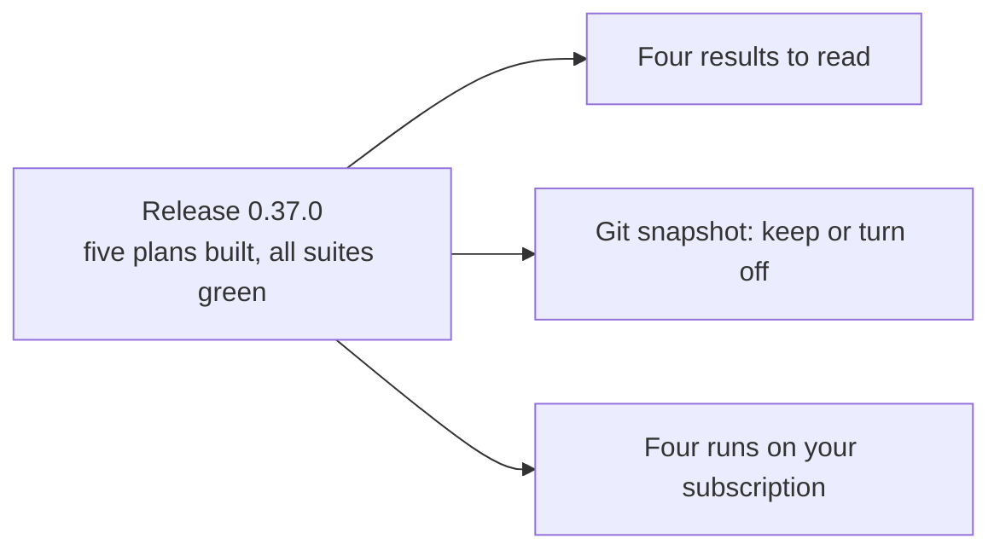

# Release 0.37.0: the checks only you can make, and the runs that spend your subscription

> [!success] Approved 2026-11-22: the four results read right and the compaction comparison is worth running. On 2026-11-24 the human chose option 1, the snapshot off by default, and allowed all four runs.

## What shipped

Each plan builds in stages, a stage being a set of tasks built, tested and merged together. Release 0.37.0 holds the first stage of all five plans and the second stage of PLAN-032 and PLAN-036. After each merge the full test suites passed; the last count was 3,317 CLI tests and 1,212 benchmark tests, none failing.

| Plan | What it gave Compass |
|---|---|
| [[PLAN-032-consolidation-grounded-in-sources]] | `compass drift` checks every code reference, index line and lesson row against git; it runs by itself at session start and fixes what git proves ([[ADR-025-drift-recheck-runs-outside-consolidation-cadence]]) |
| [[PLAN-033-compaction-keeps-the-session-state]] | after Claude Code compacts a session, Compass puts back a short block listing the open tasks, files touched, decisions and git state; the handoff takes those sections from the same command |
| [[PLAN-034-checking-cost-follows-task-and-model]] | every builder, tester and validator run is logged with its model and what it found |
| [[PLAN-035-prompt-cache-is-a-design-input]] | `compass cache` reports how much of each session's start is read from the prompt cache |
| [[PLAN-036-verification-beyond-test-pass]] | `compass requirements`, `reach`, `ablate` and `evidence`, and validator steps that check a task against its spec, not only its tests |

## Read these four results

1. **The first drift report on this vault:** [[DRIFT-20261123T053653226739Z]], 394 findings. Does each row tell you what changed without opening another file?
2. **The live compaction trial:** the section "Trial with Compass hooks" in [[RESEARCH-axis-1-compaction-hooks]]. Both test sessions passed every check: the block came back after all 8 compactions, at about 3,200 characters, and the 80% stop and the handoff behaved as specified.
3. **The compaction pilot:** [[RESEARCH-probe-pilot]]. A fresh session given only Claude Code's own compaction summary named 31% of the files changed and 33% of the tasks in progress; given nothing, it named none. The next step compares that summary with Compass's block and with a handoff, on the same questions, at about the same cost as the pilot (16 short headless sessions). Is that comparison worth running?
4. **The prompt-cache baseline:** [[RESEARCH-cache-baseline-measured]]. A session's first request reads 23% from the cache here and 17% across Compass projects; the git snapshot below is the first part that differs in 90% of session pairs.

## The git snapshot (prompt-cache plan, its second decision point)

Claude Code puts the branch, `git status` and recent commits at the start of every session and subagent, and its settings key `includeGitInstructions: false` turns that off. That snapshot is what breaks the prompt cache first in 90% of session pairs. No Compass agent, skill, rule or hook reads it; handoff, pr-describe, validator and debug run git themselves. Turning it off loses that startup view and Claude Code's built-in commit instructions, and costs one full cache rewrite on the first launch after the switch.

- [x] 1. Off by default in projects Compass installs into; a project that sets `includeGitInstructions: true` keeps it (recommended)
- [ ] 2. Off in this repo only first; `compass cache --compare` then measures the first-request cache rate before and after, and shipping is decided on that gain
- [ ] 3. Keep the snapshot

## Runs that spend your subscription

Each runs real headless Claude Code sessions. Tick the ones you allow.

- [x] **TASK-350:** 30 planned tasks, each sized S, M or L by 6 sessions that see the task text with its size removed. It measures whether that size letter is steady enough to decide how much checking a task gets ([[PLAN-034-checking-cost-follows-task-and-model]]).
- [x] **TASK-351 and TASK-352:** two benchmark builds that check the test setup (one without the post-build tester, one with the 80% stop set low), then a pilot of 12 builds, 3 topics each built twice with full Compass and twice without the post-build tester, measuring whether dropping that tester loses any of the goals a build must meet and what it saves ([[PLAN-034-checking-cost-follows-task-and-model]]).
- [x] **TASK-412:** three throwaway tasks with known defects planted in them, checked by a live validator, to see whether it catches them ([[PLAN-036-verification-beyond-test-pass]]).
- [x] **TASK-428:** the same set of builds run twice, with the default 5-minute and with a 1-hour cache lifetime for subagents, to decide whether Compass should set the 1-hour lifetime ([[PLAN-035-prompt-cache-is-a-design-input]]).
