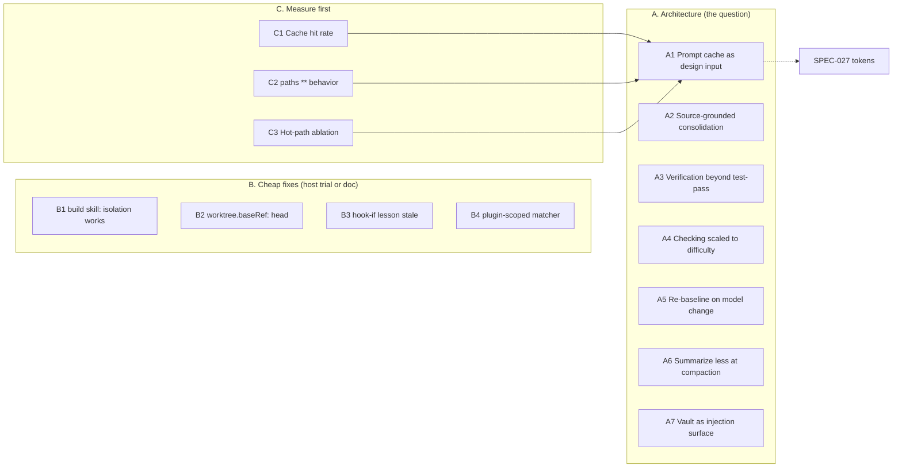

# Review: what recent Anthropic and LLM research says Compass should change

> [!IMPORTANT]
> [!success] Approved 2026-11-21
> A1, A2, A3 and A4 with A5 became draft specs; A6 is a proposed addition to [[SPEC-025-stop-and-suggest-handoff-at-80-percent-context]]; A7 has no spec. B1 to B4 were applied.

## Question

From [[RESEARCH-llm-research-for-compass]]: "What's new, and what are the things we should adapt our architecture to?" Eight axis files were merged; axis 7 (gap mapping) was run here by grepping `.compass/` and `plugin/`.

## Inputs

8 files, 6 researcher families: [[research/llm-research/RESEARCH-axis-1-anthropic-engineering]] and [[research/llm-research/RESEARCH-axis-1b-anthropic-engineering-gap]] (one family), [[research/llm-research/RESEARCH-axis-2-host-features]] and [[research/llm-research/RESEARCH-axis-2b-host-features-gap]] (one family; 2b ran host trials on Claude Code 2.1.330 and wins where they disagree), [[research/llm-research/RESEARCH-axis-3-agent-memory]], [[research/llm-research/RESEARCH-axis-4-multi-agent-verification]], [[research/llm-research/RESEARCH-axis-5-spec-driven-frameworks]], [[research/llm-research/RESEARCH-axis-6-harness-engineering]].

## Methodology

Convergence review. Each axis covers a different topic, so a "-" in the matrix means out of scope, not disagreement. Agreement is supporting axes over axes that addressed the claim. Two rules on independence:
- 1 and 1b count as one family, 2 and 2b as one.
- Every researcher is the same model family, and several axes cite the same vendor post (Cognition's 2026 multi-agent post appears in axes 4 and 6; Anthropic's harness posts in 1 and 4). A claim backed by one post through two axes is marked single-source.

Grades are copied from the axis files. Gap mapping is keyword grep plus targeted reads; "not covered" means no match, not proof of absence.

## Convergence matrix

Cells: Y = supports, N = contradicts, P = partial or a related form, - = out of scope. Grade in brackets (h, m, l).

| # | Claim | 1 | 1b | 2 | 2b | 3 | 4 | 5 | 6 | Agree | Families |
|---|---|---|---|---|---|---|---|---|---|---|---|
| 1 | Provider prompt cache should shape Compass's always-loaded text | - | - | - | Y(h) | P(m) | - | - | Y(m) | 3/3 | 3 |
| 2 | Hot path declared by `initialPrompt` never reaches subagents | - | - | Y(m) | Y(h, trial) | - | - | - | N (assumes it loads) | 2/3 | 1 + vault probe |
| 3 | Replace it with a `SubagentStart` hook | - | - | Y | Y | - | - | - | - | 2/2 | 1 (vault ruling differs) |
| 4 | A periodic offline pass should check memory against its sources | Y(m) | - | - | - | P(m-h) | - | Y(m) | Y(m) | 4/4 | 4 |
| 5 | Whole-context LLM rewrites erode detail; merge deltas mechanically | P | - | - | - | Y(m-h) | - | - | - | 1/1 | 1 |
| 6 | Lessons need an outcome or use signal, not only recurrence | - | - | - | - | Y(m) | - | - | P(l, prune by use) | 2/2 | 2 |
| 7 | Passing tests is a weak oracle; check reachability and goal | Y(m) | Y(l) | - | - | - | Y(m) | Y(l) | - | 3/3 | 3 |
| 8 | Evaluator and station cost should scale with difficulty and model | Y(m) | Y(m) | - | - | - | Y(m) | Y(m) | - | 4/4 | 3 |
| 9 | Harness parts encode model weaknesses and go stale | Y(m) | Y(m) | - | - | - | - | Y(m) | Y(l) | 3/3 | 3 |
| 10 | A clean-context reviewer finds what the author misses | - | Y(l) | - | - | - | Y(m-l) | Y(l) | Y(m) | 4/4 | 3 (4 and 6 share Cognition) |
| 11 | A different model family adds review value | - | - | - | - | - | split | - | Y(m) | split | 2 |
| 12 | Same-family agreement is not independent evidence | - | - | - | - | - | Y(m) | - | - | 1/1 | 1 |
| 13 | Prefer masking or rule-based elision over LLM summaries | - | - | - | - | Y(m-h) | - | Y(m) | split | 2 of 3 clean | 3 |
| 14 | Use PreCompact, PostCompact and compact-source SessionStart | - | - | Y(h) | - | - | - | - | P(l) | 2/2 | 2 |
| 15 | Always-loaded context files cost tokens without raising success | - | Y(m) | Y(h) | Y(h) | Y(m-h) | - | Y(m) | - | 5/5 | 4 |
| 16 | Agent-facing CLI and test output should be short, spill to a file | Y(l) | Y(l) | - | - | - | Y(m) | - | Y(l) | 4/4 | 3 |
| 17 | Persistent memory is an injection channel | - | Y(l) | - | - | P (gap) | - | - | - | 1/1 | 1 |
| 18 | Zero-exception rules belong in hooks, fail closed | - | Y(l) | Y(m) | - | - | Y(l-m) | - | Y(l) | 4/4 | 4 |
| 19 | Underspecification needs an explicit ambiguity scan | - | - | - | - | - | - | Y(m) | - | 1/1 | 1 |
| 20 | Re-inject the task list late in context (recitation) | - | - | - | - | Y(m) | - | - | Y(l) | 2/2 | 2 |
| 21 | Parallel writers fail on dependent work; one writer per file | Y(m) | - | - | - | - | Y(m) | - | split | 2 of 3 clean | 3 |
| 22 | Mine successes, not only failures, into reusable memory | P(l) | - | - | - | Y(l-m) | - | P(l) | - | 3/3 | 3, all weak |
| 23 | Consistency (pass^k) belongs beside pass@k in evals | Y(m) | Y(m) | - | - | - | - | - | - | 2/2 | 1 |
| 24 | Three recorded host limits are fixed on 2.1.330 | - | - | P(doc) | Y(h, trial) | - | - | - | - | 2/2 | 1, trial |
| 25 | Plugin-scoped agent names miss the SubagentStop matcher | - | - | P(doc) | Y(h, trial) | - | - | - | - | 2/2 | 1, trial |

## Convergence summary

| Category | Count | Claims |
|---|---|---|
| Converged (at least 80% and at least 2 families) | 12 | 1, 4, 6, 7, 8, 9, 10, 14, 15, 16, 18, 20 |
| Single-source (one family, no contradiction) | 8 | 3, 5, 12, 17, 19, 23, 24, 25 |
| Partial | 4 | 2, 13, 21, 22 |
| Divergent | 1 | 11 |

Claims 24 and 25 rest on one family but carry host trials, the strongest evidence in the set.

## A. Architecture changes (ranked)

Ranked by north-star rank served, then evidence strength.

### A1. Treat the provider prompt cache as a design input (claims 1, 15)
- **Change:** order and freeze always-loaded text for cache hits; keep vault churn out of the cached prefix; set cache TTLs for subagent and loop traffic.
- **Evidence:** cache orders tools, system, messages and a change invalidates everything after it (2b B1, B2, vendor-doc, h); the startup git-status block lists churned vault files, so sequential sessions in a Compass project share no prefix past it (2b B3, inferred, m); subagents default to a 5-minute TTL and Compass sets none (2b B7, h); Manus calls hit rate "the single most important metric" (6 f1, vendor, asserted); summarizer calls reuse the cache poorly (3 f3, m-h); context files raised cost over 20% with no success gain (5 f15, preprint, m).
- **North star:** 3, 4.
- **Touches:** `plugin/hooks/hooks.json`, `plugin/cli/looprunner.py:760` (worker env), `plugin/templates/agents/*` (cache TTL frontmatter), `plugin/cli/commands/sync.py` (which files churn), rule-file frontmatter.
- **Covered:** partly. [[research/whole-overhead/agent-context/REVIEW-agent-context-2026-11]] item 11 keeps fixed launch text byte-identical; [[LOOP-003-session-context]] shrinks session text. Neither names the git-status snapshot, TTLs or hit rate.
- **Spec:** child of [[SPEC-027-compass-uses-fewer-tokens]] or new. Settle C1 and C2 first.

### A2. A periodic, source-grounded consolidation pass (claims 4, 5, 6)
- **Change:** a detached worker that re-checks lessons, index lines and `file:line` references against transcripts and code, proposes itemized edits a CLI applies, records whether a cited lesson preceded a pass or a fail, and reports drift, never deleting.
- **Evidence:** Anthropic "dreaming" corrected a wrong note from the transcript; wiki plus search 61% vs 53% for search alone (1 f4, m, small n); one writer per page kept 57 of 57 facts vs 41 of 57 (1 f5, m); ACE: whole-context LLM rewrite fell from 66.7 to 57.1, below the 63.7 baseline, while non-LLM delta merges with helpful and harmful counters gained 10.6% (3 f1, peer-reviewed, m-h); later outcomes are free quality labels for memory (3 f2, peer-reviewed, abstract, m); stale instruction files are followed and never repaired (5 f16, preprint, m); OpenAI doc-gardening agents and Devin's daily pass (6 f11, f12, vendor, asserted); EGM `drift-report` (5 f9).
- **North star:** 1, 2.
- **Touches:** `plugin/skills/consolidate/SKILL.md` step 4 (LLM rewrite of verbose bodies, the form ACE measured as harmful), `plugin/skills/lesson-write`, `plugin/cli/capturelib.py`, `plugin/cli/commands/lesson_coverage.py`, lesson frontmatter, the ADR-013 worker pattern.
- **Covered:** partly. Capture loop ([[SPEC-012-learning-loop]], [[ADR-016-capture-by-extraction]]) writes and revises per opportunity; `consolidate` runs on cap warnings only; `score` and `seen` count recurrence, not outcome; backlog item "Lesson-coverage parity" is the nearest open question. No transcript-grounded re-verification, no drift report, no outcome counter.
- **Spec:** new child of [[SPEC-012-learning-loop]]; its measure can come from [[SPEC-028-agent-memory-is-good-enough]] (C8).

### A3. Verification beyond test-pass (claims 7, 10)
- **Change:** the validator adds a reachability probe (new code is reached from a real entry point), a no-op ablation (stub the diff's behavior, see which tests flip), and a requirement-level check of code against spec that re-opens unmet items as tasks.
- **Evidence:** 34% of test-passing patches broke a stated review constraint (4 f16, preprint plus ICSE 2026, m); with the oracle visible, agents scored near perfect while leaving the deliverable unused (4 f17, preprint, l-m); goal-level verification +15.6% on ChatDev (4 f5, m-l); out-of-the-box Claude is a weak QA agent and "tests passing is easy to mistake for done" (1 f7, f11, m); spec-kit `converge` and BMAD's "name the regression a missing test would catch" (5 f5, f8, source code, asserted); review against the spec, skip style (1b f12, vendor doc, l).
- **North star:** 1.
- **Touches:** `plugin/templates/agents/validator.md` (adversarial probes section), `plugin/templates/agents/builder.md:65` (review charter is style-level: unused imports, naming), `plugin/skills/build/SKILL.md`, possibly a `compass` check.
- **Covered:** partly. Validator compares plan to diff and runs mandatory adversarial probes; `compass test-checkpoint verify` catches edited tests; `compass coverage` traces decisions to tasks, not code. No reachability, no ablation, no re-open loop.
- **Spec:** new, sibling of [[SPEC-013-test-quality]].

### A4. Checking scaled to task difficulty and model (claim 8)
- **Change:** validator, post-build tester and builder review run in full on edge-of-capability tasks and lighter on in-capability ones, chosen by a stated rule, not fixed per task.
- **Evidence:** on Opus 4.6 the evaluator was overhead for in-capability parts and kept lift on hard parts; QA rounds $3 to $4 vs build rounds $36 to $71 (1 f7, m); above a 45% single-agent baseline, more agents gave negative returns; centralized overhead +285% (4 f2, preprint, m); planning helps weak models' accuracy and strong models' cost only (5 f20, preprint, m); agent-written tests moved no resolve rate while costing 33-49% input tokens (4 f15, preprint, m); subagents add parallelism or a fresh reviewer, not a smarter answer (1b f13, vendor doc, m).
- **North star:** 1, 4.
- **Touches:** `plugin/skills/build/SKILL.md`, `plugin/templates/agents/validator.md`, `plugin/templates/agents/tester.md`, `compass models` policy (`plugin/cli/modelslib.py`).
- **Covered:** no. Station ablation is open (C4).
- **Spec:** new, with A5; under [[SPEC-027-compass-uses-fewer-tokens]].

### A5. Re-baseline the harness when the model changes (claim 9)
- **Change:** on a model or host upgrade, ablate scaffold parts one at a time (handoff thresholds, phase splits, validator cadence, prompt rules, emphasis markers) and gate model-specific prompt text to its model.
- **Evidence:** context resets needed on Sonnet 4.5 were "dead weight" on Opus 4.5; sprints removed on Opus 4.6; cut-everything could not tell what was load-bearing (1 f1, m); one terse-output prompt line cost 3% on one eval found only by per-line ablation (1 f2, m); ALL-CAPS emphasis listed as old advice current models over-apply, and `/doctor prompt-audit` flags text written for older models (1b f10, f14, vendor doc, l-m); context anxiety is a Sonnet 4.5 trait (6 f15, l).
- **North star:** 1, 4.
- **Touches:** `bench/overhead/`, `.claude/rules` sources in `plugin/templates/rules/`, agent and skill text.
- **Covered:** partly. [[PLAN-028-whole-overhead-on-real-projects]] TASK-256 re-measures the without-Compass arm on a model or Claude Code change; [[PLAN-029-crafted-agent-context]] runs paired version comparisons. Neither ablates scaffold parts per model.
- **Spec:** with A4.

### A6. Summarize less at compaction and handoff (claims 13, 14)
- **Change:** prefer clearing old tool output and fixed-section notes over an LLM summary; use PreCompact stdout to steer the host's summary and SessionStart `source: compact` to re-inject state.
- **Evidence:** observation masking matched or beat LLM summary in 4 of 5 setups at half the cost, and summaries lengthened runs 13-15% (3 f3, preprint, m-h); rule-based elision is the most efficient context step (5 f20, m); PreCompact and PostCompact payloads exist and are unused (2 f5, vendor doc, h); post-compaction keeps only 5,000 tokens per skill (2 f13, h); Factory's anchored summary beat both vendors' and every method lost the file trail (6 f14, vendor, measured, self-favoring).
- **North star:** 2, 4.
- **Touches:** `plugin/hooks/hooks.json`, `plugin/skills/handoff/SKILL.md`, `plugin/cli/commands/context_check.py`.
- **Covered:** partly. The 80% and 95% stop ([[SPEC-025-stop-and-suggest-handoff-at-80-percent-context]], [[PLAN-019-stop-at-80-percent-context]]); masking is already cited in [[research/whole-overhead/real-projects/RESEARCH-axis-7-optimization-loop]] finding 17 (axis 3 did not note this); backlog holds the hermes 50% compression trigger. No compaction hook.
- **Spec:** existing [[SPEC-025-stop-and-suggest-handoff-at-80-percent-context]]. See disagreement 3.

### A7. The vault as an injection surface (claim 17)
- **Change:** a deterministic check on text entering lessons and subagent captures (instruction-like lines, fetched content, encoded blobs) and a provenance note on subagent-sourced lessons.
- **Evidence:** persistent memory reloads an injection every session; trusting subagent output more opens a route (1b f18, vendor, asserted, l); one injected line before signing raised unsafe commits to 37.5-97.2% (4 f7, preprint, l-m).
- **North star:** 1, 2.
- **Touches:** `plugin/cli/capturelib.py`, `plugin/cli/commands/capture_worker.py`, `compass sync` write path.
- **Covered:** no (grep of capture code for "injection" or "untrusted" finds none).
- **Spec:** new, if wanted. Single family, asserted.

### Lower-ranked architecture candidates
| Candidate | Evidence | Star | Touches | Spec |
|---|---|---|---|---|
| Push and egress guard for subagents and loops; recommend the host sandbox at setup | 1b f16, f20, f21 (m, l) | 1 | `compass guard`, setup skill | new or none |
| Spec-stage ambiguity scan, at most 5 questions, unresolved marker | 5 f2, f3, f21 (asserted; Ambig-SWE m) | 1 | `plugin/skills/spec` | none; spec skill edit |
| Recite open tasks late in context by hook, append-only | 6 f6 (l), 3 f4 (+4% recitation, m) | 1, 2 | `hooks.json` | none; conflicts with A1 if it breaks the prefix |
| Goal-conditioned handoff | 6 f13 (l) | 1, 4 | handoff skill | [[SPEC-025-stop-and-suggest-handoff-at-80-percent-context]] |
| Mine successes; strategic/functional/atomic layering | 3 f10 (l-m), 1 f15 (l) | 2 | `extract-lessons` | [[SPEC-012-learning-loop]] |
| Fan-out-then-verify review for large diffs; best-of-N for high-risk tasks | 4 f10 (l-m), f19 (m) | 1 | builder step 8, build skill | none; costly |
| Machine-owned task state in a structured sidecar | 1 f9 (asserted, l) | 1, 2 | plan format, sync | none |
| Model-run precompute brief per next-up task | 3 f5 (l-m transfer) | 3 | worker | none |
| Dynamic context injection (`` !`cmd` ``) for "run this command first" skill steps | 2 f12 (h mechanism) | 4 | skills | none |

## B. Cheap fixes and stale workarounds

Ranked: host-trial confirmed first.

| # | Change | Evidence | Star | Touches | Spec |
|---|---|---|---|---|---|
| B1 | Drop "frontmatter `isolation` does nothing"; frontmatter `isolation: worktree` works for project and plugin agents | 2b C1 (trial, h) | 4 | `plugin/skills/build/SKILL.md:39` | none |
| B2 | Offer `worktree.baseRef: "head"` for builder worktrees; keep the checkpoint commit for uncommitted files | 2b C2 (trial, h) | 1 | `plugin/skills/build/SKILL.md:32,39`; revise [[LESSON-subagent-worktrees-fork-stale]] | none |
| B3 | Rewrite [[LESSON-hook-if-clause-no-or]]: `if` works in settings-file hooks; the no-`||` limit stands | 2b C3 (trial, h) | 2 | the lesson | none |
| B4 | Widen the SubagentStop matcher to `compass:*` names, or document project-install only | 2b C4 (trial, h) | 2 | `plugin/hooks/hooks.json` (SubagentStop matcher) | none |
| B5 | Remove the dead `initialPrompt` lines | 2b C5 (trial, h) | 1, 4 | agent templates | already TASK-267 in [[PLAN-029-crafted-agent-context]] |
| B6 | Set `onFailure: "block"` on the guard hooks so a crashed guard does not let a destructive call through | 2 f2, f10, f32 (doc, h); not trialed | 1 | `plugin/hooks/hooks.json` | none; trial first |
| B7 | Set `disable-model-invocation: true` on internal skills (none set today) | 2 f11 (doc, h); 2b B8 (grep, h) | 4 | `plugin/skills/*/SKILL.md` | none |
| B8 | Builder review charter: correctness against the spec, skip style | 1b f12 (doc, l); 4 f5 (m-l) | 1, 4 | `plugin/templates/agents/builder.md:65` | none; overlaps A3 |
| B9 | Reviewer matrix records model family; same-family agreement capped | 4 f12-f14 (m) | 1 | `plugin/templates/agents/reviewer.md` | none |

Stale text in prose, no code effect: `hooks.json` description says TeammateIdle "carries only a teammate name" (2 f27); the methodology skill's debug-isolation reason "Preserves the main context window" is listed as old advice by the host docs (1b f13, doc, asserted).

## C. Measurements before deciding

| # | Measure | Settles | Evidence | Spec home |
|---|---|---|---|---|
| C1 | `cache_read_input_tokens` per agent type and across two sequential sessions in a Compass project | A1 | 2b B3 inferred, 6 gap; the field is already read by `context_check.py` | [[SPEC-027-compass-uses-fewer-tokens]] |
| C2 | What `paths: ["**"]` does at the host: loaded at start or on first read, and in subagents (interactive `/context`) | A1, rule scoping | 2b B5, C7 (trial inconclusive) | [[SPEC-027-compass-uses-fewer-tokens]] |
| C3 | Hot-path ablation: with vs without `index.md` and the lessons index on benchmark builds | A1, claim 15 | 5 f15, f20; 3 f4 | [[SPEC-032-whole-overhead-measured-on-real-projects]] |
| C4 | Post-build tester and validator station ablation on a task sample | A4 | 4 f15, cand 6 | [[SPEC-013-test-quality]] |
| C5 | Probe-based handoff sufficiency (recall, artifact, continuation, decision) | A6 | 6 f14 | [[SPEC-025-stop-and-suggest-handoff-at-80-percent-context]] |
| C6 | Do fixed capture triggers and the anti-list lose lessons free judgment keeps | A2 | 1 f6 (in-session memory; transfer unmeasured) | [[SPEC-012-learning-loop]] |
| C7 | pass^k over repeated trials beside pass@k in `bench/` | A4, A5 | 1 f17, 1b f4 | [[SPEC-032-whole-overhead-measured-on-real-projects]] |
| C8 | SPEC-028 question classes from LongMemEval and MemoryAgentBench (knowledge update, abstention, selective forgetting), graded by checkable end state on more than one model | A2 | 3 f7, f9 | [[SPEC-028-agent-memory-is-good-enough]] |
| C9 | `claude plugin eval` for skill triggering on natural prompts; `/skill-doctor` and `claude plugin details compass` numbers | B7, skill cost | 2 f14, f20 (Bash grants need WSL2 on Windows) | [[SPEC-027-compass-uses-fewer-tokens]] |

## Disagreements for the human

1. **How the hot path reaches subagents.** Axes 2 and 2b recommend a `SubagentStart` hook. [[PLAN-029-crafted-agent-context]] ruling 2 (approved 2026-11-05) puts it in the brief the orchestrating skills write, with a hook only if the brief route fails. Both agree `initialPrompt` is dead ([[research/whole-overhead/agent-context/RESEARCH-initialprompt-in-subagents]] and 2b C5). Axis 6 candidate 1 puts a cache-ordering rule inside `initialPrompt`, a field that does not run.
2. **Rule-file scoping premise.** Axis 2 candidate 5 says `compass-pipeline.md` has no `paths:`; 2b B5 read `paths: ["**"]` on three of four rule files. 2b holds; the behavior is open (C2).
3. **Compaction: shape it or avoid it.** Axis 2 proposes PreCompact hooks to steer the host summary; axis 3 (masking beats summary, m-h) and Amp (6 f13) favor less summarizing; Factory and OpenHands (6 f3, f14) tune summaries and measure gains. No source compares the approaches.
4. **Memory writes: judgment or mechanics.** 1 f6: free judgment of what to remember beat fixed rules on strong models. 3 f1: deterministic, non-LLM delta merges beat LLM rewrites. They target different steps (what to write vs how to merge), and neither tested both together.
5. **Pruning by disuse.** Devin deletes notes no session used (6 f12); ACE removes duplicates (3 f1). The vault's data rule forbids deletion, so only the "report" or "move colder" half carries over.
6. **Does model family matter in review?** Cognition says same-model agents carry no self-bias (4 f9, 6 f16, one post); 2026 preprints report family favoritism (4 f13, l); cross-model was not significantly better than a fresh same-model reviewer but caught partly different errors (4 f12, l-m).
7. **Parallel writers.** Fan-out is net-negative on sequential coding (4 f1, f2) and "most coding tasks are poor fits" (1 f12); Cursor and the C-compiler run report many parallel writers working where the success criterion is checkable (6 f17, 1 f11). Compass's disjoint-file rule sits between.
8. **Always-loaded context.** Context files gave no success gain at over 20% more cost (5 f15); every framework ships one (5 table), and the vault's hot path is one. The paper's exception (non-standard practices) is the only reconciliation offered.
9. **Agent-written tests.** 4 f15: they move no resolve rate. The vault's seeded-defect run: tests under the admission bar caught 15 of 15 vs 13 of 15 ([[research/test-quality/RESEARCH-test-quality-bar-validation]]). Different outcome measures and different test authors.
10. **Specs: problem only, or implementation detail too.** Compass specs hold problem and need; practitioners include implementation detail, which "may help agents while making specs prone to decay" (5 f17, qualitative).

## Already covered

| Candidate from an axis | Where Compass already does or decided it |
|---|---|
| Hot path into subagents without `initialPrompt` (2 c1, 2b c1) | [[PLAN-029-crafted-agent-context]] TASK-260 (done: [[research/whole-overhead/agent-context/RESEARCH-initialprompt-in-subagents]]) and TASK-267 |
| Fixed launch text byte-identical for the cache (6 f1 partly) | [[research/whole-overhead/agent-context/REVIEW-agent-context-2026-11]] item 11 |
| Skill bodies loaded lazily; split large skills (6 f5, 1 f15) | [[PLAN-029-crafted-agent-context]] TASK-261 (`obsidian` side files now exist) |
| Subagent report size band (1 f12) | [[PLAN-029-crafted-agent-context]] TASK-270 |
| Host auto memory vs vault (2 c7) | [[PLAN-029-crafted-agent-context]] TASK-271 measures memory-folder use; `consolidate-memory` skill |
| 100-line AGENTS.md as a map (6 f9) | [[SPEC-001-compass-vision-and-architecture]], [[ADR-004-hierarchical-specs-with-facets]], `compass hot-path` cap |
| No vector retrieval (6 f18, 1b f1) | [[research/vault-structure/RESEARCH-rag-fit-for-large-vaults]]; contextual-retrieval's 200,000-token whole-prompt threshold is uncited there |
| Observation masking as a cost lever (3 f3) | [[research/whole-overhead/real-projects/RESEARCH-axis-7-optimization-loop]] finding 17 cites it; not adopted |
| Keep `looprunner` over `/goal`, `/loop`, `--bg` (2b c7) | [[PLAN-021-control-loops]], [[SPEC-026-control-theory-for-loops]] |
| Keep `self-update` over host auto-update (2b c8) | [[SPEC-020-compass-updates-itself]], ADR-015 |
| One writer per file, orchestrator merges (1 f11, 4 f9, 6 f16, f17) | methodology skill "Parallel execution" |
| Generator separate from evaluator (1 f7) | validator agent; builder never runs tests |
| Acceptance tests from the spec before build (1b f7) | [[SPEC-013-test-quality]], tester pre-build station |
| `--max-turns`, `--max-budget-usd` on unattended runs (1b f15) | `plugin/cli/looprunner.py` |
| LLM-judge biases and reward hacking on tests (4 intro) | [[research/whole-overhead/real-projects/RESEARCH-axis-6-build-success]] findings 10-14 |
| Fresh-eyes reader for documents (5 f9) | `obsidian` skill, `writing-principles.md` |
| Re-measure on model or host change, whole-arm level (1 f1 partly) | [[PLAN-028-whole-overhead-on-real-projects]] TASK-256 |
| Shrinking always-loaded text by a loop (claim 15 partly) | [[LOOP-003-session-context]], [[SPEC-027-compass-uses-fewer-tokens]] |
| Session search, compression trigger (6 f3 related) | backlog "Hermes-agent portable techniques" |
| "Ruling, not stall" (5 f10) | No Stalls rule in the global and pipeline rules |
| Workflow patterns: chain with gates, orchestrator-workers, evaluator-optimizer, routing table (1b f8) | the pipeline itself, 3-cycle fix loop, `compass models` |

## Gaps

- No axis measured Compass's own cache hits, so A1's size is unknown (C1).
- No source tests a spec-derived pre-build tester against a no-test control, or a same-family different-tier validator as Compass runs it (axis 4 gaps).
- Memory poisoning of persisted lessons was not researched beyond one vendor forecast (A7).
- Most arXiv items in axes 3, 4 and 5 were read at abstract level; numbers past the abstract are unverified.
- `paths: ["**"]` behavior and `SubagentHandback` conditions remain untested (C2; 2b C6).
- Coverage claims here rest on grep; the validator's `validate` failure messages, `/compass:handoff resume` goal input and `looplib` judge step were not read.

CONVERGENCE: MIXED
