# Start-here files back under their limit

```mermaid
flowchart LR
  subgraph now["Root index now: 4,685 tokens, 86 lines"]
    direction TB
    n1["Specs: 7 lines"]
    n2["Research: 24 lines, 13 of them single documents"]
    n3["Plans: 35 lines, one per plan"]
    n4["Decisions 6, Handoffs 4, compass-cli 5, Loops 3, Ideas 2"]
  end
  subgraph a["Stage A, now: 2,399 tokens, 46 lines"]
    direction TB
    a1["Specs: 7 lines"]
    a2["Research: 10 folder lines + 1 document"]
    a3["Plans: 6 topic folders + PLAN-033 to 036"]
    a4["Decisions 6, Handoffs 2, compass-cli 5, Loops 3, Ideas 2"]
  end
  subgraph b["Stage B, after the four open plans merge: 1,900 tokens, 41 lines"]
    direction TB
    b1["Specs: 7 lines"]
    b2["Research: 10 folder lines"]
    b3["Plans: 6 topic folders"]
    b4["Decisions 6, Handoffs 2, compass-cli 5, Loops 3, Ideas 2"]
  end
  now --> a --> b
```



> [!success] Approved 2026-11-24: Stage A and L1 applied (two lessons kept active). Stage B applied 2026-11-26 after the PLAN-033 to 036 merges (B1 to B4; B5 not needed, see below): `compass hot-path` reads 3,357 / 5,000, this document's own index line included, and `compass validate` reports 0 errors.

## What was measured

The start-here files are the three files every launched agent reads first: `index.md` (the root index, the map of all documents), `active.md` (open work) and `lessons/index.md` (the lessons list). A token is the unit an AI reads in, about four characters; `compass hot-path` counts the three files in tokens. In the index, a folder line shows how many documents sit inside it ("6 children"). Plans are named PLAN-nnn, specs (what we need) SPEC-nnn, decision records ADR-nnn.

| File | Now | After Stage A | After Stage B |
|---|---|---|---|
| `index.md` | 4,685 | 2,399 | 1,900 |
| `active.md` | 1,221 | 929 | 929 |
| `lessons/index.md` | 690 | 598 | 643 |
| **Total (limit 5,000)** | **6,596** | **3,926** | **3,472** |

The size warning at the top of `index.md` reads 6,557, because the files grew to 6,596 after it was written. Every number in this document comes from applying the groupings, in the order below, to a scratch copy of the vault (a throwaway copy, so the real vault is untouched) with the real commands, and reading `compass hot-path` after each one:
- `compass make-domain` creates a topic folder with its `index.md` and a shape record (a small file noting why the folder was made).
- `compass move` moves files into a folder and rewrites every link to them.
- `compass sync` runs after every vault write and keeps the index and lists in step with the files.
- `compass validate` checks the vault for errors. On the scratch copy after Stage B it reports 0 errors, and no broken link the vault does not already have.

This document adds one line of its own to the Research section of `index.md` (66 tokens) until it moves to the archive; the totals above leave that line out. With it, Stage A ends at 3,992 and Stage B at 3,538.

Weight of the root index now, by section: Plans 2,114 tokens, Research 1,321, Specs 305, Decisions 261, compass-cli 158 (the CLI's own documents), Loops 135, Handoffs 133 (notes to resume a session). Plans and Research are 73% of it, and every one of their lines is a document listed by itself next to topic folders that already exist for specs, research and decisions.

## Stage A: groupings that can move now

Plans follow their specs: each plan goes into the topic folder named for the spec topic folder its spec sits in (`specs/learning/`, `specs/pipeline/`, and so on). Each topic folder is created by `compass make-domain plans/<name> --class-here "<line>" --reason "fold flat plan lines under the spec topic folders" --apply`, where the `--class-here` line becomes the folder's "What belongs here" text. Each move is one `compass move <files> <folder> --apply`. Stage A leaves PLAN-033 to PLAN-036 and anything their four open worktrees edit alone; a worktree is a separate checkout of the repository where an agent builds one plan.

Saved tokens are the drop in `compass hot-path` measured at that step.

### - [x] A1. `plans/learning/`: 6 plans, saves 275 tokens

What belongs here: plans that implement the learning specs - lessons, the capture loop, fidelity to the human's words, ideas.

```text
compass move PLAN-001-lessons-and-index-implementation PLAN-006-learning-loop PLAN-013-capture-by-extraction PLAN-020-clone-old-sessions PLAN-030-ideas-keep-their-status PLAN-032-consolidation-grounded-in-sources plans/learning --apply
```

```diff
-- [[PLAN-001-lessons-and-index-implementation]] - 12 tasks across 6 phases implementing SPEC-002 (done 2026-05-24)
-- [[PLAN-006-learning-loop]] - Learning Loop Implementation: harness-owned capture, catalog retrieval, lesson coverage (approved 2026-08-05)
-- [[PLAN-013-capture-by-extraction]] - implement ADR-016 across spec/vision/specs/retroactive skills and the pipeline rules; ship via push + fleet self-update
-- [[PLAN-020-clone-old-sessions]] - /compass:clone-old runs headless copies of past feature sessions, each writes its lessons, and the skill merges them through lesson-write
-- [[PLAN-030-ideas-keep-their-status]] - one file per idea in category folders holds his words, status, history and where it led; an importer backfills a hand-made table; sync moves status when a spec names an idea; stage 2 catches his words at submit and the background helper files ideas and verdicts
-- [[PLAN-032-consolidation-grounded-in-sources]] - a zero-token drift scan checks code references, index lines and catalog rows against git and the files they describe, sync keeps catalog rows true to lesson files, a mechanical check guards every lesson edit, and a seeded-staleness probe proves the scan; source pointers, the model judge and the lesson track record follow
+- [[plans/learning/index|learning]] (folder, 6 children) - plans that implement the learning specs - lessons, the capture loop, fidelity to the human's words, ideas
```

### - [x] A2. `plans/vault-structure/`: 6 plans, saves 204 tokens

What belongs here: plans that implement the vault-structure specs - hierarchy, the active sweep, graph queries, sizing, topic folders.

```text
compass move PLAN-003-hybrid-hierarchy PLAN-009-sizing-mechanism PLAN-011-active-sweep PLAN-015-graph-queries PLAN-016-domain-taxonomy PLAN-023-taxonomy-review-at-spec-creation plans/vault-structure --apply
```

```diff
-- [[PLAN-003-hybrid-hierarchy]] - Hybrid Hierarchy Implementation (Unit Folders)
-- [[PLAN-009-sizing-mechanism]] - zero-artifact units, the sizing record, and the changeability walk (draft, awaiting approval)
-- [[PLAN-011-active-sweep]] - implement ADR-014: sweep module with dry-run CLI command, wired into sync, validate drift warning, builder/build/checkup doc updates, live acceptance on this vault
-- [[PLAN-015-graph-queries]] - implement ADR-018: graphlib, compass graph, consumer wiring, ripple step; live validation; v0.13.0
-- [[PLAN-016-domain-taxonomy]] - two waves: the mechanism (record-name and loop-guard fixes, make-domain, link rules, skill contracts, compass tree), then this vault's migration, gated on the human's diff approval and judged by the useless-token baseline and blind drills
-- [[PLAN-023-taxonomy-review-at-spec-creation]] - a `compass placement` command shows a new spec its candidate parents and domains; spec and specs propose the deeper home; first run on this vault
+- [[plans/vault-structure/index|vault-structure]] (folder, 6 children) - plans that implement the vault-structure specs - hierarchy, the active sweep, graph queries, sizing, topic folders
```

### - [x] A3. `plans/pipeline/`: 6 plans now, 8 after Stage B, saves 232 tokens

What belongs here: plans that implement the pipeline specs - decision coverage, test quality, staged plans, research scope, the context stop, control loops, compaction, verification.

```text
compass move PLAN-004-decision-coverage PLAN-007-test-quality PLAN-008-rolling-wave PLAN-018-research-covers-the-whole-spec PLAN-019-stop-at-80-percent-context PLAN-021-control-loops plans/pipeline --apply
```

```diff
-- [[PLAN-004-decision-coverage]] - Decision Coverage Implementation (D-NN Parser, Coverage Gate, Audit)
-- [[PLAN-007-test-quality]] - Test Quality Instruments (Authoring Bar, Test-First Station, Admission Filter, Diagnostic Mutation)
-- [[PLAN-008-rolling-wave]] - Rolling-Wave Plans (Detail Regions, Three-State Coverage, the Elaboration Loop)
-- [[PLAN-018-research-covers-the-whole-spec]] - rebuilds Compass's research surfaces so a run scopes to a whole spec instead of its question list, draws from a shipped list of sources with a retriever apiece, reads code instead of documentation, and grades its evidence only with the human told and able to refuse
-- [[PLAN-019-stop-at-80-percent-context]] - a PostToolUse hook measures the main session's context from its transcript and, once it reaches 80% of the window, halts after the current tool with a stopReason suggesting /compass:handoff; fires once per crossing so the handoff itself runs; Claude Code only
-- [[PLAN-021-control-loops]] - control loops under .compass/loops/: `compass loop run` drives sensor, controller and actuator as a state machine inside caps and budget, plus four experiments
+- [[plans/pipeline/index|pipeline]] (folder, 6 children) - plans that implement the pipeline specs - decision coverage, test quality, staged plans, research scope, the context stop, control loops, compaction, verification
```

### - [x] A4. `plans/distribution/`: 4 plans, saves 197 tokens

What belongs here: plans that implement the distribution specs - model resolution, self-update, dsh host support, local additions.

```text
compass move PLAN-005-model-table PLAN-012-self-update PLAN-017-dsh-host-support PLAN-026-local-additions-tell-the-truth plans/distribution --apply
```

```diff
-- [[PLAN-005-model-table]] - Model Resolution Table Implementation (Tiers, apply-models, Overrides)
-- [[PLAN-012-self-update]] - implement ADR-015: self_update command with sha gate and local-source mode, SessionStart(startup) hook entry, setup/update skill alignment, live acceptance in this repo
-- [[PLAN-017-dsh-host-support]] - dsh is a native Compass host from the one canonical plugin source (v0.19-0.23): materializers, model routes, doctor, capture worker, global auto-installed bundle, and Wave 6 zero-decision (SPEC-006 D-05) - hosts detected never asked, dsh-first bootstrap via a second bridge mount, both-direction acceptance at 0 errors
-- [[PLAN-026-local-additions-tell-the-truth]] - local additions already survive update (v0.14.0); this plan makes them honest: an edited addition refreshes, doctor tells applied from not applied, the update notice names what it re-applied, dsh gets them too, then a live round-trip and a way to keep old hand edits
+- [[plans/distribution/index|distribution]] (folder, 4 children) - plans that implement the distribution specs - model resolution, self-update, dsh host support, local additions
```

### - [x] A5. `plans/tooling/`: 4 plans now, 6 after Stage B, saves 191 tokens

What belongs here: plans that implement the tooling specs - invisible capture, capability usage, whole token overhead, agent context, checking cost, prompt cache.

```text
compass move PLAN-010-invisible-capture PLAN-014-capability-usage PLAN-028-whole-overhead-on-real-projects PLAN-029-crafted-agent-context plans/tooling --apply
```

```diff
-- [[PLAN-010-invisible-capture]] - capture moves off the conversation into a hook-spawned detached worker, with recorded runs, dead-worker detection, a quiet fallback, and a paired live-fire acceptance
-- [[PLAN-014-capability-usage]] - implement ADR-017: usage recording in dispatch, usage report, doctor advisory, retirements, reachability line; ship v0.12.0
-- [[PLAN-028-whole-overhead-on-real-projects]] - a pilot of twelve headless builds on the human's subscription, in throwaway projects outside the repo, with and without Compass, sets the batch size and closes the research's open checks; then a baseline batch, the overhead broken into areas, and a loop that cuts the biggest area first
-- [[PLAN-029-crafted-agent-context]] - slim launched agents by design A: per-agent-type token measure and the initialPrompt check first, then a split obsidian skill and a start-here fix land after the pilot; the lessons skill stays until a paired run shows it can go
+- [[plans/tooling/index|tooling]] (folder, 4 children) - plans that implement the tooling specs - invisible capture, capability usage, whole token overhead, agent context, checking cost, prompt cache
```

### - [x] A6. `plans/human-surface/`: 5 plans, saves 295 tokens

What belongs here: plans that implement the human-surface specs - review in Obsidian, visual documents, numbered choices, screenplays.

```text
compass move PLAN-022-review-in-obsidian PLAN-024-working-in-compass-is-visual PLAN-025-review-across-files-and-sessions PLAN-027-numbered-choices PLAN-031-screenplays-in-the-vault plans/human-surface --apply
```

```diff
-- [[PLAN-022-review-in-obsidian]] - the Compass Review Obsidian plugin, a `compass review` command, install, doctor and guard support; gate wiring follows an experiment
-- [[PLAN-024-working-in-compass-is-visual]] - five trials in Obsidian and three agreed mockups first; then documents gain callouts, embeds, block links and footnotes, Compass's plugin draws task tables, graphs, charts and the spec canvas, and the CLI speaks short plain words, every visual earning its bytes
-- [[PLAN-025-review-across-files-and-sessions]] - two live checks in Obsidian and an agreed mockup first; then one review walks the human through several files with one verdict, each card names its project and session, edits and stepping aside stay inside their own review, and a VS Code surface follows
-- [[PLAN-027-numbered-choices]] - one rule in the always-loaded pipeline rules makes every choice put to the human a numbered list a bare number can answer; the guide skill's prose questions go through the same rule; ships as 0.34.2
-- [[PLAN-031-screenplays-in-the-vault]] - five live checks of the Fountain plugin in Obsidian and BetterFountain in VS Code come first, in one sitting; then Compass bundles Fountain 0.34.3, installs it into every project with an Obsidian vault, gives agents a fountain skill and a text check, and ships after acceptance here and in one other project
+- [[plans/human-surface/index|human-surface]] (folder, 5 children) - plans that implement the human-surface specs - review in Obsidian, visual documents, numbered choices, screenplays
```

### - [x] A7. `research/llm-research/` becomes a topic folder: 8 lines, saves 544 tokens

The folder already holds ten documents but has no `index.md`, so each of its documents is listed by itself, indented under the wrong folder line (whole-overhead). Giving it an `index.md` turns ten lines into one; the survey's own axes document moves in beside its findings.

`compass make-domain` refuses a folder that already exists, so the `index.md` is written by hand in the exact shape `make-domain` writes, with this summary and "What belongs here" line: "the survey of Anthropic's engineering posts and 2025-2026 LLM agent research for changes Compass should make - its axes, gap passes, merged review and the checks of the stages it led to". Without a shape record it joins the seven folders `compass validate` already reports as made before shape records existed.

```text
compass move RESEARCH-llm-research-for-compass research/llm-research --apply
```

```diff
-- [[RESEARCH-llm-research-for-compass]] - approved axes for surveying Anthropic's engineering posts and 2025-2026 LLM agent research for changes Compass should make; axis findings in research/llm-research/
-  - [[research/llm-research/RESEARCH-axis-6-harness-engineering]] - What OpenAI, Manus, Cursor, Cognition, Amp, Factory, OpenHands, Cline, Gemini CLI and a 2026 source-code survey say about harness design, checked against what Compass already does; reports only what the earlier context prior-art review did not cover
-  - [[research/llm-research/RESEARCH-axis-3-agent-memory]] - 2025-2026 agent-memory papers against Compass's hot path, 5-line lessons and consolidation: helpful/harmful counters, delta-only curation, masking over summarizing, length-alone degradation, sleep-time precompute
-  - [[research/llm-research/RESEARCH-axis-1-anthropic-engineering]] - 28 Anthropic engineering posts surveyed; the changes that touch Compass architecture are model-change harness ablation, offline memory consolidation, evaluator-on-demand, and bounded test output
-  - [[research/llm-research/RESEARCH-axis-5-spec-driven-frameworks]] - Nine spec-driven frameworks read from source, comparison table, and the empirical evidence on specs, plans, TDD and ambiguity; candidate Compass changes
-  - [[research/llm-research/RESEARCH-axis-4-multi-agent-verification]] - Evidence that fan-out hurts sequential coding, that test-pass is a weak oracle (34% of passing patches break review constraints), that clean-context and cross-model review help only partly, and that deterministic checks beat LLM checkers; maps each to builder, tester, validator, reviewer and the 3-cycle fix loop
-  - [[research/llm-research/RESEARCH-axis-1b-anthropic-engineering-gap]] - Gap pass over six partly-read Anthropic engineering posts plus the missing 29th post; adds containment-first design, pass^k, absolute-path tool poka-yoke, think-tool deprecation, and trust-boundary lessons
-  - [[research/llm-research/REVIEW-llm-research-for-compass]] - Eight axis files merged and gap-mapped against the vault: seven architecture candidates, nine host-trial or doc fixes, nine measurements; strongest are cache-aware context, source-grounded consolidation, verification beyond test-pass and difficulty-scaled checking
+- [[research/llm-research/index|llm-research]] (folder, 11 children) - the survey of Anthropic's engineering posts and 2025-2026 LLM agent research for changes Compass should make - its axes, gap passes, merged review and the checks of the stages it led to
```

The saving includes the 36-token warning line at the top of `index.md`, which `compass sync` removes once the total is under the limit; this step is where the total crosses it.

### - [x] A8. The two review documents join `research/human-surface/`: saves 66 tokens

Both are about the review panel in Obsidian, the subject of the human-surface research folder.

```text
compass move RESEARCH-review-in-obsidian RESEARCH-review-mockup research/human-surface --apply
```

```diff
-- [[RESEARCH-review-in-obsidian]] - a small Obsidian plugin takes the verdict and returns the human; proven on Windows; ranks Compass features for an Obsidian UI
-- [[RESEARCH-review-mockup]] - the review lives in one side panel that follows the human through links
```

### - [x] A9. Four leftover nested lines fold into their folders: saves 248 tokens

These lines point at documents a listed folder line already covers, so `compass sync` would remove them from the index, but it keeps them for two reasons. The two `(folder)` lines lack the child count that `compass sync` expects; their text is the folder's own `summary:`, word for word, so removing them by hand loses nothing. The two axis-2 lines carry an older description than the document's current summary; each old description is first appended to its own document as a line `> Root-index description preserved when this document was folded under its topic folder (2026-11-24): <the old text>`, the same note `compass move` writes, and `compass sync` then removes the line.

```diff
-  - [[research/whole-overhead/prompt-cache/index|prompt-cache]] (folder) - three research axes on how Compass's text hits the provider prompt cache: measured hit rate, what changes the session-start prefix, and cache lifetime for subagents and loops
-  - [[research/whole-overhead/checking-cost/index|checking-cost]] (folder) - research for SPEC-034: how Compass sizes tasks, what its checking stations cost per task, and how a part-by-part re-baseline on a model change would run
-  - [[research/llm-research/RESEARCH-axis-2-host-features]] - Claude Code 2.1.330 hook, skill, subagent, plugin, memory and compaction features mapped against Compass hooks, CLI and skills; first pass, API-side features pending
-  - [[research/llm-research/RESEARCH-axis-2b-host-features-gap]] - Gap pass on axis 2: Compass looprunner/proctree/self_update versus /goal, --bg, /loop and marketplace auto-update; prompt-cache ordering for always-loaded text; host trials of first-pass findings 7, 8, 21, 24, 25, 26
```

### - [x] A10. Two scratch handoff lines move to the older-handoffs list; the Lessons section becomes its pointer: saves 34 tokens

The two handoff lines point at files in `.compass/tmp/trial-334/`, which is scratch space, so both links are broken now. They move, unchanged, to the end of [[handoff-pointers|Older handoffs]], which `compass sync` already counts as indexing what it links. The Lessons section gets the pointer text the consolidate skill (the Compass routine that tidies an over-full vault) prescribes, since `lessons/index.md`, not the catalog, is what agents read.

```diff
 ## Handoffs
-- [[2026-11-22_19-09-13_scripted-trial-334]] - Handoff: scripted trial 334 (scratch edit, pad reads)
-- [[2026-11-22_19-19-42_scratch-edit-trial-334]] - Handoff: scratch-edit trial 334

 ## Lessons
-Indexed in meta/lessons-catalog.yaml (loaded with the hot path); files in `lessons/`, archived ones in `archive/lessons/`.
+See `lessons/index.md` - the grep-first surface sync keeps current; `compass lessons` ranks via `meta/lessons-catalog.yaml`; archived lessons live in `archive/lessons/`.
```

### - [x] A11. Old notes leave `active.md` for the backlog: saves 292 tokens

Four sections of `active.md` hold notes rather than work in progress: an initiative from before September, a status note about v0.15.0, two open questions that wait on the human, and a Next Up list. The first Next Up item says it is queued in the backlog, and the backlog records that item as closed by [[ADR-019-subagentstop-redelivery-and-teammate-typing]] on 2026-08-30. They move verbatim, each under its own heading, into a new backlog section "Parked from active.md (2026-11-24)", the same shape as the backlog's "Parked from active.md (2026-10-24)" section. Every task line of a plan stays in `active.md`.

```diff
-## Sizing + discoverability initiative
-
-Triggered by a live failure in another project: a vision session produced seven epic-sized needs and Compass proposed seven flat specs with no signal anything was wrong.
-
-- [ ] Open: pin the project where the seven-monster-specs session happened ([[LESSON-pin-the-motivating-datum]]).
-
-## Per-domain organization initiative
-
-- [ ] v0.15.0's premature skill/sync edits were reverted; index depth-0 rule stays (shipped); everything further waits on the plan.
-
-## Research covers the whole spec (SPEC-023)
-
-- [ ] [[specs/pipeline/SPEC-024-walled-sources-through-the-browser]] awaits the human's ruling.
-- [ ] Open: a text-and-data-mining request to ACM is the human's to send if wanted.
-
-## Next Up
-
-- [ ] SubagentStop typed-signal fix, fleet-wide (payload evidence captured: `agent_type` empty string). Queued in [[backlog]].
-- [ ] [[SPEC-006-multi-host-agent-cli-support]] hosts: hermes first, then deepseek-harness (dsh; fit assessed in [[research/distribution/RESEARCH-deepseek-harness-fit]], 2026-09-04), then Kimi Code / Codex.
-- [ ] Blinded rerun of the test-bar experiment ([[LESSON-blind-the-author-in-self-validation]]).
```

In `backlog.md` the same lines arrive under `## Parked from active.md (2026-11-24)`, each `##` heading becoming `###`.

### - [x] A12. Lessons: a `verification` topic folder, and one lesson joins `subagents`: saves 92 tokens

Two of the three lessons at the root of `lessons/` teach the same craft, checking a claim before acting on it; a pair is a topic folder. The third is about research agents fanned out onto one spec, the subject of `lessons/subagents/`.

```text
compass make-domain lessons/verification --class-here "checking a claim before acting on it - exact text past a compressing layer, wiring proven by its call sites" --reason "pair of root lessons sharing one craft" --apply
compass move LESSON-verify-exactness-past-a-compressing-layer LESSON-verify-wiring-by-call-site-grep lessons/verification --apply
compass move LESSON-parallel-research-check-siblings-first lessons/subagents --apply
```

```diff
-- [[LESSON-parallel-research-check-siblings-first]] - Research agents fanned out onto one spec should read sibling docs in the target domain folder first, and scope around what a sibling already owns
-- [[LESSON-verify-exactness-past-a-compressing-layer]] - Headroom-compressed Bash output can drop words; verify exact text via Read or grep before judging it
-- [[LESSON-verify-wiring-by-call-site-grep]] - A confident claim that a predicate or flag is wired up can be wrong from reading only its defining module; grep every call site first
+- [[lessons/verification/index|verification]] (2 lessons) - checking a claim before acting on it - exact text past a compressing layer, wiring proven by its call sites
```

`lessons/subagents/` then holds 13 lessons, one over the folder limit of 12; B5 below splits it.

**Stage A total: 6,596 to 3,926 tokens.**

## Stage B: after the PLAN-033 to PLAN-036 worktrees merge

These moves rewrite links inside files the four open worktrees (separate checkouts, see Stage A) edit (the four plan files, `RESULTS-wave-1-checks`, and the compaction-survival research the PLAN-033 worktree writes), so they wait for those merges.

### - [x] B1. PLAN-033 and PLAN-036 join `plans/pipeline/`: saves 215 tokens

Their specs, SPEC-025 and SPEC-034, sit in `specs/pipeline/`.

```text
compass move PLAN-033-compaction-keeps-the-session-state PLAN-036-verification-beyond-test-pass plans/pipeline --apply
```

```diff
-- [[PLAN-033-compaction-keeps-the-session-state]] - after a compaction a hook puts a state block built from the transcript, vault and git (open tasks, files touched, decisions, last request) back in front of the model with no model call, PreCompact tells the host summary which sections to keep, the handoff fills its file trail and decisions from the same command, and a probe pilot in bench/overhead measures what the host summary alone keeps
-- [[PLAN-036-verification-beyond-test-pass]] - the validator gains three rerunnable checks per task: changed lines reached from the task's named entry point, tests that flip when the task's code is reverted, and each spec requirement judged met or returned as work; the builder adds a correctness review beside its style review, the reviewer matrix records model family, and a planted-defect probe measures the KPI
```

### - [x] B2. PLAN-034 and PLAN-035 join `plans/tooling/`: saves 218 tokens

Their specs sit in `specs/tooling/SPEC-027-compass-uses-fewer-tokens/`.

```text
compass move PLAN-034-checking-cost-follows-task-and-model PLAN-035-prompt-cache-is-a-design-input plans/tooling --apply
```

```diff
-- [[PLAN-034-checking-cost-follows-task-and-model]] - instruments first: the bench learns variant arms, a noninferiority guard and builder-review attribution, Compass records every checking spawn with its task, verdict and model, the planner's letter is tested for repeatability, and a pilot sizes the station ablation; checking levels change only in later waves, and only where measurement shows defects caught do not fall
-- [[PLAN-035-prompt-cache-is-a-design-input]] - measure first: a `compass cache` report reads the host's transcripts for first-request reads, next-session pairing with the first block that differs, per-agent-type and loop hit rates and the cache-write tier, and records the baseline; then, at your gate, Compass turns the git snapshot off and checks the gain, and a subagent 1-hour cache lifetime ships only if an A/B on builder waves shows it pays
```

### - [x] B3. The wave-checks line folds into `llm-research/`: saves 65 tokens

Same treatment as the axis-2 lines in A9: the old description is appended to the document, then `compass sync` removes the line.

```diff
-  - [[research/llm-research/RESULTS-wave-1-checks]] - release 0.37.0 ships the first waves of PLAN-032 to PLAN-036; this page holds their manual checks, Gate 2 of the prompt-cache plan, and the four runs that need your go before they spend subscription usage
```

### - [x] B4. Topic folders inside research folders over the limit of 12: no root-index lines

`compass validate` reports three research folders over 12 items. Their documents are not listed on the root index, so these moves only change the child count each folder line shows; they make each folder readable at a glance. B4 and B5 together add 44 tokens, measured as one step, nearly all of it the new line B5 adds.

| New folder | Members | Folder after |
|---|---|---|
| `research/pipeline/control-loops/` | RESEARCH-control-theory-for-loops, RESEARCH-loop-ast-grep-rule-experiment, RESEARCH-loop-caps-experiment, RESEARCH-loop-fresh-checkout-experiment, RESEARCH-loop-judge-sensor-experiment | `research/pipeline/`: 17 to 7 items |
| `research/pipeline/research-scope/` | RESEARCH-code-as-primary-source, RESEARCH-research-methodologies-catalog, RESEARCH-research-spawning-research, RESEARCH-scope-derivation-from-a-spec, RESEARCH-source-inventory, RESEARCH-source-reliability-criteria, REVIEW-spec-023-research-consolidation | |
| `research/whole-overhead/real-projects/` | RESEARCH-whole-overhead-axes, RESEARCH-axis-1-session-records to RESEARCH-axis-8-gap-pass (eight), RESEARCH-whole-overhead-pilot, RESEARCH-whole-overhead-pilot-run-1, REVIEW-whole-overhead | `research/whole-overhead/`: 19 to 4 items |
| `research/whole-overhead/agent-context/` | RESEARCH-agent-context-prior-art, RESEARCH-compass-agent-context-measured, RESEARCH-compass-context-launcher-options, RESEARCH-initialprompt-in-subagents, REVIEW-agent-context-2026-11 | |
| `research/human-surface/mockups/` | RESEARCH-plain-words-mockup, RESEARCH-plugin-ui-mockup, RESEARCH-review-panel-mockup, RESEARCH-terminal-output-mockup, RESEARCH-visual-documents-mockup, RESEARCH-vscode-review-mockup, RESEARCH-review-mockup | `research/human-surface/`: 14 to 8 items |

What belongs in each: control-loops, evidence on control loops and the experiments that tested loop caps, sensors, judges and fresh checkouts; research-scope, evidence on how research covers a whole spec (scope derivation, methodologies, sources and their reliability, code as a primary source, when research spawns research); real-projects, the research axes, pilot runs and review for measuring Compass's whole overhead on projects agents build; agent-context, what a launched agent's context holds and costs; mockups, the clickable mockups the human judged before a build.

### - [ ] B5. `lessons/subagents/worktrees/`: adds about 45 tokens

After A12, `lessons/subagents/` holds 13 lessons. Four of them teach one craft, agents sharing one repository: LESSON-agents-never-stash-the-shared-tree, LESSON-parallel-builders-share-one-git-index, LESSON-subagent-worktrees-fork-stale, LESSON-verify-worktree-isolation-is-real. The new folder adds one line to `lessons/index.md`.

Not applied: L1 moved LESSON-verify-worktree-isolation-is-real to `archive/lessons/`, so `lessons/subagents/` holds 9 lessons, under the limit of 12, and three of the four members remain.

**Stage B total: 3,926 to 3,472 tokens.**

Measured on the vault on 2026-11-26 with `compass hot-path`: 3,856 before Stage B, 3,423 after B1 and B2, 3,358 after B3, 3,357 after B4, against the limit of 5,000. These totals include this document's own index line. `compass validate`: 0 errors, 9 warnings, the three `folder_over_ceiling` warnings gone.

## Lesson catalog

The lesson catalog is the index file behind `compass lessons`, which ranks lessons for agents. It carries its own size warning: 63 lessons in 443 lines, against limits of 50 lessons and 360 lines. It is not one of the start-here files, so nothing here changes the totals above.

- No lesson is flagged for your review (none carries `escalated:`).
- No lesson body runs past 5 lines.
- No pair met the merge test (same category, same area, two shared tags, the same rule) on a read of every summary.

### - [x] L1. Move 20 lessons to `archive/lessons/`

The consolidate skill moves a lesson to the archive when it was never reinforced (score 5), never came back (`seen: []`), and was last updated more than 90 days ago (before 2026-08-26). Twenty lessons meet all three. Moving them brings the catalog to 43 lessons, under both limits; each file keeps its full text in `archive/lessons/`.

Applied to 18 of them: LESSON-hooks-load-only-from-settings and LESSON-blind-the-author-in-self-validation stay active, since both still hold (see the warning below).

> [!NOTE]- The 20 lessons
> - distribution: LESSON-installer-removes-only-what-it-installed
> - experiments: LESSON-blind-the-author-in-self-validation, LESSON-measure-the-procedures-intermediates, LESSON-outputs-must-span-the-decision-space, LESSON-score-the-do-nothing-baseline-before-running
> - hooks: LESSON-hook-cli-gate-stdin-on-flag, LESSON-hooks-load-only-from-settings, LESSON-spawned-sessions-inherit-project-hooks
> - instructions: LESSON-remove-context-before-adding
> - pipeline: LESSON-verify-the-inverse-not-the-forward-path
> - platform: LESSON-autocrlf-churns-lf-writers, LESSON-windows-crlf-breaks-linux-container-scripts
> - subagents: LESSON-dont-strip-agent-quality-stations, LESSON-headless-worker-denies-tools-silently, LESSON-subagent-reports-need-sendmessage, LESSON-verify-worktree-isolation-is-real
> - test-quality: LESSON-suite-size-is-not-coverage, LESSON-test-driven-tasks-dont-discriminate
> - vault-structure: LESSON-tag-index-trades-cost-for-directed-retrieval, LESSON-type-dir-discovery-needs-content-signal

> [!WARNING]
> The age rule catches lessons that still hold: LESSON-hooks-load-only-from-settings is the reason no Compass hook fired anywhere before 2026-08-06, and LESSON-blind-the-author-in-self-validation is cited by the blinded-rerun note in A11. An archived lesson leaves the search agents run before work. Untick L1, or name the lessons to keep, if any should stay in use.
