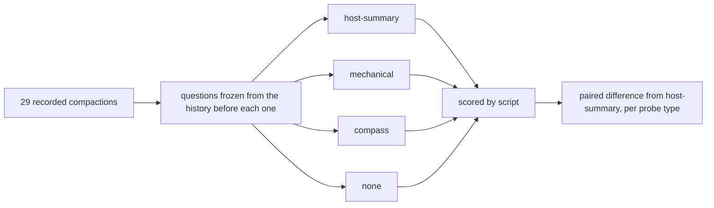

# Probe arm comparison

> [!question] You decide
> Which of the Later tasks of [[plans/PLAN-033-compaction-keeps-the-session-state]] to run next. The numbers point four ways:
> 1. **Revise the state block (recommended first; not yet a task).** The block names edited files only when its size budget leaves room after the open tasks and decisions: 12 of 29 blocks end before the files section, and across all 29 the block lists 94 of the 583 files the questions expect. The block alone scores worse than the host summary on the pooled state score, and fixing the order or caps costs a rerun of two arms, no new arm.
> 2. **The `before` arm, TASK-434 (recommended second).** It gives the ceiling every other arm is read against; without it, 0.45 for the host summary has no frame.
> 3. **The `handoff` arm, TASK-338.** Worth running once the block is revised, so the handoff is compared with the best block.
> 4. **The judge, TASK-340 (recommended last).** The misses that remain are a wrong task id and a missing file, which exact match already grades; a judge helps free-text recall and decision, which have 9 and 13 points.
>
> The order is my recommendation; say if the handoff arm should come before the revision.

> [!summary] Result
> Adding the state block to the host summary names more of the edited files (0.52 against 0.45 over the session, 0.64 against 0.54 over the latest stretch, both intervals clear of zero) at about 2,000 more tokens. The block alone carries 2,095 tokens, 60% fewer than the host summary's 5,254, and scores lower than the host summary on every type except decision; only the pooled state score is clearly worse. Recall has too few points for any verdict.

## Method

Each arm gives a fresh model with no tools the same questions about a recorded compaction and a different carried text:

- **host-summary**: the summary the host wrote at that compaction.
- **none**: nothing. This is the floor.
- **mechanical**: the state block Compass renders from the transcript and git history as they stood at that compaction, with no model call.
- **compass**: the host summary followed by the state block, the order a Compass session holds them after a compaction. At a subagent compaction it carries the summary alone, since the session-start hook prints nothing there.

Probe types: `artifact` is the share of the edited files named, over the whole session; `artifact-recent` the same over the edits since the previous compaction; `recall` an error line or failed-test count from a failing tool result; `continuation` the task or plan id in hand; `decision` the option the human last chose; `state` the mean of a point's recall, continuation and decision scores. A paired interval is the 95% bootstrap interval of the mean difference from host-summary over the points both arms were asked, resampling points with replacement.

The pool is 29 of the 30 recorded points. The 8 pilot points keep the pilot's host-summary and none replies, regraded under the current recall rule; the other 21 were asked in all four arms. The 30th point has no state block, since its working folder is gone, so it is left out of every arm. Every point asked rendered a block: no point is no-state in any arm.

## Report

| arm | probe | points | mean score | unparsed | mean carried tokens |
|---|---|---|---|---|---|
| compass | artifact | 29 | 0.52 | 0 | 7238 |
| compass | artifact-recent | 24 | 0.64 | 0 | 7238 |
| compass | recall | 9 | 0.11 | 0 | 7238 |
| compass | continuation | 19 | 0.32 | 0 | 7238 |
| compass | decision | 13 | 0.85 | 0 | 7238 |
| compass | state | 20 | 0.47 | 0 | 7238 |
| host-summary | artifact | 29 | 0.45 | 0 | 5254 |
| host-summary | artifact-recent | 24 | 0.54 | 0 | 5254 |
| host-summary | recall | 9 | 0.11 | 0 | 5254 |
| host-summary | continuation | 19 | 0.37 | 0 | 5254 |
| host-summary | decision | 13 | 0.54 | 0 | 5254 |
| host-summary | state | 20 | 0.44 | 0 | 5254 |
| mechanical | artifact | 29 | 0.28 | 0 | 2095 |
| mechanical | artifact-recent | 24 | 0.31 | 0 | 2095 |
| mechanical | recall | 9 | 0.00 | 0 | 2095 |
| mechanical | continuation | 19 | 0.21 | 0 | 2095 |
| mechanical | decision | 13 | 0.38 | 0 | 2095 |
| mechanical | state | 20 | 0.26 | 0 | 2095 |
| none | artifact | 29 | 0.00 | 0 | 0 |
| none | artifact-recent | 24 | 0.00 | 0 | 0 |
| none | recall | 9 | 0.00 | 0 | 0 |
| none | continuation | 19 | 0.05 | 0 | 0 |
| none | decision | 13 | 0.00 | 0 | 0 |
| none | state | 20 | 0.02 | 0 | 0 |

Paired differences from host-summary:

| arm | probe | pairs | mean difference from host-summary | 95% paired interval |
|---|---|---|---|---|
| compass | artifact | 29 | 0.07 | [0.01, 0.15] |
| compass | artifact-recent | 24 | 0.10 | [0.00, 0.23] |
| compass | recall | 9 | 0.00 | too few points |
| compass | continuation | 19 | -0.05 | [-0.21, 0.11] |
| compass | decision | 13 | 0.31 | [0.00, 0.62] |
| compass | state | 20 | 0.02 | [-0.12, 0.14] |
| mechanical | artifact | 29 | -0.16 | [-0.37, 0.05] |
| mechanical | artifact-recent | 24 | -0.23 | [-0.49, 0.04] |
| mechanical | recall | 9 | -0.11 | too few points |
| mechanical | continuation | 19 | -0.16 | [-0.37, 0.00] |
| mechanical | decision | 13 | -0.15 | [-0.62, 0.31] |
| mechanical | state | 20 | -0.18 | [-0.36, -0.02] |
| none | artifact | 29 | -0.45 | [-0.60, -0.31] |
| none | artifact-recent | 24 | -0.54 | [-0.68, -0.39] |
| none | recall | 9 | -0.11 | too few points |
| none | continuation | 19 | -0.32 | [-0.53, -0.11] |
| none | decision | 13 | -0.54 | [-0.77, -0.23] |
| none | state | 20 | -0.42 | [-0.59, -0.27] |

## Tokens carried

Carried tokens are a session's input-side tokens minus the `none` session's at the same point.

| arm | mean carried tokens | against host-summary |
|---|---|---|
| none | 0 | fewer |
| mechanical | 2,095 | fewer (60% fewer) |
| host-summary | 5,254 | reference |
| compass | 7,238 | more (38% more) |

No-state points: 0 in every arm.

## Verdicts

Better means the interval's low end is above 0, worse its high end is below 0, otherwise not distinguishable. A type under 10 pairs gets no verdict.

| arm | probe | pairs | verdict against host-summary |
|---|---|---|---|
| compass | artifact | 29 | better (low end 0.007) |
| compass | artifact-recent | 24 | better (low end 0.002) |
| compass | continuation | 19 | not distinguishable |
| compass | decision | 13 | not distinguishable (low end exactly 0) |
| compass | state | 20 | not distinguishable |
| compass | recall | 9 | no verdict, too few points |
| mechanical | artifact | 29 | not distinguishable |
| mechanical | artifact-recent | 24 | not distinguishable |
| mechanical | continuation | 19 | not distinguishable (high end exactly 0) |
| mechanical | decision | 13 | not distinguishable |
| mechanical | state | 20 | worse (high end -0.017) |
| mechanical | recall | 9 | no verdict, too few points |

- **compass** names more edited files than the host summary alone, at 38% more carried tokens. Both gains have low ends within 0.01 of zero, so they are marginal. Its decision mean is 0.85 against 0.54, an interval whose low end sits exactly at zero.
- **mechanical** carries 60% fewer tokens than the host summary and loses on the pooled state score. On the other types its means sit below the host summary's and the intervals span 0.

## What the block holds

The state block ends at the first section that does not fit its 7,900-character budget, in this order: last request, open tasks, decisions, files edited, files read, uncommitted changes, last test run, branch. Of the 29 blocks, 12 end after the decisions, so they name no edited file; 17 hold a files section. Across all 29, the block lists 94 of the 583 edited files the artifact questions expect. The block's low artifact score therefore follows from what it leaves out, and a score for a block that always lists its files is not yet measured.

## Cost

100 sessions: 62 on Opus 5.5, 32 on Haiku 5.5 and 6 on Sonnet 5. The Opus 5.5 sessions weigh 965,175 tokens (raw: 124 input, 39,718 output, 40,238 cache read, 611,559 cache write); the pilot's 10 Opus sessions, whose replies are reused here, weighed 125,341.

The price table holds no weight for Haiku 5.5 or Sonnet 5, so the weighted total undercounts the run: it counts none of the 38 sessions on those models. Their raw tokens:

| model | sessions | input | output | cache read | cache write |
|---|---|---|---|---|---|
| Haiku 5.5 | 32 | 64 | 9,360 | 20,768 | 250,606 |
| Sonnet 5 | 6 | 12 | 562 | 21,090 | 91,955 |

## Not yet run

- The `handoff` arm (a headless session writes a handoff from the history before the compaction) and the `before` arm (the model holds the history itself, the KPI's reference) are not yet run, so the comparison holds no handoff or before-the-boundary figure.
- Recall has 9 points and no verdict; it waits for more points or for a judge that grades free text.
