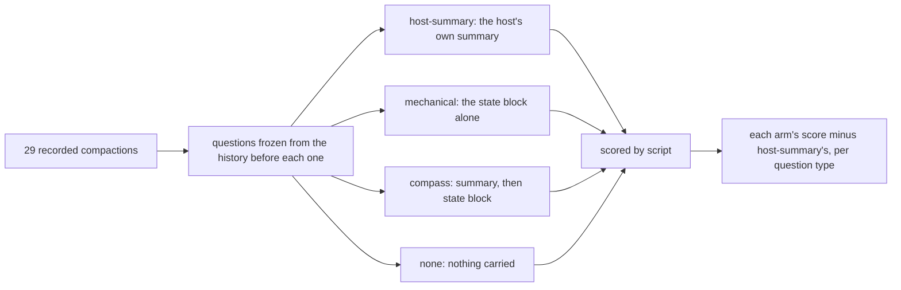

# Probe arm comparison

> [!success] Approved 2026-11-24: the next steps run in the recommended order: revise the state block so it always lists edited files, then the `before` arm (TASK-434), the `handoff` arm (TASK-338), and the judge (TASK-340). The reasons are in [[#Options for the next step]].

> [!NOTE] Result
> The state block (the session state Compass writes out mechanically) was measured in three forms. In its latest form ([[#Rerun with the task in progress]]), which lists the edited files and names the task in progress, the block alone names the task the session was on far more often than the host summary (the summary the host program writes at a compaction): 0.89 against 0.37, at 2,722 tokens against 5,254. The host summary plus the block names more edited files (0.68 against 0.45) and more chosen options (0.92 against 0.54). On the pooled state score (recall, continuation and decision averaged together) neither is distinguishable from the host summary. Recall has too few points for any verdict.
>
> In the first run, which the sections from [[#Report]] to [[#Options for the next step]] describe, adding the block to the host summary named more of the edited files (0.52 against 0.45 over the session, 0.64 against 0.54 over the latest stretch, both intervals clear of zero) at about 2,000 more tokens. The block alone carried 2,095 tokens, 60% fewer than the host summary's 5,254, and scored lower than the host summary on every question type except decision; only the pooled state score was clearly worse. Every term is defined in [[#Terms]] and [[#Method]].

## Terms

- **Compaction**: the moment the host (the program running the model session) shrinks a long session's history to fit the model's context. A **recorded compaction**, or **point**, is one such moment saved from a real session, with the history as it stood just before.
- **Host summary**: the summary the host itself writes at a compaction; after it, the model sees this summary in place of the history.
- **State block**: a text Compass builds from the session transcript and git history with no model call: the last request, open tasks, decisions, files edited and read, uncommitted changes, last test run and branch.
- **Probe**: one question about the session before the compaction, asked to a fresh model holding only a carried text. Its answer is scored by script against what the history shows.
- **Arm**: one choice of carried text. Every arm is asked the same probes, so arms compare directly.
- **Carried tokens**: how much text an arm hands the model, in tokens.
- **Pilot**: the earlier, smaller run of these probes ([[research/pipeline/compaction-survival/RESEARCH-probe-pilot]]).
- **Headless**: run by a script with no person at the keyboard.
- **Main session and subagents**: the session the human talks to is the main session; a subagent is a helper session it starts for one job, with a transcript of its own.
- **Budget and floor**: the state block is held to 7,900 characters, its budget. A section's floor is the share of that budget it always gets when it has that much to say.
- **Open tasks**: the unchecked task lines of the project's task list, in the order that list holds them, which is oldest first.
- **Task id**: an id of the form TASK-N (one task) or PLAN-N (one plan).
- **First run and reruns**: the block arms were asked three times, with three forms of the block: the first run, the rerun with the revised block, and the rerun with the task in progress. The `host-summary` and `none` replies were asked once.

## Method

Each arm gives a fresh model with no tools the same questions about a recorded compaction and a different carried text:

- **host-summary**: the summary the host wrote at that compaction.
- **none**: nothing. This is the floor.
- **mechanical**: the state block Compass renders from the transcript and git history as they stood at that compaction, with no model call.
- **compass**: the host summary followed by the state block, the order a Compass session holds them after a compaction. At a subagent compaction it carries the summary alone, since the session-start hook prints nothing there.

Probe types (each scored from 0 to 1):

- `artifact`: the share of the files edited over the whole session that the answer names.
- `artifact-recent`: the same share, counting only the files edited since the previous compaction (the latest stretch of the session).
- `recall`: an error line or failed-test count from a failing tool result.
- `continuation`: the task or plan id in hand.
- `decision`: the option the human last chose.
- `state`, also called the **pooled state score**: the mean of a point's recall, continuation and decision scores, which pools those three small types into one larger sample.

A **paired interval** is the 95% bootstrap interval of the mean difference from host-summary over the points both arms were asked, resampling points with replacement. In plain words: each point is scored under both arms, the differences are averaged, and the interval is the range that average would likely fall in on another sample of points. An interval entirely above zero means the arm reliably beats the host summary.

The pool is 29 of the 30 recorded points. The 8 pilot points keep the pilot's host-summary and none replies, graded under the same recall rule as the rest; the other 21 were asked in all four arms. The 30th point has no state block, since its working folder is gone, so it is left out of every arm. Every point asked rendered a block, so no point in any arm lacks a state block (a **no-state** point).

## Report

`points` counts the points that asked that probe type; `unparsed` counts answers the scoring script could not read.

| arm | probe | points | mean score | unparsed | mean carried tokens |
|---|---|---|---|---|---|
| compass | artifact | 29 | 0.52 | 0 | 7238 |
| compass | artifact-recent | 24 | 0.64 | 0 | 7238 |
| compass | recall | 9 | 0.11 | 0 | 7238 |
| compass | continuation | 19 | 0.32 | 0 | 7238 |
| compass | decision | 13 | 0.85 | 0 | 7238 |
| compass | state | 20 | 0.47 | 0 | 7238 |
| host-summary | artifact | 29 | 0.45 | 0 | 5254 |
| host-summary | artifact-recent | 24 | 0.54 | 0 | 5254 |
| host-summary | recall | 9 | 0.11 | 0 | 5254 |
| host-summary | continuation | 19 | 0.37 | 0 | 5254 |
| host-summary | decision | 13 | 0.54 | 0 | 5254 |
| host-summary | state | 20 | 0.44 | 0 | 5254 |
| mechanical | artifact | 29 | 0.28 | 0 | 2095 |
| mechanical | artifact-recent | 24 | 0.31 | 0 | 2095 |
| mechanical | recall | 9 | 0.00 | 0 | 2095 |
| mechanical | continuation | 19 | 0.21 | 0 | 2095 |
| mechanical | decision | 13 | 0.38 | 0 | 2095 |
| mechanical | state | 20 | 0.26 | 0 | 2095 |
| none | artifact | 29 | 0.00 | 0 | 0 |
| none | artifact-recent | 24 | 0.00 | 0 | 0 |
| none | recall | 9 | 0.00 | 0 | 0 |
| none | continuation | 19 | 0.05 | 0 | 0 |
| none | decision | 13 | 0.00 | 0 | 0 |
| none | state | 20 | 0.02 | 0 | 0 |

Paired differences from host-summary:

| arm | probe | pairs | mean difference from host-summary | 95% paired interval |
|---|---|---|---|---|
| compass | artifact | 29 | 0.07 | [0.01, 0.15] |
| compass | artifact-recent | 24 | 0.10 | [0.00, 0.23] |
| compass | recall | 9 | 0.00 | too few points |
| compass | continuation | 19 | -0.05 | [-0.21, 0.11] |
| compass | decision | 13 | 0.31 | [0.00, 0.62] |
| compass | state | 20 | 0.02 | [-0.12, 0.14] |
| mechanical | artifact | 29 | -0.16 | [-0.37, 0.05] |
| mechanical | artifact-recent | 24 | -0.23 | [-0.49, 0.04] |
| mechanical | recall | 9 | -0.11 | too few points |
| mechanical | continuation | 19 | -0.16 | [-0.37, 0.00] |
| mechanical | decision | 13 | -0.15 | [-0.62, 0.31] |
| mechanical | state | 20 | -0.18 | [-0.36, -0.02] |
| none | artifact | 29 | -0.45 | [-0.60, -0.31] |
| none | artifact-recent | 24 | -0.54 | [-0.68, -0.39] |
| none | recall | 9 | -0.11 | too few points |
| none | continuation | 19 | -0.32 | [-0.53, -0.11] |
| none | decision | 13 | -0.54 | [-0.77, -0.23] |
| none | state | 20 | -0.42 | [-0.59, -0.27] |

## Tokens carried

Carried tokens are a session's input-side tokens minus the `none` session's at the same point.

| arm | mean carried tokens | against host-summary |
|---|---|---|
| none | 0 | fewer |
| mechanical | 2,095 | fewer (60% fewer) |
| host-summary | 5,254 | reference |
| compass | 7,238 | more (38% more) |

No-state points: 0 in every arm.

## Verdicts

Better means the interval's low end is above 0, worse its high end is below 0, otherwise not distinguishable. A type under 10 pairs gets no verdict.

| arm | probe | pairs | verdict against host-summary |
|---|---|---|---|
| compass | artifact | 29 | better (low end 0.007) |
| compass | artifact-recent | 24 | better (low end 0.002) |
| compass | continuation | 19 | not distinguishable |
| compass | decision | 13 | not distinguishable (low end exactly 0) |
| compass | state | 20 | not distinguishable |
| compass | recall | 9 | no verdict, too few points |
| mechanical | artifact | 29 | not distinguishable |
| mechanical | artifact-recent | 24 | not distinguishable |
| mechanical | continuation | 19 | not distinguishable (high end exactly 0) |
| mechanical | decision | 13 | not distinguishable |
| mechanical | state | 20 | worse (high end -0.017) |
| mechanical | recall | 9 | no verdict, too few points |

- **compass** names more edited files than the host summary alone, at 38% more carried tokens. Both gains have low ends within 0.01 of zero, so they are marginal. Its decision mean is 0.85 against 0.54, an interval whose low end sits exactly at zero.
- **mechanical** carries 60% fewer tokens than the host summary and loses on the pooled state score. On the other types its means sit below the host summary's and the intervals span 0.

## What the block holds

The state block ends at the first section that does not fit its 7,900-character budget, in this order: last request, open tasks, decisions, files edited, files read, uncommitted changes, last test run, branch. Of the 29 blocks, 12 end after the decisions, so they name no edited file; 17 hold a files section. Across all 29, the block lists 94 of the 583 edited files the artifact questions expect. The block's low artifact score therefore follows from what it leaves out, and a score for a block that always lists its files is not yet measured.

## Options for the next step

The open steps of [[plans/PLAN-033-compaction-keeps-the-session-state]], in the recommended order:

1. **Revise the state block (recommended first; not yet a task in the plan).** The block names edited files only when its size budget leaves room after the open tasks and decisions: 12 of 29 blocks end before the files section, and across all 29 the block lists 94 of the 583 files the questions expect. The block alone scores worse than the host summary on the pooled state score, and fixing the order or caps costs a rerun of two arms, no new arm.
2. **The `before` arm, TASK-434 (recommended second).** The model holds the history itself, with no compaction, which gives the ceiling every other arm is read against; without it, 0.45 for the host summary has no frame.
3. **The `handoff` arm, TASK-338.** A headless session writes a handoff (notes to resume a session) from the history before the compaction, and that handoff is the carried text. Worth running once the block is revised, so the handoff is compared with the best block. Running it before the revision is the alternative order.
4. **The judge, TASK-340 (recommended last).** A judge is a model that grades free-text answers. The misses that remain are a wrong task id and a missing file, which exact match (the script comparing the answer to the expected text) already grades; a judge helps free-text recall and decision, which have 9 and 13 points.

## Cost

100 sessions: 62 on Opus 5.5, 32 on Haiku 5.5 and 6 on Sonnet 5. Each session is one fresh model answering one arm's probes at one point; sessions are tool-less, so the model only reads and answers. Weighted tokens count each kind of token at its price relative to the others, from a price table. The Opus 5.5 sessions weigh 965,175 tokens (raw: 124 input, 39,718 output, 40,238 cache read, 611,559 cache write); the pilot's 10 Opus sessions, whose replies are reused here, weighed 125,341.

The price table holds no weight for Haiku 5.5 or Sonnet 5, so the weighted total undercounts the run: it counts none of the 38 sessions on those models. Their raw tokens:

| model | sessions | input | output | cache read | cache write |
|---|---|---|---|---|---|
| Haiku 5.5 | 32 | 64 | 9,360 | 20,768 | 250,606 |
| Sonnet 5 | 6 | 12 | 562 | 21,090 | 91,955 |

## Arms on the reference page

The `before` arm (the model holds the history before the compaction itself, the reference the compaction-survival measure is read against), the `handoff` arm (a session holding that history writes a handoff, and the questions are asked against it) and the judge (a model that grades the free-text answers) are reported in [[research/pipeline/compaction-survival/RESEARCH-probe-reference-arms]]. Recall has 9 points and no verdict in any arm.

## Rerun with the revised block

> [!NOTE] Result
> With the revised block, which gives every section a share of its size budget and lists the main session's edited files ahead of its subagents', `compass` names clearly more edited files than the host summary alone (0.67 against 0.45 over the session, interval [0.12, 0.32]) and `mechanical` alone names more than before (0.52 against 0.28). The block alone lost ground on continuation (0.05 against 0.21 in the first run), so its pooled state score is now further below the host summary's.

The same 29 points, the same frozen questions and the same models; only the `mechanical` and `compass` arms were asked again, 58 sessions. The `host-summary` and `none` replies are those of the first run. The first run's block replies are kept beside the new ones.

What changed in the block: each section holds a floor of the 7,900-character budget (open tasks 2,000, decisions 1,200, files edited 3,000, files read 300, uncommitted changes 300, last test run 400, the request and the branch whole), the characters a section leaves unused go to files edited first, and no section ends the block. The files list puts the edits the main session made itself first, then the edits only its subagents made; before, subagent edits came first and filled the list.

**Files the block lists.** Counting the expected paths a block's files-edited section names, compared as the grader compares paths: the first run's blocks listed 64 of 583, the revised blocks 350 of 583. (The 94 above counted paths anywhere in the block.) Every revised block holds a files section; 12 of the first run's did not.

| arm | probe | points | first run | rerun | rerun minus host-summary | 95% paired interval |
|---|---|---|---|---|---|---|
| compass | artifact | 29 | 0.52 | 0.67 | 0.22 | [0.12, 0.32] |
| compass | artifact-recent | 24 | 0.64 | 0.73 | 0.20 | [0.08, 0.33] |
| compass | recall | 9 | 0.11 | 0.11 | 0.00 | too few points |
| compass | continuation | 19 | 0.32 | 0.32 | -0.05 | [-0.21, 0.11] |
| compass | decision | 13 | 0.85 | 0.85 | 0.31 | [0.00, 0.62] |
| compass | state | 20 | 0.47 | 0.47 | 0.03 | [-0.12, 0.16] |
| mechanical | artifact | 29 | 0.28 | 0.52 | 0.07 | [-0.17, 0.29] |
| mechanical | artifact-recent | 24 | 0.31 | 0.70 | 0.17 | [-0.06, 0.37] |
| mechanical | recall | 9 | 0.00 | 0.00 | -0.11 | too few points |
| mechanical | continuation | 19 | 0.21 | 0.05 | -0.32 | [-0.53, -0.11] |
| mechanical | decision | 13 | 0.38 | 0.31 | -0.23 | [-0.69, 0.23] |
| mechanical | state | 20 | 0.26 | 0.12 | -0.32 | [-0.52, -0.13] |

The host summary's own means are unchanged: artifact 0.45, artifact-recent 0.54, recall 0.11, continuation 0.37, decision 0.54, state 0.44.

| arm | mean carried tokens, first run | rerun | against host-summary's 5,254 |
|---|---|---|---|
| mechanical | 2,095 | 2,717 | 48% fewer |
| compass | 7,238 | 7,860 | 50% more |

Verdicts against `host-summary`, by the rule in [[#Verdicts]]:

- **compass**: better on artifact (low end 0.12) and artifact-recent (low end 0.08), both clear of zero where the first run's were within 0.01 of it; not distinguishable on continuation, decision (low end exactly 0) and state; recall gets no verdict.
- **mechanical**: not distinguishable on artifact and artifact-recent; worse on continuation (high end -0.11) and on state (high end -0.13); not distinguishable on decision; recall gets no verdict.

**The continuation loss.** The task id the continuation question expects appears in 9 of the 19 revised blocks against 11 of the first run's, yet the block-alone answers name it at 1 point against 4. With a longer files list the answerer picks an id from elsewhere in the block more often. The `compass` arm, which also holds the host summary, keeps its continuation score.

No-state points: 0 in both arms.

**Cost.** 58 sessions: 36 on Opus 5.5, 16 on Haiku 5.5 and 6 on Sonnet 5. The Opus sessions weigh 850,530 tokens (raw: 72 input, 62,223 output, 23,364 cache read, 430,540 cache write). Haiku 5.5 and Sonnet 5 have no weight in the price table; their raw tokens are 32 input, 5,823 output, 10,384 cache read and 136,323 cache write (Haiku), and 12 input, 560 output, 21,090 cache read and 91,965 cache write (Sonnet).

## Rerun with the task in progress

> [!NOTE] Result
> With a line naming the task in progress, the block alone names the task the session was on at 17 of 19 points (0.89, against 0.05 with the revised block and 0.37 for the host summary; interval [0.26, 0.79]). The host summary plus the block, `compass`, gains less (0.42), because with both texts the answerer mostly follows the summary. The pooled state score is not distinguishable from the host summary's for either arm. The line is built by the same rule that sets the expected answer, so this run shows that the answerer reads the line; whether that rule picks the task the human meant is not measured.

**Why the revised block lost continuation.** The continuation question asks for the task id the assistant last named as the work in hand. With the revised block, the block-alone answers named it at 1 of 19 points against 4 in the first run. Three points went from right to wrong; the stored blocks and replies at those points show why:

- At one point the task's line was gone. The open tasks list oldest first, and the revised block gives the characters left over to files edited before open tasks, so that section was cut to its 2,000-character floor (2,226 characters whole in the first run) and the task in hand, near the end of the list, fell off.
- At the other two the task's line stood unchanged. One block was byte-identical in both runs and the answer still changed; at the other the open tasks matched and the answer named a plan id taken from a file name in the longer files list.

Underneath all three: no line said which open task was in hand. The expected id sat somewhere in 11 of the 19 first-run blocks and 9 of the revised ones, yet the answers named it at 4 and 1.

**What changed in the block.** A section `## Task in progress` prints right after the last human request. It holds the last task id in the assistant's own messages of the main session (not the human's messages, tool calls, tool results or subagents), shown as its open-task line when the open tasks hold one, else the id alone. It is never cut. Rendered at the 29 points, it names the expected id at 18 of the 19 points with a continuation question. Nothing else changed: the revised block's floors, its files order and its 7,900-character budget stay.

The same 29 points, frozen questions and models; only `mechanical` and `compass` were asked again, 58 sessions. Files listed by the blocks: 350 of 583 expected (`compass` 342 of 575, since it carries no block at the subagent points), as in the rerun with the revised block.

| arm | probe | points | first run | revised block | task in progress | minus host-summary | 95% paired interval |
|---|---|---|---|---|---|---|---|
| compass | artifact | 29 | 0.52 | 0.67 | 0.68 | 0.23 | [0.14, 0.34] |
| compass | artifact-recent | 24 | 0.64 | 0.73 | 0.74 | 0.20 | [0.07, 0.34] |
| compass | recall | 9 | 0.11 | 0.11 | 0.11 | 0.00 | too few points |
| compass | continuation | 19 | 0.32 | 0.32 | 0.42 | 0.05 | [-0.11, 0.21] |
| compass | decision | 13 | 0.85 | 0.85 | 0.92 | 0.38 | [0.15, 0.62] |
| compass | state | 20 | 0.47 | 0.47 | 0.53 | 0.09 | [-0.07, 0.22] |
| mechanical | artifact | 29 | 0.28 | 0.52 | 0.47 | 0.02 | [-0.22, 0.25] |
| mechanical | artifact-recent | 24 | 0.31 | 0.70 | 0.66 | 0.12 | [-0.10, 0.33] |
| mechanical | recall | 9 | 0.00 | 0.00 | 0.00 | -0.11 | too few points |
| mechanical | continuation | 19 | 0.21 | 0.05 | 0.89 | 0.53 | [0.26, 0.79] |
| mechanical | decision | 13 | 0.38 | 0.31 | 0.31 | -0.23 | [-0.69, 0.23] |
| mechanical | state | 20 | 0.26 | 0.12 | 0.53 | 0.09 | [-0.13, 0.31] |

The last two columns compare the task-in-progress run with `host-summary`. The host summary's means are those of the first run: artifact 0.45, artifact-recent 0.54, recall 0.11, continuation 0.37, decision 0.54, state 0.44. `mechanical`'s files score moved from 0.52 to 0.47 with the same files listed, the spread of asking the same text twice.

Verdicts against `host-summary`, by the rule in [[#Verdicts]]:

- **mechanical**: better on continuation (low end 0.26); not distinguishable on artifact, artifact-recent, decision and state; recall gets no verdict.
- **compass**: better on artifact (low end 0.14), artifact-recent (low end 0.07) and decision (low end 0.15, where it sat exactly at zero in both earlier runs); not distinguishable on continuation and state; recall gets no verdict.

**The summary leads when both texts are present.** At 9 points `mechanical` named the right task and `compass` did not; at 8 of them `compass` gave the same answer as `host-summary`.

| arm | mean carried tokens | against host-summary's 5,254 |
|---|---|---|
| mechanical | 2,722 | 48% fewer |
| compass | 7,865 | 50% more |

No-state points: 0 in both arms.

**Cost.** 58 sessions: 36 on Opus 5.5, 16 on Haiku 5.5 and 6 on Sonnet 5. The Opus sessions weigh 862,788 tokens (raw: 72 input, 64,598 output, 23,364 cache read, 430,846 cache write). Haiku 5.5 and Sonnet 5 have no weight in the price table; their raw tokens are 32 input, 6,178 output, 10,384 cache read and 136,329 cache write (Haiku), and 12 input, 568 output, 21,090 cache read and 91,961 cache write (Sonnet).
