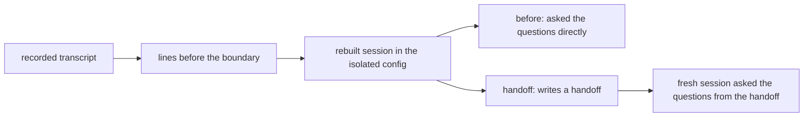

# Probe reference arms

The probe arms of [[research/pipeline/compaction-survival/RESEARCH-probe-arm-comparison]] each hand a fresh model a carried text. The two arms here need the history before the compaction itself: `before`, the reference the compaction-survival measure reads every arm against, and `handoff`, where a session holding that history writes the handoff. The last section adds a judge for the free-text answers.

## Terms

- **Compaction and boundary**: a compaction is the moment the host (the program running the model session) shrinks a long session's history to fit the model's context; the boundary is the record it writes there. A **point** is one recorded compaction, with the history as it stood just before.
- **Probe**: one question about the session before the compaction, scored from 0 to 1 by script against what the history shows. The types: `artifact`, the share of the files edited over the session that the answer names; `artifact-recent`, the same share over the files edited since the previous compaction; `recall`, an error line or failed-test count from a failing command; `continuation`, the task id (TASK-N or PLAN-N) in hand; `decision`, the option the human last chose; and `state`, the **pooled state score**, a point's recall, continuation and decision scores averaged.
- **Arm**: one choice of what the answering model holds. `host-summary`: the summary the host wrote at the compaction. `none`: nothing. `mechanical`: the state block, a text Compass builds from the transcript, the task list and git with no model call (last request, task in progress, open tasks, decisions, files edited and read, last test run, branch). `compass`: the host summary followed by the state block, as a Compass session holds them after a compaction. `before` and `handoff` are this page's arms.
- **Carried tokens**: how many tokens the arm hands the answering model: its input tokens minus those of the `none` session at the same point.
- **Paired interval**: the 95% bootstrap interval of the mean difference between two arms over the points both were asked, resampling points. **Better** means its low end is above 0, **worse** its high end below 0, otherwise **not distinguishable**; under 10 pairs a type gets no verdict ("too few points").
- **Share of `before`**: an arm's mean as a percentage of the `before` arm's mean on the same type.
- **Headless**: run by a script with no person at the keyboard (`claude -p`).
- **Handoff**: the notes Compass's handoff skill writes so a later session can resume the work; its template holds, among others, four sections Compass fills mechanically (tasks, recent changes, decisions, uncommitted changes).
- **Sandbox project and isolated config**: a throwaway project folder and a Claude configuration of the probe's own, so no session sees the real project or the human's settings. A **tool-less** session (`--tools ""`) can only read its prompt and answer.
- **Weighted tokens**: tokens counted at their price relative to each other, from a price table; cache read and cache write are the tokens a session reads from and writes to the host's prompt cache.

## Rebuilt session

> [!NOTE] Result
> A session rebuilt at a compaction point loads headless. The history before the boundary, written as a session of a fresh sandbox project in the isolated Claude config, resumed with `claude -p --resume <id> --tools ""`, and the model answered from it.

- **How it is rebuilt.** `probe.py`'s `rebuild` copies the records on the boundary's side that come before it into a new session file of the sandbox project, with a new session id and the project folder as each record's working folder. The recorded transcript is only read.
- **The check.** One run on the recorded point with the smallest history (61,617 tokens before its compaction, on Haiku 5.5). Asked to quote the start of the last message the human typed, the model quoted it, matched by script against the history.
- **The history loaded whole.** The answering turn wrote 61,568 tokens to the cache, the size of the history before the compaction. The history's tool calls and results loaded under `--tools ""` with no error.
- **Cost.** One session: 38,883 input, 4,133 output, 119,590 cache read and 170,607 cache write tokens on Haiku 5.5, which the price table does not weigh. The answering turn accounts for 61,568 of the cache writes; the rest come from the session's other calls.

So the `before` and `handoff` arms resume the rebuilt session; neither needs the history rendered as text.

## The before arm

> [!NOTE] Result
> Holding the history itself, the model scores 0.62 on edited files, 0.82 on the latest stretch's files, 0.68 on continuation and 0.63 on the pooled state score. The host summary keeps 73% of the first, 66% of the second and 54% of continuation. The host summary plus the revised block names as many edited files as the history does (0.67 against 0.62, interval spanning zero) but keeps continuation at 0.32 against 0.68.

The same 29 points and frozen questions. Each session resumes the point's rebuilt history with no tools and is asked the questions; the host loads that history from the last earlier compaction on, as it does in a live session. The arm ran twice: the first run's means are within 0.02 of the second's on every type (artifact 0.61, artifact-recent 0.84, continuation 0.68, decision 0.77, state 0.63), and its token counts are unusable (see Cost), so the tables hold the second run.

| probe | points | before | host-summary | mechanical | compass | handoff |
|---|---|---|---|---|---|---|
| artifact | 29 | 0.62 | 0.45 (73%) | 0.52 (84%) | 0.67 (108%) | 0.68 (110%) |
| artifact-recent | 24 | 0.82 | 0.54 (66%) | 0.70 (85%) | 0.73 (89%) | 0.73 (89%) |
| recall | 9 | 0.11 | 0.11 | 0.00 | 0.11 | 0.00 |
| continuation | 19 | 0.68 | 0.37 (54%) | 0.05 (7%) | 0.32 (47%) | 0.37 (54%) |
| decision | 13 | 0.77 | 0.54 (70%) | 0.31 (40%) | 0.85 (110%) | 0.62 (81%) |
| state | 20 | 0.63 | 0.44 (70%) | 0.12 (19%) | 0.47 (75%) | 0.41 (65%) |

Each arm's mean, with its share of `before`'s in brackets; `mechanical` and `compass` are the revised block's ([[research/pipeline/compaction-survival/RESEARCH-probe-arm-comparison#Rerun with the revised block]]). Recall, at 9 points, gets no share.

Paired differences, `before` minus `host-summary`:

| probe | pairs | mean difference | 95% paired interval |
|---|---|---|---|
| artifact | 29 | 0.17 | [0.06, 0.29] |
| artifact-recent | 24 | 0.28 | [0.15, 0.43] |
| continuation | 19 | 0.32 | [0.11, 0.53] |
| decision | 13 | 0.23 | [0.00, 0.46] |
| state | 20 | 0.19 | [0.08, 0.32] |

Paired differences, `compass` minus `before`:

| probe | pairs | mean difference | 95% paired interval |
|---|---|---|---|
| artifact | 29 | 0.05 | [-0.08, 0.17] |
| artifact-recent | 24 | -0.09 | [-0.22, 0.01] |
| continuation | 19 | -0.37 | [-0.58, -0.16] |
| decision | 13 | 0.08 | [-0.31, 0.38] |
| state | 20 | -0.16 | [-0.30, -0.03] |

- The host summary loses to the history on every type with enough points: the low ends lie above zero for artifact, artifact-recent, continuation and state, and at exactly zero for decision.
- `compass` is not distinguishable from the history on files and decision, and worse on continuation and state.
- Carried tokens: 210,378 on average, the history before the compaction from the last earlier one on, against 5,254 for the host summary.

**Cost.** 29 sessions per run, 18 on Opus 5.5, 8 on Haiku 5.5 and 3 on Sonnet 5. A resumed session's result reports, beside its own usage, the usage its resumed history recorded (up to 300,000 output tokens for a one-turn answer), so the first run's stored counts measure the recorded sessions, not this one; `probe.py` now reads a resumed session's own usage. The second run read the histories the first run had cached: its Opus sessions weigh 364,147 tokens (raw: 36 input, 15,983 output, 5,263,069 cache read, 16,834 cache write). The first run wrote those histories to the cache: about 5.3 million cache-write tokens on Opus, the amount the second run read back, about 6.6 million weighted. Haiku 5.5 and Sonnet 5 have no weight in the price table; the second run's raw tokens on them are 16 input, 1,865 output, 534,652 cache read and 1,449 cache write (Haiku), and 6 input, 809 output, 23,944 cache read and 464,492 cache write (Sonnet).

## The handoff arm

> [!NOTE] Result
> A handoff written by a session holding the history, with the mechanical sections pasted in, scores like the host summary plus the revised block: 0.68 against 0.67 on edited files, intervals spanning zero on every type. It beats the host summary on files (+0.23, interval [0.12, 0.35]) and on the latest stretch's files, ties it on continuation and the pooled state score, and carries about the same tokens (5,488 against 5,254). It costs a model writing the handoff at every compaction, which the block does not.

Two sessions per point. The writer resumes the rebuilt history with no tools and is given step 6 of the handoff skill (its instruction and its template) and the four sections `compass session-state --format handoff` prints for the point at its boundary, to paste verbatim. The answerer is a fresh session holding only the handoff it wrote. The handoffs ran 5,213 to 21,177 characters, 12,439 on average. No point lacked its sections.

Paired differences of `handoff`:

| probe | pairs | minus host-summary | minus compass | minus mechanical |
|---|---|---|---|---|
| artifact | 29 | 0.23 [0.12, 0.35] | 0.01 [-0.07, 0.10] | 0.16 [-0.02, 0.35] |
| artifact-recent | 24 | 0.19 [0.04, 0.36] | 0.00 [-0.08, 0.11] | 0.03 [-0.10, 0.18] |
| recall | 9 | -0.11, too few points | -0.11, too few points | 0.00, too few points |
| continuation | 19 | 0.00 [-0.16, 0.16] | 0.05 [0.00, 0.16] | 0.32 [0.11, 0.53] |
| decision | 13 | 0.08 [-0.38, 0.54] | -0.23 [-0.54, 0.08] | 0.31 [0.08, 0.62] |
| state | 20 | -0.03 [-0.20, 0.11] | -0.07 [-0.23, 0.10] | 0.28 [0.14, 0.43] |

- Against `host-summary`: better on artifact and artifact-recent, not distinguishable on continuation, decision and state.
- Against `compass`: not distinguishable on any type; continuation's low end sits exactly at zero.
- Against `mechanical`: better on continuation, decision and state; not distinguishable on files.

**Cost.** 58 sessions, 36 on Opus 5.5, 16 on Haiku 5.5 and 6 on Sonnet 5, counting writers by their own usage. The Opus sessions weigh 7,815,910 tokens (raw: 72 input, 180,531 output, 86,189 cache read, 5,527,099 cache write); the writers loading the history account for 5,295,749 of the cache writes. Haiku 5.5 and Sonnet 5 raw tokens: 32 input, 38,808 output, 30,656 cache read and 594,643 cache write (Haiku); 12 input, 16,274 output, 34,489 cache read and 503,518 cache write (Sonnet).

## The task-in-progress block against the before arm

> [!NOTE] Result
> With a line naming the task in progress, the block alone answers which task was in hand at 0.89 against the history's 0.68 (131% of `before`), but keeps 76% of the history's edited files and 40% of its chosen options. The host summary plus that block stays below the history on continuation (0.42, 62%).

The state block has had three forms: the first, which ended at the first section over its size budget; the revised block, which gives every section a share of the budget; and the third, which adds a line naming the task in progress. The block arms were asked again with the third form ([[research/pipeline/compaction-survival/RESEARCH-probe-arm-comparison#Rerun with the task in progress]]); the tables of the two sections above hold the revised block's figures. The `before` and `handoff` replies are unchanged.

| probe | points | before | mechanical | compass |
|---|---|---|---|---|
| artifact | 29 | 0.62 | 0.47 (76%) | 0.68 (110%) |
| artifact-recent | 24 | 0.82 | 0.66 (80%) | 0.74 (90%) |
| recall | 9 | 0.11 | 0.00 | 0.11 |
| continuation | 19 | 0.68 | 0.89 (131%) | 0.42 (62%) |
| decision | 13 | 0.77 | 0.31 (40%) | 0.92 (119%) |
| state | 20 | 0.63 | 0.53 (84%) | 0.53 (84%) |

Paired differences from `before` and from `handoff`, mean and 95% paired interval:

| probe | pairs | mechanical minus before | compass minus before | mechanical minus handoff | compass minus handoff |
|---|---|---|---|---|---|
| artifact | 29 | -0.14 [-0.36, 0.05] | 0.07 [-0.07, 0.19] | -0.21 [-0.39, -0.02] | 0.00 [-0.09, 0.07] |
| artifact-recent | 24 | -0.16 [-0.33, -0.03] | -0.09 [-0.22, 0.02] | -0.07 [-0.25, 0.09] | 0.00 [-0.11, 0.09] |
| recall | 9 | -0.11, too few points | 0.00, too few points | 0.00, too few points | 0.11, too few points |
| continuation | 19 | 0.21 [-0.05, 0.42] | -0.26 [-0.47, -0.11] | 0.53 [0.26, 0.79] | 0.05 [-0.11, 0.21] |
| decision | 13 | -0.46 [-0.85, 0.00] | 0.15 [-0.15, 0.46] | -0.31 [-0.62, -0.08] | 0.31 [0.08, 0.54] |
| state | 20 | -0.10 [-0.30, 0.09] | -0.10 [-0.24, 0.02] | 0.12 [-0.05, 0.28] | 0.12 [-0.05, 0.29] |

- `mechanical` against the history: worse on the latest stretch's files, not distinguishable elsewhere; decision's high end sits exactly at zero.
- `compass` against the history: worse on continuation only; with the revised block it was worse on the pooled state score too.
- Against the handoff, `mechanical` is better on continuation and worse on files and decision; `compass` is better on decision and not distinguishable elsewhere.

## The judge

> [!NOTE] Result
> A model judge of the free-text answers gives the same score as exact matching to 233 of 246 answers. It credits 11 answers the script scored 0 and lowers 2 the script scored 1, which moves means by up to 0.15 and changes no verdict against the host summary. Its agreement with a human's grading is pending: a sample of 40 answers waits for the human to grade.

**What the judge does.** The script grades recall, continuation and decision by exact match, so a paraphrased option or an error line cut short scores 0. The judge is one tool-less Opus 5.5 session per point. Its prompt holds each recall, continuation and decision question, the reference answer (the expected value frozen with the question), and every distinct answer the point's arms gave, numbered in an order shuffled per point, so the judge never sees which arm gave which answer. It grades each answer right (1), partly (0.5, part of the reference, such as an error name without its message) or wrong (0).

**The run.** 20 of the 29 points hold a free-text question; the other 9 started no session. The 20 sessions graded 148 distinct answers, which stand for 246 arm answers, since arms that gave the same answer share one verdict. 5 verdicts were partly.

Judged means beside the script's over the same answers:

| arm | recall (9) | continuation (19) | decision (13) | state (20) |
|---|---|---|---|---|
| before | 0.22 / 0.11 | 0.68 / 0.68 | 0.77 / 0.77 | 0.65 / 0.63 |
| compass | 0.06 / 0.11 | 0.42 / 0.42 | 1.00 / 0.92 | 0.53 / 0.53 |
| handoff | 0.00 / 0.00 | 0.37 / 0.37 | 0.77 / 0.62 | 0.46 / 0.41 |
| host-summary | 0.11 / 0.11 | 0.37 / 0.37 | 0.62 / 0.54 | 0.45 / 0.44 |
| mechanical | 0.00 / 0.00 | 0.89 / 0.89 | 0.46 / 0.31 | 0.58 / 0.53 |
| none | 0.00 / 0.00 | 0.05 / 0.05 | 0.15 / 0.00 | 0.07 / 0.02 |

Each cell is the judged mean, then the script's; the number beside each type is its points. `mechanical` and `compass` are the block in its third form.

Judged paired differences from `host-summary`:

| arm | continuation (19) | decision (13) | state (20) |
|---|---|---|---|
| before | 0.32 [0.11, 0.53] | 0.15 [0.00, 0.38] | 0.20 [0.08, 0.32] |
| compass | 0.05 [-0.11, 0.21] | 0.38 [0.15, 0.62] | 0.08 [-0.07, 0.21] |
| handoff | 0.00 [-0.16, 0.16] | 0.15 [-0.23, 0.54] | 0.01 [-0.12, 0.12] |
| mechanical | 0.53 [0.26, 0.79] | -0.15 [-0.62, 0.31] | 0.13 [-0.07, 0.33] |
| none | -0.32 [-0.53, -0.11] | -0.46 [-0.69, -0.23] | -0.38 [-0.54, -0.23] |

Recall's differences, at 9 points: before 0.11, compass -0.06, handoff -0.11, mechanical -0.11, none -0.11, all too few points. Every verdict matches the script's: `before` better on continuation and state with decision's low end exactly at zero; `compass` better on decision; `mechanical` better on continuation; `none` worse on all three; the rest not distinguishable.

So exact matching understates the decision answers most: the judge raises every arm's decision mean except `before`'s, by 0.08 to 0.15. Recall still has 9 points, too few for a verdict with either grader.

**The agreement sample.** 40 judged answers (14 continuation, 13 recall, 13 decision) are on a grading sheet in the probe's private store, each with its question, reference answer and a blank mark, showing neither the arm nor the judge's verdict. The judge's agreement with the human's marks is pending his grading.

**Cost.** 20 sessions on Opus 5.5, weighing 154,312 tokens (raw: 40 input, 1,399 output, 12,980 cache read, 117,302 cache write).
