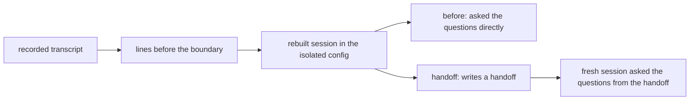

# Probe reference arms

The probe arms of [[research/pipeline/compaction-survival/RESEARCH-probe-arm-comparison]] each hand a fresh model a carried text. The two arms here need the history before the compaction itself: `before`, the reference the compaction-survival measure reads every arm against, and `handoff`, where a session holding that history writes the handoff. Terms (point, arm, probe, carried tokens) are defined on the comparison page.

## Rebuilt session

> [!NOTE] Result
> A session rebuilt at a compaction point loads headless. The history before the boundary, written as a session of a fresh sandbox project in the isolated Claude config, resumed with `claude -p --resume <id> --tools ""`, and the model answered from it.

- **How it is rebuilt.** `probe.py`'s `rebuild` copies the records on the boundary's side that come before it into a new session file of the sandbox project, with a new session id and the project folder as each record's working folder. The recorded transcript is only read.
- **The check.** One run on the recorded point with the smallest history (61,617 tokens before its compaction, on Haiku 5.5). Asked to quote the start of the last message the human typed, the model quoted it, matched by script against the history.
- **The history loaded whole.** The answering turn wrote 61,568 tokens to the cache, the size of the history before the compaction. The history's tool calls and results loaded under `--tools ""` with no error.
- **Cost.** One session: 38,883 input, 4,133 output, 119,590 cache read and 170,607 cache write tokens on Haiku 5.5, which the price table does not weigh. The answering turn accounts for 61,568 of the cache writes; the rest come from the session's other calls.

So the `before` and `handoff` arms resume the rebuilt session; neither needs the history rendered as text.
