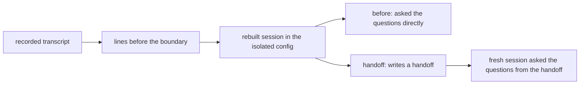

# Probe reference arms

The probe arms of [[research/pipeline/compaction-survival/RESEARCH-probe-arm-comparison]] each hand a fresh model a carried text. The two arms here need the history before the compaction itself: `before`, the reference the compaction-survival measure reads every arm against, and `handoff`, where a session holding that history writes the handoff. Terms (point, arm, probe, carried tokens) are defined on the comparison page.

## Rebuilt session

> [!NOTE] Result
> A session rebuilt at a compaction point loads headless. The history before the boundary, written as a session of a fresh sandbox project in the isolated Claude config, resumed with `claude -p --resume <id> --tools ""`, and the model answered from it.

- **How it is rebuilt.** `probe.py`'s `rebuild` copies the records on the boundary's side that come before it into a new session file of the sandbox project, with a new session id and the project folder as each record's working folder. The recorded transcript is only read.
- **The check.** One run on the recorded point with the smallest history (61,617 tokens before its compaction, on Haiku 5.5). Asked to quote the start of the last message the human typed, the model quoted it, matched by script against the history.
- **The history loaded whole.** The answering turn wrote 61,568 tokens to the cache, the size of the history before the compaction. The history's tool calls and results loaded under `--tools ""` with no error.
- **Cost.** One session: 38,883 input, 4,133 output, 119,590 cache read and 170,607 cache write tokens on Haiku 5.5, which the price table does not weigh. The answering turn accounts for 61,568 of the cache writes; the rest come from the session's other calls.

So the `before` and `handoff` arms resume the rebuilt session; neither needs the history rendered as text.

## The before arm

> [!NOTE] Result
> Holding the history itself, the model scores 0.62 on edited files, 0.82 on the latest stretch's files, 0.68 on continuation and 0.63 on the pooled state score. The host summary keeps 73% of the first, 66% of the second and 54% of continuation. The host summary plus the revised block names as many edited files as the history does (0.67 against 0.62, interval spanning zero) but keeps continuation at 0.32 against 0.68.

The same 29 points and frozen questions. Each session resumes the point's rebuilt history with no tools and is asked the questions; the host loads that history from the last earlier compaction on, as it does in a live session. The arm ran twice: the first run's means are within 0.02 of the second's on every type (artifact 0.61, artifact-recent 0.84, continuation 0.68, decision 0.77, state 0.63), and its token counts are unusable (see Cost), so the tables hold the second run.

| probe | points | before | host-summary | mechanical | compass | handoff |
|---|---|---|---|---|---|---|
| artifact | 29 | 0.62 | 0.45 (73%) | 0.52 (84%) | 0.67 (108%) | 0.68 (110%) |
| artifact-recent | 24 | 0.82 | 0.54 (66%) | 0.70 (85%) | 0.73 (89%) | 0.73 (89%) |
| recall | 9 | 0.11 | 0.11 | 0.00 | 0.11 | 0.00 |
| continuation | 19 | 0.68 | 0.37 (54%) | 0.05 (7%) | 0.32 (47%) | 0.37 (54%) |
| decision | 13 | 0.77 | 0.54 (70%) | 0.31 (40%) | 0.85 (110%) | 0.62 (81%) |
| state | 20 | 0.63 | 0.44 (70%) | 0.12 (19%) | 0.47 (75%) | 0.41 (65%) |

Each arm's mean, with its share of `before`'s in brackets; `mechanical` and `compass` are the revised block's ([[research/pipeline/compaction-survival/RESEARCH-probe-arm-comparison#Rerun with the revised block]]). Recall, at 9 points, gets no share.

Paired differences, `before` minus `host-summary`:

| probe | pairs | mean difference | 95% paired interval |
|---|---|---|---|
| artifact | 29 | 0.17 | [0.06, 0.29] |
| artifact-recent | 24 | 0.28 | [0.15, 0.43] |
| continuation | 19 | 0.32 | [0.11, 0.53] |
| decision | 13 | 0.23 | [0.00, 0.46] |
| state | 20 | 0.19 | [0.08, 0.32] |

Paired differences, `compass` minus `before`:

| probe | pairs | mean difference | 95% paired interval |
|---|---|---|---|
| artifact | 29 | 0.05 | [-0.08, 0.17] |
| artifact-recent | 24 | -0.09 | [-0.22, 0.01] |
| continuation | 19 | -0.37 | [-0.58, -0.16] |
| decision | 13 | 0.08 | [-0.31, 0.38] |
| state | 20 | -0.16 | [-0.30, -0.03] |

- The host summary loses to the history on every type with enough points: the low ends lie above zero for artifact, artifact-recent, continuation and state, and at exactly zero for decision.
- `compass` is not distinguishable from the history on files and decision, and worse on continuation and state.
- Carried tokens: 210,378 on average, the history before the compaction from the last earlier one on, against 5,254 for the host summary.

**Cost.** 29 sessions per run, 18 on Opus 5.5, 8 on Haiku 5.5 and 3 on Sonnet 5. A resumed session's result reports, beside its own usage, the usage its resumed history recorded (up to 300,000 output tokens for a one-turn answer), so the first run's stored counts measure the recorded sessions, not this one; `probe.py` now reads a resumed session's own usage. The second run read the histories the first run had cached: its Opus sessions weigh 364,147 tokens (raw: 36 input, 15,983 output, 5,263,069 cache read, 16,834 cache write). The first run wrote those histories to the cache: about 5.3 million cache-write tokens on Opus, the amount the second run read back, about 6.6 million weighted. Haiku 5.5 and Sonnet 5 have no weight in the price table; the second run's raw tokens on them are 16 input, 1,865 output, 534,652 cache read and 1,449 cache write (Haiku), and 6 input, 809 output, 23,944 cache read and 464,492 cache write (Sonnet).

## The handoff arm

> [!NOTE] Result
> A handoff written by a session holding the history, with the mechanical sections pasted in, scores like the host summary plus the revised block: 0.68 against 0.67 on edited files, intervals spanning zero on every type. It beats the host summary on files (+0.23, interval [0.12, 0.35]) and on the latest stretch's files, ties it on continuation and the pooled state score, and carries about the same tokens (5,488 against 5,254). It costs a model writing the handoff at every compaction, which the block does not.

Two sessions per point. The writer resumes the rebuilt history with no tools and is given step 6 of the handoff skill (its instruction and its template) and the four sections `compass session-state --format handoff` prints for the point at its boundary, to paste verbatim. The answerer is a fresh session holding only the handoff it wrote. The handoffs ran 5,213 to 21,177 characters, 12,439 on average. No point lacked its sections.

Paired differences of `handoff`:

| probe | pairs | minus host-summary | minus compass | minus mechanical |
|---|---|---|---|---|
| artifact | 29 | 0.23 [0.12, 0.35] | 0.01 [-0.07, 0.10] | 0.16 [-0.02, 0.35] |
| artifact-recent | 24 | 0.19 [0.04, 0.36] | 0.00 [-0.08, 0.11] | 0.03 [-0.10, 0.18] |
| recall | 9 | -0.11, too few points | -0.11, too few points | 0.00, too few points |
| continuation | 19 | 0.00 [-0.16, 0.16] | 0.05 [0.00, 0.16] | 0.32 [0.11, 0.53] |
| decision | 13 | 0.08 [-0.38, 0.54] | -0.23 [-0.54, 0.08] | 0.31 [0.08, 0.62] |
| state | 20 | -0.03 [-0.20, 0.11] | -0.07 [-0.23, 0.10] | 0.28 [0.14, 0.43] |

- Against `host-summary`: better on artifact and artifact-recent, not distinguishable on continuation, decision and state.
- Against `compass`: not distinguishable on any type; continuation's low end sits exactly at zero.
- Against `mechanical`: better on continuation, decision and state; not distinguishable on files.

**Cost.** 58 sessions, 36 on Opus 5.5, 16 on Haiku 5.5 and 6 on Sonnet 5, counting writers by their own usage. The Opus sessions weigh 7,815,910 tokens (raw: 72 input, 180,531 output, 86,189 cache read, 5,527,099 cache write); the writers loading the history account for 5,295,749 of the cache writes. Haiku 5.5 and Sonnet 5 raw tokens: 32 input, 38,808 output, 30,656 cache read and 594,643 cache write (Haiku); 12 input, 16,274 output, 34,489 cache read and 503,518 cache write (Sonnet).

## Not yet run

- A judge for free-text answers. Recall has 9 points and no verdict in any arm.
