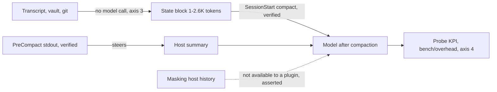

# Review: what survives compaction and handoff

> [!IMPORTANT]
> You decide: the three questions in "Questions for the human" (build vs probe first, where the probe lives, how decisions reach the block).

## Inputs

4 axes plus prior evidence ([[research/pipeline/RESEARCH-context-threshold-stop]], [[research/llm-research/REVIEW-llm-research-for-compass]] rows 13, 14, A6, C5). Question: the compaction-survival need of [[specs/pipeline/SPEC-025-stop-and-suggest-handoff-at-80-percent-context]]; the 80% stop is built ([[PLAN-019-stop-at-80-percent-context]]) and out of scope.

## What a hook-only plugin can and cannot do

| Capability | Status | Evidence |
|---|---|---|
| PreCompact stdout appended to the summarizer's instructions, steers the summary | verified (trial, manual trigger, haiku) | axis 1 f3: codeword kept, labelled "from compaction instructions" |
| PreCompact receives `trigger`, `custom_instructions`, `transcript_path` | verified for `manual`; `auto` asserted (docs) | axis 1 f2 |
| PreCompact exit 2 blocks a manual compaction | verified | axis 1 f7; `decision: block` JSON and blocking an auto compaction asserted only |
| PreCompact stdout cap of 10,000 chars | asserted (vault reading of docs) | axis 2 f14, axis 3 f15; axis 1 could not reach the docs section |
| SessionStart `source: compact` `additionalContext` stored and sent to the model, after the summary | verified | axis 1 f4, f11 (transcript request body, compact-only codeword) |
| Model attends to that text when asked | verified 2 of 3 probes | axis 1 f11: one open-question probe missed it |
| SessionStart cap 10,000 chars, spill to file with 2,000-char preview | asserted (docs) | axis 1 f4 |
| PostCompact receives the full `compact_summary` | verified | axis 1 f5 (payload framing differs from stored summary) |
| PostCompact injects context | cannot (verified): `hookSpecificOutput` fails schema validation | axis 1 f6 |
| PostCompact `systemMessage` reaches the transcript as command stdout | verified | axis 1 f12 |
| Event order PreCompact, SessionStart(compact), PostCompact | verified, one run | axis 1 f9 |
| Mask or clear the host's tool-result history (context editing, memory tool) | cannot (asserted): API request parameters, docs do not mention Claude Code; not tested | axis 2 f14, f6 |
| Read pre-compaction history from the transcript after a boundary | verified (structure) | axis 1 f8, axis 3 f9 (5 boundaries in one file, history kept) |

## Convergence matrix

A = axis. Cell: Y/N/P(partial), grade (h/m/l), evidence type. "-" = not addressed. Agreement counts axes that addressed the claim; "prior" = an earlier vault document.

| # | Claim | A1 | A2 | A3 | A4 | Prior | Agreement |
|---|---|---|---|---|---|---|---|
| 1 | `plugin/` registers no PreCompact, PostCompact or compact-source handler | Y(h, grep) | Y(h, code) | Y(h, grep) | Y(h, grep) | Y (A6 "No compaction hook") | 4/4 |
| 2 | PreCompact stdout steers the host summary | Y(h, trial) | Y(m-h, doc) | Y(doc via vault) | - | Y (row 14) | 3/3 |
| 3 | SessionStart(compact) `additionalContext` reaches the model | Y(h sent, m attended, trial) | Y(m-h, doc) | - | - | Y (row 14) | 2/2 |
| 4 | PostCompact is observe-only (gets the summary, no context channel) | Y(h, trial) | Y(doc) | Y(doc) | - | Y | 3/3 |
| 5 | PreCompact can block compaction | Y(h exit 2 manual; m JSON, auto) | Y(doc) | - | - | Y | 2/2 |
| 6 | PreCompact stdout cap is 10,000 chars | P (section not reached) | Y(doc via vault) | Y(doc via vault) | - | Y | 2/3 |
| 7 | A plugin cannot mask or clear host history | - | Y(m-h, doc, untested) | - | - | - | 1/1 |
| 8 | Transcript keeps full history plus `compact_boundary` and `isCompactSummary` | Y(h, trial) | - | Y(h, 5 transcripts) | Y(h, bench code) | - | 3/3 |
| 9 | Host already re-injects file references and task status after compaction | P (env/skill/model attachments seen) | - | Y(h) | - | Y (A6: 5,000 tokens per skill) | 2/2 |
| 10 | Masking matches LLM summary on solve rate at about half the cost | - | Y(m-h, preprint, 4 of 5 setups) | - | - | Y (row 13) | 1/1 + prior |
| 11 | Summaries drop rules and scope exclusions, compounding per compaction | - | Y(m, preprint) | - | - | - | 1/1 |
| 12 | File trail is the weakest dimension for every summarizer | - | Y(m-l, vendor) | - | Y(vendor, self-favoring) | Y (A6, spec) | 2/2 |
| 13 | No source compares masking against an anchored summary | - | Y(m, bounded search) | - | - | Y (disagreement 3) | 1/1 + prior |
| 14 | Files read/edited, last human request, git, open tasks are mechanical; decisions and current step only partly | - | Y (assumed in candidate 1) | Y(h/m, measured) | Y (used as probe ground truth) | - | 3/3 |
| 15 | Free-text decisions and failed approaches have no mechanical source | - | P (rules live only in context, f9) | Y(m) | Y (decision probes need a judge) | - | 3/3 |
| 16 | The handoff is wholly model-written | - | P ("not confirmed either way") | Y(h, code read) | - | - | 1 Y, 1 open |
| 17 | A mechanical block is 1,000 to 2,600 tokens, under 1% of the window | - | - | Y(m, 4 chars/token) | - | - | 1/1 |
| 18 | Artifact and recall probes are script-gradable; decision and free-text continuation need a judge | - | - | Y (ground truth fields) | Y(inference) | - | 2/2 |
| 19 | `bench/overhead` has launcher, blind judge, calibration, bootstrap; no probe builder | - | - | - | Y(h, code) | - | 1/1 |
| 20 | Factory's probe result is a small, single-judge, self-favoring gap | - | Y(m-l) | - | Y | Y (axis-6 f14) | 2/2 |
| 21 | A model's "I see X" self-report is unreliable evidence | Y(h, trial) | - | - | P (judge leniency, f12) | - | 1/1 + related |
| 22 | Order of the next steps: build re-injection first | - | Y (candidate 1 ranked first) | - | N (candidate 5: pilot "before building anything else") | - | split 1/1 |
| 23 | The probe runner lives in `bench/overhead`, not `plugin/` | - | P ("Compass-side probe", home unstated) | - | Y | N (axis-6 candidate 4: a `compass` check) | split |

## Converged (high confidence)

1. **No compaction handler exists in Compass** - 4/4. `plugin/hooks/hooks.json` SessionStart has matcher `startup` plus a matcherless `capture-check` entry, which therefore also fires on `compact` (axis 1 f10).
2. **Two hook levers are real and trial-verified: PreCompact steers, SessionStart(compact) re-injects** - 3/3. Codeword survival in the summary and in the request body (axis 1 f3, f4, f11).
3. **PostCompact cannot carry state into context** - 3/3. Schema rejects `hookSpecificOutput` for PostCompact (axis 1 f6).
4. **The transcript holds everything a mechanical assembler needs, across compaction boundaries** - 3/3. Read/Edit/Write `file_path` exact; human prompts by `origin.kind: human`; `compact_boundary` and `isCompactSummary` records (axis 3 f1, f3, f9; axis 1 f8).
5. **Decisions and "why an approach failed" are the elements without a mechanical source** - 3/3. Only `AskUserQuestion` answers and vault `D-NN` bullets are fields (axis 3 f7); summaries also drop rules (axis 2 f9).
6. **File trail is what summaries lose first** - 2/2 plus spec. Factory artifact 2.19 to 2.45 of 5 for all methods (axis 2 f5, axis 4 f6).
7. **Probes split by gradability** - 2/2. Artifact (path set recall) and recall (substring) need no judge; decision needs a judge with the reference answer (axis 4 f18, f20).

## Partial (needs attention)

1. **PreCompact cap of 10,000 chars** - 2/3.
   - Majority: 10,000 chars (axis 2 f14, axis 3 f15, both from the earlier vault reading of the docs).
   - Minority: unverified; the PreCompact output section was not reached, and 10,000 is the spill rule for other hook output (axis 1 f3, Gaps).
2. **Does re-injected text get used?** Axis 2 and 3 assume it; axis 1 grades delivery high but attention medium (one miss on an open question, f11). Axis 1 f13 also shows model self-reports are unreliable, which bears on how axis 4 grades probes.
3. **Does steering the summary keep rules?** Axis 1 verified one codeword kept on one compaction; axis 2 f9 shows a summary prompt asking for constraints still dropped 0.51 to 2.73 rules per compaction. Different scale (one token vs three rules over 30 compactions), so neither refutes the other. Axis 2 ranks re-injection above steering for this reason.
4. **Handoff content source** - axis 2 candidate 3 left it open; axis 3 f13 (code read, high) settles it: every section is model-written, while git, file and task inputs already have helpers in `plugin/cli/sessionslib.py` the skill does not call (axis 3 f16, Contradictions).

## Divergent (human decision)

1. **Build first or measure first** - split 1/1.
   - Position A (axis 2): rank 1 is the SessionStart(compact) re-injection; probe is rank 5, "if it matters" (axis 2 Candidate changes).
   - Position B (axis 4): pilot probes on recorded sessions with a compaction "before building anything else"; candidate pool exists (axis 4 c5, `bench/overhead/attribute.py:198`).
2. **Where the probe runs** - split.
   - Position A (axis 4): a repo-local module in `bench/overhead`, beside `judge.py`, not shipped (axis 4 c1); matches the vault rule that success signals exist in both arms ([[research/whole-overhead/real-projects/REVIEW-whole-overhead]] decision 4).
   - Position B (prior, [[research/llm-research/RESEARCH-axis-6-harness-engineering]] candidate 4): a `compass` check that probes a fresh agent against a written handoff, i.e. a user-facing command.

## Cross-axis findings the axes did not state

- **The largest measured block exceeds the SessionStart cap.** Axis 3 f17: 10,286 chars on the 24 MB session; axis 1 f4 (docs): 10,000-char cap, spill to a file with a 2,000-char preview. Per-list caps are an untested design variable (axis 3 f17).
- **SessionStart(compact) fires before PostCompact** (axis 1 f9), so the re-injection hook cannot read `compact_summary` from a payload; whether the transcript already holds the summary at that moment is untested. Pre-compaction history is readable either way (axis 3 f9).
- **The spec's "13 to 15% on coding tasks"** ([[specs/pipeline/SPEC-025-stop-and-suggest-handoff-at-80-percent-context]] Problem) is narrower in axis 2 f3: summary ran 15% longer than raw and 13% longer than masking on one model (Qwen3-Coder), 4% longer than raw on Gemini Flash, and masking ran 13% longer than raw on Qwen3-32B.
- **Prior disagreement 3 ("shape it or avoid it") narrows**: avoiding the summary by masking is not open to a hook-only plugin (axis 2 f14, asserted); what remains is steer (PreCompact) and supplement (SessionStart re-injection) ([[research/llm-research/REVIEW-llm-research-for-compass]] disagreement 3).

## Candidate changes, ranked

Ranked by how many axes support them and by evidence strength. North stars: 1 accuracy, 2 perfect memory, 3 cache misses, 4 low tokens.

1. **Mechanical state block re-injected on SessionStart(compact).** North star 2, 1. Supported by axes 1 (channel verified), 2 (c1), 3 (all elements measured), prior A6.
   - `plugin/hooks/hooks.json`: SessionStart entry with matcher `compact`.
   - New command in `plugin/cli/commands/` printing `additionalContext`: open `active.md` tasks, branch, non-vault git status, files read and edited, last human request, `AskUserQuestion` answers, `D-NN` of the specs in play, test-run tails.
   - `plugin/cli/sessionslib.py`: the extractors axis 3 f16 lists as missing (Read/Edit/Write paths, last human prompt, question answers, test output, `task_status`, `compact_boundary`).
   - Constraint: stay under 10,000 chars (cross-axis finding above). Covered: no.
2. **Handoff body filled by the same assembler; model writes intent and next step only.** North star 4, 1. Axes 2 (c3), 3 (f12, f13, f16). `plugin/skills/handoff/SKILL.md` calls the command instead of composing git, files and tasks by model. Covered: no.
3. **PreCompact instructions naming fixed sections** (intent, files changed with paths, decisions, scope exclusions, next step). North star 1. Axes 1 (verified), 2 (c2, anchored beat free-form in one vendor eval). `plugin/hooks/hooks.json` PreCompact entry plus a command or static text. Covered: no. Axis 2 f9 caveat: instruction alone does not keep rules.
4. **Probe runner, script-graded first, three arms plus full-context reference.** North star 1, 4. Axes 4 (c1, c2, c4), 2 (c5). Home is divergence 2; axis 4 places it in `bench/overhead` (new module beside `judge.py`, reusing `launch.py`, `records.py`, `compare.py`, `grade.py`), not `plugin/`. Artifact-trail recall as headline number. Covered: no.
5. **References, never tool-output bodies, in the handoff and the block.** North star 4. Axis 2 c4. Covered: partly, the `methodology` skill "Handoffs" already says `file:line`, no check enforces it.
6. **Judge only for decision probes, reference in prompt, hand-graded agreement sample.** North star 1. Axis 4 c3. Covered: partly (calibration exists for builds via `grade.py`, not for probes).

## Questions for the human

Asked one at a time, in this order.

1. Build the re-injection first, or pilot the probe first?
   1. Run both at once: build candidate 1 while the pilot measures the host summary arm (Recommended; the two touch disjoint files)
   2. Build candidate 1 first, probe afterwards
   3. Pilot probes first, build only after the numbers
2. Where does the probe runner live?
   1. `bench/overhead`, repo-local, not shipped (Recommended; axis 4, matches the both-arms measurement rule)
   2. A `compass` command shipped in `plugin/`
3. How do decisions reach the state block?
   1. Mechanical sources only (`AskUserQuestion` answers, vault `D-NN`); free-text decisions stay a known gap the decision probe measures (Recommended; no model-written text added)
   2. A convention: agents log each decision through a `compass` command as it is taken
   3. A short model-written decisions section at compaction or handoff time

## Gaps

- **Free-text decisions and failed approaches have no mechanical source** (axis 3 Gaps, axis 2 f9). Does not block planning; forces question 3.
- **Unprompted attention to re-injected text** is medium (axis 1 f11). Does not block; the probe measures it.
- **`trigger: auto` never produced**; auto blocking and `decision: block` JSON untested (axis 1 Gaps). Does not block; a plan verification step can drive it with `--autocompact`.
- **No measurement of a re-read memory file against a model summary** for coding agents (axis 2 f15, Gaps). This is the KPI itself; only Compass's own probe closes it. Blocks claiming the KPI, not planning.
- **PreCompact cap unverified** (Partial 1). Does not block; size the instructions well under 10,000.
- **Masking vs anchored summary unresolved** (axis 2 f4). Does not block: a hook-only plugin cannot mask host history.
- **Transcript fields are undocumented and host-version-bound** (2.1.328 to 2.1.330, axis 3 Gaps); `bashEditDiff` cannot yet separate this session's edits from prior dirt (axis 3 f2). Does not block; same exposure PLAN-019 already carries.
- **Judge reliability for decision probes on this domain** unmeasured (axis 4 f12, f13). Does not block.

No gap blocks planning.

CONVERGENCE: MIXED (facts HIGH; sequencing and probe home divergent)
