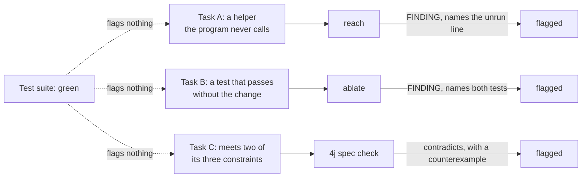

# Research: the planted-defect probe

The measurement behind the KPI of [[SPEC-034-verification-beyond-test-pass]], built by [[PLAN-036-verification-beyond-test-pass]] TASK-412. The script is `bench/verification/planted.py`; its README says how to run it.

The three checks, each a `compass` command the validator runs per task:

- **reach** runs the task's entry point (the command a user types) under coverage and names every line the task changed that did not run. It answers PASS, FINDING, or SKIP when nothing was measured.
- **ablate** reverts the task's code in a scratch copy, reruns the task's tests, and names every test that stays green without the code (FINDING).
- **4j** is the validator's spec check: it lists the spec's requirement rows (outcomes `O-n`, the KPI `K-1`, constraints `C-n`) and judges each one `met`, `partial`, `missing` or `contradicts` against the code, running a command where one can show the answer.

`compass evidence run` keeps each check's command, commit and full output as a record; `compass evidence rerun` runs it again at that commit and answers `match` when the verdict is the same.

## Question

On tasks that each carry one planted failure (code the program never reaches, a test that does not depend on the change, a spec constraint left unmet), do the checks flag every planted instance where a green test suite flags none, and do they stay quiet on the tasks without one?

## Method

The script builds a throwaway Python project with its own virtual environment: a small word-count command line tool, a spec with three outcomes, a KPI line and three constraints, and a plan of three tasks, each landed as its own merge commit. The suite stays green after every merge.

| Task | Planted failure | Check that should flag it |
|---|---|---|
| A | adds a helper; the command line never calls it | `compass reach` from the task's entry point |
| B | adds a behavior; its tests pass without it | `compass ablate` |
| C | the tie rule of the third constraint is not met | step 4j of the validator |

The script runs the suite, then `compass reach` and `compass ablate` for every task through `compass evidence run`, reruns every record with `compass evidence rerun`, and starts one headless validator session that runs step 4j for task C only. The unplanted pairs (reach on B and C, ablate on A and C) are the controls for false alarms. The 4j controls are the six other rows the session judged: O-3, K-1, C-1 and C-2, which task C owns besides the planted C-3, plus O-1 (task B) and O-2 (task A).

Six builds were measured, each with its own validator session: three on a first seed and three on a corrected seed (see "The first seed held two gaps nobody planted").

## Findings

1. **The green suite flagged nothing on any task, in all six builds.** Grade: measured. Confidence: high.
2. **reach flagged task A in six of six builds** and named the helper's body line as unrun; the helper's own definition line counts as run, since Python runs it on import. reach gave PASS on tasks B and C in all six. Grade: measured. Confidence: high.
3. **ablate flagged task B in six of six builds** and named both of its tests as staying green once the code was reverted. It gave PASS on tasks A and C in all six. On task A the test cannot even import once the helper is reverted; ablate reports that as a collection error, not a finding. Grade: measured. Confidence: high.
4. **The 4j session flagged the planted constraint in six of six runs**, each time as `contradicts`, with a two-word input whose output broke the tie rule. It ran that input through `compass evidence run`, so the claim reruns. Grade: measured. Confidence: medium (six runs of one model on one planted case).
5. **On the corrected seed the 4j session raised no false alarm**: 0 of 18 control rows judged unmet across three runs. It judged met every row task C owns besides the planted one, and both rows of tasks A and B. Grade: measured. Confidence: medium.
6. **Every record reran to `match`**: the 36 reach and ablate records of the six builds, and the 20 records the second-seed sessions wrote for their own 4j checks. Grade: measured. Confidence: high.
7. **4j's split leaned on commands.** Each session wrote between 6 and 9 records, so most rows were judged on a command's output rather than on reading the code alone. Step 4j's rule (a requirement a command can show goes to that command) held without tuning on this spec. Grade: measured. Confidence: medium (a spec of small, runnable requirements favors commands).
8. **Cost.** A whole build plus the checks took 81 to 109 seconds; the mechanical part alone (build, suite, six checks, six reruns) about 30 seconds. One 4j session took 51 to 76 seconds and 4 to 12 turns of the validator's 40, wrote 2,970 to 5,455 output tokens and read 79,000 to 167,000 input tokens, nearly all from cache. Grade: measured. Confidence: high for this project size.

### Node project

The same spec, plan and three tasks were built as a Node package: tests run under `node:test`, coverage comes from c8 as LCOV, and task C adds an HTTP server whose route answers with the most frequent word, reached through a driver script that starts the server, sends one request and closes it.

- **reach flagged task A** although both of its changed lines ran: the helper is a one-line arrow function, whose line runs when the module loads. reach named the function itself as never called, from the LCOV function records, and answered FINDING. Grade: measured. Confidence: high.
- **reach gave PASS on task C through the server**: every changed line of the server, the route and the driver ran from the driver's one request. Grade: measured. Confidence: high.
- **ablate flagged task B** and named both of its tests; reach on B and ablate on A and C gave PASS; the suite stayed green; all six records reran to `match`. The whole Node build and its checks took about 22 seconds. Grade: measured. Confidence: high.

### The first seed held two gaps nobody planted

On the first seed, every 4j run also judged task C's outcome row `partial`: the spec defines a word with the punctuation around it ignored, and the first seed's new command counted `dog,` and `dog` as two words. Two of the three runs also judged task B's outcome row `partial`, since that seed's spec said a word is "a run of letters" while task B's code still counted digits. One run judged task A's outcome row `partial` because the command line never shows the separated total, the same gap reach flags. Each claim came with an input and its wrong output, and each was a real gap in the seed. The seed was then corrected so the spec defines a word the way task B's code does and the new command strips punctuation the same way; the second three runs are findings 5 to 7.

### Smaller observations

- `compass requirements --for-task` returns every requirement row that is not a decision, so each session also checked the rows of tasks A and B and filed their records under task C. It named the owning task correctly every time. The KPI row went to task C in some runs and to `unowned` in others, since no task line cites it by id.
- One session first passed the interpreter as a relative path with forward slashes; on Windows `compass evidence run` could not start it and recorded exit 127. Its rerun with an absolute path ran. This is a defect of `compass evidence run` on Windows, carried by [[PLAN-036-verification-beyond-test-pass]] TASK-441.

## Limits

- One small Python project and its Node twin, and one planted spec failure of one kind: a rule the code breaks on a two-word input. Every requirement of this spec could be shown by a command; a requirement only reading can judge is outside what was measured.
- Three runs per seed, all on one model family; agreement between them is not independence.
- The planted failures are blatant by design. The probe shows that the checks see each kind; how often they see subtler cases is outside what was measured.

## Answer to the KPI

On this probe the KPI holds: each planted instance was flagged by its check in six of six builds, the green suite flagged none, the controls raised no alarm, and every record reruns. The Node build gives the same reach and ablate verdicts, including the one-line function; step 4j was measured on the Python build.
