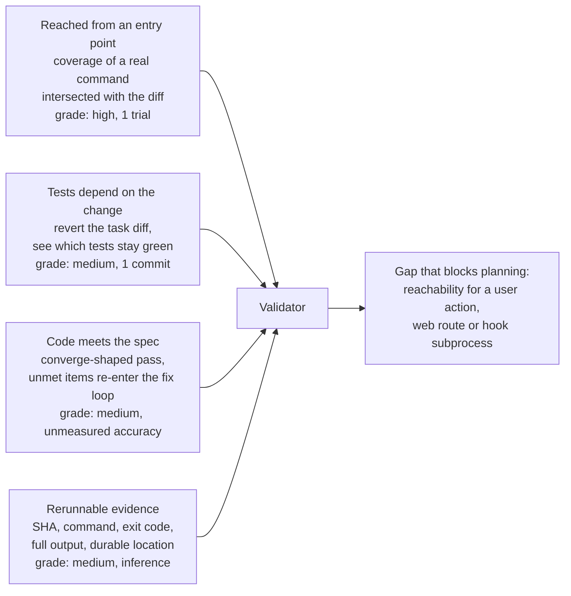

# Review: verification beyond test-pass

> [!IMPORTANT]
> You decide: the eight items under "Disagreements for the human", and whether the "user action" half of the reached outcome waits for one more research pass.

## Inputs

4 agents | Question: how Compass can confirm, for [[SPEC-034-verification-beyond-test-pass]], that a task's new code is reached from a real entry point, that its tests depend on the change, that the code meets each spec requirement with unmet items returned as open work, and that a done claim is checkable by rerunning its evidence. Prior context: [[research/llm-research/REVIEW-llm-research-for-compass]] section A3, rows B8 and B9.

| Agent | Axis file |
|---|---|
| R | [[research/test-quality/beyond-test-pass/RESEARCH-reachability]] |
| A | [[research/test-quality/beyond-test-pass/RESEARCH-change-ablation]] |
| S | [[research/test-quality/beyond-test-pass/RESEARCH-spec-conformance]] |
| I | [[research/test-quality/beyond-test-pass/RESEARCH-integration-and-evidence]] |

The axes split the question, so most claims were addressed by one or two agents. Agreement is the share of agents that addressed a claim; `-` means not addressed. A claim with one voter is uncontested, not cross-checked.

## Convergence matrix

| # | Claim | R | A | S | I | Agreement |
|---|---|---|---|---|---|---|
| 1 | Compass has no reachability check today | YES (h) | - | - | YES (h) | 2/2 |
| 2 | Coverage of a real entry-point run, intersected with the diff by diff-cover, is the reachability check | YES (h) | - | - | - | 1/1 |
| 3 | Static call-graph and dead-code tools miss string dispatch and cannot be the primary check | YES (h) | - | - | - | 1/1 |
| 4 | The entry point must be named per task or project; no field holds it | YES (m) | - | - | YES (h) | 2/2 |
| 5 | Where the entry point is named: plan task or verification bullet only, not the spec | YES (m) | - | - | NO, "plan/spec field" (m) | 1/2 |
| 6 | Reachability is judged per changed line, so no new-symbol extractor is needed | YES (h) | - | - | NO, per new symbol, extractor missing (m) | 1/2 |
| 7 | Reachability belongs in the validator, as a new per-task step | YES (m, implied) | - | - | YES (m) | 2/2 |
| 8 | Reached is necessary, not sufficient: executed is not correct | YES (m) | - | - | - | 1/1 |
| 9 | Pre-build red proves fail-without-change once; nothing re-derives it from the final diff; post-build tests have no red | - | YES (h) | - | YES (m-h) | 2/2 |
| 10 | Whole-diff revert of the task's non-test diff, then run the task's tests, is the ablation check | - | YES (m) | - | YES (m) | 2/2 |
| 11 | Ablation costs one extra run of the task's matching tests (seconds), not of the full suite | - | YES (m, measured) | - | NO, "one extra full suite run" (m, inference) | 1/2 |
| 12 | Ablation station is open between post-build tester and validator | - | YES | - | YES, plus build merge step | 2/2 |
| 13 | Per-file and per-hunk reverts overstate dependence; per-function stubbing is a diagnostic only | - | YES (m) | - | - | 1/1 |
| 14 | Ablation needs a green baseline per test, one repeat on a flip, and a CRLF-tolerant revert | - | YES (h/m) | - | - | 1/1 |
| 15 | An unflipped new test is a reported finding, never a fail | - | YES (h) | - | - | 1/1 |
| 16 | `compass coverage` traces decisions to tasks, never to code | - | - | YES (h) | YES (h) | 2/2 |
| 17 | No path turns an unmet requirement into open work; the fix loop fires only on tester bugs | - | - | YES (h) | YES (h) | 2/2 |
| 18 | A converge-shaped requirement pass beside validator step 4d, feeding unmet items into the fix loop | - | - | YES (m) | YES (h) | 2/2 |
| 19 | Spec requirements outside D-NN bullets carry no ID; IDs or an extraction step are needed | - | - | YES (m) | - | 1/1 |
| 20 | The conformance judge runs with tools; requirements expressible as a test or grep go to a command | - | - | YES (m) | - | 1/1 |
| 21 | The builder review charter is style-level and sees the diff only | YES (h) | - | YES (h) | YES (h) | 3/3 |
| 22 | B8: replace the charter with correctness against the spec, skipping style | - | - | YES (l-m) | - | 1/1 |
| 23 | All evidence today sits in gitignored `.compass/tmp/`; validator output is truncated and carries no run-time SHA | - | - | - | YES (h) | 1/1 |
| 24 | A rerunnable record stores pointers (SHA, command, test ids, output file) and lets git hold content | - | - | - | YES (m) | 1/1 |
| 25 | The reviewer matrix records no model or family; under defaults every column is one family | - | - | - | YES (h) | 1/1 |
| 26 | Agreement among same-model or same-family agents is weaker evidence than its count | - | - | - | YES (m, 6 sources) | 1/1 |
| 27 | Family is the grouping that matters for the cap | - | - | - | MIXED (f17 against, f18 for) | split within I |
| 28 | Two specs share the number SPEC-034 | - | - | - | YES (h) | 1/1 |

## Convergence summary

| Category | Count | Claims |
|---|---|---|
| Converged, cross-checked (2+ agents) | 10 | 1, 4, 7, 9, 10, 12, 16, 17, 18, 21 |
| Converged, single axis (1 agent, uncontested) | 14 | 2, 3, 8, 13, 14, 15, 19, 20, 22, 23, 24, 25, 26, 28 |
| Split (1/2) | 3 | 5, 6, 11 |
| Evidence conflict within one agent | 1 | 27 |

## Recommended mechanism per spec outcome

### Reached from an entry point

- **Mechanism:** run the task's named entry-point command under the language's coverage tool with tests excluded, export Cobertura or LCOV, run diff-cover against the task diff; changed lines not executed are named by file and line. Output uses the validator's existing `Check / Command run / Output observed / Result` block, so a missing command reads SKIP, never PASS.
- **Evidence grade:** high for the CLI case, one trial. On a copy of `plugin/cli`: run 0.60 s, diff 0.42 s; a seeded unreferenced helper was named by line, the reached edit scored 100% (R f2).
- **Cheap Python cross-check:** vulture run with and without tests, diffed, separates dead code from code reached only by tests; name matching hides dead code behind any same-named callee (R f4, grade medium-high).
- **Not primary:** pyan3 drew no edge to any `commands.<name>.run` because `maincli.py:126-137` dispatches by string (R f3, grade high).
- **Limit:** a line executed from the entry point is not a line that produces the spec's result (R f9); the conformance pass covers the rest.
- **Touches:** `plugin/templates/agents/validator.md` (new per-task step after 4g, step 9 PASS list); the plan task line in `plugin/templates/agents/planner.md` and `plugin/skills/obsidian/templates.md` (an entry field, or the Automated verification bullet); optionally `plugin/templates/agents/builder.md` step 8 (I f3). diff-cover needs a git repository (R f2).

### Tests depend on the change

- **Mechanism:** in a scratch worktree under `.claude/worktrees/` (deletable by subagents, `plugin/cli/commands/guard.py:13-14,89-91`), revert the task's non-test diff, taken as `git diff <merge>^1 <merge>` of the per-task merge commit, with `git apply -R --ignore-whitespace`; run the task's checkpointed test ids plus tests the task added; report which stay green. Require a green baseline per selected test; repeat once on a flip.
- **Reporting rule:** an unflipped new test on a behavior task is a finding; a nonzero flip on a refactor-only task is a finding; neither is a fail, because ablation cannot tell a weak test from a correct must-fail-cleanly test (A f17).
- **Evidence grade:** medium, one commit. Whole-diff revert of `compass idea import` flipped 12 of 14 new tests and no others; both non-flips were explained (A f9). SWE-bench FAIL_TO_PASS is the same check done offline (A f5, grade high, source read).
- **Refinement:** record the kind of red (own failure versus import or collection error) in the checkpoint, so only tests without a genuine red are ablated (A candidate 2).
- **Diagnostic only:** per-function stubbing, N runs per task, consistent with mutation being on-demand (`plugin/skills/methodology/SKILL.md`, Testing mandate item 3); it found no pseudo-tested function where tests are end-to-end (A f12).
- **Touches:** `plugin/templates/agents/validator.md` (probe section) or `plugin/templates/agents/tester.md` (post-build step 3); `plugin/cli/commands/test_checkpoint.py` (red kind); `plugin/skills/build/SKILL.md` if placed at the merge step; possibly a `compass` command wrapping worktree, revert and run.

### Code meets the spec, unmet items return as open work

- **Mechanism:** a validator step beside 4d builds a requirement inventory with one stable ID per requirement, assesses code within the tasks' `files:` scope, classifies each as met, partial, missing, contradicts or unrequested (unrequested is surfaced, never removed) with severity, and reports `Requirement | Status | Evidence | Task` with counts. Requirements expressible as a test or grep go to a command; the judge runs with tools in a fresh context for the rest (S candidates 1, 4, 5).
- **Return path:** unmet items become fix-loop triggers in `plugin/skills/build/SKILL.md`, which today fire only on tester bugs (`SKILL.md:42`), under the existing 3-cycle cap (S f8, I f5). S adds: append one `- [ ] TASK-NNN ... per <spec>/<id> (<gap>)` line per item, never rewriting existing tasks; a clean run leaves the plan byte-identical (converge, S f3).
- **Prerequisite:** requirement IDs. A spec's Problem, Desired Outcome, KPI and Constraints carry none, and D-NN bullets appear in about 20 of 44 specs (S f10, grep); SPEC-034 itself has no D-NN, so `compass coverage` has nothing to trace for it (S f6).
- **Evidence grade:** high for the gap (code read); medium for the converge shape (shipped template, no accuracy data, S f1-f3); medium for judge accuracy, on neighbouring tasks only: agent judge with tools about 90% agreement with humans against 60-71% for a plain LLM judge (S f13, 2024 models); deterministic checker 78.7% against LLM 59.0% (S f15, low-medium).
- **Touches:** `plugin/templates/agents/validator.md` (step beside 4d, report section); `plugin/skills/build/SKILL.md` (fix-loop trigger); `plugin/cli/decisionslib.py` and `plugin/cli/commands/coverage.py` (requirement ID grammar, one level toward code); the spec template in `plugin/skills/obsidian/templates.md`.

### A done claim is checkable by rerunning its evidence

- **Mechanism:** a `compass` command (new, or an option on `test-checkpoint`) writes one record per check: command, commit SHA at run time, exit code, full output file, runner and interpreter versions, clean or dirty tree, at a durable location. It follows the checkpoint's pattern of storing pointers and re-reading content with `git show <sha>:<path>` (`test_checkpoint.py:6-10`). The validator's step 9 PASS list requires a record for each new check (I candidate 1).
- **Shape from prior art:** SLSA v1 splits what to rerun (`buildDefinition`) from what happened (`runDetails`) and makes the definition the only input (I f9, grade high, normative spec); SWE-bench stores `patch.diff`, `eval.sh`, `test_output.txt`, `report.json` per instance (I f10, medium-high).
- **Evidence grade:** high for the current-state gap (I f6, f7); medium for the field list, which is inference (I f8).
- **Open:** the location. The validator cannot write files (`validator.md:5`); its report reaches `.compass/tmp/phase-reports/` through the SubagentStop capture, and `.compass/tmp/` is gitignored (I f6).
- **Touches:** `plugin/cli/commands/test_checkpoint.py` or a new module in `plugin/cli/commands/`; `plugin/templates/agents/validator.md` (check block format, step 9); `plugin/skills/build/SKILL.md` step 7a (report capture).

## B8 and B9

- **B8, builder review charter.** All three agents that looked confirm the charter at `plugin/templates/agents/builder.md:65` is style-level and sees the diff only. S proposes a charter that receives the diff plus the task's cited requirements and edge cases, gives a met, partial, missing or contradicts verdict per requirement with file evidence, surfaces unrequested code, and skips style. Evidence grade low-medium: vendor guidance, unmeasured (S f18). S states the style items stay with the formatter step; `builder.md:59-61` runs a formatter (prettier, black, gofmt, rustfmt) only, so unused imports, leftover debug statements, missing error handling and copy-paste would lose their check if the charter is replaced (item D6 below).
- **B9, model family in the reviewer matrix.** The matrix in `plugin/templates/agents/reviewer.md` scores agreement count only; `plugin/cli/modelslib.py` holds tier-to-name tables and no family field, and every default agent is a Claude tier, so a cap would apply to every run (I f13, f14, grade high). Recording family needs a family column or a derivation from the model name in `modelslib.py`, model metadata on agent outputs (the research frontmatter has none), and a matrix row in `reviewer.md` (I f15). The cap rule is undecided: count same-family agents as one vote, or keep counts and flag "n of m agreeing agents share a family" (item D5 below). Evidence grade medium.

## Disagreements for the human

1. **D1. Where the entry point is named.**
   - R: in the plan task, either a new field or the Automated verification bullet; the spec holds no solution detail (R f5).
   - I: "a plan/spec field naming the entry point"; for other projects, whatever "the task or spec names" (I f3, candidate 4).
2. **D2. What ablation costs.**
   - A: one extra run of the task's matching tests, 5.6 s for 58 tests against 661 s for the full suite under load (A f10, measured).
   - I: "one extra full suite run per task, plus a revert worktree" (I f22, inference from the axis file).
   - Explanation offered by neither: the cost depends on which tests are selected; A selected by name and checkpoint ids.
3. **D3. The unit of reachability.**
   - R: changed diff lines, via diff-cover; no symbol list needed (R f2).
   - I: per new symbol; "no entry-point inventory or new symbol extractor exists" is listed as a gap (I f3, Gaps).
4. **D4. Which station runs ablation.** Both A and I name post-build tester step 3 and a validator step; I adds the build merge step. Neither chose. The post-build tester already holds the worktree, suite command and checkpoint (I f4); the validator alone sees the whole plan and baseline-to-HEAD diff (I f2).
5. **D5. B9 cap rule.** One vote per family, or flag only. Evidence inside I conflicts: a 9-judge, 7-family panel carried about 2 effective votes with same-family phi about 0.44 against 0.39 cross-family (I f17, summary-level numbers), so family barely separates; same-provider judges inflate weaker family members (I f18) and self-preference tracks self-recognition (I f19). Cross-model review was not significantly better than fresh same-model review (I f16, low-medium).
6. **D6. B8 replace or add.** Replacing the style charter removes checks the formatter does not perform (`builder.md:59-61` against `:65`); adding a correctness charter beside it keeps them at a token cost. Removing a capability needs the human's approval.
7. **D7. How much of conformance an LLM judges.** S's own evidence points both ways: tool-using agent judges track humans about 90% (S f13) while an LLM checker missed more violations than a deterministic one (S f15). S's routing rule (commands first, judge for the residue) is a proposal, not measured.
8. **D8. Duplicate number SPEC-034.** [[SPEC-034-verification-beyond-test-pass]] in `specs/pipeline/` and [[SPEC-034-checking-cost-follows-task-and-model]] in `specs/tooling/SPEC-027-compass-uses-fewer-tokens/` share the number (I f21). Full filenames differ, so wikilinks resolve; a bare "SPEC-034" in prose or a commit message is ambiguous. Numbering is local per folder ([[ADR-003-drop-counter-file-jit-compute]]), so the pair may be valid under the convention; whether to renumber is the human's call.

## Gaps

| Gap | Effect |
|---|---|
| Reachability for a non-CLI entry point: a UI action or web route (needs a driver such as Playwright or an HTTP request) and a hook-fired subprocess (coverage subprocess configuration). Only a one-process CLI command was measured (R Gaps). | **Blocks planning** of the "user action" half of the reached outcome. The CLI-command half is plannable now. |
| Returning unmet work into an approved plan: no axis addressed whether appended task lines need the human's plan approval again, or go through plan iteration. | **Blocks planning** of the return path until the human rules; a gate question, not a research one. |
| Languages beyond Python for coverage plus diff-cover (JVM, C#, Rust, JS runs); diff-cover reads Cobertura, JaCoCo, Clover and LCOV, but no other language was run. | Known limitation. |
| diff-cover against a real branch diff (`--compare-branch`) not run. | Known limitation. |
| Ablation measured on one commit, one language, one host; refactor-only case untested. | Known limitation; the SPEC-034 planted-defect KPI is the test bed. |
| No measured accuracy for an LLM requirement-by-requirement check on 2025-2026 models; converge has no accuracy data. | Known limitation; the planted unmet-requirement KPI measures it inside the plan. |
| Rerun record field list and durable location are inference; no rerun contract exists in the vault. | Does not block: a planner decision with prior art in hand (I Gaps). |
| How the checks apply to a task whose diff is agent or skill text rather than executable code; no axis covered it. | Known limitation; the plan states which tasks the checks cover. |
| CI artifact retention as prior art not read (I f12). | Known limitation. |
| Same-family correlation values read from search summaries and abstracts only (I Gaps). | Known limitation; bears on D5. |
| Difficulty signal for scaling the checks is undefined; it belongs to the sibling cost spec, which holds no rule yet (I f21, f22). | Known limitation, out of this spec's scope. |

Gap pass result (2026-11-21, non-CLI entry points): closed for planning, with named limits. Measured a Python and a Node server, a Playwright-driven UI click with server coverage, a Python child, a shell-launched hook stand-in and a Pool worker; each reached the diff check at 0.5 to 1.9 s. A killed server, an unconfigured child or worker, and a one-line function fail silently as a false 0% or 100%, so the plan states those guards. Untested: a real Claude Code hook launch, client V8 data into diff-cover, pre-fork servers, Linux/macOS signal options. Detail: [[RESEARCH-reachability#Gap pass: non-CLI entry points]].

CONVERGENCE: HIGH on the mechanism for each outcome; three 1/2 splits on detail (D1 to D3) and one evidence conflict (D5) go to the human.
