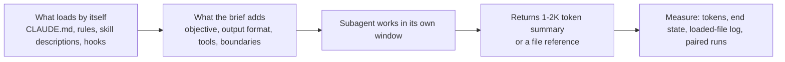

# Prior art on minimal, exact context for each agent

From [[SPEC-028-agent-memory-is-good-enough]], [[SPEC-027-compass-uses-fewer-tokens]] and [[SPEC-032-whole-overhead-measured-on-real-projects]].



> [!IMPORTANT]
> You decide: which of the testable practices below (section "Testable practices") enter the Compass brief-crafting design for [[SPEC-028-agent-memory-is-good-enough]]. This document records prior art only.

## Question

What do published guidance, the Claude Code docs, a context-engineering reference repo and cited papers say about the minimal, exact context an agent needs for its task: what a subagent brief holds and omits, how large it is, how state is handed over, and how sufficiency is measured?

## Methodology

Grey-literature review: the subject is practitioner guidance (vendor engineering posts, product docs, a reference repo, vendor-neutral blogs) plus two papers. Claude Code behavior is stated by its first-party docs (the docs are the specification of the shipped tool; the tool source is not public). The reference repo's prompts were read directly. No disclosure about grading reached this run, so findings are marked and ungraded.

## Findings

### A. Principles

1. **Goal is the smallest set of high-signal tokens** (confidence: high)
   - Anthropic defines context engineering as choosing and managing the tokens the model sees at inference; the guiding principle is the smallest possible set of high-signal tokens that maximizes the likelihood of the desired outcome.
   - https://www.anthropic.com/engineering/effective-context-engineering-for-ai-agents
   - Marks: first-party vendor blog, owner checked (Anthropic); not retracted; not a preprint; citations n/a; 4 sources agree (this post, 12-factor factor 3 and 10, Claude Code docs, Chroma title claim)

2. **Recall falls as context grows (context rot); tokens have an attention budget** (confidence: high)
   - The post states recall accuracy decreases as the window fills; context is a finite resource with diminishing marginal returns. Degradation is gradual (reduced precision in retrieval and long-range reasoning), not a cliff.
   - https://www.anthropic.com/engineering/effective-context-engineering-for-ai-agents
   - https://arxiv.org/abs/2307.03172 (Liu et al., TACL): relevant information at the start or end of the input is used best; accuracy drops when it sits in the middle, even for long-context models.
   - Marks: vendor blog owner checked plus peer-reviewed paper (TACL 2023, arXiv v3 2023-11-20); not retracted; citation count not retrieved; 2 sources agree

3. **Prompt "altitude": specific enough to steer, flexible enough to avoid brittle logic** (confidence: high)
   - Two failure modes named: hardcoded brittle logic, and vague guidance that falsely assumes shared context. Sections are labeled (XML tags or Markdown headers). Method: start with a minimal prompt on the best model, then add instructions only to fix observed failures.
   - Examples: a few diverse canonical examples beat long edge-case lists.
   - https://www.anthropic.com/engineering/effective-context-engineering-for-ai-agents
   - Marks: vendor blog owner checked; 1 source

4. **Hold lightweight identifiers, load data just in time** (confidence: high)
   - Agents keep paths, stored queries and links and load the data with tools when needed. Metadata (file size, names, timestamps) guides discovery. Claude Code itself is hybrid: CLAUDE.md up front, glob and grep just in time. Trade-off stated: slower than pre-computed retrieval. Advice: "do the simplest thing that works".
   - https://www.anthropic.com/engineering/effective-context-engineering-for-ai-agents
   - Marks: vendor blog owner checked; 1 source

5. **Own the context window: build the input yourself, hide resolved errors** (confidence: medium)
   - 12-factor agents factor 3: input is "here is what happened so far, what is the next step"; format is free to design for token and attention efficiency; consider hiding errors and failed calls once resolved; decide what is stored vs what is passed.
   - 12-factor-agents repo, content/factor-03-own-your-context-window.md (https://github.com/humanlayer/12-factor-agents)
   - Marks: community repo (HumanLayer authors, identity checked); no formal citation; 1 source plus Anthropic agreement on point 1

6. **Keep agents small: 3 to 10, maybe 20 steps** (confidence: medium)
   - Factor 10: more steps lengthen the window and "as context grows, LLMs are more likely to get lost or lose focus"; narrow scope also makes agents easier to test and debug.
   - 12-factor-agents repo, content/factor-10-small-focused-agents.md
   - Marks: community repo, authors checked; 1 source; step limit is a rule of thumb without measurement behind it

5a. **Chroma measured degradation across 18 models: length, distractors and coherence each matter** (confidence: high)
   - Same task, only input length changed: scores fall in all 18 models, even on word copying. On LongMemEval, focused prompts of about 300 tokens beat full prompts of about 113k tokens, with thinking modes on too.
   - Lower question-to-answer similarity degrades faster; one distractor lowers scores and four lower them more; shuffled filler beat logically ordered filler. Answer position showed no notable variation in their needle tests.
   - https://www.trychroma.com/research/context-rot (Hong, Troynikov, Huber, 2025-07-14)
   - Marks: vendor technical report, owner checked (Chroma); not peer-reviewed; not retracted; citation count not retrieved; agrees with points 2 and 6. Position finding differs from Liu et al. (see Contradictions).

5b. **Share the decisions, not only the task: actions carry implicit decisions** (confidence: medium)
   - Cognition (Walden Yan, June 2025): pass full agent traces, not just individual messages; subagents that cannot see each other's work make conflicting assumptions (Flappy Bird example: mismatched background and bird styles). Default design is a single-threaded linear agent; long tasks add an LLM that compresses history into key details, events and decisions, described as hard to get right and still limited eventually.
   - Observation of Claude Code subagents (June 2025): they mostly answer well-defined questions and lack the main agent's context; their investigation stays out of the main history.
   - https://cognition.com/blog/dont-build-multi-agents
   - Marks: vendor blog, owner checked (Cognition); opinion backed by one worked example, not measured; 1 source; stance opposes multi-agent designs that Anthropic reports in point 18.

### B. What a subagent brief holds and omits

7. **Brief carries four things: objective, output format, tool and source guidance, task boundaries** (confidence: high)
   - Without them Anthropic saw agents duplicate work, leave gaps or miss information. A brief like "research the semiconductor shortage" led one subagent to the 2021 auto chip crisis and two others to the same 2025 supply chain topic.
   - https://www.anthropic.com/engineering/multi-agent-research-system
   - Marks: vendor blog owner checked; 1 source (consistent with point 11)

8. **Effort scaling is written into the brief or lead prompt** (confidence: high)
   - Anthropic's rules: simple fact-finding 1 agent with 3 to 10 tool calls; direct comparison 2 to 4 subagents with 10 to 15 calls each; complex research more than 10 subagents with divided duties. Early versions spawned 50 subagents for simple queries.
   - https://www.anthropic.com/engineering/multi-agent-research-system
   - Marks: vendor blog owner checked; 1 source

9. **A Claude Code subagent starts with exactly six inputs** (confidence: high)
   - Its own system prompt (agent file body plus environment details), the delegation message Claude writes, the CLAUDE.md hierarchy, a git status snapshot, full content of skills named in its `skills` field, and a sibling roster when it can use SendMessage.
   - Never passed: parent conversation, invoked skills, files already read, output style, main-conversation auto memory. Exception: a fork inherits the parent conversation.
   - Explore and Plan agents skip CLAUDE.md and git status.
   - https://code.claude.com/docs/en/sub-agents
   - Marks: first-party docs, owner checked; 1 source (memory page agrees on auto memory)

10. **Rules the subagent needs are restated in the delegation prompt** (confidence: high)
    - Docs: if the subagent needs a rule from CLAUDE.md, restate it in the prompt given when delegating. An @-mention selects the subagent but not what prompt it receives. `omitClaudeMd: true` loads only managed policy files.
    - https://code.claude.com/docs/en/sub-agents
    - Marks: first-party docs; 1 source

11. **Skill `context: fork` runs with no conversation history, so instructions must stand alone** (confidence: high)
    - Skill docs: a forked skill's subagent does not see the conversation; Explore and Plan agents lack CLAUDE.md so "put everything the task needs in your SKILL.md"; a skill that only lists guidelines "returns without meaningful output".
    - https://code.claude.com/docs/en/skills
    - Marks: first-party docs; 1 source

12. **Preloading a skill injects its full body into the subagent at startup, up to 32 names** (confidence: high)
    - Field `skills:` controls preload only; without it the subagent can still find skills through the Skill tool. Skills with `disable-model-invocation: true` cannot be preloaded.
    - https://code.claude.com/docs/en/sub-agents
    - Marks: first-party docs; 1 source

13. **Descriptions are always-on cost; keep detail in the agent body** (confidence: high)
    - Claude Code warns at startup when combined subagent descriptions exceed 15,000 tokens and advises moving detail into the system prompt, which loads only when the subagent runs. Skill listing text (`description` plus `when_to_use`) is truncated at 1,536 characters.
    - https://code.claude.com/docs/en/sub-agents ; https://code.claude.com/docs/en/skills
    - Marks: first-party docs; 2 pages agree

14. **Reference-repo pattern: the orchestrator reads named inputs fully before spawning, then gives short prompts** (confidence: high)
    - `research_codebase.md`: read mentioned files fully in the main context before spawning sub-tasks; run locators first, analyzers on the most promising results; "Don't write detailed prompts about HOW to search - the agents already know"; remind agents they document, not evaluate.
    - Reference repo humanlayer, `.claude/commands/research_codebase.md` lines 30-70; role text lives in `.claude/agents/codebase-locator.md` (tools restricted to Grep, Glob, LS; model sonnet).
    - Marks: code read directly, owner checked; 1 source

15. **Reference-repo pattern: implementer re-reads the plan and every file the plan names, fully** (confidence: high)
    - `implement_plan.md`: read the plan completely, read the ticket and all files mentioned, no limit/offset; on mismatch stop and report expected vs found vs why it matters.
    - Reference repo humanlayer, `.claude/commands/implement_plan.md` lines 1-40
    - Marks: code read directly; 1 source

### C. How big

16. **Returned summaries run 1,000 to 2,000 tokens; the search detail stays inside the subagent** (confidence: high)
    - A subagent may spend tens of thousands of tokens and returns a condensed summary. Docs agree: the subagent does the work in its own context and returns only the summary.
    - https://www.anthropic.com/engineering/effective-context-engineering-for-ai-agents ; https://code.claude.com/docs/en/sub-agents
    - Marks: 2 first-party sources agree

17. **Size ceilings in Claude Code for each memory surface** (confidence: high)
    - CLAUDE.md: target under 200 lines per file; `@path` imports organize but do not reduce cost; per-file 4 MiB hard skip; startup warning past recommended length and past a combined limit.
    - Auto memory and subagent memory: first 200 lines or 25KB of MEMORY.md load; one line per entry, detail in topic files; over-limit writes succeed but return an error telling Claude to rewrite the index.
    - Skills: SKILL.md under 500 lines; body stays in context across turns once loaded; after compaction the most recent invocation of each skill is re-attached, first 5,000 tokens each, 25,000 combined, older skills may drop.
    - Hook `additionalContext`, `systemMessage` and stdout: 10,000 characters each; over the cap the text is saved to a file and replaced by the path plus a 2,000 character preview, and Claude is not asked to read it.
    - https://code.claude.com/docs/en/memory ; https://code.claude.com/docs/en/skills ; https://code.claude.com/docs/en/hooks
    - Marks: first-party docs, owner checked; 3 pages

18. **Multi-agent runs cost about 15 times chat tokens; token use explains 80% of variance on BrowseComp** (confidence: medium)
    - Agents use about 4 times chat tokens, multi-agent systems about 15 times. Token usage alone explained 80% of performance variance; with tool-call count and model choice it explained 95%. Opus 4 lead with Sonnet 4 subagents beat single-agent Opus 4 by 90.2% on the internal research eval.
    - https://www.anthropic.com/engineering/multi-agent-research-system
    - Marks: vendor blog owner checked; internal benchmark, not independently replicated; 1 source
    - Caveat: this is the counterweight to point 1; smaller context and more tokens are both reported to matter, for different task types (research breadth vs focused tasks).

### D. How state is handed over

19. **Subagents write artifacts to the filesystem and pass lightweight references back** (confidence: high)
    - Avoids a "game of telephone" and the token cost of copying large outputs through conversation history; stated to work especially well for code, reports and visualizations.
    - https://www.anthropic.com/engineering/multi-agent-research-system
    - Marks: vendor blog owner checked; 1 source (agrees with point 4)

20. **Persist the plan before the window fills; continue with a fresh subagent plus a careful handoff** (confidence: high)
    - The lead saves its plan to Memory first because context past 200,000 tokens is truncated; finished phases are summarized into external memory before new work; near the limit, fresh subagents with clean context take over and the plan is read back.
    - https://www.anthropic.com/engineering/multi-agent-research-system
    - Marks: vendor blog owner checked; 1 source

21. **Handoff document shape: concise, with 2 to 3 critical references and file:line changes** (confidence: high)
    - Template sections: Task(s) with status and plan phase, Critical References (only the 2 to 3 most important paths), Recent changes (file:line), Learnings, Artifacts (exhaustive paths), Action Items, Other Notes. Frontmatter holds git commit and branch. Stated aim: compact context "without losing any of the key details".
    - Reference repo humanlayer, `.claude/commands/create_handoff.md` lines 1-80; resume side in `resume_handoff.md`.
    - Marks: code read directly; 1 source

22. **Reference-repo fresh-session loop: one ticket, one worktree, one new session started from a plan file** (confidence: medium)
    - `ralph_impl.md` picks one small ticket, requires a linked plan (exits and moves the ticket back if none), creates a worktree and launches a new session whose first input is the plan command.
    - Reference repo humanlayer, `.claude/commands/ralph_impl.md` lines 13-33
    - Marks: code read directly; 1 source

23. **Compaction keeps decisions, unresolved bugs and implementation details; tune recall first, then precision** (confidence: high)
    - Claude Code summary keeps architectural decisions, unresolved bugs, implementation details, drops redundant tool output, and continues with the five most recently accessed files. Clearing old tool results is called one of the safest lightest-touch forms.
    - https://www.anthropic.com/engineering/effective-context-engineering-for-ai-agents
    - Project-root CLAUDE.md is re-read from disk after /compact; conversation-only instructions are lost; nested CLAUDE.md and path-scoped rules reload on demand. https://code.claude.com/docs/en/memory
    - Marks: 2 first-party sources agree

24. **Pick the technique by task shape** (confidence: medium)
    - Compaction for long back-and-forth; structured note-taking for iterative work with milestones (agent writes NOTES.md or a to-do list and reads it after a reset); multi-agent for parallel exploration.
    - https://www.anthropic.com/engineering/effective-context-engineering-for-ai-agents
    - Marks: vendor blog owner checked; 1 source

### E. Context injected by hooks and files

25. **SubagentStart hooks can add context at the head of a subagent's conversation, but cannot see its prompt** (confidence: high)
    - `additionalContext` is wrapped in a system reminder and lands "at the start of the conversation, before the first prompt". Several hooks on one event all contribute. The docs advise factual statements over imperative system-style commands, which can trigger prompt-injection defenses.
    - SubagentStart input holds only the common fields plus `agent_id` and `agent_type`; it cannot block creation. Matching is on agent type (plugin agents as `plugin:name`, anchor with ^ and $). To read the delegation text, a PreToolUse hook matched on `Agent` receives `tool_input.prompt`, `description`, `subagent_type`, `model`.
    - A repeat run for the same subagent injects only if it holds no copy already (prompt cache stays intact); after auto-compaction drops the copy, the next run injects again.
    - https://code.claude.com/docs/en/hooks
    - Marks: first-party docs, owner checked; 1 source

26. **Skills can compute their context at invocation by shell command** (confidence: high)
    - `` !`cmd` `` and fenced ` ```! ` blocks run before the skill text is sent and the output replaces the placeholder; run once, not re-scanned; a failing command aborts the invocation; default 2-minute timeout.
    - https://code.claude.com/docs/en/skills
    - Marks: first-party docs; 1 source

27. **Scope rules to where they apply** (confidence: high)
    - `.claude/rules/*.md` with `paths:` load when the matching file is read, written or edited; subdirectory CLAUDE.md loads when a file in that directory is touched; `claudeMdExcludes` skips named files; the docs say a multi-step procedure or one-area rule belongs in a skill or path-scoped rule.
    - https://code.claude.com/docs/en/memory
    - Marks: first-party docs; 1 source

### F. Measuring that the context was enough

28. **Small eval first: about 20 real queries, one LLM-judge call with a 0.0 to 1.0 rubric** (confidence: high)
    - Early prompt changes moved success from 30% to 80%, so a handful of cases shows effect. Rubric: factual accuracy, citation accuracy, completeness, source quality, tool efficiency; one call with one prompt gave the most consistent, human-aligned scores. Human testers found failures automation missed (agents preferring SEO content farms). For agents that change state, judge the end state, not each turn.
    - https://www.anthropic.com/engineering/multi-agent-research-system
    - Marks: vendor blog owner checked; 1 source

29. **Paired-trajectory compression tuning: full context succeeds, compressed context fails, analyze the gap** (confidence: medium)
    - ACON (Microsoft authors): an LLM reads pairs where full context passed and compressed context failed, finds what the compression dropped, and updates the compression guideline; reports 26 to 54% lower peak tokens with accuracy largely preserved on AppWorld, OfficeBench and multi-objective QA; distilled compressors keep over 95% of accuracy.
    - https://arxiv.org/abs/2510.00615 ; code https://github.com/microsoft/acon
    - Marks: [Preprint] arXiv 2510.00615, v1 2025-10-01, v3 current, no published version found; code repo exists; citation count not retrieved; 1 source

30. **Claude Code exposes what actually loaded** (confidence: high)
    - `InstructionsLoaded` hook (async, observability only, cannot block) fires per CLAUDE.md or rules file with `file_path`, `memory_type`, `load_reason` (session_start, nested_traversal, path_glob_match, include, compact), `globs`, `trigger_file_path`, `parent_file_path`; it logs which files loaded, when and why; `/doctor prompt-audit` audits CLAUDE.md, skills, subagents and rules; `/skill-doctor` shows each skill's cost and use (v2.1.252 and later); startup and `/status` warn on oversize instruction files.
    - https://code.claude.com/docs/en/memory ; https://code.claude.com/docs/en/skills
    - Marks: first-party docs; 2 pages

## Testable practices

Each is a statement a Compass run can check, drawn from the findings above (no recommendation implied).

- Brief inventory: does each delegation message name objective, output format, tool and source guidance, boundaries (7). Check by parsing briefs from session records.
- Brief size: tokens in the delegation message and in the preloaded skills, per agent type (9, 12).
- Inheritance audit: tokens a subagent gets from CLAUDE.md, rules and git status that its task never uses (9, 10, 17).
- Return size: tokens of each subagent report against the 1,000 to 2,000 band (16).
- Reference vs copy: share of handed-over state passed as a file path versus pasted text (19).
- Sufficiency: paired runs of the same task with the full context and the trimmed brief, compared on end state (28, 29).
- Re-read count: files a subagent reads that the brief could have named (4, 15).
- Loaded-file log: `InstructionsLoaded` records per subagent against the files the task touched (30).
- Always-on cost: description tokens for all agents and skills against the 15,000 token and 1,536 character thresholds (13).

## Contradictions

- Point 14 (reference repo: short prompts, "agents already know" how to search) versus point 7 (Anthropic: short vague briefs caused duplicated and misdirected work). Reconciliation visible in the sources: the reference repo puts the role and method in the agent file (point 14) and the Anthropic failure case had a general lead prompt with no scoped role text. Not tested here.
- Point 1 (smaller context) versus point 18 (more tokens explain more performance). Task types differ (breadth research vs focused work); no source tests both together.
- Point 2 (Liu et al.: position matters, middle is weakest) versus point 5a (Chroma: no notable position variation in its needle tests). Tasks and models differ (multi-document QA and key-value retrieval vs needle-in-haystack variants); both agree that length itself degrades results.
- Point 5b (Cognition: share full traces, avoid multi-agent) versus points 16 and 19 (Anthropic: subagents return summaries or file references). Both sources agree each agent's context must carry the decisions that bind its work; they differ on whether the carrier is a trace or a summary.
- Point 6 (3 to 10 steps) is a rule of thumb; Anthropic's effort rules (point 8) give tool-call counts per task class that overlap but differ (3 to 15 calls).

## Gaps

- RULER was not fetched; the Compass methodology skill cites it with Liu et al. and Chroma for the lost-in-the-middle claim.
- Hooks page read to character 200,000 of 286,092 (PreCompact and PostCompact detail not read); the skills and sub-agents pages were read to character 100,000 of about 119,000 and 117,000; the unread tails were not checked.
- Citation counts for Liu et al. and ACON were not retrieved.
- How Compass builds its own delegation messages today (research, build, validate skills) and what the saved profiles show per agent type are not covered here; they belong to the Compass-side axes.
