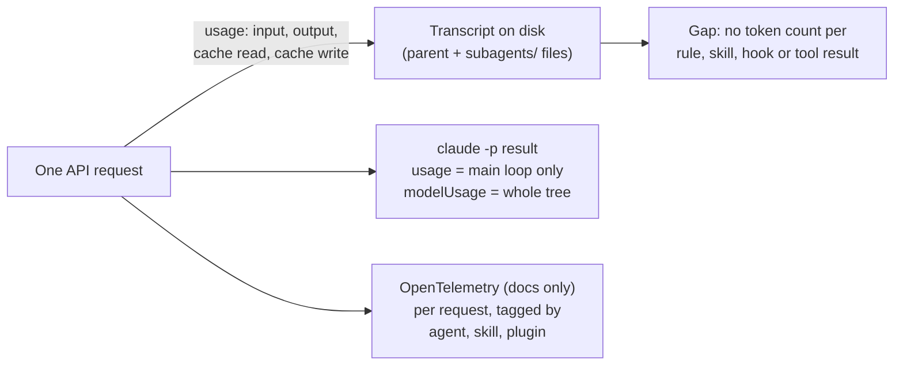

# Axis 1: What a Claude Code Session Records

> [!IMPORTANT]
> You decide: whether SPEC-032's measure may rest on these records (per-request totals, whole-tree totals per run, no per-source token counts), so that splitting Compass's tokens from the work's (axis 2) must be derived rather than read.

## Question

Which token counts does Claude Code keep per request, per subagent and per headless run, where do they land, and how reliable are they?

## Scope

In: usage fields, subagent visibility, hook and tool-result attribution, reliability. Out: how to split Compass tokens from work tokens (axis 2), headless setup (axes 3 and 5). Local numbers come from Claude Code 2.1.312 and 2.1.316 transcripts; other projects' transcripts were read for field names and token arithmetic only.

## Methodology

Repository mining (empirical study of the artifact: "how does an existing system actually behave"): the transcript files and the `claude -p` output were read and reconciled numerically, then cross-checked against Claude Code's own documentation. Code over documentation: Claude Code is closed source, so the on-disk records and live runs stand in for its source. Grading is allowed (GRADE-style: high, moderate, low); each finding carries marks and a grade.

## Findings

1. **Every API request records four token counts plus detail** (confidence: high)
   The assistant record's `message.usage` holds `input_tokens`, `cache_read_input_tokens`, `cache_creation_input_tokens`, `output_tokens`, `output_tokens_details.thinking_tokens`, a `cache_creation` split into `ephemeral_5m` and `ephemeral_1h`, `server_tool_use`, `service_tier`, `speed` and an `iterations` list. Input excludes cache reads and writes, so a request's prompt size is input + cache read + cache write.
   - Evidence: live run, transcript `message.usage` (tiny run: 4 + 8,668 read + 4,966 written = 13,638 prompt tokens).
   - Evidence: [OTel docs](https://code.claude.com/docs/en/monitoring-usage): `"input"` excludes cache reads and writes.
   - Marks: primary artifact observed plus vendor docs; retraction n/a; preprint n/a; citations n/a; 2 sources agree
   - Grade: high

2. **One response is written as several records with identical usage; count each `message.id` once** (confidence: high)
   A response with thinking, text and tool_use blocks becomes one assistant record per block, each repeating the same `usage`. In one 3,137-record transcript, 1,314 records repeated an earlier `message.id`, and none differed in usage. Summing records naively inflates totals.
   - Evidence: transcript scan of one large session (3,137 assistant records, 1,823 unique ids, 0 differing).
   - Evidence: [cost-tracking docs](https://code.claude.com/docs/en/agent-sdk/cost-tracking.md): "deduplicate by ID to avoid double-counting."
   - Marks: primary artifact plus vendor docs; retraction n/a; preprint n/a; citations n/a; 2 sources agree
   - Grade: high

3. **Streamed `output_tokens` is a placeholder; the transcript and the final result carry the real count** (confidence: high)
   In a `stream-json` run the three parent assistant messages showed output 6, 17, 6; the transcript of the same run holds 219, 140, 63, which sum to the result's `usage.output_tokens` (422). Input and cache counts matched in both places.
   - Evidence: live `stream-json` run versus its transcript (same message ids).
   - Evidence: cost-tracking docs, "Read output tokens from the result message": per-step output is the `message_start` count.
   - Marks: primary artifact plus vendor docs; retraction n/a; preprint n/a; citations n/a; 2 sources agree
   - Grade: high

4. **`claude -p --output-format json` returns the run's counts, but `usage` leaves out subagents** (confidence: high)
   Fields observed: `usage` (the four counts, thinking tokens, 5m/1h cache split, `iterations`), `modelUsage` (per model: `inputTokens`, `outputTokens`, `cacheReadInputTokens`, `cacheCreationInputTokens`, `thinkingTokens`, 5m/1h cache creation, `costUSD`, `costBasis`, `provider`), `total_cost_usd`, `num_turns`, `duration_api_ms`, `session_id`, `subagent_stats`, `terminal_reason`. In a run with one subagent, `usage` equalled the parent's three requests (input 8, cache read 51,421, cache write 49,983) while `modelUsage` was larger by exactly the subagent's counts (input 12, cache read 57,198, cache write 55,724).
   - Evidence: live runs `claude -p "say hi" --output-format json --model haiku` and a one-subagent `stream-json` run, arithmetic checked.
   - Evidence: cost-tracking docs table: `usage` excludes subagents; `total_cost_usd` and `modelUsage` include them; "Use modelUsage for whole-tree token accounting."
   - Marks: primary artifact plus vendor docs; retraction n/a; preprint n/a; citations n/a; 2 sources agree
   - Grade: high

5. **Subagent transcripts are separate files next to the parent's** (confidence: high)
   Path: `~/.claude/projects/<cwd-encoded>/<session-id>/subagents/agent-<id>.jsonl` plus `agent-<id>.meta.json` (`agentType`, `toolUseId`, `parentAgentId`, `spawnDepth`, `requestShape`, `finished`, `description`). Records carry `isSidechain: true`, `agentId`, and api-request `querySource` such as `agent:builtin:general-purpose`. Their assistant usage is not inside the parent file. One session had 168 such files.
   - Evidence: directory listing and record scan of this machine's transcripts; live one-subagent run.
   - Marks: primary artifact; retraction n/a; preprint n/a; citations n/a; 1 source (local), consistent across 168 files
   - Grade: high

6. **The parent sees a subagent's usage only in its Agent tool result, and only for foreground runs** (confidence: medium)
   A completed foreground subagent returns `totalTokens` (4 + 5,741 + 5,777 + 4 = 11,526 in the run), `totalDurationMs`, `totalToolUseCount` and a `usage` object. A background launch returns `status: async_launched` with `agentId` and `outputFile` and no usage. In `stream-json`, subagent messages carry `parent_tool_use_id`; by default only their `tool_use` and `tool_result` blocks are forwarded, with text and thinking added by `--forward-subagent-text`. The subagent's own assistant usage did not appear in the stream in the observed run.
   - Evidence: live `stream-json` run (user record with `tool_use_result`); async result in a local transcript.
   - Evidence: [headless docs](https://code.claude.com/docs/en/headless), "Follow subagent messages".
   - Marks: primary artifact plus vendor docs; retraction n/a; preprint n/a; citations n/a; 2 sources agree; one live run
   - Grade: moderate

7. **A transcript carries its own session totals in a `cost-state` record** (confidence: medium)
   Fields: `totalCostUSD`, `modelUsage` per model (input, output, thinking, cache read, cache creation with 5m/1h split, web searches, cost), durations, lines added and removed, `hasUnknownModelCost`. Of 1,395 transcripts holding one, 1,192 (85%) matched exactly the deduplicated assistant usage of the parent plus its `subagents/` files, across all four token counts. 203 did not (see Gaps). 70 older files had no `cost-state`.
   - Evidence: reconciliation script over all transcripts on this machine (aggregates only).
   - Marks: primary artifact; retraction n/a; preprint n/a; citations n/a; 1 source (local), 85% internal agreement
   - Grade: moderate

8. **Two of the three read paths agree to the token; resumed sessions change what a result means** (confidence: medium)
   Result `modelUsage`, the transcript's `cost-state`, and the sum of deduplicated assistant records (parent plus subagent files) reconciled exactly in the live runs. A call that resumes a session reports the session's whole spend, earlier runs included, so summing results double-counts; totals are saved at normal exit and restored on resume or fork. In streaming input mode `/clear`, `/reset`, `/new` restart the running totals.
   - Evidence: live runs; [cost-tracking docs](https://code.claude.com/docs/en/agent-sdk/cost-tracking.md), "Accumulate costs across multiple calls", "Track costs in streaming input mode"; [headless docs](https://code.claude.com/docs/en/headless).
   - Marks: primary artifact plus vendor docs; retraction n/a; preprint n/a; citations n/a; 2 sources agree
   - Grade: moderate

9. **Dollar figures are client-side estimates; token counts are what the API reported** (confidence: medium)
   `total_cost_usd` and `costUSD` come from a price table bundled in the client at list price (or a managed `modelPricing` table) and "can drift" from the bill; `costBasis` says `list`, `managed` or `unknown`. The docs tell callers not to bill or decide finances from them. The token fields are copied from API responses.
   - Evidence: cost-tracking docs warning box; [costs docs](https://code.claude.com/docs/en/costs), "Using the /usage command".
   - Marks: vendor docs; retraction n/a; preprint n/a; citations n/a; 2 pages agree
   - Grade: moderate

10. **Failed and crashed runs can under-report** (confidence: medium)
    After a session crash, the `error_during_execution` result may carry zeroed `usage`, cost and `modelUsage`; with `error_max_budget_usd`, `usage` omits the response that crossed the budget while `total_cost_usd` and `modelUsage` include it. The docs say to account from `modelUsage` or `total_cost_usd` where there is a choice.
    - Evidence: cost-tracking docs, "Track costs on failed conversations", "Recover totals after a session crash". Not reproduced locally.
    - Marks: vendor docs; retraction n/a; preprint n/a; citations n/a; 1 source
    - Grade: low

11. **Each request's composition is stored, but token counts are only per request** (confidence: medium)
    Transcripts hold `api-request-shape` (system blocks and tool definitions, hashed), `api-request-blob` (message content by hash) and `api-request` (model, betas, effort, `cacheControl` breakpoints with TTL, `querySource`, and a `base`/`keep`/`tail` delta against an earlier request). The text of every system block, tool definition and message can be rebuilt and tokenized offline. No field gives tokens per rule file, skill listing, agent listing, tool definition or tool result. The growth between consecutive requests' prompt totals (input + read + write) is the new content plus the prior output (example: 42,755 to 45,019, a step of 2,264 against 140 output tokens).
    - Evidence: record-structure scan of a live run's transcript; per-request arithmetic from its usage.
    - Marks: primary artifact; retraction n/a; preprint n/a; citations n/a; 1 source (local), one run
    - Grade: low

12. **Hook output is recorded as text and timing, never as tokens** (confidence: medium)
    A hook run writes an `attachment` record `hook_success` (`hookEvent`, `hookName`, `command`, `content`, `stdout`, `stderr`, `exitCode`, `durationMs`, `toolUseID`); context-injecting output also appears as `hook_additional_context`; Stop hooks write a `system` record `stop_hook_summary` (`hookInfos[].durationMs`, `hookAdditionalContext`, `preventedContinuation`). Counts in this repo's transcripts: 206 PostToolUse and 6 SessionStart `hook_success`. The OTel docs list no hook event; hooks appear only as the `claude_code.hook` trace span, which needs detailed beta tracing.
    - Evidence: attachment-type scan of this repo's transcripts; [OTel docs](https://code.claude.com/docs/en/monitoring-usage), "Hooks".
    - Marks: primary artifact plus vendor docs; retraction n/a; preprint n/a; citations n/a; 2 sources agree
    - Grade: moderate

13. **Tool results are recorded as content, with byte sizes and an approximate token size only in telemetry** (confidence: medium)
    A tool result is a `user` record carrying `tool_result` plus `toolUseResult` and the originating `toolUseID`; large results spill into the session's `tool-results/` folder. The OTel `tool_result` event has `tool_result_size_bytes` and, from v2.1.310, `request_id` of the response that made the call. The only token figure for a result is `result_tokens` on the `claude_code.tool` span ("approximate").
    - Evidence: transcript scan (`toolUseResult`, `tool-results/` directories); OTel docs event and span tables.
    - Marks: primary artifact plus vendor docs; retraction n/a; preprint n/a; citations n/a; 2 sources agree
    - Grade: moderate

14. **OpenTelemetry offers per-request token events tagged by agent, skill, plugin and MCP server** (confidence: medium)
    `claude_code.token.usage` counts `type` input, output, cacheRead, cacheCreation by `model`, `query_source` (main, subagent, auxiliary), `agent.name`, `skill.name`, `plugin.name`, `mcp_server.name`. The `api_request` event adds `request_id`, 5m and 1h cache writes, detailed `query_source` (`repl_main_thread`, `compact`, a subagent name), `prompt.id`, and `agent_id` / `parent_agent_id` (v2.1.310+). Third-party plugin and skill names show as `third-party` and user agents as `custom` unless `OTEL_LOG_TOOL_DETAILS=1`. An MCP server is credited only for requests that consumed one of its tool results. Telemetry env vars are ignored in a project's `.claude/settings.json` and are not passed to child processes.
    - Evidence: [OTel docs](https://code.claude.com/docs/en/monitoring-usage), metrics and events tables. A local `claude -p` run with `OTEL_LOGS_EXPORTER=console` printed no event on stdout or stderr, so this is unverified here.
    - Marks: vendor docs; retraction n/a; preprint n/a; citations n/a; 1 source, not reproduced
    - Grade: low

15. **Requests beyond the conversation also draw tokens and are labelled `auxiliary` or by `querySource`** (confidence: low)
    Session titles (a small-model background request), compaction, session recap, idle compaction and prompt suggestions send their own requests. `/usage`'s "Prompt cache" line covers the main conversation only, not subagents. The `api-request` records show `querySource` values `sdk` and `repl_main_thread` locally. Whether every such request lands in `cost-state` and in the transcript's assistant records was not established.
    - Evidence: [costs docs](https://code.claude.com/docs/en/costs), "Background token usage", "Prompt cache statistics"; local `querySource` counts.
    - Marks: vendor docs plus primary artifact; retraction n/a; preprint n/a; citations n/a; 2 sources, partial
    - Grade: low

16. **A fixed prefix is paid on the first request and again after a prefix change** (confidence: medium)
    A `claude -p "say hi"` on Haiku in a scratch directory under this user's own settings wrote 13,603 cache tokens (4 input, 14 output) before any task. In the subagent run, loading a deferred tool mid-run changed the tool list and the next request wrote 42,753 tokens with 0 read. A first request in one Compass-repo session wrote 31,507 and read 5,777. Cache entries carry a 5-minute or 1-hour TTL, visible in the `cache_creation` split; the docs note the 5m/1h split can read 0 when the API omits it.
    - Evidence: live run `out1.json`, subagent run transcript, one local session's first assistant record; costs docs "Cache misses"; OTel docs on `cache_creation_5m_tokens`.
    - Marks: primary artifact plus vendor docs; retraction n/a; preprint n/a; citations n/a; 3 requests observed
    - Grade: low

17. **Where the records live, how long they stay, and how the format may change** (confidence: high)
    Transcripts: `~/.claude/projects/<cwd with non-alphanumerics as ->/<session-id>.jsonl`; `claude -p` runs write there too (observed). Retention is 30 days by default (`cleanupPeriodDays`); `CLAUDE_CONFIG_DIR` moves storage, `CLAUDE_CODE_PROJECT_DIR_NAME` names the folder, `--no-session-persistence` and `CLAUDE_CODE_SKIP_PROMPT_HISTORY` suppress writes, `CLAUDE_CODE_TRANSCRIPT_LOCAL_GC` limits file growth for `-p`/SDK sessions. The docs state the entry format "is internal to Claude Code and changes between versions"; record types such as `api-request` and `cost-state` are present in 2.1.312 and 2.1.316 and absent from 70 older files.
    - Evidence: [sessions docs](https://code.claude.com/docs/en/sessions.md), "Where transcripts are stored"; live run's file location; local file scan.
    - Marks: primary artifact plus vendor docs; retraction n/a; preprint n/a; citations n/a; 2 sources agree
    - Grade: high

## Contradictions

- Finding 3: the docs and the live stream call per-step `output_tokens` a placeholder, yet the on-disk transcript holds the final value. Both are true: which one a reader sees depends on the surface (stream versus file).
- Finding 7 versus 8: three read paths reconcile exactly in live runs and in 85% of old transcripts, but not in the other 15%.

## Gaps

- The 15% mismatch (203 of 1,395 transcripts) is unexplained. In 169 of the 203, `cost-state` is larger than the transcript sum; in 34 the transcript is larger. 42 of the mismatches contain a compaction, and 112 hold more than one `cost-state` record. Resume and fork restoring totals from an earlier file is a candidate cause, untested. Would be closed by reconciling a controlled run that is resumed and compacted.
- A live run showed 4 `api-request` records against 3 assistant messages in the parent (none of the extra carried usage), and across the single-`cost-state` transcripts under 20 MB, 126 `api-request` records had no matching assistant record (123 of them in transcripts that reconciled exactly). Which requests those are, and whether any cost tokens, is unknown.
- OpenTelemetry: the console exporter showed nothing in `claude -p` JSON mode here. Not established: whether it works in `-p`, whether the `agent.name` / `plugin.name` tags identify Compass components (third-party names are masked without `OTEL_LOG_TOOL_DETAILS=1`), and whether the OTLP route needs a local collector.
- No token count per component (rules, skills, agents, hooks, tool results) exists in any surface read; whether offline tokenization of the rebuilt request reproduces the API's counts closely was not tested.
- Subagent usage when subagents run in the background, nest, or are forked skills was not exercised locally.
- Whether auxiliary requests (titles, compaction, recap, classifier) appear in `cost-state` and the headless `modelUsage` was not isolated (Finding 15).
- Plan-limit consumption on a subscription (what a build "costs" against the 5-hour and weekly windows) is not a recorded field; axis 5 owns it.
