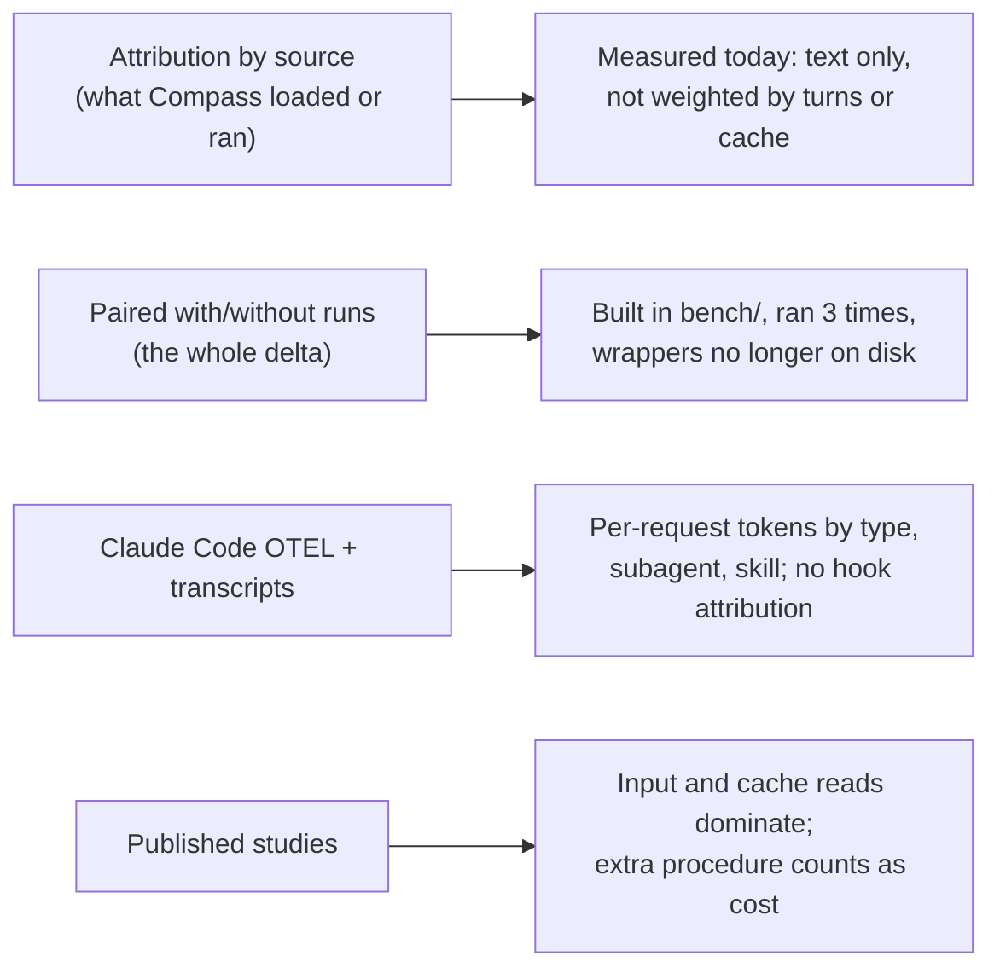

# Whole Overhead, Axis 2: Which Tokens Are Compass's

> [!IMPORTANT]
> You decide: whether Compass-driven extra work (tests, research, review rounds) counts as overhead, because the evidence below supports either reading and the plan's measure depends on it.

## Question

How can a build's tokens be split into Compass overhead and the work itself, by source attribution, by a with/without counterfactual, or both, and how do cache reads, subagents and Compass-driven extra work enter that split?

## Scope

In: the `bench/` harness, the SPEC-004 measurement note, the LOOP-003 sensor and record, Claude Code's own accounting (OTEL, `/usage`, CLI flags, pricing), published agent token-cost studies. Out: how to read transcripts in detail (axis 1), how agents play the human (axis 3), how many builds are needed (axis 4).

## Methodology

Technology landscape / comparative evaluation (DESMET feature-analysis mode): the axis asks which of two or three concrete attribution designs fits, so each is described by what it captures, what it needs and what its sources say about it; local code was read directly (repository-mining style) and papers were read at abstract level. Grading is allowed: each finding carries a GRADE-style certainty (high, moderate, low) weighing its evidence type. Papers were checked on arXiv abstract pages only; full-text figures were not read except where stated.

## Findings

### A. What exists in this repository

1. **`bench/` is a paired with/without design, but its wrappers are not on disk** (confidence: high)
   `bench/README.md` defines two arms (compass vs baseline) that differ only in what is installed in the workspace, same binary, model, tool allowlist and turn budget. The README layout lists `agents/compass-agent.sh` and `baseline-agent.sh`; `bench/agents/` does not exist, and `results/` is `runs/`. Only `analyze.py`, `setup.sh`, `fleet_update.py`, configs and fixtures remain.
   - `bench/README.md:26-33` - arms and what differs
   - `bench/README.md:11-12` - lists `agents/` wrappers; `ls bench/` shows no `agents/` directory
   - `bench/configs/arm-compass.yaml:9-22` - model `claude-opus-4-7`, `budget_usd: 2.00`, allowlist includes `Task`, `stream-json`
   - Marks: code read, owner checked (this repo); n/a retraction; not a preprint; no citations; 1 source
   - Grade: high

2. **The harness's cost math weights cache tokens; its token totals do not** (confidence: high)
   `analyze.py` prices four token kinds per model (cache read at 0.1x input, cache write at 1.25x) but `summarize` sums only `tokens_input + tokens_output`, so cache tokens are absent from "tokens_per_task". The smoke-run rows carry `tokens_total` with `tokens_input`, `tokens_output`, `tokens_cache_read`, `tokens_cache_write` all null, because those arms ran as Agent-tool subagents that report one total.
   - `bench/scripts/analyze.py:33-47` - PRICING and `cost_usd`
   - `bench/scripts/analyze.py:67` - tokens exclude cache fields
   - `bench/runs/20260610T202237_binary-search-bug/arm_compass.jsonl` - null token breakdown
   - Marks: code read, owner checked; not a preprint; no citations; 1 source
   - Grade: high

3. **The three recorded bench runs show Compass at +4% to +39% tokens for equal pass results** (confidence: medium)
   Two single-function fixtures: Compass +4.3% and +5% total tokens, tied on visible tests, held-out tests, lint and a blinded judge. One SWE-bench Pro task (N=1): generation tokens 42,354 baseline vs 58,797 Compass (+39%), tool uses 17 vs 35, wall 172s vs 515s, both PASS. The summary attributes the extra to more reading, a stub harness, a 10,000-trial fuzz check and an explicit contract, which the benchmark did not reward.
   - `bench/runs/summary-cross-runs.md:8-17` - table; `:21` headline
   - `bench/runs/20260610T223212_swebp-qutebrowser-elf/summary.md` - Results and Process delta sections
   - Marks: local measurement, owner checked; not a preprint; no citations; 1 source, N=1 per fixture
   - Grade: low (tiny N, tokens counted by the harness that reports a single total)
   - Caveat: the smoke arms delivered Compass "as text in the system context" through a general-purpose subagent, so hooks, vault and installed agents did not run.

4. **The paired design measures the whole delta, including behavior change, with no breakdown by source** (confidence: high)
   In the bench runs the process delta (more reads, fuzzing, longer reports) is described in prose from transcripts, not as token counts per cause. Nothing in `bench/` splits the Compass arm's tokens into rules, skills, agents or hooks.
   - `bench/runs/summary-cross-runs.md:33` - "methodology-as-text, NOT methodology-as-installed-system"
   - `bench/runs/20260610T223212_swebp-qutebrowser-elf/summary.md` - "Process delta" is prose
   - Marks: code and document read, owner checked; 1 source
   - Grade: high

5. **The LOOP-003 sensor is a static estimate of text, weighted by how often sessions load it** (confidence: high)
   Always-loaded sources count whole (rules files) or by frontmatter fields only (skills, agents); on-demand sources (skill bodies, skill folder files, agent bodies) count tokens times the share of sessions that loaded them. Tokens are UTF-8 bytes divided by 4, rounded up. "Weighted" means weighted by load share; there is no multiplier for turns per session and no price weighting of cache reads versus fresh input.
   - `plugin/cli/sensorlib.py:351-352` - `_estimate`; `:463-487` - `_weighted_tokens`; `:490-525` - `sense_context`
   - `plugin/cli/sensorlib.py:20-38` - docstring of what is counted
   - Marks: code read, owner checked; not a preprint; no citations; 1 source
   - Grade: high

6. **The sensor sees load events, not output or work** (confidence: high)
   `usage-scan` marks a source as loaded from three transcript signals: a `Skill` tool_use, an `Agent`/`Task` tool_use naming a `subagent_type`, and a `Read` of a file under a skill or agent folder. A Bash or hook call that runs the Compass CLI only flags the session as one Compass was in; the size of that CLI output, vault file reads and writes, hook output, and tokens a spawned agent spends are not counted. SPEC-032 states the same boundary.
   - `plugin/cli/sensorlib.py:625-642` - `_block_keys`; `:672-693` - `_line_trace`; `:696-718` - `_scan_session`
   - SPEC-032 Problem section - "counts only the text Compass ships ... part of the overhead, not all"
   - Marks: code read, owner checked; 1 source
   - Grade: high

7. **Subagent transcripts are separate files and the scan reads every `*.jsonl` under the projects folder** (confidence: medium)
   `scan_usage` uses `rglob("*.jsonl")`. On this machine a session folder holds a `subagents/` directory with one `agent-<id>.jsonl` plus `.meta.json` per subagent, and the main transcript has zero `isSidechain` lines. By code reading, each subagent file counts as its own "session" in the weighting denominator; this was not run to confirm.
   - `plugin/cli/sensorlib.py:730` - `rglob`
   - Local transcript structure check (types and key names only, no content copied): main file has `assistant`, `attachment`, `api-request` entries; `message.usage` keys `input_tokens`, `output_tokens`, `cache_creation_input_tokens`, `cache_read_input_tokens`
   - Marks: code read plus structure inspection; 1 source
   - Grade: moderate

8. **The calibration shows first-request overhead can be measured directly by a with/without pair** (confidence: high)
   LOOP-003 ran `claude -p "hi" --model sonnet` in two scratch projects: first-request input was 29,140 tokens without Compass and 41,235 with it, a difference of 12,095. The sensor read 9,117 for the same content. The loop's own note: the two agree in direction; the sensor counts only what Compass ships, not Claude Code's handling of it.
   - `.compass/loops/LOOP-003-session-context/index.md:48-51` - the calibration entry
   - Marks: local measurement, owner checked; 1 source, one pair
   - Grade: moderate (single pair; the first request is a cache write, so it is not the later re-read cost)

9. **The loop's latest figures keep the same unit and show the plateau** (confidence: high)
   The sensor reading with real load shares went from 11,969 (start) to 9,479 per average session after the unattended batch (-21%), with 1,540 sessions scanned; moved passages that every session ends up reading anyway were noted as saving "about 0 in practice".
   - `.compass/loops/LOOP-003-session-context/index.md:78-79`, `:113-119`, `:146` - readings and the "about 0 in practice" remarks
   - Marks: local measurement, owner checked; 1 source
   - Grade: moderate

10. **SPEC-004's measurement is source attribution by structural floor, with the end-to-end A/B left unrun** (confidence: high)
    The note measures one hook's per-fire input (prompt 94 + skill body 3,051 = 3,145 tokens, chars/4) against a command hook's ~6 tokens, then states a live two-session A/B "is not required to accept the hypothesis" and "worth running opportunistically". It also argues the unmeasured variable reasoning belongs to the baseline arm only, so the floor is conservative.
    - `.compass/compass-cli/research/RESEARCH-cli-token-reduction-measurement.md:20-36`, `:44-46`
    - Marks: local document, owner checked; 1 source
    - Grade: moderate

11. **The result envelope the loop runner parses carries all four token kinds per model** (confidence: high)
    `parse_result` sums `inputTokens`, `outputTokens`, `cacheReadInputTokens`, `cacheCreationInputTokens` over `modelUsage`; its docstring states the top-level `usage` block is zeroed on a budget stop and differs from `modelUsage` on a resumed session. Whether `modelUsage` includes subagent requests was not established here.
    - `plugin/cli/sensorlib.py:3-8`, `:65-70`, `:155-187`
    - Marks: code read, owner checked; 1 source
    - Grade: high for what is summed; the subagent inclusion is a gap

### B. What Claude Code itself records and offers

12. **Token counts are split in four types and tagged by main, subagent or auxiliary** (confidence: high)
    The `claude_code.token.usage` counter carries `type` of `input` (excluding cache), `output`, `cacheRead`, `cacheCreation`, plus `model` and `query_source` of `main`, `subagent` or `auxiliary`. The `api_request` event adds per-request `cost_usd`, `cache_creation_5m_tokens`/`cache_creation_1h_tokens` (v2.1.300+), and `agent_id`/`parent_agent_id` (v2.1.310+), `prompt.id`.
    - https://code.claude.com/docs/en/monitoring-usage - token counter attributes; `api_request` event
    - Marks: vendor documentation (primary), not read against code; n/a retraction; not a preprint; no citations; 1 source
    - Grade: moderate

13. **Skill, agent and plugin attribution exists but is request-level and redacted by default** (confidence: high)
    `skill.name` is the skill "active for the request, set by the Skill tool or a `/` command, or inherited by a spawned subagent"; `agent.name` is the subagent type issuing the request; `plugin.name` is the owning plugin. User-defined agent names appear as `custom` and third-party plugin skills as `third-party` unless `OTEL_LOG_TOOL_DETAILS=1`. Attribution tags the whole request, not the skill's own marginal text.
    - https://code.claude.com/docs/en/monitoring-usage - cost counter attributes, redaction paragraph
    - Marks: vendor documentation; 1 source
    - Grade: moderate

14. **Hooks cannot be attributed token or cost data; tool-result size can be** (confidence: high)
    The docs say neither metric has a hook attribute and the `claude_code.hook` span (detailed beta tracing only) carries no token or cost fields. The `tool_result` event carries `tool_name`, `tool_use_id`, `tool_input_size_bytes`, `tool_result_size_bytes`, `request_id`, and with `OTEL_LOG_TOOL_DETAILS=1` the Bash command and the Skill or Agent parameter, so the bytes a Compass CLI call returned are attributable by command.
    - https://code.claude.com/docs/en/monitoring-usage - Hooks and `tool_result` sections
    - Marks: vendor documentation; 1 source
    - Grade: moderate

15. **The transcript records hook results as attachment entries** (confidence: low)
    In a local transcript, `attachment` entries include types `hook_success`, `hook_additional_context`, `instructions`, `skill_listing`, `invoked_skills`, `agent_listing_delta`, `mcp_instructions_delta`. Which of these reach the model as tokens, and their sizes, was not verified; the sensor reads hook attachments only to detect a Compass CLI command.
    - Local transcript structure check (type names only)
    - `plugin/cli/sensorlib.py:677-681` - the only hook-attachment use
    - Marks: local observation; 1 source
    - Grade: low

16. **`/usage` already attributes recent plan usage to skills, subagents, plugins and MCP servers** (confidence: high)
    The breakdown shows each as a share of total, from local session history on this machine; one request can count toward several rows so shares can exceed 100%. The prompt-cache line (share of input from cache, misses) covers the main conversation only, not subagents.
    - https://code.claude.com/docs/en/costs - "Plan usage breakdown", "Prompt cache statistics"
    - Marks: vendor documentation; 1 source
    - Grade: moderate

17. **Switches that make a "without Compass" arm exist, and `--bare` removes more than Compass** (confidence: medium)
    `--bare` skips hooks, skills, custom commands, subagents, installed plugins, MCP servers, auto memory and CLAUDE.md; `--disable-slash-commands` disables skills and commands; `--plugin-dir` loads a plugin for one session; `--setting-sources`, `--settings`, `--strict-mcp-config`, `--max-budget-usd` (subagent spend counts toward the cap) and `--no-session-persistence` also exist. The bench arm used a scaffold copied into the workspace for the Compass side and nothing for the baseline.
    - https://code.claude.com/docs/en/cli-reference - flag table
    - `bench/README.md:30-31` - how the arms were installed
    - Marks: vendor documentation; 1 source
    - Grade: moderate
    - Caveat: that `--bare` also drops non-Compass items is the flag's documented scope; how it compares to an empty project directory was not tested.

### C. Cache reads versus fresh input

18. **A token's weight depends on its type: cache read 0.1x, 5-minute write 1.25x, 1-hour write 2x of base input** (confidence: high)
    Exceptions: Sonnet 5.5 and Opus 5.5 cache reads at 0.05x, Fable 5.1 and Mythos 5.1 at 0.025x. Total input is `cache_read + cache_creation + input_tokens`. Claude Code reports its dollar figure at list price from local counts; for subscribers the figure is "not relevant for billing", and plan usage bars are shown instead.
    - https://platform.claude.com/docs/en/build-with-claude/prompt-caching - pricing paragraph, usage-field formula
    - https://code.claude.com/docs/en/costs - `/usage` Session block note
    - `bench/scripts/analyze.py:33-37` - same 0.1x/1.25x ratios for the three models listed there
    - Marks: vendor documentation plus code, 2 sources agree
    - Grade: high for the API price ratios; how plan usage weighs types is a gap

19. **Claude Code resends the whole conversation each request and reads it from cache** (confidence: high)
    The costs page says it "sends your full conversation with every request" and "re-reads that history at the cached token rate", so any always-loaded Compass text is read once per request for the life of the session, and tool results added later ride along on every following request. Subagents and workflow agents "send their own requests on top of the main conversation's".
    - https://code.claude.com/docs/en/costs - "Why usage climbs in a long session"
    - Marks: vendor documentation; 1 source
    - Grade: moderate

### D. Published studies

20. **In agentic coding, input tokens and cache reads dominate tokens and cost** (confidence: medium)
    Bai et al. (OpenHands, SWE-bench Verified, 8 models, 4 runs per problem) report cache reads as "the largest category by a wide margin" in every phase and the dominant cost contributor in every phase, though output is priced "roughly 80x higher than cache reads". Runs on the same task differ up to 30x in total tokens. Phase shares given (Setup 9.98%, Explore 30.37%, Fix 33.53%, Validate 16.59%, Closeout 9.53%) are shares of rounds, not of tokens; token and cost splits appear only in figures not read.
    - arXiv:2604.22750 v3 (2026-10-02) HTML, cost-model and phase sections
    - Marks: preprint v3 2026-10 (v1 2026-04), not retracted; Semantic Scholar 47 citations; related prior analyses agree; 2 sources agree on input dominance (arXiv:2608.15127 and 2605.26297 also report 84.6 to 99.5% cache-hit ratios, abstract-level via search result only)
    - Grade: moderate (large trajectory sample, other agent framework than Claude Code)

21. **The paper's cost formula has a stated inconsistency for GPT-5** (confidence: medium)
    The GPT-5 equation charges cache reads at 0.2x input while the price table listed in the same paper is $0.125 against $1.250 (0.1x). The Claude equation uses "the 5-minute write rate throughout" and links Anthropic's page for rates without listing them.
    - arXiv:2604.22750 v3 HTML, pricing weights section
    - Marks: preprint; 47 citations; 1 source
    - Grade: low for the dollar totals, unaffected for the direction in finding 20

22. **Attribution to workflow stages by mapping a framework's phases shows review dominating** (confidence: medium)
    Salim et al. mapped ChatDev's internal phases to six SDLC stages across 30 tasks with a GPT-5 reasoning model: Code Review averaged 59.4% of tokens and input tokens 53.9%. The authors conclude cost is in "automated refinement and verification, not initial code generation" and call the results preliminary.
    - arXiv:2601.14470 v1 (2026-01-20) abstract page
    - Marks: preprint v1; not retracted; citation count not retrieved (rate-limited); 1 source
    - Grade: low

23. **Repository context files raise cost with no success gain in one study and cut output tokens in another** (confidence: medium)
    Gloaguen et al.: context files "do not generally improve task success rates" and raise inference cost "by over 20% on average" across Claude Code, Codex and Qwen Code. Lulla et al. (10 repos, 124 PRs): AGENTS.md associated with 28.64% lower median runtime and 16.58% fewer output tokens, comparable completion. A third study (arXiv:2607.27250, via search summary) argues the difference is injection mechanics in each setup. Neither abstract states which token types made up "cost".
    - arXiv:2602.11988 v3 (2026-09-29) abstract; arXiv:2601.20404 v2 (2026-03-30) abstract; arXiv:2607.27250 search summary only
    - Marks: preprints; Semantic Scholar 35 citations for 2602.11988, others not retrieved; 2 sources disagree on direction
    - Grade: low

24. **Skill ablations pair each task with and without the injected text, and one adds a length-matched control** (confidence: medium)
    SWE-Skills-Bench: 98 skills, each task run with and without, 3,920 paired comparisons, 92 of 98 skills no significant effect, average pass 76.6% to 76.9%. "Signal or Noise": 31 web skills, four conditions including a length-matched irrelevant skill to "isolate Skill effects from prompt-length artifacts"; token cost up 72% to 394%, pass@2 down 1.3% to 4.2%. The control separated two failure modes, length-distraction and content-misleading.
    - arXiv:2603.15401 v2 (2026-10-27) abstract; arXiv:2608.23067 v1 (2026-08-24) abstract
    - Marks: preprints; citation counts not retrieved; 2 sources agree that skills add tokens without general success gain
    - Grade: low to moderate (paired designs, abstract-level read, token-measurement method not read)

25. **One study classes Compass-style extra procedure as a cost category** (confidence: medium)
    Dong et al. compared skill-guided runs with reference runs: 307 skill-induced failures, 182 of them efficiency regressions "not explained by prompt length alone"; the "Excessive Procedure" category (too much verification: 67 cases, heavy implementation pipelines: 30) arises because skills "turn checklists and recipes into mandatory work". The Compass bench run also attributes its +39% to added verification (finding 3).
    - arXiv:2608.11888 v1 (2026-08-12) abstract; `bench/runs/20260610T223212_swebp-qutebrowser-elf/summary.md`
    - Marks: preprint; citation count not retrieved; 2 sources agree on the mechanism
    - Grade: low

26. **A sub-agent can carry a larger share of spend than of tokens** (confidence: low)
    A search-result summary of arXiv:2609.04564 (a self-driving-lab agent) reports a sub-agent with short fresh conversations handling 8% of input tokens but 27% of spend, and caching cutting input cost 6.0x. The paper itself was not opened.
    - arXiv:2609.04564 via search summary only
    - Marks: preprint; citations not retrieved; 1 source, second-hand
    - Grade: low

### E. Attribution designs, as the sources describe them

27. **Design A, source attribution: what it can and cannot capture** (confidence: medium)
    Capturable per sources above: text loaded at start (rules, skill and agent listings), loads of skill and agent bodies (transcript tool_use blocks, OTEL `skill.name`/`agent.name`), subagent requests (`query_source`, subagent transcripts), tool-result bytes by tool and command (`tool_result` event). Not capturable per the docs: hook tokens by hook (no attribute). Request-level tags assign a whole request, including the conversation re-read, to one skill or agent.
    - Findings 5, 6, 12 to 14
    - Marks: derived from vendor documentation and code; 2 sources
    - Grade: moderate

28. **Design B, paired with/without runs: what it can and cannot capture** (confidence: medium)
    Captures the whole token delta including changed behavior (more reads, extra verification, different turn counts), as in the bench runs and in the skill ablations. Needs the same task in both arms; the same task varies up to 30x between runs (finding 20), and the bench results are N=1 per fixture. Reports one total unless transcripts or OTEL are also kept per arm.
    - Findings 3, 4, 20, 24
    - Marks: derived from local measurement and preprints; 3 sources
    - Grade: moderate

29. **Design C, both: the sources show each design answering a different part** (confidence: medium)
    Design B's delta minus Design A's attributed total is the part not explained by loaded text: changed behavior. LOOP-003's first-request pair (finding 8) is already a small instance: 12,095 measured against 9,117 sensed. The skill-ablation papers use paired runs for the total and read transcripts for the cause (findings 24, 25).
    - Findings 8, 24, 25
    - Marks: derived; 3 sources
    - Grade: low (an arrangement of findings, not a tested method)

## Contradictions

- Findings 23: Gloaguen et al. report +20% cost from context files; Lulla et al. report -16.58% output tokens. Different token measure (cost vs output tokens only) and different setups; a third paper attributes it to injection mechanics.
- Findings 3 and 25: the bench note treats Compass's extra verification as work the benchmark "didn't reward"; Dong et al. treat extra procedure as an efficiency regression. Neither study judges the same system.
- Finding 21: the cost paper's GPT-5 formula (0.2x) and its listed price (0.1x) disagree.

## Gaps

- Whether `modelUsage` in the `claude -p --output-format json` envelope includes subagent requests (finding 11): needs a small run, or the Agent SDK cost-tracking page, not read here.
- How subscription plan usage weights cache reads versus fresh input (finding 18): the docs give API prices and say plan usage is shown as bars; no weighting was found. SPEC-032 runs on the subscription.
- Which transcript attachment types (finding 15) enter model context and at what size: needs a transcript-to-API-request comparison (the transcript also holds `api-request` entries).
- Whether Compass installed as a copied `.claude/` folder (as in this repo and the bench scaffold) shows its skill, agent and plugin names in OTEL, or as `custom`/`third-party` (finding 13): depends on `OTEL_LOG_TOOL_DETAILS` and install form; not tested.
- Token-versus-cost splits per phase in Bai et al. are in figures not read (finding 20); token-measurement methods in the skill-ablation papers (finding 24) not read.
- Citation counts: retrieved for arXiv:2604.22750 (47) and 2602.11988 (35); Semantic Scholar rate-limited the rest.
- Open questions for the planner, not answered by any source: whether tokens from Compass-driven tests, research and review rounds count as overhead or as the work (finding 25 and the SPEC-032 KPI both bear on it); how a paired arm gets the same task when agents choose their own topic (SPEC-032 D-01); whether the unit is plan-weighted usage or token counts.
